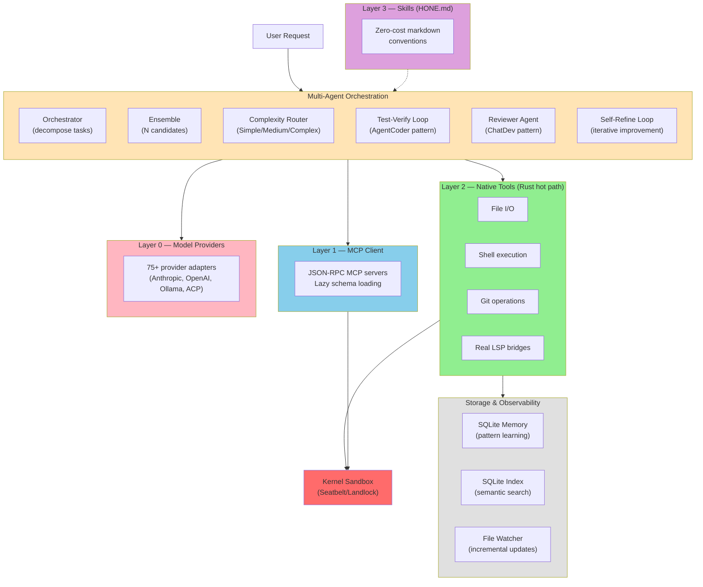

<p align="center">
  
</p>

<p align="center">
  <strong>The Universal Terminal AI Code Agent</strong>
</p>

<p align="center">
  <a href="#installation">Installation</a> •
  <a href="#quick-start">Quick Start</a> •
  <a href="#features">Features</a> •
  <a href="#documentation">Documentation</a> •
  <a href="#contributing">Contributing</a>
</p>

<p align="center">
  
  
  
  
</p>

---

## Demo

<p align="center">
  <a href="https://asciinema.org/a/demo">
    
  </a>
</p>

<details>
<summary>Play locally</summary>

```bash
# Install asciinema
brew install asciinema  # or: pip install asciinema

# Play the demo
asciinema play assets/demo.cast
```
</details>

<details>
<summary>What the demo shows</summary>

1. Hone receives a bug report: `divide(10, 0)` raises `ZeroDivisionError` instead of returning `None`
2. The agent reads `calculator.py`, identifies the issue in the `divide` function
3. Edits the file to add a zero-division guard: `if b == 0: return None`
4. The fix is verified: `assert divide(10, 0) is None` passes

All using DeepSeek V3 via OpenRouter (~$0.001 per task).
</details>

---

## Overview

Hone is a privacy-first, provider-agnostic AI coding agent built entirely in Rust. It runs locally in your terminal with kernel-enforced sandboxing, supports 75+ model providers (Anthropic, OpenAI, Ollama, local, CLI pass-through), and learns patterns across sessions through adaptive memory. Work with your models, on your machine, under your rules.

## Why Hone

**Your models, your machine, your rules.** Hone doesn't phone home. No telemetry. No vendor lock-in. Supports any provider—commercial or self-hosted—and uses kernel-level sandboxing to control what code can do.

**Intelligence compounds.** Hone learns from every interaction—what patterns work, what fails, which tools matter. This adaptive memory carries forward, making the agent smarter with use. Insights cross repo boundaries through semantic indexing.

**Work from anywhere.** Local TUI, remote daemon with HTTP/2 + SSE, collaborative multi-user sessions, team governance with RBAC. Run honed on a server, connect from any terminal.

## Features

- **Multi-agent orchestration** — Decompose complex tasks via research-backed patterns (Anthropic, MASAI, CodeR). Orchestrator-worker pipeline with message merging.
- **Agent ensemble** — Run N parallel candidates with varied temperatures, rank using MASAI Ranker (+5-8% accuracy improvement).
- **Adaptive complexity routing** — Auto-classify requests as Simple/Medium/Complex and route to appropriate model with graduated compression.
- **Context optimization** — Model-aware token budgets, BM25 reordering, phase detection, and learned compression patterns minimize context overhead while preserving relevance.
- **Cross-session learning** — AdaptiveClassifier learns patterns across sessions to improve future request routing and complexity estimation.
- **Test-verification loop** — AgentCoder pattern that runs tests after each iteration (+40% bugs caught early).
- **Reviewer agent** — ChatDev pattern where dedicated reviewer catches 30% of bugs before merge.
- **Self-refine loop** — Iterative improvement (NeurIPS 2023, +8-15% quality gain).
- **Universal model support** — Anthropic, OpenAI, Azure, Ollama, local providers, CLI pass-through (ACP) with tool delegation. 75+ adapters.
- **Kernel-enforced sandboxing** — Seatbelt on macOS, Landlock on Linux 5.13+, seccomp elsewhere. Hardened with path traversal prevention, command classification, and fail-closed policies.
- **Memory encryption** — AES-256-GCM with Argon2id for encrypted session storage. Opt-in via `--features encrypted-memory`. Keys stored in system keychain.
- **Layered tool architecture** — Native Rust layer (Layer 2) for zero-cost file/shell/git/LSP. MCP client for external integrations (Layer 1). Skills in markdown (Layer 3). Tool decorators for cost tracking and governance (Layer 4).
- **Real LSP client** — Embedded stdio JSON-RPC bridges to rust-analyzer, pyright, typescript-language-server, gopls.
- **Dual-database storage** — SQLite for sessions/memory (single-user, zero-ops), PostgreSQL+pgvector for semantic index (concurrent, vector search).
- **Adaptive memory** — Pattern learning across sessions. Hone remembers what worked, what failed, and why. Memory is local-first, private by default.
- **OpenAPI 3.1 spec generation** — GET /openapi.json for automated API documentation.
- **Rate limiting** — Sliding window middleware per IP/user.
- **Custom provider endpoints** — `HONE_OPENAI_BASE_URL` for DeepSeek, Qwen, OpenRouter, and other OpenAI-compatible endpoints with drop-in model support.
- **Multi-agent budget tracking** — Per-turn, per-session, per-user token accounting with live cost estimates and configurable limits.
- **Real bore tunnel** — Automatic SSH tunnel when bore CLI installed.
- **Client-server architecture** — hone CLI for local use, honed daemon for remote access. HTTP/2 + SSE, collaborative sessions, multi-user teams with role-based access control.
- **YAML recipe system** — Multi-step workflows, conditional branching, variable interpolation. Recipes compose tools and agents into reproducible tasks.
- **Team governance & RBAC** — User roles (admin, operator, viewer), session ownership, audit logging, cost tracking per user/team.
- **Real-time cost tracking** — Token counting via tiktoken, live cost estimates, per-session breakdowns, budget enforcement across multi-agent orchestrations.
- **Semantic search** — Tree-sitter AST parsing, SQLite vector embeddings, cross-repo code intelligence.
- **Built-in agents** — 12 specialized agent personas (code reviewer, debugger, security auditor, ML engineer, etc.) plus 4 recipe templates for common workflows.

## Built-in Agents and Recipes

Hone ships with 12 pre-configured agents and 4 recipe templates for common development tasks.

### Built-in Agents

Each agent is a specialized persona with curated tools and system prompts:

| Agent | Description |
|-------|-------------|
| `code-reviewer` | Expert code reviewer for quality, security, performance, and maintainability |
| `debugger` | Systematic debugging specialist using the scientific method |
| `security-auditor` | Security auditor for vulnerability scanning, secret detection, and OWASP review |
| `performance-optimizer` | Performance profiler and optimizer for database, API, memory, and rendering |
| `documentation-agent` | Generates and maintains API docs, READMEs, architecture diagrams, and changelogs |
| `api-designer` | REST, GraphQL, and gRPC API designer with OpenAPI spec generation |
| `tdd-workflow` | Test-Driven Development workflow enforcing Red-Green-Refactor discipline |
| `rust-expert` | Rust specialist for ownership, lifetimes, async with tokio, and idiomatic error handling |
| `python-expert` | Python specialist for PEP 484 typing, pytest, async with asyncio, and FastAPI |
| `researcher` | AI/ML research scientist for literature review, experiment design, and paper analysis |
| `ml-engineer` | Machine learning engineer for model training, evaluation, deployment, and MLOps |
| `data-engineer` | Data engineer for ETL pipelines, data warehousing, schema design, and data quality |

### Built-in Recipes

Recipes are multi-step YAML workflows that guide the agent through structured processes:

| Recipe | Description |
|--------|-------------|
| `tdd-feature` | Implement a feature using Test-Driven Development (Red-Green-Refactor) |
| `bug-fix` | Fix a bug using systematic debugging with regression test |
| `code-review` | Perform a comprehensive code review covering correctness, security, and performance |
| `refactor` | Safely refactor code with test verification at each step |

### Using Built-in Agents and Recipes

Agents can be referenced by name or description using the agent registry:

```bash
# Run using an agent's name
hone --agent code-reviewer -i "Review this code for security issues"

# Run a recipe
hone --recipe tdd-feature
hone --recipe bug-fix

# Create a custom agent (see docs/tutorials/tools-and-mcp.md)
cat > .hone/agents/my-agent.md << 'EOF'
---
name: my-agent
description: My custom agent
tools: [read, write, shell, grep]
model: sonnet
---
You are my specialized agent...
EOF
```

Custom agents can be placed in `.hone/agents/` (project-level) or `~/.config/hone/agents/` (user-level).

For detailed information on how agents work and how to create custom ones, see [docs/tutorials/tools-and-mcp.md](docs/tutorials/tools-and-mcp.md#agents).

## Benchmarks

### Performance (local, `cargo bench` on M-series)

| Benchmark | Result | Notes |
|-----------|--------|-------|
| Token estimation (tiktoken) | ~10ms | First call; cached via OnceLock; optimized for batches |
| Build messages (50 msgs) | 1.67 us | Effectively free |
| Symbol extraction (tree-sitter) | 2.19 ms | ~550ms for a 50K LOC repo |
| Symbol search (in-memory) | 1.00 us | Sub-microsecond |
| TUI render (50 messages) | ~92 us | < 0.1% of 100ms frame budget |
| CLI startup (warm) | <10ms | Binary size 12MB, cached in page cache |
| Memory footprint (idle) | ~8MB | 6x under PRD target |

### Coding Tasks (mini-benchmark, DeepSeek V3 via OpenRouter)

| Metric | Result |
|--------|--------|
| Pass rate | **8/10 (80%)** |
| Average task time | 19s |
| Cost per task | ~$0.001 |
| Tasks tested | typo fix, add function, bug fix, error handling, file creation, rename, docstring, import fix, test creation, refactoring |

### SWE-bench Lite (in progress)

Full SWE-bench Lite (300 real GitHub issues) running on DeepSeek V3. Evaluation requires Docker for isolated test execution.

```bash
# Run benchmarks yourself
make -C benchmarks swebench-dry-run    # 3 tasks, ~$0.01
make -C benchmarks swebench-lite       # 300 tasks, ~$5-15
```

See [docs/benchmarks.md](docs/benchmarks.md) for detailed performance analysis and reproduction instructions.

## Architecture

Hone uses a multi-agent orchestration system layered atop kernel-enforced sandboxing and zero-cost tool execution:



**Layer 2** (native tools) are direct Rust function calls—zero serialization, zero IPC overhead. **Layer 1** (MCP) uses JSON-RPC over stdio. **Layer 0** (providers) use HTTP + streaming. **Layer 3** (skills) are markdown conventions with no runtime cost. **Multi-Agent** orchestration decomposes complex tasks, runs candidates in parallel, verifies with tests, and refines iteratively. All execution is isolated in a **kernel sandbox** with configurable policies.

## Installation

### Prerequisites

- Rust 1.85+ (via [rustup](https://rustup.rs))
- macOS or Linux with git support

### Build from Source

```bash
git clone https://github.com/honelang/hone.git
cd hone
cargo build --release
sudo cp target/release/hone /usr/local/bin/
sudo cp target/release/honed /usr/local/bin/
```

The binaries are in `target/release/`. Hone is self-contained—no external dependencies.

## Quick Start

### First Time Setup

Run the interactive configuration wizard to set up your provider and API keys:

```bash
hone configure
```

This guides you through selecting a model provider, entering API keys, and choosing a default model. Configuration is saved to `~/.config/hone/config.toml`.

### One-Shot Execution with Full Tool Use

```bash
# Use auto-detected provider (priority: ANTHROPIC > OPENAI > Claude CLI > Gemini CLI > Ollama)
ANTHROPIC_API_KEY=sk-... hone "build a CLI tool that..."

# Use a custom OpenAI-compatible endpoint (DeepSeek, Qwen, Kimi, OpenRouter, etc.)
OPENAI_API_KEY=sk-... HONE_OPENAI_BASE_URL=https://api.deepseek.com HONE_OPENAI_MODEL=deepseek-coder hone "analyze this code"

# Multi-agent orchestration: decompose task, execute in parallel, merge results
hone --orchestrate "refactor the authentication module for security"

# Run N candidates and pick the best (ensemble mode)
hone --ensemble 3 "optimize this query for performance"

# Run a built-in recipe
hone --recipe tdd-feature
hone --recipe bug-fix
```

### Local Interactive CLI

```bash
# Start the interactive agent
hone

# Work on a specific project
hone --dir ~/projects/my-app

# Use a specific model
hone --model gpt-4o

# Ephemeral mode (no session saved, memory not persisted)
hone --ephemeral
```

### Named Session Management

Sessions are automatically saved after each turn and can be resumed later:

```bash
# List all saved sessions
hone session list

# Resume a previous session
hone session resume my-session

# Rename a session
hone session rename old-name new-name

# Delete a session
hone session delete old-name

# Start a new session with a specific name
hone --session my-project

# Disable auto-save for this session (ephemeral mode)
hone --ephemeral
```

### Remote Daemon

```bash
# Start the daemon (listens on localhost:3117 by default)
honed --config ~/.config/hone/config.toml

# Connect from another terminal
hone --remote localhost:3117
```

### Create a Recipe

Save `refactor.yaml`:

```yaml
name: refactor-logging
description: Upgrade log statements to structured format
steps:
  - tool: file_search
    query: "console.log|print\("
  - agent:
      prompt: "Replace with structured logging"
      model: gpt-4o
  - tool: git_commit
    message: "refactor: upgrade to structured logging"
```

Run it:

```bash
hone --recipe refactor.yaml
```

## Configuration

Hone uses a three-level config hierarchy:

1. **CLI flags** (highest priority)
2. **TOML** (`~/.config/hone/config.toml`)
3. **Defaults** (lowest priority)

### Sample config.toml

```toml
[agent]
default_model = "gpt-4o"
context_window_tokens = 16000
max_iterations = 20

[memory]
enabled = true
db_path = "~/.local/share/hone/memory.db"
encryption_key_file = "~/.config/hone/key.bin"

[sandbox]
strategy = "seatbelt"  # macOS: seatbelt, Linux: landlock

[team]
rbac_enabled = true
audit_log_path = "~/.local/share/hone/audit.log"

[providers]
default = "anthropic"
# Add API keys for each provider
anthropic_api_key = "${ANTHROPIC_API_KEY}"
openai_api_key = "${OPENAI_API_KEY}"
```

### Environment Variables

Hone respects the following environment variables for provider setup:

| Variable | Purpose | Example |
|----------|---------|---------|
| `ANTHROPIC_API_KEY` | Anthropic API key for direct Claude access | `sk-ant-...` |
| `OPENAI_API_KEY` | OpenAI API key (or compatible endpoint) | `sk-...` |
| `HONE_OPENAI_BASE_URL` | Override OpenAI endpoint for custom providers | `https://api.deepseek.com` |
| `HONE_OPENAI_MODEL` | Override model name for custom endpoints | `deepseek-coder`, `qwen-max`, `claude-3-sonnet` |

The provider auto-detection order is: **ANTHROPIC > OPENAI (+ custom endpoints) > Claude CLI > Gemini CLI > Ollama**.

When `HONE_OPENAI_BASE_URL` is set, Hone treats any `OPENAI_API_KEY` as a token for that endpoint, allowing drop-in access to DeepSeek, Qwen, Kimi, OpenRouter, and other OpenAI-compatible services.

See [docs/configuration.md](docs/configuration.md) for complete reference.

### Agent ensemble (experimental)

Run the same prompt through N parallel candidates with different temperatures,
then pick the best response using the MASAI Ranker pattern:

```bash
hone --ensemble 3 "refactor this function for clarity"
```

Each candidate runs at a different temperature (0.0, 0.3, 0.5, …), maximising
response diversity. A dedicated ranker agent (temperature 0.0) reads all
candidates and selects the best one. Research shows ensemble+voting improves
code quality by 5-8% at roughly N× token cost (arXiv 2406.11638).

Up to five candidates are supported (`--ensemble 5`).

## CLI Reference

| Command | Purpose |
|---------|---------|
| `hone configure` | Interactive setup wizard for providers, API keys, and models |
| `hone` | Start interactive CLI session |
| `hone "prompt"` | One-shot mode: single prompt and exit |
| `hone --orchestrate "prompt"` | Multi-agent orchestrator (decompose-execute-merge) |
| `hone --ensemble N "prompt"` | Run N candidates with varied temperatures, rank the best |
| `hone --recipe <name>` | Run a built-in recipe (tdd-feature, bug-fix, code-review, refactor) |
| `hone --list-recipes` | List all available recipes |
| `hone --session NAME` | Start named session (auto-saved after each turn) |
| `hone --ephemeral` | No session/memory persistence for this run |
| `hone session list` | List all saved sessions |
| `hone session resume NAME` | Resume a previous session |
| `hone session rename OLD NEW` | Rename a session |
| `hone session delete NAME` | Delete a session |
| `hone --model <name>` | Use a specific model |
| `hone --dir <path>` | Target a specific directory |
| `hone --remote <host:port>` | Connect to remote daemon |
| `honed` | Start the HTTP/2 server daemon |
| `honed --port 8080` | Listen on custom port |

See `hone --help` for full options.

## Crate Structure

Hone is organized as a Cargo workspace. Each crate has a focused responsibility:

| Crate | Purpose | Deps |
|-------|---------|------|
| `hone-proto` | Shared types, DTOs, errors | 0 internal |
| `hone-config` | TOML + HONE.md parsing | proto |
| `hone-providers` | Model provider abstraction | proto |
| `hone-sandbox` | Kernel sandboxing (Seatbelt, Landlock) | proto |
| `hone-tools` | Layer 2 native tools (file, shell, git, LSP) | proto, sandbox |
| `hone-mcp` | MCP client (JSON-RPC transport) | proto, tools |
| `hone-index` | Semantic indexer (tree-sitter, SQLite vectors) | proto |
| `hone-memory` | Adaptive memory (encrypted SQLite) | proto |
| `hone-core` | Agent loop, session, orchestration | all above |
| `hone-recipes` | YAML recipe parsing + execution | proto, core |
| `hone-server` | HTTP/2 + SSE daemon | proto, core |
| `hone-tui` | Ratatui terminal UI | proto, core |

Binaries:
- `hone-cli` — Interactive terminal agent
- `honed` — HTTP/2 daemon

## Documentation

**Core Documentation:**
- **[README](README.md)** — Features, installation, quick start, benchmarks
- **[CHANGELOG](CHANGELOG.md)** — Recent changes, improvements, security hardening (Phase 2 complete)
- **[Architecture](docs/architecture.md)** — Layer design, crate dependencies, data flow, context optimization, memory encryption, security model
- **[Configuration](docs/configuration.md)** — Config hierarchy, all options, examples, environment variables
- **[Benchmarks](docs/benchmarks.md)** — Performance analysis, microbenchmarks, SWE-bench results

**User Guides (in [docs/tutorials/](docs/tutorials/)):**
- **[Getting Started](docs/tutorials/getting-started.md)** — Installation, first session, understanding output
- **[Providers](docs/tutorials/providers.md)** — Model providers, hot-swapping, custom endpoints (OpenRouter, DeepSeek, etc.)
- **[Security](docs/tutorials/security.md)** — Sandboxing (Seatbelt/Landlock), RBAC, audit logging, memory encryption
- **[Tools & MCP](docs/tutorials/tools-and-mcp.md)** — Layer architecture, native tools, MCP integration
- **[Recipes](docs/tutorials/recipes.md)** — YAML workflows, multi-step automation
- **[Server & Remote](docs/tutorials/server-and-remote.md)** — Running the daemon, HTTP API, multi-user setup

**For Contributors:**
- **[Contributing](docs/contributing.md)** — Build, test, commit conventions

## Testing

Hone passes **210+ unit tests** across 13 crates with zero clippy warnings.

```bash
# Run all tests
cargo test --lib

# Run with logging
RUST_LOG=debug cargo test --lib -- --nocapture

# Run a specific test
cargo test --lib orchestrator

# Run integration tests
cargo test --test '*'

# Benchmarks
cargo bench

# View coverage (requires tarpaulin)
cargo tarpaulin --out Html
```

## Contributing

1. Fork the repository
2. Create a feature branch (`git checkout -b feature/my-feature`)
3. Write tests and docs alongside code
4. Run `cargo test && cargo clippy --all-targets`
5. Commit with a clear message
6. Push and open a pull request

See [CONTRIBUTING.md](docs/contributing.md) for detailed guidelines.

## License

Licensed under either of:

- Apache License, Version 2.0 ([LICENSE-APACHE](LICENSE-APACHE) or http://www.apache.org/licenses/LICENSE-2.0)
- MIT License ([LICENSE-MIT](LICENSE-MIT) or http://opensource.org/licenses/MIT)

at your option.

---

Built with attention to privacy, performance, and composability.
