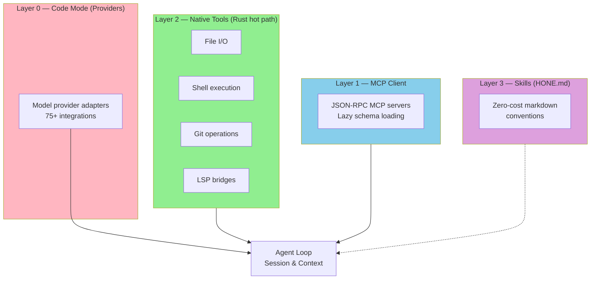

<p align="center">
  
</p>

<p align="center">
  <strong>The Universal Terminal AI Code Agent</strong>
</p>

<p align="center">
  <a href="#installation">Installation</a> •
  <a href="#quick-start">Quick Start</a> •
  <a href="#features">Features</a> •
  <a href="#documentation">Documentation</a> •
  <a href="#contributing">Contributing</a>
</p>

<p align="center">
  
  
  
</p>

---

## Overview

Hone is a privacy-first, provider-agnostic AI coding agent built entirely in Rust. It runs locally in your terminal with kernel-enforced sandboxing, supports 75+ model providers (Anthropic, OpenAI, Ollama, local, CLI pass-through), and learns patterns across sessions through adaptive memory. Work with your models, on your machine, under your rules.

## Why Hone

**Your models, your machine, your rules.** Hone doesn't phone home. No telemetry. No vendor lock-in. Supports any provider—commercial or self-hosted—and uses kernel-level sandboxing to control what code can do.

**Intelligence compounds.** Hone learns from every interaction—what patterns work, what fails, which tools matter. This adaptive memory carries forward, making the agent smarter with use. Insights cross repo boundaries through semantic indexing.

**Work from anywhere.** Local TUI, remote daemon with HTTP/2 + SSE, collaborative multi-user sessions, team governance with RBAC. Run honed on a server, connect from any terminal.

## Features

- **Universal model support** — Anthropic, OpenAI, Azure, Ollama, local providers, CLI pass-through (ACP) with tool delegation. 75+ adapters.
- **Kernel-enforced sandboxing** — Seatbelt on macOS, Landlock on Linux, seccomp elsewhere. Code execution is isolated and auditable.
- **Layered tool architecture** — Native Rust layer (Layer 2) for zero-cost file/shell/git/LSP. MCP client for external integrations (Layer 1). Skills in markdown (Layer 3). Tool decorators for cost tracking and governance (Layer 4).
- **Adaptive memory** — Encrypted SQLite with pattern learning. Hone remembers what worked, what failed, and why. Memory is local-first, private by default.
- **Client-server architecture** — hone CLI for local use, honed daemon for remote access. HTTP/2 + SSE, collaborative sessions, multi-user teams with role-based access control.
- **LSP integration** — Hover, diagnostics, code actions, workspace symbols via embedded LSP bridges to Node.js/Python/Rust/Go language servers.
- **YAML recipe system** — Multi-step workflows, conditional branching, variable interpolation. Recipes compose tools and agents into reproducible tasks.
- **Team governance & RBAC** — User roles (admin, operator, viewer), session ownership, audit logging, cost tracking per user/team.
- **Real-time cost tracking** — Token counting via tiktoken, live cost estimates, per-session breakdowns, budget enforcement.
- **Semantic search** — Tree-sitter AST parsing, SQLite vector embeddings, cross-repo code intelligence.

## Architecture

Hone uses a layered tool architecture where each layer integrates differently with the AI loop:



**Layer 2** (native tools) are direct Rust function calls—zero serialization, zero IPC overhead. **Layer 1** (MCP) uses JSON-RPC over stdio. **Layer 0** (providers) use HTTP + streaming. **Layer 3** (skills) are markdown conventions with no runtime cost.

## Installation

### Prerequisites

- Rust 1.85+ (via [rustup](https://rustup.rs))
- macOS or Linux with git support

### Build from Source

```bash
git clone https://github.com/honelang/hone.git
cd hone
cargo build --release
sudo cp target/release/hone /usr/local/bin/
sudo cp target/release/honed /usr/local/bin/
```

The binaries are in `target/release/`. Hone is self-contained—no external dependencies.

## Quick Start

### Local CLI

```bash
# Start the interactive agent
hone

# Work on a specific project
hone --dir ~/projects/my-app

# Use a specific model
hone --model gpt-4o

# Run a recipe
hone --recipe scripts/refactor.yaml
```

### Remote Daemon

```bash
# Start the daemon (listens on localhost:7070 by default)
honed --config ~/.config/hone/config.toml

# Connect from another terminal
hone --remote localhost:7070
```

### Create a Recipe

Save `refactor.yaml`:

```yaml
name: refactor-logging
description: Upgrade log statements to structured format
steps:
  - tool: file_search
    query: "console.log|print\("
  - agent:
      prompt: "Replace with structured logging"
      model: gpt-4o
  - tool: git_commit
    message: "refactor: upgrade to structured logging"
```

Run it:

```bash
hone --recipe refactor.yaml
```

## Configuration

Hone uses a three-level config hierarchy:

1. **CLI flags** (highest priority)
2. **TOML** (`~/.config/hone/config.toml`)
3. **Defaults** (lowest priority)

### Sample config.toml

```toml
[agent]
default_model = "gpt-4o"
context_window_tokens = 16000
max_iterations = 20

[memory]
enabled = true
db_path = "~/.local/share/hone/memory.db"
encryption_key_file = "~/.config/hone/key.bin"

[sandbox]
strategy = "seatbelt"  # macOS: seatbelt, Linux: landlock

[team]
rbac_enabled = true
audit_log_path = "~/.local/share/hone/audit.log"

[providers]
default = "anthropic"
# Add API keys for each provider
anthropic_api_key = "${ANTHROPIC_API_KEY}"
openai_api_key = "${OPENAI_API_KEY}"
```

See docs/configuration.md for complete reference.

## CLI Reference

| Command | Purpose |
|---------|---------|
| `hone` | Start interactive CLI session |
| `hone --model <name>` | Use a specific model |
| `hone --dir <path>` | Target a specific directory |
| `hone --recipe <path>` | Run a YAML recipe |
| `hone --remote <host:port>` | Connect to remote daemon |
| `honed` | Start the HTTP/2 server daemon |
| `honed --port 8080` | Listen on custom port |

See `hone --help` for full options.

## Crate Structure

Hone is organized as a Cargo workspace. Each crate has a focused responsibility:

| Crate | Purpose | Deps |
|-------|---------|------|
| `hone-proto` | Shared types, DTOs, errors | 0 internal |
| `hone-config` | TOML + HONE.md parsing | proto |
| `hone-providers` | Model provider abstraction | proto |
| `hone-sandbox` | Kernel sandboxing (Seatbelt, Landlock) | proto |
| `hone-tools` | Layer 2 native tools (file, shell, git, LSP) | proto, sandbox |
| `hone-mcp` | MCP client (JSON-RPC transport) | proto, tools |
| `hone-index` | Semantic indexer (tree-sitter, SQLite vectors) | proto |
| `hone-memory` | Adaptive memory (encrypted SQLite) | proto |
| `hone-core` | Agent loop, session, orchestration | all above |
| `hone-recipes` | YAML recipe parsing + execution | proto, core |
| `hone-server` | HTTP/2 + SSE daemon | proto, core |
| `hone-tui` | Ratatui terminal UI | proto, core |

Binaries:
- `hone-cli` — Interactive terminal agent
- `honed` — HTTP/2 daemon

## Documentation

- **[Architecture](docs/architecture.md)** — Layer design, crate dependencies, data flow
- **[Configuration](docs/configuration.md)** — Config hierarchy, HONE.md conventions, security policies
- **[API Reference](docs/api.md)** — HTTP/2 + SSE endpoints, authentication, rate limits
- **[Recipes](docs/recipes.md)** — YAML schema, tool reference, examples
- **[Security Model](docs/security.md)** — Sandboxing, audit logging, team governance
- **[Contributing](docs/contributing.md)** — Build, test, commit conventions

## Testing

Hone passes 309 tests with zero clippy warnings.

```bash
# Run all tests
cargo test

# Run with logging
RUST_LOG=debug cargo test -- --nocapture

# Run a specific test
cargo test memory::pattern_learning

# Benchmarks
cargo bench
```

## Contributing

1. Fork the repository
2. Create a feature branch (`git checkout -b feature/my-feature`)
3. Write tests and docs alongside code
4. Run `cargo test && cargo clippy --all-targets`
5. Commit with a clear message
6. Push and open a pull request

See [CONTRIBUTING.md](docs/contributing.md) for detailed guidelines.

## License

Licensed under Apache License, Version 2.0. See [LICENSE](LICENSE) for details.

---

Built with attention to privacy, performance, and composability.
