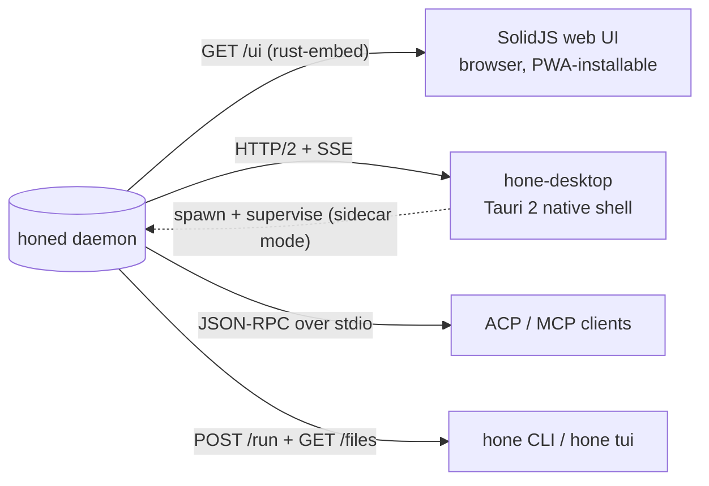
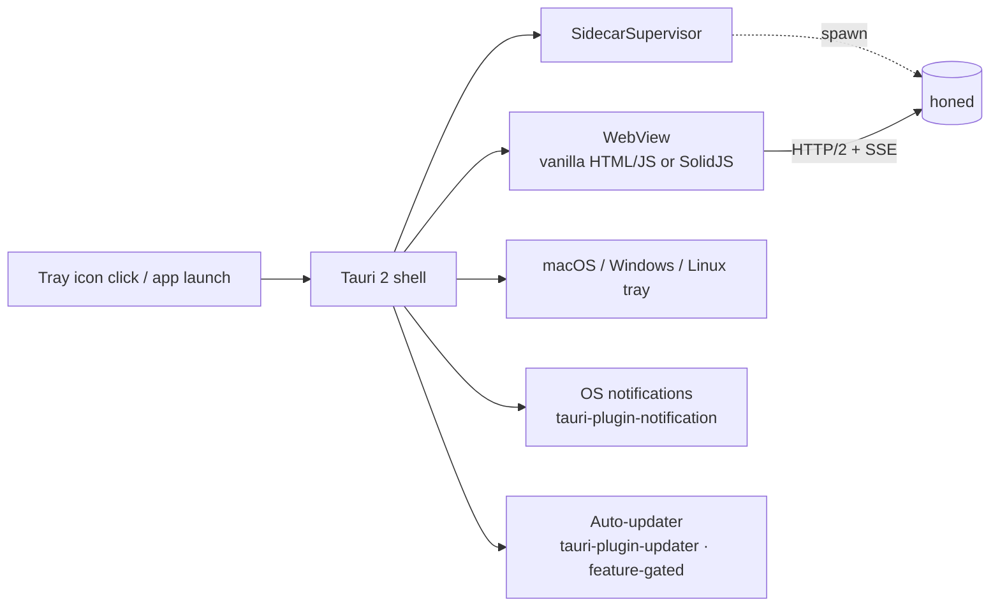
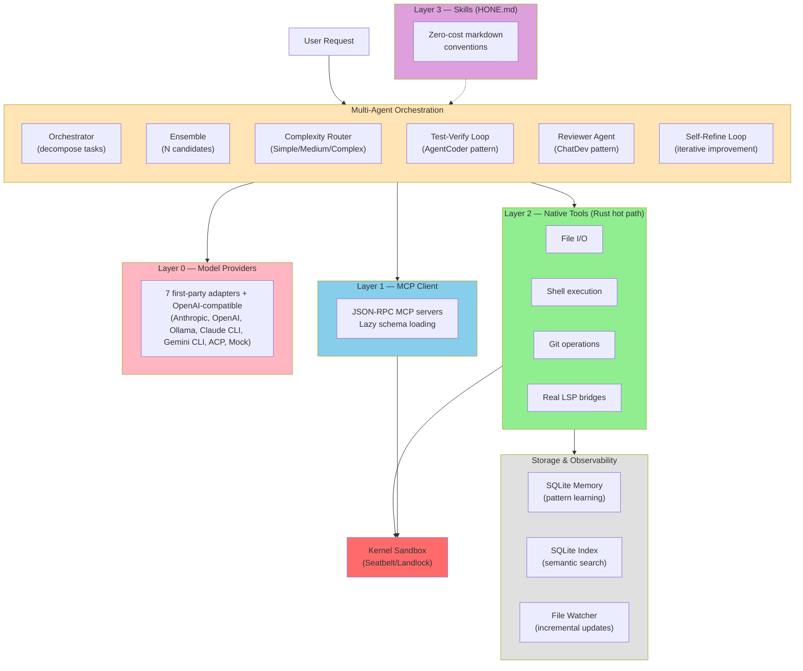

<p align="center">
  <picture>
    <source media="(prefers-color-scheme: dark)" srcset="assets/lockup-horizontal-v2-dark.png">
    <source media="(prefers-color-scheme: light)" srcset="assets/lockup-horizontal-v2-light.png">
    
  </picture>
</p>

<h3 align="center">The coding agent that shows its receipts.</h3>

<p align="center">
  Hone is an open-source coding agent written in Rust. It works with any model, cloud or local,
  and records what the model was given, what the agent did and what it cost, so you can check every run.
</p>

<p align="center">
  <a href="#quick-start">Quick start</a> •
  <a href="#installation">Installation</a> •
  <a href="#whats-new">What's new</a> •
  <a href="#features">Features</a> •
  <a href="#documentation">Documentation</a> •
  <a href="#contributing">Contributing</a>
</p>

<p align="center">
  
  
  
</p>

---

## Receipts for every run

- **What it saw.** `hone context show` lists every block sent on each model call: the system prompt, recalled memories, skills, code context and history, with where each came from and how many tokens it took.
- **What it did.** Run with `--audit` and every tool call is recorded in `.hone/audit.jsonl`: its arguments, a preview of the result, whether a rule or the sandbox blocked it, and any prompt-injection warning. `hone trace` lists and summarises those records. Rules in `permissions.toml` allow, ask about or deny tool calls by shell command, file path or network host.
- **What it cost.** The terminal UI shows the session's cost as it grows, and `[budget]` caps it. Each interactive session leaves a report, and `hone reports diff` compares two of them.

## Quick start

**1. Install.** You need [Rust 1.85+](https://rustup.rs) on macOS or Linux.

```bash
cargo install --locked --git https://github.com/wojciechkpl/hone hone-cli honed
```

**2. Choose a model.** Use an API key, or run a model on your own machine with [Ollama](https://ollama.com) and no key at all.

```bash
export ANTHROPIC_API_KEY=sk-ant-...   # or OPENAI_API_KEY, for OpenAI or any OpenAI-compatible endpoint

# Or, with no API key:
ollama pull qwen2.5-coder:14b         # then add --model ollama:qwen2.5-coder:14b to the commands below
```

`hone configure` walks through the same choice and saves it to `~/.config/hone/config.toml`.

**3. Run a task, then read the receipts.**

```bash
cd your-project
hone --audit "add a test for the empty-input case in the parser"
hone context show    # what the model was given, call by call
hone trace list      # what the agent did
```

Run `hone` with no arguments for the interactive terminal UI. See [Usage](#usage) for more, and [Installation](#installation) for other ways to install.

## Demo

<p align="center">
  
</p>

<sub><i>A hand-drawn animation of a typical session, not a screen recording; a real recording will replace it.
Each panel fades in as the agent takes the next action: prompt → read_file → edit_file (diff) → cargo test
(green) → fix summary → cost line.</i></sub>

### Step-by-step

1. **Prompt** — user describes the failing test.
   ```text
   $ hone "the test_divide test fails because divide(10, 0) raises
           ZeroDivisionError. fix it to return None."
   ```
2. **`read_file`** — Hone opens `calculator.py` to see what's there.
   ```python
   1  def divide(a, b):
   2      return a / b
   ```
3. **`edit_file`** — Hone applies a unified-diff patch.
   ```diff
   -     return a / b
   +     if b == 0:
   +         return None
   +     return a / b
   ```
4. **`!cargo test`** — Hone runs the test suite to verify.
   ```
   running 12 tests
   test test_divide_by_zero ... ok
   12 passed in 0.3s
   ```
5. **Done** — assistant reports the fix and the cost line.
   ```
   Fixed. divide() now returns None on zero division.
   claude-sonnet | $0.001 | ctx 18% | 5s
   ```

<details>
<summary>Play the recording locally</summary>

```bash
# Install asciinema
brew install asciinema  # or: pip install asciinema

# Play the recorded demo
asciinema play assets/demo.cast
```

The embedded `assets/demo.svg` is a **hand-written animation** illustrating a typical session; it is not a screen recording. It replaced an earlier render of a real DeepSeek V3 run (`assets/demo.cast`) whose output showed raw tool-call sentinels. A fresh real recording will replace it.
</details>

<details>
<summary>Browser &amp; desktop GUI demos (text walk-throughs)</summary>

Three independent surfaces ship alongside the TUI: a **SolidJS web UI**
served by `honed` at `/ui`, a **Tauri 2 desktop app** with system tray
+ multi-daemon switcher, and the same daemon's HTTP/SSE API anything
else can embed against. See the
[Remote Access &amp; Web UI](#remote-access--web-ui) and
[Desktop App](#desktop-app) sections below for layout sketches,
walkthroughs of every panel (file preview, side-by-side diff,
approval modal, task-tree DAG, sandbox / memory / provenance / evals
viewers, artifact pane), bundle profile, and the full daemon endpoint
table.

Quick spin-up:

```bash
# Browser
make webui                                              # build the SPA
ANTHROPIC_API_KEY=sk-... cargo run --release -p honed   # serve at /ui
open http://127.0.0.1:3117/ui

# Desktop (Tauri 2 native shell — system tray, OS notifications, Cmd+K)
cargo build -p honed --release && cp target/release/honed /usr/local/bin/
cargo run -p hone-desktop
```

</details>

---

## Overview

Hone is a privacy-first, provider-agnostic AI coding agent built entirely in Rust. It runs locally in your terminal with kernel sandboxing (Seatbelt on macOS; Landlock on Linux, currently opt-in), supports 7 first-party provider adapters plus any OpenAI-compatible endpoint via `HONE_OPENAI_BASE_URL`, and learns patterns across sessions through adaptive memory. Work with your models, on your machine, under your rules.

## Why Hone

**Every run leaves receipts.** You can check what the model was given, which tools the agent called and what it spent, instead of taking the agent's word for it. See [Receipts for every run](#receipts-for-every-run).

**Your models, your machine, your rules.** Hone doesn't phone home. No telemetry. No vendor lock-in. Supports any provider—commercial or self-hosted—and sandboxes shell commands at the kernel level (Seatbelt on macOS; Landlock on Linux, opt-in).

**Memory you can inspect.** Hone keeps memories across sessions and recalls the relevant ones into later prompts. `hone memory ls` lists them, `hone memory forget` prunes them, and `hone context show` shows which ones reached the model on each call.

**Work from anywhere.** Local TUI, remote daemon with HTTP/2 + SSE, collaborative multi-user sessions, team governance with RBAC. Run honed on a server, connect from any terminal.

## What's new

Recent highlights. They are all in the `[Unreleased]` section of the [CHANGELOG](CHANGELOG.md), which has the details.

### Decide what the agent may do

- **Permission rules.** Allow, ask about or deny tool calls by shell command, file path or network host.
  - Where they live: your own `~/.config/hone/permissions.toml`, and the project's `.hone/permissions.toml`, which can only tighten your rules.
  - Where they're checked: on every tool call, in the TUI, one-shot runs, `honed` and `hone-mcp-server`.
  - Headless runs: `--approve <rule-id>` approves an `ask` rule in advance. A `deny` can't be lifted that way.
  - Built-in rules: `HONE_POLICY_BUILTINS=1` adds 39 rules (`.env` files, `~/.ssh`, cloud and package credentials, …) and redacts secrets in tool output.
  - With no permission files, nothing changes. See the [permissions guide](docs/permissions-and-sandbox.md).
- **Approvals on every turn.** The TUI asks before edits and commands on every turn, and `--step` asks before each call. In a complex prompt or a `/plan` Run, the specialist workers ask too. The approval menu names the worker, and "always" covers the rest of the session.

```toml
# ~/.config/hone/permissions.toml or .hone/permissions.toml
version = 2

[[rules]]
id = "no-push"
command = "git push*"
decision = "deny"

[[rules]]
id = "ask-secrets"
path = "secrets/**"
op = "read"
decision = "ask"
```

### The right model for each turn, and a fallback when it fails

- **Routing by complexity.** Hone sorts every prompt as simple, medium or complex, and `[[routing]]` in `config.toml` gives each kind its own model. `/model` now switches the provider as well as the model.
- **Fallback models.** `fallback_models`, set in your own config only, are tried in order when the turn's model fails before answering: an overload, a rate limit, a 5xx error, or no answer at all. Hone tells you when a fallback took over: in the TUI, on stderr, and in `--json` output.
- **`config.toml` takes effect.** `default_model`, `[providers.*]` and `[budget]` are now applied. A project's `.hone/config.toml` may choose models and lower the budget, but it can't change endpoints or API keys.

```toml
# ~/.config/hone/config.toml
default_model = "anthropic:claude-sonnet-4-5"      # medium turns, and any tier without a rule
fallback_models = ["openai:deepseek-chat", "ollama:qwen2.5-coder"]

[[routing]]
task = "simple"
model = "openai:deepseek-chat"

[[routing]]
task = "complex"
model = "anthropic:claude-opus-4-5"
```

See [routing and fallback](docs/configuration.md#routing-and-fallback).

### Answers that arrive whole, and tools that recover

- **Streaming:**
  - A response that fails before any output is retried, or handed to a fallback model.
  - A response cut off midway is reported as an error, not kept as if it were complete.
  - Long answers are no longer cut off at two minutes: the 120 s limit now applies only when nothing arrives.
  - A character split across two network chunks (accented letters, CJK, emoji) is no longer lost.
  - Base URLs ending in `/v1` work.
  - An error that a retry can't fix isn't retried.
- **A failing tool doesn't end the turn.** For example, an `edit_file` whose text isn't in the file: the model sees the error and can try again.
- **Workers can act.** In a complex prompt or a `/plan` Run, the specialist agents (`rust-expert`, `code-reviewer`, …) get the tools their agent definition lists. They run under the session's approvals, permission rules and sandbox.

### Nothing left running after Hone stops (unix)

- **Shell commands** each run in their own process group. When a call ends early (<kbd>Esc</kbd>, a timeout, a stopped run), the whole group is killed, so a `cargo test` or a dev server doesn't keep running in the background.
- **MCP servers:**
  - Every request gives up after the server's `timeout_ms`.
  - A server that hangs at startup is skipped.
  - All servers start and stop in parallel.
  - Every way Hone ends stops them: a normal exit, an error, a signal or a panic. Servers get SIGTERM first, so they can clean up. Only `kill -9` or a crash that isn't a panic can still leave one running.
- **`honed` shuts down gracefully.** On SIGTERM, running requests and a worker's current task finish with their tools still working, and the result is reported to the coordinator. This includes a coordinator and worker in one `honed`.
  - The wait lasts at most `HONE_SHUTDOWN_GRACE_SECS` (default 20 s). After that, open connections are cut.
  - Then MCP servers stop gracefully.
  - A second signal stops everything at once.
  - See [shutting down `honed`](docs/configuration.md#environment-variables).

### Memory and code context that reach the model

- **Recall finds older memories.** Each turn ranks up to the 5,000 newest memories and keeps the best 5. It used to rank only the 5 newest. Hone's own after-turn logs no longer show up as "Relevant Memories".
- **Plain-English prompts pull in code.** The code index matches each word of the prompt, so "fix the login bug" finds `login` and `handle_login`. Names that match more words rank first, and the "Potentially relevant code" block appears when one match clearly leads.
- **Phase-aware compaction (opt-in).** With `HONE_PHASE_COMPACTION=1`, when the agent moves from reading code to editing it (`edit_file`, `apply_patch`, …) or running tests through `shell`, older long tool results are shortened to summaries. The files being edited and the newest results stay whole. It's off by default until a benchmark shows it helps.
- **No crash on non-ASCII tool output.** Summarising an old tool result could panic when a multi-byte character (Polish, CJK, emoji) sat at the cut point. Summaries of file reads now keep the path and the declarations.
- **The TUI shows injected code context.** When Hone adds repository context to the first prompt, the prompt mirror (<kbd>Ctrl</kbd>+<kbd>M</kbd>) lists the files and the skeleton strategy. It was always empty before.

### Also new

- **`HONE_CONTEXT_WINDOW`** sets the context window for a model that is served with a smaller one than its name suggests.
- **Typed memories.** The model reads an index of memories and fetches the ones it needs. Recall uses BM25 ranking. Manage memories with `hone memory ls | show | forget`.

## Features

- **Shell escape** — Run native shell commands with `!command`: `!ls`, `!git status`, `!cargo test` show inline output. `!cd src` changes directory (confined to project). `!nvim file.rs` suspends TUI, runs editor, restores after.
- **Vim mode** — Type `--vim` or `:set vim` for vim-style keybindings. Normal mode: j/k scroll, gg/G top/bottom, i/a insert, :q quit. Insert mode: type normally, Esc returns to normal.
- **TDD mode** — Type `:tdd [command]` to watch source files and auto-run tests on change (300ms debounce). Shows PASS/FAIL inline. Type `:tdd off` to stop.
- **Review mode** — Type `:review` to enter hunk-by-hunk review of git diff changes. Navigate with j/k, accept/reject hunks with a/r, accept/reject all with A/R, quit with q.
- **Session switcher overlay** — Press `Ctrl+O` to browse and switch between saved sessions with a full-screen overlay showing name, last-updated relative time, and message count. Navigate with j/k, Enter to select, q to close.
- **Expanded keybindings help** — Press `Ctrl+?` to see 31 keybindings across 5 sections (Input, Navigation, Overlays, Agent control, Commands) with descriptions.
- **Observability sidebar & session reports** — Press `Ctrl+R` to toggle the Agent Rail sidebar showing files touched, context injected, and memory recalls per turn. On session end, detailed reports are auto-generated with cost, tokens, files, tools, and timelines. View with `hone reports list/show/diff`.
- **Multi-agent orchestration** — Decompose complex tasks via research-backed patterns (Anthropic, MASAI, CodeR). Orchestrator-worker pipeline with message merging. Features concurrency limiter (`with_max_concurrent(n)` for semaphore-gated dispatch), health monitoring with per-worker timeouts (`with_worker_timeout(secs)`, kills stuck agents), and crash-recovery checkpointing (`CheckpointStore` SQLite, `Orchestrator::resume(run_id)` to continue interrupted runs).
- **Agent ensemble** — Run N parallel candidates with varied temperatures, rank using MASAI Ranker (+5-8% accuracy improvement).
- **Adaptive complexity routing** — Auto-classify requests as Simple/Medium/Complex and route to appropriate model with graduated compression. Choose the model for each tier with `[[routing]]` in `config.toml`, and add `fallback_models` for outages ([routing and fallback](docs/configuration.md#routing-and-fallback)).
- **Adaptive hierarchical skeleton** — Proactive context injection with intelligent strategy selection: auto-detects repository size and auto-selects detail level. 4-level hierarchy: directory → file list → signatures → call graph. The default strategy is **Adaptive**; `call-graph`, `hybrid`, `dependency-graph` and `flat` are selectable with `--skeleton-strategy`. Adaptive skips large files (>100KB) and slow parses (>100ms). Progressive budget filling ensures efficient token use. Disable with `--no-inject` or `HONE_NO_INJECTION=1`. Its effect on SWE-bench resolve rate is being measured (see [SWE-bench Results](#swe-bench-results)).
- **Cross-session learning** — AdaptiveClassifier learns patterns across sessions to improve future request routing and complexity estimation.
- **Test-verification loop** — AgentCoder pattern that runs tests after each iteration (+40% bugs caught early).
- **Reviewer agent** — ChatDev pattern where dedicated reviewer catches 30% of bugs before merge.
- **Self-refine loop** — Iterative improvement (NeurIPS 2023, +8-15% quality gain).
- **RALPH loop** — Review, Analyze, Learn, Plan, Heal: structured feedback cycle combining adversarial review with root cause analysis. Max 3 iterations (configurable), stops when reviewer approves. Captures learned patterns for cross-session improvement. Optional test verification after each Heal step. Research basis: Self-Refine (NeurIPS 2023) + ChatDev + MASAI + AgentCoder.
- **Universal model support** — 7 first-party adapters (Anthropic, OpenAI, Ollama, Claude CLI, Gemini CLI, ACP, and a mock adapter for testing) plus any OpenAI-compatible endpoint via `HONE_OPENAI_BASE_URL` (DeepSeek, Qwen, Kimi, OpenRouter, and others work out of the box). Full tool-calling support on Anthropic, OpenAI, Ollama, **and ACP** adapters (`claude --acp`, `gemini --acp`, or custom ACP servers); the legacy Claude/Gemini CLI pass-through adapters remain prose-only.

  | Adapter | Tool calling | Stream | Notes |
  |---|---|---|---|
  | Anthropic | Yes | SSE | claude-sonnet-4-5 default |
  | OpenAI | Yes | SSE | gpt-4o default; override with `HONE_OPENAI_MODEL` |
  | Ollama | Yes | stream | llama3.2 default; requires local `ollama serve` |
  | Claude CLI (legacy) | No | text | `claude` binary on PATH; prose-only passthrough |
  | Gemini CLI (legacy) | No | text | `gemini` binary on PATH; prose-only passthrough |
  | ACP — `claude --acp` | Yes | JSON-RPC | Subscription Claude with full bidirectional tool dispatch |
  | ACP — `gemini --acp` | Yes | JSON-RPC | Free-tier Gemini with full bidirectional tool dispatch |
  | ACP — custom | Yes | JSON-RPC | Self-hosted ACP servers; see [`docs/api/acp-protocol.md`](docs/api/acp-protocol.md) |
  | Mock | Yes | in-process | Test double only |
- **Kernel sandboxing** — Shell commands run under Seatbelt on macOS (enforced by default). On Linux 5.13+, Landlock enforcement is **opt-in** with `HONE_SANDBOX_ENFORCE=1` while it is validated: before November 2026 a bug meant Landlock was never applied to shell commands. Read allowlist: system and toolchain roots plus `HONE_SANDBOX_EXTRA_READ`. Also: path traversal prevention for file tools and command classification. No sandbox on other platforms.
- **Memory encryption** — AES-256-GCM with Argon2id for encrypted memory storage. Opt-in at runtime via `--encrypted-memory` plus `HONE_MEMORY_PASSPHRASE`. A wrong or missing passphrase exits the binary non-zero rather than silently degrading. Each store persists its own random 16-byte salt (plus a version marker) as a sentinel memory record, so keys rotate per-vault and cannot be cross-replayed against a hardcoded constant.
- **Typed memories with index-driven recall** — Memories carry a `kind` (`User`, `Feedback`, `Project`, `Reference`, `Outcome`, `Conversation`) and an optional one-line `description`. The system prompt embeds a budgeted `## Memory index`; the agent fetches bodies on demand via the `memory_read` tool. Recall ordering uses BM25 (k1=1.5, b=0.75) over content + description. Inspect or prune via `hone memory ls | show <id> | forget`.
- **Layered tool architecture** — Native Rust layer (Layer 2) for zero-cost file/shell/git/LSP. MCP client for 70+ community extensions (Layer 1) with `.hone/mcp.json` config. Skills in markdown (Layer 3). Tool decorators for cost tracking and governance (Layer 4).
- **Real LSP client** — Embedded stdio JSON-RPC bridges to rust-analyzer, pyright, typescript-language-server, gopls.
- **SQLite storage** — sessions and memory live in SQLite (single-user, zero-ops). The code index (`hone-index`) is tree-sitter symbols in SQLite, searched by name; there is no pgvector or vector index.
- **Adaptive memory** — Pattern learning across sessions. Hone remembers what worked, what failed, and why. Memory is local-first, private by default.
- **OpenAPI 3.1 spec generation** — GET /openapi.json for automated API documentation.
- **Rate limiting** — Sliding window middleware per IP/user.
- **Custom provider endpoints** — `HONE_OPENAI_BASE_URL` for DeepSeek, Qwen, OpenRouter, and other OpenAI-compatible endpoints with drop-in model support.
- **Multi-agent budget tracking** — Per-turn, per-session, per-user token accounting with live cost estimates and configurable limits.
- **Real bore tunnel** — Automatic SSH tunnel when bore CLI installed.
- **Client-server architecture** — hone CLI for local use, honed daemon for remote access. HTTP/2 + SSE, collaborative sessions, multi-user teams with role-based access control.
- **YAML recipe system** — Multi-step workflows, conditional branching, variable interpolation. Recipes compose tools and agents into reproducible tasks.
- **Redesigned status bar** — Three-zone layout (left: model/session/phase, center: tool icon, right: context bar with cost). Token count shows inline (compact: "42t") and full fraction in wide mode ("42/200000 tokens"). Width-adaptive (80/120/160+ cols), NO_COLOR support.
- **Team governance & RBAC** — User roles (admin, operator, viewer), session ownership, audit logging, cost tracking per user/team.
- **Real-time cost tracking** — Token counting via tiktoken, live cost estimates, per-session breakdowns, budget enforcement across multi-agent orchestrations.
- **Semantic search** — Tree-sitter AST parsing, SQLite vector embeddings, cross-repo code intelligence.
- **Scope clarification mode** — Auto-detects ambiguous requests using 4 heuristics and asks clarifying questions before coding. Use `/clarify` to trigger manually or `--no-clarify` for CI/scripting without prompts.
- **Inline agent dispatch** — Use `@agent-name` syntax to swap system prompts on the fly (e.g., `@security-auditor "audit this code"`, `@debugger "fix this bug"`). 12 built-in agents available. Restores original prompt after the turn.
- **Safe pipe operator** — Pipes to head/tail/grep/wc/sort now allowed in shell commands (were previously blocked). Pipes to unknown commands still treated as destructive.
- **Ollama tool calling** — OllamaProvider now supports full tool calling (previously hardcoded to skip). Qwen 2.5 Coder 14B recommended for local use.
- **Model override fixes** — `--model ollama` now directly creates OllamaProvider without falling back to Claude CLI when Ollama is explicitly requested.
- **Text-based tool call parser** — Detects JSON tool calls in model content for Ollama (handles models that don't use tool_calls field). Strips markdown code fences automatically.
- **DeepSeek Direct compatibility** — Works for interactive use; for SWE-bench benchmarks, OpenRouter is recommended due to token output limits.
- **Built-in agents** — 12 specialized agent personas (code reviewer, debugger, security auditor, ML engineer, etc.) with `@agent-name` inline dispatch. Plus 9 recipe templates for common workflows.
- **Agent-loop robustness** — Three pre-LLM safety checks break out of failure modes that tend to waste tokens: (1) **Doom-loop detector** — injects a corrective user message when the last 30 messages show 3+ identical consecutive tool calls or a repeating 2–5 step pattern; (2) **Context-budget graceful abort** — at 95 % of the model's context limit, strips tools from the next request and tells the model to finalize now instead of being mid-tool-call truncated; (3) **Output-truncation retry hint** — when the provider ends with `stop_reason = "max_tokens"` (Anthropic) or `finish_reason = "length"` (OpenAI), commits partial assistant text, drops the malformed tool-use block, and injects a user hint naming the lost tools so the model can retry with smaller content.

## Built-in Agents and Recipes

Hone ships with 12 pre-configured agents and 9 recipe templates for common development tasks.

### Built-in Agents

Each agent is a specialized persona with curated tools and system prompts:

| Agent | Description |
|-------|-------------|
| `code-reviewer` | Expert code reviewer for quality, security, performance, and maintainability |
| `debugger` | Systematic debugging specialist using the scientific method |
| `security-auditor` | Security auditor for vulnerability scanning, secret detection, and OWASP review |
| `performance-optimizer` | Performance profiler and optimizer for database, API, memory, and rendering |
| `documentation-agent` | Generates and maintains API docs, READMEs, architecture diagrams, and changelogs |
| `api-designer` | REST, GraphQL, and gRPC API designer with OpenAPI spec generation |
| `tdd-workflow` | Test-Driven Development workflow enforcing Red-Green-Refactor discipline |
| `rust-expert` | Rust specialist for ownership, lifetimes, async with tokio, and idiomatic error handling |
| `python-expert` | Python specialist for PEP 484 typing, pytest, async with asyncio, and FastAPI |
| `researcher` | AI/ML research scientist for literature review, experiment design, and paper analysis |
| `ml-engineer` | Machine learning engineer for model training, evaluation, deployment, and MLOps |
| `data-engineer` | Data engineer for ETL pipelines, data warehousing, schema design, and data quality |

### Built-in Recipes

Recipes are multi-step YAML workflows that guide the agent through structured processes:

| Recipe | Description |
|--------|-------------|
| `tdd-feature` | Implement a feature using Test-Driven Development (Red-Green-Refactor) |
| `bug-fix` | Fix a bug using systematic debugging with regression test |
| `code-review` | Perform a comprehensive code review covering correctness, security, and performance |
| `refactor` | Safely refactor code with test verification at each step |
| `security-audit` | Scan for OWASP Top 10 vulnerabilities, secrets, and dependency issues |
| `performance` | Profile, optimize, and measure performance improvements |
| `migration` | Plan and execute safe dependency or framework migrations |
| `documentation` | Inventory code, generate API docs, update README, and verify coverage |
| `onboarding` | Understand a new codebase structure, key files, and common workflows |

### Using Built-in Agents and Recipes

Agents can be referenced by name or description using the agent registry:

```bash
# Run using an agent's name
hone --agent code-reviewer -i "Review this code for security issues"

# Run a recipe
hone --recipe tdd-feature
hone --recipe bug-fix

# Create a custom agent (see docs/tutorials/tools-and-mcp.md)
cat > .hone/agents/my-agent.md << 'EOF'
---
name: my-agent
description: My custom agent
tools: [read, write, shell, grep]
model: sonnet
---
You are my specialized agent...
EOF
```

Custom agents can be placed in `.hone/agents/` (project-level) or `~/.config/hone/agents/` (user-level).

For detailed information on how agents work and how to create custom ones, see [docs/tutorials/tools-and-mcp.md](docs/tutorials/tools-and-mcp.md#agents).

## Remote Access & Web UI

The `honed` daemon serves three independent surfaces over HTTP/2 + SSE: a
**SolidJS web UI** at `/ui`, a **Tauri 2 desktop app** that can supervise
its own daemon, and a documented **REST + SSE API** that can be embedded
in anything else. All three share the same wire format.

### Three GUIs, one daemon



| Surface | Path | Stack | Best for |
|---|---|---|---|
| **TUI** | `hone tui` | Rust + ratatui | terminal-native, SSH, vim users |
| **Web** | `/ui` | SolidJS + UnoCSS + Vite | any browser, no install, PWA |
| **Desktop** | `hone-desktop` | Tauri 2 (Rust shell + WebView) | system tray, OS notifications, multi-daemon switcher |

### Web UI walkthrough

A complete browser-based chat surface with file preview, syntax highlighting,
diff renderer, multi-agent task tree, IndexedDB conversation history, step-mode
approvals, multi-daemon support, and four themes. Initial bundle: **~24 KB JS
gzipped**; on-demand syntax highlighting lazy-loads Shiki + Oniguruma WASM.

```bash
# Build the SPA into the daemon binary, then run it.
make webui
ANTHROPIC_API_KEY=sk-ant-... cargo run --release -p honed
open http://127.0.0.1:3117/ui
```

#### 1. Chat with streaming + Cmd+K command palette

What the chat surface contains, in render order:

- **Topbar:** brand · session selector · `collab: N` button · agent selector · step toggle · daemon health badge · theme cycler · `⚙` settings · `Cmd+K`
- **Conversation list (scrollable):**
  - user bubble (right-aligned, brand-color background)
  - assistant bubble (left-aligned, accent border, streaming cursor `▍` while tokens arrive)
  - tool-call card per invocation: tool name, status (`running` / `done` / `error`), `duration_ms`, collapsible result body, `(cached)` suffix on cache hits
  - error bubble for any `error` event
- **Worker progress panel** (only when `Orchestrator` is running)
- **Input bar:** textarea + autocomplete menu when the draft starts with `/`
- **Status bar:** version label · token count · USD spend (driven by `done.usage` + `done.cost_usd` events)

Slash commands (intercepted client-side, never hit `/run`):

| Command | What it does |
|---|---|
| `/theme <crimson \| chalk \| neon \| minimal>` | set palette |
| `/settings` | open the settings drawer |
| `/clear` | reset the session cost meter |
| `/help` | list available commands |

- Token stream renders with markdown (fenced code blocks get **lazy
  Shiki syntax highlighting** in 27 languages — `rust`, `ts`, `tsx`,
  `python`, `go`, `c`, `cpp`, `bash`, `json`, `yaml`, `diff`,
  `markdown`, etc.). The first highlight fetches Shiki + Oniguruma
  WASM; subsequent highlights are cached.
- Type `/` to autocomplete commands. `/theme neon` swaps the palette,
  `/settings` opens the drawer, `/clear` resets the cost meter.
- `Cmd+Enter` sends; the **Cancel** button aborts mid-stream.

#### 2. File preview + side-by-side diffs

When the agent runs `read_file` / `edit_file` / `write_file`, the
preview pane to the right opens automatically and shows the file with
syntax highlighting. The gutter between chat and preview is
**resizable** — drag to split (clamped 25–85%, persisted to
`localStorage`).

The two-column layout (chat left, preview right):

- **Chat side** keeps streaming. Tool results that look like unified
  diffs auto-render as **side-by-side** with theme-driven add /
  remove / hunk colors. Long tool results (>6 lines) collapse with a
  *show all (N lines)* button.
- **Preview side** shows a 200 px wide file tree on its left and a
  Shiki-highlighted code viewer on its right. The tree lazily expands
  directories on click; hidden entries (`.git`, dotfiles) are skipped.
- **Gutter** is the 6 px draggable bar between the two halves. The
  ratio is clamped to `[0.25, 0.85]` and persisted to `localStorage`
  under `hone-webui:split-ratio`.

A typical diff card embedded in the chat:

```diff
diff --git a/src/lib/diff.ts b/src/lib/diff.ts
@@ -42,3 +42,9 @@
   context line
-    return null;
+    return parsed;
+  } catch (err) {
+    return null;
```

- Tool results that look like unified diffs auto-render as
  **side-by-side** with theme-driven add / remove / hunk colors.
- File tree on the left lazily expands directories. Hidden entries
  (`.git`, dotfiles) are skipped.
- Files >2 MiB or with NUL bytes (binaries) get a placeholder.

#### 3. Multi-agent orchestration with task tree

When you submit a turn that triggers `Orchestrator::run` (multi-agent
plans), a `<WorkerProgressPanel>` appears above the chat. It shows a
goal header, one row per worker, and a budget footer.

A typical render after two of four workers have finished:

| status | agent | task | result |
|---|---|---|---|
| done (green) | researcher | `t-001` explore current `auth/` tree | $0.003 |
| done (green) | planner | `t-002` draft the migration steps | $0.005 |
| running (warn, pulses) | implementer | `t-003` apply the rename mechanically | — |
| queued (muted) | reviewer | `t-004` verify against TDD harness | — |

Footer: `spent $0.008 / $0.50 · 2/4 workers`.

Driven by `plan_created` / `worker_started` / `worker_completed` /
`budget_progress` events on the SSE stream.

#### 4. Step-mode approvals

Tick **step** in the topbar to require approval for risky tools.
When the agent pauses on a `tool_call_paused` event, a centred modal
pops with the tool name + arguments. Buttons:

| button | StepAction wire shape | semantics |
|---|---|---|
| Allow | `"Proceed"` | execute this call only |
| Always allow | `{"ApproveAlways": "<tool_name>"}` | execute and auto-allow same tool name for the rest of the session |
| Skip | `"Skip"` | proceed without this tool; agent gets an empty result |
| Deny | `{"Deny": "user denied"}` | agent receives a tool error and reacts |

Click-outside dismisses with `Skip`. The chosen action is POSTed to
`/run/{request_id}/step` (202 Accepted on success).

#### 5. Multi-session + IndexedDB persistence

The session selector in the topbar lists every session you've created
locally. Each is a bucket of messages stored in IndexedDB; refreshing
the page hydrates the conversation back from the local cache before
SSE reconnects.

#### 6. Settings drawer

Press `⚙` in the topbar (or `/settings`) for a slide-in drawer with:

- **Theme** picker (4 swatches: crimson · chalk · neon · minimal)
- **Font size** (small / medium / large) — applied via root CSS var
- **Daemon endpoint** override — for cross-origin / Tauri shell setups
- **Tunnel** — start / stop / copy URL against `POST/DELETE/GET /tunnel`
- **Team usage** — totals + per-model breakdown from `GET /team/usage`
- **Reset** — wipes settings without touching sessions or chat history

#### 7. Collaborative sessions

Click the `collab: N` button next to the agent selector to join the
active session by name. The first joiner becomes the **Owner** and
gets a Kick button next to other participants. `user_id` is generated
locally and persisted so the same browser keeps its identity across
reloads. Wired against `POST /sessions/{id}/join` /
`POST /sessions/{id}/leave` / `GET /sessions/{id}/participants` /
`POST /sessions/{id}/kick`.

#### Bundle profile

| chunk | first paint | first highlight | first file open |
|---|---|---|---|
| initial JS | **~24 KB gz** | (cached) | (cached) |
| initial CSS | ~2 KB gz | (cached) | (cached) |
| Shiki core + WASM | — | ~285 KB gz once | (cached) |
| per-language | — | 3–18 KB gz on first use | (cached) |
| total dist on disk | — | — | 3.1 MB across 36 files |

### Daemon HTTP/SSE API surface

Every endpoint below is hit-tested and surfaced in at least one of the
GUIs:

| Group | Endpoint | Purpose |
|---|---|---|
| chat | `POST /run` | streaming turn (SSE of `AgentEvent`s) |
| chat | `POST /run/{id}/step` | submit `StepAction` for a step-mode run |
| chat | `POST /orchestrate` | multi-agent run via `Orchestrator` |
| sessions | `POST /sessions` / `GET /sessions` / `GET /sessions/{id}` / `DELETE /sessions/{id}` | session lifecycle |
| sessions | `POST /sessions/{id}/join` / `/leave` / `/kick` / `GET /sessions/{id}/participants` | collaborative |
| discover | `GET /agents` / `GET /agents/{name}` | agent registry browser |
| discover | `GET /recipes` / `GET /recipes/{name}` | recipe gallery |
| discover | `GET /mcp/marketplace` / `GET /mcp/installed` | MCP marketplace |
| files | `GET /files?path=` / `GET /files/content?path=` | workspace file tree + read |
| sandbox | `GET /sandbox/policies` | active server policy + per-agent overrides |
| memory | `GET /memory` / `GET /memory/stats` | encrypted memory viewer |
| provenance | `GET /provenance` / `GET /provenance/{id}` / `/verify` | tamper-evident hash chain |
| evals | `GET /evals` / `GET /evals/{id}` | eval-run history |
| ops | `POST /tunnel` / `DELETE /tunnel` / `GET /tunnel` | bore-style tunnel mgmt |
| ops | `GET /team/usage` / `/team/members` / `/team/policy` | governance |
| meta | `GET /health` / `GET /openapi.json` | liveness + spec |

For deployment, see [docs/getting-started.md](docs/getting-started.md#12-remote-access-honed)
and [docs/configuration.md](docs/configuration.md#server-configuration).
For the SolidJS source + dev workflow, see
[apps/webui/README.md](apps/webui/README.md).

## Desktop App

`apps/hone-desktop/` is a **Tauri 2** native shell that can either
supervise its own `honed` (sidecar mode, double-click and go) or
connect to a daemon on a team VM (external mode). Distinct from the
web UI: the desktop app adds a system tray, OS notifications,
keyboard-only command palette, multi-daemon switcher, and
right-docked artifact pane that surveys every file the agent has
touched in the session.



### Quick start

```bash
# Local sidecar mode: the app starts a private honed on a free port
cargo install --path bins/honed --locked    # puts honed in ~/.cargo/bin; keep that on PATH
export ANTHROPIC_API_KEY=sk-...             # the daemon reads only this key for now
cargo run -p hone-desktop                   # launches the window
```

The first-run wizard asks **Manage daemon for me** (sidecar) vs
**Connect to an existing daemon** (external URL + bearer token). Pick the
first and the app starts `honed` for you, now and on every later launch.

You should see a green pill in the top bar, such as
`local sidecar · sidecar @ http://127.0.0.1:<port>` (the profile name comes
first). If starting the daemon failed, the pill is red, reads "daemon failed
to start", and its tooltip and the **Daemon** panel say why (for example
`honed` not found on `PATH`, or its exit status and last error lines). Then:

- fix the cause (install `honed`, set `ANTHROPIC_API_KEY` in the terminal you
  launched from) and press **Daemon → Start**;
- or, to start over with the wizard, remove the daemon profile in the top-bar
  daemon menu, then press <kbd>Cmd</kbd>+<kbd>K</kbd> → "Reset onboarding".

The choice is saved in the app's local storage, so later launches skip the
wizard. The daemon profiles live in `desktop.json` under the OS config
directory: `~/Library/Application Support/hone/` on macOS,
`~/.config/hone/` on Linux, `%APPDATA%\hone\` on Windows.

### Feature tour

- **Sidecar supervisor.** `SidecarSupervisor::spawn` allocates a free
  `127.0.0.1` port via `TcpListener::bind(":0")`, generates a
  per-instance bearer token, sets `HONE_EPHEMERAL=1`, and waits for
  `/health` to come up before unlocking the UI.
- **System tray.** Right-click → Show Hone / Hide window / Stop honed
  sidecar / Quit. Window close hides instead of quitting so the tray
  stays the source of truth for "is the daemon running."
- **Cmd+K command palette.** Floating fuzzy-search overlay with
  `Refresh daemon status`, `Start/Stop sidecar`, `Cancel current run`,
  `Reset session cost meter`, and `Reset onboarding`.
- **Streaming chat surface.** Same shape as the web UI — token-stream
  bubbles, inline tool-call cards (running → done with `duration_ms`,
  red border on error, `(cached)` suffix on cache hits), cost/token
  meter in the topbar driven by `done.usage` events.
- **Approval queue (step-mode).** Sidebar pane lists every pending
  approval. Buttons: `Approve` / `Approve all` / `Skip` / `Deny`. Wired
  to the daemon's `POST /run/{id}/step`.
- **Task-tree DAG.** When you tick **Orchestrate**, the sidebar shows
  per-worker status dots (queued / running pulses / completed /
  failed) plus a budget bar. Driven by `plan_created` /
  `worker_started` / `worker_completed` / `budget_progress`.
- **Discover pane.** Browse the **Agents** registry (built-in / user /
  project sources, click to expand the system prompt and Fork into
  `<project>/.hone/agents/`), the **Recipes** gallery (click to expand
  steps; "Use first step as prompt" prefills the chat input), and the
  **MCP marketplace** (7 curated servers; click "Install '<id>' to
  .hone/mcp.json" to add an entry).
- **Sandbox policy viewer.** Read-only display of the active server
  policy + per-agent `sandbox:` overrides. Mode pill, network on/off,
  and rule lists for read / write / exec / domains / env.
- **Memory browser.** When `HONE_MEMORY_DB=...` is set, the daemon
  exposes encrypted memory entries; the GUI shows total + per-kind
  breakdown + top-tag chips + a search box.
- **Provenance hash-chain explorer.** When `HONE_PROVENANCE_DIR=...`
  is set, every run writes a tamper-evident `*.jsonl` chain. Click an
  entry → green ✓ banner with Merkle root for valid chains, red ✗
  banner pinpointing the broken index for tampered ones, plus the
  first 200 entries with kind + per-event summary.
- **Eval-run dashboard.** When `HONE_EVAL_HISTORY_DB=...` is set, the
  GUI shows recent runs with model + tag pill + colored pass/total +
  visual pass-bar (green ≥90%, amber ≥50%, red <50%) + per-task
  outcomes on click.
- **Artifact pane.** Right-docked card lists every file the agent
  has touched this session with tool pill (write/edit/read), call
  count, relative timestamp, and a **Reveal** button that opens the
  OS file manager at that path (macOS `open -R`, Windows
  `explorer /select,`, Linux `xdg-open` parent dir).
- **Multi-daemon switcher.** Click the topbar daemon badge to switch
  between profiles (local sidecar, team VM, cloud). Switch tears
  down the prev sidecar; **Add external daemon** form lets you
  register an HTTP target with optional bearer token. Persisted to
  `desktop.json` in the OS config directory (see Quick start).

### Walkthrough — running a step-mode turn end-to-end

```
1. Launch hone-desktop → wizard skipped → window opens to chat.
2. Topbar shows "local sidecar · sidecar @ http://127.0.0.1:54321 · 0 tok · $0.000".
3. Tick `step` checkbox in the sidebar.
4. Type "create hello.txt with the word 'hi'" → Cmd+Enter.
5. Token stream begins; assistant decides to call write_file.
6. Approval modal pops with the path + content shown verbatim.
7. Click `Allow` → tool runs, file appears under apps/hone-desktop/dist/.
8. Bottom of screen: cost meter ticks to "47 tok · $0.0008".
9. Click the Reveal button on the new artifact card → Finder opens with
   hello.txt selected.
10. Right-click the tray icon → Quit Hone → sidecar shuts down cleanly.
```

### Bundling + releases

`apps/hone-desktop/RELEASE.md` documents the full release pipeline:

- **CI workflow** at `apps/hone-desktop/ci/desktop-release.yml` —
  builds on macOS arm64 + x86_64, Linux x86_64, Windows x86_64 on
  every `desktop-v*` tag push (or manual `workflow_dispatch`).
  Uses `tauri-apps/tauri-action@v0`. Produces `.dmg` / `.app` /
  `.deb` / `.AppImage` / `.msi`.
- **Signing slots** wired but disabled when secrets are absent —
  `APPLE_*`, `TAURI_SIGNING_PRIVATE_KEY*`. Unsigned builds are
  flagged as such in the release body.
- **Updater plugin** is optional behind a `updater` cargo feature so
  dev builds without signing keys still compile.
- **Branded icons** generated by `scripts/generate_icons.py` (pure
  stdlib PNG writer — no PIL/imagemagick dep).

See [apps/hone-desktop/README.md](apps/hone-desktop/README.md) for the
full layout and dev workflow.

## Customization

- **Theme colors** (`~/.config/hone/theme.toml`) — Override any named theme color with `key = "#rrggbb"` (24-bit RGB). Example: `accent-hot = "#FF1744"`, `bg-normal = "#0d1117"`. Merges with the selected theme instead of replacing it.
- **Session switcher** (`Ctrl+O`) — Full-screen overlay to browse and switch between saved sessions. Shows session name, last-updated relative time, and message count. Navigate with j/k, Enter to select, q to close.
- **Notification bell** (`\x07` on 10s+ turns) — Terminal bell fires for long-running turns. Disable with `HONE_NO_BELL=1`.

See [docs/getting-started.md](docs/getting-started.md) for examples and detailed configuration.

## Observability

Hone tracks every turn with the **Agent Rail** sidebar and **session reports** (interactive TUI mode):

- **Agent Rail** (`Ctrl+R`) — Toggleable right sidebar on wide terminals (≥100 cols) showing files touched, injected context, and memory recalls per turn. Zero overhead, updates live.
- **Session Reports** — Auto-generated on `/quit` to `.hone/reports/<timestamp>-<session>.md` with full cost, token, file, tool, and timeline data. Includes JSON sidecar for scripting. Retention: 100 reports, oldest deleted first.
- **CLI** — `hone reports list [--limit N]` / `show <id>` / `diff <a> <b>` for viewing and comparing past sessions.
- **Cross-session learning** — When memory is enabled, the AdaptiveClassifier records each turn's outcome (tier, tokens, cost, success) and uses historical patterns to improve future complexity routing (Simple/Medium/Complex). Transparent fallback to rule-based classification when no memory store is present.
- **Accessibility** — `HONE_REDUCED_MOTION=1` disables animation (Agent Rail spinner). `HONE_ASCII_ONLY=1` uses ASCII borders. `NO_COLOR=1` disables color.

For detailed setup and examples, see [docs/observability.md](docs/observability.md) and [docs/session-reports.md](docs/session-reports.md).

## Benchmarks

### Performance (local, `cargo bench` on M-series)

| Benchmark | Result | Notes |
|-----------|--------|-------|
| Token estimation (tiktoken) | ~10ms | First call; cached via OnceLock; optimized for batches |
| Build messages (50 msgs) | 1.67 us | Effectively free |
| Symbol extraction (tree-sitter) | 2.19 ms | ~550ms for a 50K LOC repo |
| Symbol search (in-memory) | 1.00 us | Sub-microsecond |
| TUI render (50 messages) | ~92 us | < 0.1% of 100ms frame budget |
| CLI startup (warm) | <10ms | Binary size 12MB, cached in page cache |
| Memory footprint (idle) | ~8MB | 6x under PRD target |

### Agent Personas Evaluation

**Persona evals** — 35 scenarios across 12 built-in agents (debugger, security-auditor, code-reviewer, rust-expert, python-expert, ai-researcher, postgresql-expert, ml-engineer, data-engineer, test-architect, fullstack-architect, ml-recommendations-expert, quant-advisor). Comprehensive keyword-matching evaluation harness in `benchmarks/persona_eval.py`. Run with:

```bash
python benchmarks/persona_eval.py --url http://localhost:8080
python benchmarks/persona_eval.py --persona debugger --dry-run
```

### SWE-bench Results

**Graded results** (official SWE-bench harness):

| Run | Dataset | Model | Resolved | Cost |
|-----|---------|-------|----------|------|
| v1 (Apr 2026) | SWE-bench Lite, 300 tasks | DeepSeek V3 via OpenRouter | **58/300 (19.3%)** | $8.56 total (~$0.03/task) |
| v2 (Apr 2026) | SWE-bench Lite, 300 tasks | DeepSeek V3 via OpenRouter | 39/300 (13.0%) | structured prompt; reverted |

In v1, 226 of 300 tasks produced a patch; 21 of those hit Docker errors during grading and count as unresolved.

> **Withdrawn (November 2026).** Earlier versions of this README reported 86% (V3) and 95% (V4) figures labelled as SWE-bench pass rates. They were **patch-generation rates** (the share of tasks where the agent produced any non-empty diff) on 50- and 20-task samples, extrapolated to 300 tasks. They were never graded and are not resolve rates. The V4 multi-attempt strategy also lived in the benchmark script, not in Hone. Those figures, and the cost comparisons built on them, are withdrawn. A pre-registered comparison is in progress: same local model, Hone vs [Pi](https://github.com/badlogic/pi-mono), official grader, published trajectories. See the [plan](docs/plans/trust-defaults-daemon-2026-11.md).

**Context injection — what was measured.** On a 10-task sample, patch generation went from 7/10 without injection to 9/10 (Flat, Hybrid) and 10/10 (CallGraph). Whether injection raises the *resolve* rate is what the pre-registered ablation (Hone with vs without injection) measures. The three tiers:
- **Tier 1** — Repository skeleton (file tree + function/type signatures), 800–1,500 tokens, always injected. Default strategy: Adaptive.
- **Tier 2** — Confidence-gated BM25-ranked signatures (injected only when score gap > 0.4)
- **Tier 3** — Exploration budget hint based on retrieval confidence (3–15 tool calls)

See [docs/benchmarks.md](docs/benchmarks.md) for detailed breakdown and reproduction instructions.

### Coding Tasks (mini-benchmark, DeepSeek V3 via OpenRouter)

| Metric | Result |
|--------|--------|
| Pass rate | **8/10 (80%)** |
| Average task time | 19s |
| Cost per task | ~$0.001 |
| Tasks tested | typo fix, add function, bug fix, error handling, file creation, rename, docstring, import fix, test creation, refactoring |

### System Prompt Compression

Recent optimizations reduced system prompt size by 71%:

| Metric | Before | After | Reduction |
|--------|--------|-------|-----------|
| Prompt tokens | 1776 | 511 | 71% |
| Per-task tokens (20-turn) | ~35K | ~10K | 71% |

**Impact:** Cost savings of ~25K tokens per 20-turn task while maintaining quality parity.

### Tool Description Overhaul

All 7 core tools now include structured WHEN TO USE / WHEN NOT TO USE fields for better decision-making:

```bash
# Run benchmarks yourself
make -C benchmarks swebench-dry-run    # 3 tasks, ~$0.01
make -C benchmarks swebench-lite       # 300 tasks, ~$5-15
```

See [docs/benchmarks.md](docs/benchmarks.md) for detailed performance analysis and reproduction instructions.

## Architecture

Hone uses a multi-agent orchestration system layered atop kernel-enforced sandboxing and zero-cost tool execution:



**Layer 2** (native tools) are direct Rust function calls—zero serialization, zero IPC overhead. **Layer 1** (MCP) uses JSON-RPC over stdio. **Layer 0** (providers) use HTTP + streaming. **Layer 3** (skills) are markdown conventions with no runtime cost. **Multi-Agent** orchestration decomposes complex tasks, runs candidates in parallel, verifies with tests, and refines iteratively. Shell commands run in a **kernel sandbox** (Seatbelt on macOS; Landlock on Linux with `HONE_SANDBOX_ENFORCE=1`).

## Installation

### Option 1: Install with cargo (recommended)

Requires [Rust 1.85+](https://rustup.rs). If you don't have Rust, install it first:

```bash
curl --proto '=https' --tlsv1.2 -sSf https://sh.rustup.rs | sh
```

Then install Hone from this repository:

```bash
cargo install --locked --git https://github.com/wojciechkpl/hone hone-cli honed
```

This installs both `hone` (CLI agent) and `honed` (server daemon) to `~/.cargo/bin/`.

> [!NOTE]
> The `hone-cli` and `honed` packages on crates.io (0.1.0) are an early build that predates most of this README. Install from the repository as above until a new release is published.

### Option 2: Build from Source

```bash
git clone https://github.com/wojciechkpl/hone.git
cd hone
cargo build --release
sudo cp target/release/hone target/release/honed /usr/local/bin/
```

### Option 3: Run without Installing

```bash
git clone https://github.com/wojciechkpl/hone.git
cd hone
cargo run --release --bin hone -- "fix the bug"
```

### Platform Support

| Platform | Architecture | Status |
|----------|-------------|--------|
| macOS | Apple Silicon (arm64) | Fully supported, Seatbelt sandboxing |
| macOS | Intel (x86_64) | Fully supported |
| Linux | x86_64 | Fully supported; Landlock sandboxing opt-in (`HONE_SANDBOX_ENFORCE=1`) |
| Linux | arm64 | Supported (cross-compile) |
| Windows | x86_64 | Not supported (no sandbox backend) |

### Verify Installation

```bash
hone --version    # hone 0.1.0
honed --version   # honed 0.1.0
which hone        # ~/.cargo/bin/hone
```

Every build reports 0.1.0 for now, so the version doesn't tell an old install from a new one. If you installed from crates.io before, run the update command below.

### Update

```bash
cargo install --locked --force --git https://github.com/wojciechkpl/hone hone-cli honed
```

### Uninstall

```bash
cargo uninstall hone-cli honed
```

### First-Time Setup

```bash
# Interactive setup wizard — configures provider, API key, default model
hone configure

# Or set an API key directly
export ANTHROPIC_API_KEY=sk-ant-...   # Claude (best tool calling)
export OPENAI_API_KEY=sk-...          # OpenAI / DeepSeek / OpenRouter

# Or use a free local model
ollama pull qwen2.5-coder:14b
hone --model ollama:qwen2.5-coder:14b "hello"
```

`hone configure` saves your choice to `~/.config/hone/config.toml`. If you haven't chosen a model and no API key is set, Hone looks for an installed Claude Code (`claude`) or Gemini CLI (`gemini`) before it looks for Ollama. Those two are chat only: the model can answer, but it can't call tools, so it can't read or edit your files. To get tool calling without a key, choose an Ollama model with `--model` or `hone configure`.

## Usage

### One-Shot Execution with Full Tool Use

```bash
# Use auto-detected provider (priority: ANTHROPIC > OPENAI > Claude CLI > Gemini CLI > Ollama)
ANTHROPIC_API_KEY=sk-... hone "build a CLI tool that..."

# Use a custom OpenAI-compatible endpoint (DeepSeek, Qwen, Kimi, OpenRouter, etc.)
OPENAI_API_KEY=sk-... HONE_OPENAI_BASE_URL=https://api.deepseek.com HONE_OPENAI_MODEL=deepseek-coder hone "analyze this code"

# Multi-agent orchestration: decompose task, execute in parallel, merge results
hone --orchestrate "refactor the authentication module for security"

# Run N candidates and pick the best (ensemble mode)
hone --ensemble 3 "optimize this query for performance"

# Run a built-in recipe
hone --recipe tdd-feature
hone --recipe bug-fix
```

### Local Interactive CLI

```bash
# Start the interactive agent
hone

# Work on a specific project
hone --dir ~/projects/my-app

# Use a specific model
hone --model gpt-4o

# Ephemeral mode (no session saved, memory not persisted)
hone --ephemeral
```

### Named Session Management

Sessions are automatically saved after each turn and can be resumed later:

```bash
# List all saved sessions
hone session list

# Resume a previous session
hone session resume my-session

# Rename a session
hone session rename old-name new-name

# Delete a session
hone session delete old-name

# Start a new session with a specific name
hone --session my-project

# Disable auto-save for this session (ephemeral mode)
hone --ephemeral
```

### Remote Daemon

```bash
# Start the daemon (port 3117 by default; HONE_BIND sets the address, HONE_AUTH_TOKEN the token)
honed

# Connect from another terminal
hone --remote localhost:3117
```

### Create a Recipe

Save `refactor.yaml`:

```yaml
name: refactor-logging
description: Upgrade log statements to structured format
steps:
  - tool: file_search
    query: "console.log|print\("
  - agent:
      prompt: "Replace with structured logging"
      model: gpt-4o
  - tool: git_commit
    message: "refactor: upgrade to structured logging"
```

Run it:

```bash
hone --recipe refactor.yaml
```

## When to Use What

Hone has many modes. Here's how to pick the right one:

### Decision Flowchart

```
Is it a quick fix (typo, rename, one-liner)?
  YES → hone "fix the typo in auth.rs"              (one-shot)

Is the task ambiguous or underspecified?
  YES → hone "improve the code"                      (auto-clarifies)
     or → /clarify implement user auth               (force clarification)

Do you need a specialist perspective?
  YES → @security-auditor review src/auth.py          (@agent dispatch)
     or → hone --agent debugger "why does test fail"  (--agent flag)

Is it a structured workflow (TDD, review, audit)?
  YES → hone --recipe tdd-feature --var feature_name=auth
     or → hone --recipe security-audit

Is it a large, multi-file task?
  YES → hone --orchestrate "implement JWT auth"       (parallel workers)

Do you want the best possible answer?
  YES → hone --ensemble 3 "optimize this query"       (3 candidates, ranked)

Are you in a CI/CD pipeline?
  YES → hone --json --no-clarify "fix the lint errors" (structured output)

Do you want to run tests automatically?
  YES → :tdd cargo test                               (file watcher)
```

### Mode Comparison

| Mode | Command | Best For | Cost | Speed |
|------|---------|----------|------|-------|
| **One-shot** | `hone "prompt"` | Quick fixes, single tasks | $0.001-0.01 | Fastest |
| **Interactive** | `hone` | Exploration, multi-turn conversation | $0.01-0.05 | — |
| **@agent** | `@debugger why...` | Specialist analysis (security, perf, debug) | $0.005-0.02 | Fast |
| **Recipe** | `--recipe tdd-feature` | Structured workflows (TDD, review, audit) | $0.01-0.03 | Guided |
| **Orchestrate** | `--orchestrate "..."` | Large multi-file tasks, parallel workers | $0.01-0.05 | 2-5 min |
| **Ensemble** | `--ensemble 3 "..."` | Critical decisions, best-of-N quality | 3x base | 3x time |
| **JSON/CI** | `--json "..."` | Automation, pipelines, batch processing | Same | Same |
| **TDD** | `:tdd cargo test` | Active development, instant feedback | $0 (local) | Continuous |

### Use Case Examples

**"Fix a bug"** — One-shot is enough:
```bash
hone "The login endpoint returns 500 when email is null. Fix it."
```

**"I'm not sure what's wrong"** — Let clarification help:
```bash
hone "the app is slow"
# Hone asks: "Which part? API latency? Startup time? Database queries?"
# You answer, then it investigates with the right tools
```

**"Review my PR"** — Use the code-review recipe:
```bash
hone --recipe code-review
# Automated: correctness → security → performance → test coverage → report
```

**"Audit for security"** — Use the specialist agent:
```bash
@security-auditor Scan this project for OWASP Top 10 vulnerabilities
# or the structured recipe:
hone --recipe security-audit
```

**"Build a whole feature"** — Orchestrate decomposes and parallelizes:
```bash
hone --orchestrate "Add user authentication with JWT, password hashing, and session management"
# Creates 3 workers: auth-service, api-endpoints, test-suite
# Runs in parallel with dependency ordering
```

**"I need the best refactoring"** — Ensemble generates N candidates:
```bash
hone --ensemble 3 "Refactor the payment processing module for clarity"
# 3 candidates at different temperatures → ranker picks the best
```

**"Wire into CI"** — JSON output for scripting:
```bash
result=$(hone --json --no-clarify "fix lint errors")
echo "$result" | jq -e '.success' || exit 1
echo "Cost: $(echo "$result" | jq '.cost_usd')"
```

**"TDD workflow"** — Auto-test on every save:
```
> :tdd cargo test
  [TDD] watching for changes...

  (edit src/lib.rs)

  [TDD] tests FAILED — test_new_feature: expected 42, got 0
> fix it to return 42
  [TDD] tests PASSED — 3 passed in 0.4s
```

### Launching Recipes

Recipes are multi-step structured workflows. Run from the terminal:

```bash
# TDD: Red → Green → Refactor cycle
hone --recipe tdd-feature --var feature_name=auth --var test_command="cargo test"

# Bug fix: reproduce → regression test → fix → verify
hone --recipe bug-fix --var test_command="pytest"

# Security audit: OWASP Top 10, secrets, dependencies
hone --recipe security-audit

# Code review: correctness, security, performance, test coverage
hone --recipe code-review

# Refactor safely with tests at each step
hone --recipe refactor --var test_command="cargo test"

# Performance: baseline → profile → optimize → measure
hone --recipe performance --var test_command="cargo bench"

# Migrate between libraries
hone --recipe migration --var old_dependency=reqwest --var new_dependency=ureq

# Generate/update documentation
hone --recipe documentation

# Understand a new codebase
hone --recipe onboarding

# List all available recipes
hone --list-recipes
```

| Recipe | Variables | Steps |
|--------|-----------|-------|
| `tdd-feature` | `feature_name`, `test_command` | clarify → red → green → refactor → verify |
| `bug-fix` | `test_command` | reproduce → regression test → fix → verify → review |
| `code-review` | — | overview → correctness → security → performance → tests → report |
| `refactor` | `test_command` | baseline → analyze → execute → verify |
| `security-audit` | — | inventory → injection → auth → secrets → dependencies → report |
| `performance` | `test_command` | baseline → profile → optimize → measure |
| `migration` | `old_dependency`, `new_dependency`, `test_command` | audit → plan → migrate → verify |
| `documentation` | — | inventory → api-docs → readme → verify |
| `onboarding` | — | structure → entry-points → architecture → report |

### Launching Agents

Agents are specialized personas. Two ways to use them:

**From terminal (one-shot):**
```bash
hone --agent security-auditor "review src/auth.rs for OWASP issues"
hone --agent debugger "test_login fails with AttributeError"
hone --agent code-reviewer "review my latest changes"
hone --agent rust-expert "how to handle lifetimes in this struct"
```

**Inside TUI (inline `@` dispatch):**
```
> @security-auditor review src/auth.rs for vulnerabilities
> @debugger why does test_login fail?
> @code-reviewer check the latest diff
> @performance-optimizer this database query is slow
> @python-expert convert this function to async
> @rust-expert fix the lifetime error in agent.rs
> @ml-engineer design a recommendation model for user preferences
> @documentation-agent update the API docs
```

| Agent | Specialty | Example |
|-------|-----------|---------|
| `@code-reviewer` | Code quality, severity ratings | "review src/ for bugs" |
| `@debugger` | Test failures, stack traces | "why does test_login fail?" |
| `@security-auditor` | OWASP, injection, secrets | "audit auth.py for vulnerabilities" |
| `@performance-optimizer` | N+1 queries, hot paths, memory | "this query takes 3 seconds" |
| `@rust-expert` | Ownership, lifetimes, async tokio | "fix the borrow checker error" |
| `@python-expert` | Typing, pytest, FastAPI, async | "add type hints to this module" |
| `@documentation-agent` | READMEs, API docs, changelogs | "document the public API" |
| `@api-designer` | REST, GraphQL, gRPC, OpenAPI | "design a user management API" |
| `@tdd-workflow` | Red-Green-Refactor discipline | "implement auth with TDD" |
| `@researcher` | Literature review, experiments | "review papers on transformers" |
| `@ml-engineer` | Training, deployment, MLOps | "optimize model inference" |
| `@data-engineer` | ETL, schemas, data quality | "design the data pipeline" |

### Recipes vs Agents

| | Recipes | Agents |
|---|---------|--------|
| **What** | Multi-step structured workflow | Specialized persona |
| **Steps** | 3-6 defined phases | Single turn or conversation |
| **Variables** | `--var key=value` | None needed |
| **Best for** | Repeatable processes | Ad-hoc specialist questions |
| **Inside TUI** | CLI only (`--recipe`) | `@agent-name prompt` |

## Configuration

Settings come from CLI flags first, then environment variables, then `config.toml`, then
built-in defaults. The model is the exception: `default_model` and the wizard's model win
over auto-detection (see [Choosing a provider and model](docs/configuration.md#choosing-a-provider-and-model)).

### Sample config.toml

`~/.config/hone/config.toml` sets your default model, provider settings and a session
budget. A project's `.hone/config.toml` may choose models and lower the budget, but it
can't set endpoints or keys. Unknown keys stop `hone` with exit code 2, so check the
[schema](docs/configuration.md#configtoml) before adding one.

```toml
default_model = "anthropic:claude-sonnet-4-5"

[providers.openai]
api_key_env = "DEEPSEEK_API_KEY"       # name of the variable that holds the key
base_url = "https://api.deepseek.com"
model = "deepseek-chat"

[budget]
session_limit_usd = 2.0
```

### Environment Variables

Hone respects the following environment variables for provider setup:

| Variable | Purpose | Example |
|----------|---------|---------|
| `ANTHROPIC_API_KEY` | Anthropic API key for direct Claude access | `sk-ant-...` |
| `OPENAI_API_KEY` | OpenAI API key (or compatible endpoint) | `sk-...` |
| `HONE_OPENAI_BASE_URL` | Override OpenAI endpoint for custom providers | `https://api.deepseek.com` |
| `HONE_OPENAI_MODEL` | Override model name for custom endpoints | `deepseek-coder`, `qwen-max`, `claude-3-sonnet` |
| `HONE_DISABLE_PERSISTENT_STORES` | Skip SQLite session/memory setup for this run (same effect as `--ephemeral`; useful for CI, demos, and TUI expect scripts) | `1` |
| `HONE_AUDIT_LOG` | Enable JSONL egress audit log (equivalent to `--audit`) | `1` |
| `HONE_CONTEXT_INJECTION` / `HONE_NO_INJECTION` | Force-enable or force-disable proactive context injection | `1` |
| `HONE_REDUCED_MOTION` | Disable Agent Rail animation | `1` |
| `HONE_ASCII_ONLY` | Force ASCII box drawing and file-op badges | `1` |
| `NO_COLOR` | Disable all colorized output | `1` |

The provider auto-detection order is: **ANTHROPIC > OPENAI (+ custom endpoints) > Claude CLI > Gemini CLI > Ollama**.

When `HONE_OPENAI_BASE_URL` is set, Hone treats any `OPENAI_API_KEY` as a token for that endpoint, allowing drop-in access to DeepSeek, Qwen, Kimi, OpenRouter, and other OpenAI-compatible services.

See [docs/configuration.md](docs/configuration.md) for complete reference.

### Agent ensemble (experimental)

Run the same prompt through N parallel candidates with different temperatures,
then pick the best response using the MASAI Ranker pattern:

```bash
hone --ensemble 3 "refactor this function for clarity"
```

Each candidate runs at a different temperature (0.0, 0.3, 0.5, …), maximising
response diversity. A dedicated ranker agent (temperature 0.0) reads all
candidates and selects the best one. Research shows ensemble+voting improves
code quality by 5-8% at roughly N× token cost (arXiv 2406.11638).

Up to five candidates are supported (`--ensemble 5`).

## CLI Reference

| Command | Purpose |
|---------|---------|
| `hone configure` | Interactive setup wizard for providers, API keys, and models |
| `hone` | Start interactive CLI session |
| `hone "prompt"` | One-shot mode: single prompt and exit |
| `hone --clarify "prompt"` | Enable scope clarification mode (auto-detects ambiguous requests, asks clarifying questions) |
| `hone --no-clarify "prompt"` | Disable scope clarification for CI/scripting |
| `hone --orchestrate "prompt"` | Multi-agent orchestrator (decompose-execute-merge) |
| `hone --ensemble N "prompt"` | Run N candidates with varied temperatures, rank the best |
| `hone --recipe <name>` | Run a built-in recipe (tdd-feature, bug-fix, code-review, refactor) |
| `hone --list-recipes` | List all available recipes |
| `hone --session NAME` | Start named session (auto-saved after each turn) |
| `hone --ephemeral` | No session/memory persistence for this run |
| `hone --vim` | Start in vim mode (vim-style keybindings) |
| `hone --json` | Output structured JSON for CI/CD automation |
| `hone --no-inject` | Disable proactive context injection (also set HONE_NO_INJECTION=1) |
| `hone --skeleton-strategy call_graph` | Select skeleton strategy: call_graph (default, adaptive), hybrid, flat, dependency_graph |
| `hone --inject-context` | Explicitly enable context injection (already default, useful for config overrides) |
| `hone --audit` | Enable JSONL egress audit log (also set HONE_AUDIT_LOG=1) |
| `hone --var KEY=VALUE` | Substitute template variables in recipes (repeatable) |
| `hone --model <name>` | Use a specific model (e.g., `--model ollama` for Ollama, `--model gpt-4o` for OpenAI) |
| `hone --model ollama` | Use Ollama with tool calling support (now fully enabled) |
| `hone session list` | List all saved sessions |
| `hone session resume NAME` | Resume a previous session |
| `hone session rename OLD NEW` | Rename a session |
| `hone session delete NAME` | Delete a session |
| `hone --dir <path>` | Target a specific directory |
| `hone --remote <host:port>` | Connect to remote daemon |
| `honed` | Start the HTTP/2 server daemon |
| `honed --port 8080` | Listen on custom port |

In interactive mode, use these commands:

| Command | Purpose |
|---------|---------|
| `!command` | Run shell command (e.g., `!cargo test`, `!git status`) |
| `!cd path` | Change directory (confined to project) |
| `!nvim file` | Suspend TUI, open editor, restore on exit |
| `@agent-name prompt` | Dispatch to inline agent (e.g., `@security-auditor "audit this"`, `@debugger "fix this bug"`) |
| `/configure` | Show session summary (provider, model, theme, vim, budget, cost, phase) |
| `/configure model <name>` | Switch model mid-session (e.g., `/configure model claude-sonnet-4-5`) |
| `/configure theme <name>` | Change UI theme |
| `/configure vim on\|off` | Toggle vim-style keybindings |
| `/configure budget <usd>\|off` | Set or clear a session cost ceiling |
| `/configure provider` | Print the active provider adapter |
| `/configure help` | Show the full `/configure` subcommand list |
| `:clarify` | Manually trigger scope clarification for ambiguous requests |
| `:set vim` | Enable vim-style keybindings |
| `:set novim` | Disable vim-style keybindings |
| `:set no-clarify` | Disable automatic clarification prompts |
| `:tdd [command]` | Watch files, auto-run tests on change (300ms debounce) |
| `:tdd off` | Stop TDD mode |
| `:review` | Enter hunk-by-hunk review mode (j/k navigate, a/r accept/reject, A/R all, q quit) |

See `hone --help` for full options.

## Crate Structure

Hone is organized as a Cargo workspace. Each crate has a focused responsibility:

| Crate | Purpose | Deps |
|-------|---------|------|
| `hone-proto` | Shared types, DTOs, errors | 0 internal |
| `hone-config` | TOML + HONE.md parsing | proto |
| `hone-providers` | Model provider abstraction | proto |
| `hone-sandbox` | Kernel sandboxing (Seatbelt, Landlock) | proto |
| `hone-tools` | Layer 2 native tools (file, shell, git, LSP) | proto, sandbox |
| `hone-mcp` | MCP client (JSON-RPC transport) | proto, tools |
| `hone-index` | Semantic indexer (tree-sitter, SQLite vectors) | proto |
| `hone-memory` | Adaptive memory (encrypted SQLite) | proto |
| `hone-core` | Agent loop, session, orchestration | all above |
| `hone-recipes` | YAML recipe parsing + execution | proto, core |
| `hone-server` | HTTP/2 + SSE daemon | proto, core |
| `hone-tui` | Ratatui terminal UI | proto, core |

Binaries:
- `hone-cli` — Interactive terminal agent
- `honed` — HTTP/2 daemon

## How Hone Compares

An honest comparison, including where the others are ahead. Every competitor cell was checked against that tool's own docs or repository on 13 November 2026, and the sources are listed below. These tools change quickly, so please [open an issue](https://github.com/wojciechkpl/hone/issues) if a cell is out of date.

| | Hone | Claude Code | Codex CLI | Goose | Kiro | Gemini CLI |
|---|---|---|---|---|---|---|
| **Licence** | MIT / Apache-2.0 | Proprietary | Apache-2.0 | Apache-2.0 | Proprietary | Apache-2.0 |
| **Where it runs** | Terminal, web UI, desktop app | Terminal, IDE extensions, desktop and web apps | Terminal, IDE extension, desktop app | Terminal, desktop app | IDE, terminal (Kiro CLI) | Terminal, IDE integration |
| **Models** | 7 adapters, any OpenAI-compatible endpoint, local via Ollama | Claude only | OpenAI, local (`--oss`), custom providers | 15+ providers | Hosted models from several vendors | Gemini only |
| **OS sandbox for commands** | Seatbelt on macOS (on by default); Landlock on Linux (opt-in) | Seatbelt or bubblewrap (off by default) | Seatbelt, bubblewrap + seccomp, or Windows (on by default) | Permission modes | Seatbelt, bubblewrap or Windows (off by default) | Opt-in: Seatbelt, containers, gVisor and others |
| **MCP** | Yes | Yes | Yes | Yes (70+ extensions) | Yes | Yes |
| **Subagents** | Yes, plus DAG orchestration, ensembles and a RALPH loop | Yes; agent teams (experimental) | Yes, in parallel | Yes, in parallel | Yes, in parallel | Yes |
| **Reusable workflows** | 9 YAML recipes, agents, skills | Skills, slash commands, plugins | Skills, plugins | Recipes, subrecipes | Specs, hooks, steering, skills | Custom commands, skills, extensions |
| **Spend shown** | Live $ in the TUI, session cap, session reports | `/cost` | Tokens and plan usage | Estimated $ | Credits (`/usage`) | Tokens and quota (`/stats`) |
| **Review edits by hunk** | Yes (TUI) | Per change in VS Code; per edit in the terminal | Not found | Not found | Yes (IDE, Supervised mode) | Per file in the IDE diff view |

All six resume saved sessions, so that row is gone. Gemini CLI is now for Gemini Code Assist Standard and Enterprise customers: free individual access [moved to Antigravity CLI](https://developers.googleblog.com/an-important-update-transitioning-gemini-cli-to-antigravity-cli/) in June 2026.

### Where Competitors Are Better (honestly)

| Area | Ahead | Why |
|------|-------|-----|
| **Resolve rate** | Agents on frontier models | Hone's only graded result is 19.3% on SWE-bench Lite with DeepSeek V3 (April 2026). Agents running frontier models score far higher on SWE-bench Verified. A like-for-like comparison is in progress ([plan](docs/plans/trust-defaults-daemon-2026-11.md)). |
| **Community** | All of them | Each has tens of thousands of GitHub stars or more. Hone is new. |
| **IDE integration** | Kiro, Claude Code, Codex CLI, Gemini CLI | Kiro is an IDE, and the others have IDE extensions. Hone has a terminal UI, a web UI and a desktop app, but no IDE extension. |
| **Sandbox on by default on Linux** | Codex CLI | Codex sandboxes commands by default on Linux. Hone's Landlock sandbox is opt-in. |
| **Windows** | Codex CLI, Kiro, Claude Code | They run on Windows, and Codex and Kiro sandbox commands there. Hone doesn't support Windows. |
| **Spec-driven planning** | Kiro | Its IDE workflow is built around specs. Hone can generate a Kiro-style spec (`hone spec`), but specs aren't central to how it works. |

### Where Hone Wins

| Area | Detail |
|------|--------|
| **Receipts** | Per-call context receipts (`hone context show`), a tool-call audit log (`hone trace`), injection warnings, and session reports you can diff. |
| **Model choice** | Any OpenAI-compatible endpoint, cloud or local, with routing by task and fallback models. Claude Code and Gemini CLI each run one vendor's models. |
| **Cost efficiency** | ~$0.03/task (DeepSeek V3) vs $0.50–$3.00 for frontier-model agents: roughly 17–100× cheaper per task, at a lower resolve rate (see above). |
| **Privacy** | Kernel sandbox (macOS; Linux opt-in) + encrypted memory + no telemetry. Nothing leaves your machine except calls to your model provider. |
| **Multi-agent patterns** | Beyond subagents: DAG orchestration, ensemble voting (several candidates, the best one kept) and a RALPH loop with a reviewer. |

### Choose Hone If...
- You want to **check what the agent saw and did**, not take its word for it
- You want to run **your own models**, cloud or local, not one vendor's
- **Privacy matters**: kernel sandbox, encrypted memory, no telemetry
- You want **cheap models to go further** (~$0.03/task with DeepSeek V3, at a lower resolve rate)

### Choose Something Else If...
- You need the **highest resolve rate** today → an agent running a frontier model, such as Claude Code or Codex CLI
- You want **IDE integration** → Kiro, or the IDE extensions of Claude Code, Codex CLI or Gemini CLI
- You work on **Windows** → Codex CLI, Kiro or Claude Code
- You want a **sandbox on by default on Linux** → Codex CLI

<details>
<summary>Sources (checked 13 November 2026)</summary>

- **Claude Code:** [licence](https://github.com/anthropics/claude-code/blob/main/LICENSE.md), [overview](https://code.claude.com/docs/en/overview), [agent teams](https://code.claude.com/docs/en/agent-teams), [sandboxing](https://code.claude.com/docs/en/sandboxing), [MCP](https://code.claude.com/docs/en/mcp), [model providers](https://code.claude.com/docs/en/third-party-integrations), [skills](https://code.claude.com/docs/en/skills), [costs](https://code.claude.com/docs/en/costs)
- **Codex CLI:** [repository](https://github.com/openai/codex), [subagents](https://learn.chatgpt.com/docs/agent-configuration/subagents), [sandboxing](https://learn.chatgpt.com/docs/sandboxing), [MCP](https://learn.chatgpt.com/docs/extend/mcp?surface=cli), [providers](https://learn.chatgpt.com/docs/config-file/config-advanced), [skills](https://learn.chatgpt.com/docs/build-skills), [commands](https://learn.chatgpt.com/docs/developer-commands?surface=cli)
- **Goose:** [repository](https://github.com/aaif-goose/goose), [subagents](https://goose-docs.ai/docs/guides/context-engineering/subagents), [providers](https://goose-docs.ai/docs/getting-started/providers), [recipes](https://goose-docs.ai/docs/guides/recipes), [sessions](https://goose-docs.ai/docs/guides/sessions/session-management), [cost display](https://goose-docs.ai/docs/guides/sessions/smart-context-management)
- **Kiro:** [CLI](https://kiro.dev/docs/cli/), [subagents](https://kiro.dev/docs/custom-agents/subagents/), [sandbox](https://kiro.dev/docs/sandbox/), [MCP](https://kiro.dev/docs/mcp/), [models](https://kiro.dev/docs/models/available-models/), [specs](https://kiro.dev/docs/specs/), [slash commands](https://kiro.dev/docs/reference/slash-commands/), [hunk review](https://kiro.dev/changelog/ide/0-10/)
- **Gemini CLI:** [repository](https://github.com/google-gemini/gemini-cli), [docs](https://geminicli.com/docs/), [subagents](https://geminicli.com/docs/core/subagents), [sandbox](https://geminicli.com/docs/cli/sandbox), [MCP](https://geminicli.com/docs/tools/mcp-server), [custom commands](https://geminicli.com/docs/cli/custom-commands), [commands](https://geminicli.com/docs/reference/commands), [IDE integration](https://geminicli.com/docs/ide-integration), [Antigravity CLI transition](https://developers.googleblog.com/an-important-update-transitioning-gemini-cli-to-antigravity-cli/)

</details>

## Documentation

**Core Documentation:**
- **[README](README.md)** — Features, installation, quick start, benchmarks
- **[CHANGELOG](CHANGELOG.md)** — Recent changes, improvements, security hardening (Phase 2 complete)
- **[Architecture](docs/architecture.md)** — Layer design, crate dependencies, data flow, context optimization, memory encryption, security model
- **[Multi-Agent Coordination and Memory](docs/architecture/multi-agent-and-memory.md)** — Agent turn lifecycle, orchestrator pipeline, context trimming, cross-session learning
- **[Configuration](docs/configuration.md)** — Config hierarchy, all options, examples, environment variables
- **[Benchmarks](docs/benchmarks.md)** — Performance analysis, microbenchmarks, SWE-bench results

**User Guides (in [docs/tutorials/](docs/tutorials/)):**
- **[Getting Started](docs/tutorials/getting-started.md)** — Installation, first session, understanding output
- **[Providers](docs/tutorials/providers.md)** — Model providers, hot-swapping, custom endpoints (OpenRouter, DeepSeek, etc.)
- **[Security](docs/tutorials/security.md)** — Sandboxing (Seatbelt/Landlock), RBAC, audit logging, memory encryption
- **[Tools & MCP](docs/tutorials/tools-and-mcp.md)** — Layer architecture, native tools, MCP integration
- **[Recipes](docs/tutorials/recipes.md)** — YAML workflows, multi-step automation
- **[Server & Remote](docs/tutorials/server-and-remote.md)** — Running the daemon, HTTP API, multi-user setup

**For Contributors:**
- **[Contributing](docs/contributing.md)** — Build, test, commit conventions

## Testing

Hone has **more than 5,000 tests** (unit + integration) across the workspace's 23 crates, with the workspace clippy/rust lint policy applied to every crate.

```bash
# Run all tests
cargo test --workspace

# Run with logging
RUST_LOG=debug cargo test --lib -- --nocapture

# Run a specific test
cargo test --lib orchestrator

# Run integration tests
cargo test --test '*'

# Benchmarks
cargo bench

# View coverage (requires tarpaulin)
cargo tarpaulin --out Html
```

## Contributing

1. Fork the repository
2. Create a feature branch (`git checkout -b feature/my-feature`)
3. Write tests and docs alongside code
4. Run `cargo test && cargo clippy --all-targets`
5. Commit with a clear message
6. Push and open a pull request

See [CONTRIBUTING.md](docs/contributing.md) for detailed guidelines.

## License

Licensed under either of:

- Apache License, Version 2.0 ([LICENSE-APACHE](LICENSE-APACHE) or http://www.apache.org/licenses/LICENSE-2.0)
- MIT License ([LICENSE-MIT](LICENSE-MIT) or http://opensource.org/licenses/MIT)

at your option.

---

Built with attention to privacy, performance, and composability.
