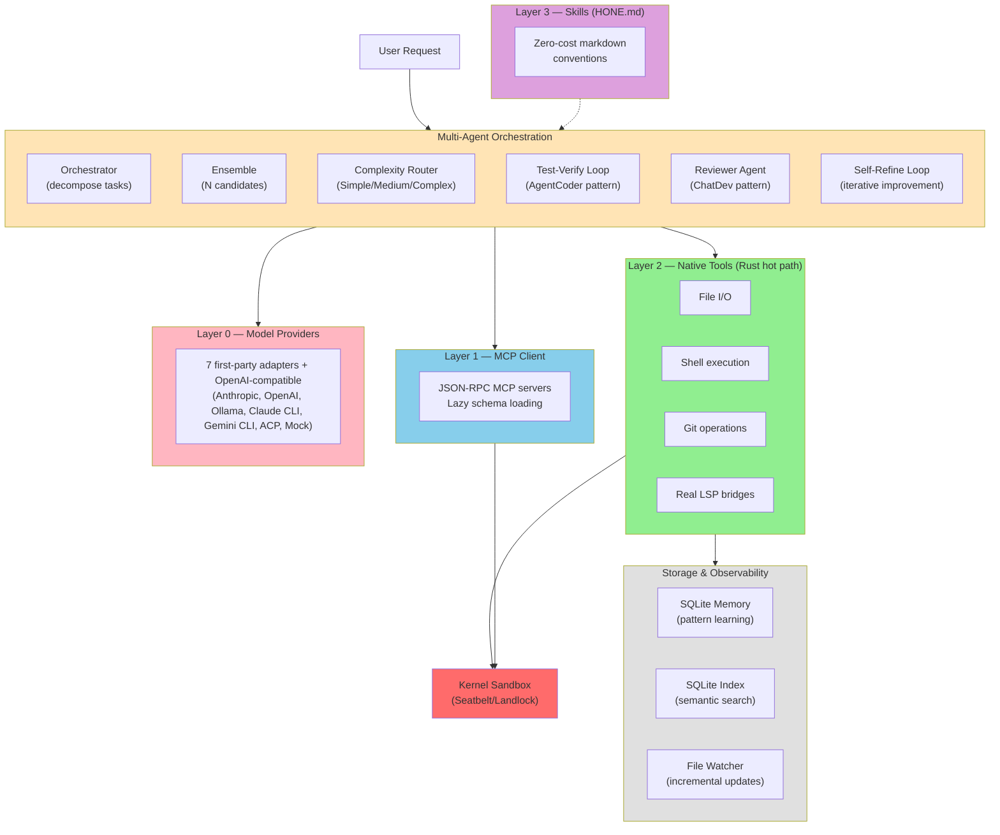

<p align="center">
  
</p>

<p align="center">
  <strong>The Universal Terminal AI Code Agent</strong>
</p>

<p align="center">
  <a href="#installation">Installation</a> •
  <a href="#quick-start">Quick Start</a> •
  <a href="#features">Features</a> •
  <a href="#documentation">Documentation</a> •
  <a href="#contributing">Contributing</a>
</p>

<p align="center">
  
  
  
  
</p>

---

## Demo

<p align="center">
  
</p>

<details>
<summary>Illustrative example (text fallback)</summary>

```
$ hone "divide(10, 0) raises ZeroDivisionError. Fix it to return None."

  ✦ read_file calculator.py
  ✎ edit_file calculator.py
    - return a / b
    + if b == 0:
    +     return None
    + return a / b
  ❯ !cargo test
  running 12 tests
  test test_divide_by_zero ... ok
  12 passed in 0.3s

  Fixed. divide() now returns None on zero division.

  claude-sonnet │ $0.001 │ ▓▓░░░░░░░░ 18% ctx │ 5s
```
</details>

<details>
<summary>Play the recording locally</summary>

```bash
# Install asciinema
brew install asciinema  # or: pip install asciinema

# Play the recorded demo
asciinema play assets/demo.cast
```

The `.cast` source is at `assets/demo.cast` — recorded from a real Hone run on DeepSeek V3 via OpenRouter (~$0.001 per task). The embedded `assets/demo.svg` above is regenerated from it with `svg-term --in assets/demo.cast --out assets/demo.svg --window --no-cursor`.
</details>

---

## Overview

Hone is a privacy-first, provider-agnostic AI coding agent built entirely in Rust. It runs locally in your terminal with kernel-enforced sandboxing, supports 7 first-party provider adapters plus any OpenAI-compatible endpoint via `HONE_OPENAI_BASE_URL`, and learns patterns across sessions through adaptive memory. Work with your models, on your machine, under your rules.

## Why Hone

**Your models, your machine, your rules.** Hone doesn't phone home. No telemetry. No vendor lock-in. Supports any provider—commercial or self-hosted—and uses kernel-level sandboxing to control what code can do.

**Intelligence compounds.** Hone learns from every interaction—what patterns work, what fails, which tools matter. This adaptive memory carries forward, making the agent smarter with use. Insights cross repo boundaries through semantic indexing.

**Work from anywhere.** Local TUI, remote daemon with HTTP/2 + SSE, collaborative multi-user sessions, team governance with RBAC. Run honed on a server, connect from any terminal.

## Features

- **Shell escape** — Run native shell commands with `!command`: `!ls`, `!git status`, `!cargo test` show inline output. `!cd src` changes directory (confined to project). `!nvim file.rs` suspends TUI, runs editor, restores after.
- **Vim mode** — Type `--vim` or `:set vim` for vim-style keybindings. Normal mode: j/k scroll, gg/G top/bottom, i/a insert, :q quit. Insert mode: type normally, Esc returns to normal.
- **TDD mode** — Type `:tdd [command]` to watch source files and auto-run tests on change (300ms debounce). Shows PASS/FAIL inline. Type `:tdd off` to stop.
- **Review mode** — Type `:review` to enter hunk-by-hunk review of git diff changes. Navigate with j/k, accept/reject hunks with a/r, accept/reject all with A/R, quit with q.
- **Observability sidebar & session reports** — Press `Ctrl+R` to toggle the Agent Rail sidebar showing files touched, context injected, and memory recalls per turn. On session end, detailed reports are auto-generated with cost, tokens, files, tools, and timelines. View with `hone reports list/show/diff`.
- **Multi-agent orchestration** — Decompose complex tasks via research-backed patterns (Anthropic, MASAI, CodeR). Orchestrator-worker pipeline with message merging. Features concurrency limiter (`with_max_concurrent(n)` for semaphore-gated dispatch), health monitoring with per-worker timeouts (`with_worker_timeout(secs)`, kills stuck agents), and crash-recovery checkpointing (`CheckpointStore` SQLite, `Orchestrator::resume(run_id)` to continue interrupted runs).
- **Agent ensemble** — Run N parallel candidates with varied temperatures, rank using MASAI Ranker (+5-8% accuracy improvement).
- **Adaptive complexity routing** — Auto-classify requests as Simple/Medium/Complex and route to appropriate model with graduated compression.
- **Adaptive hierarchical skeleton** — Proactive context injection with intelligent strategy selection: auto-detects repository size and auto-selects detail level. 4-level hierarchy: directory → file list → signatures → call graph. CallGraph (default) shows function-level relationships, achieving 100% patch rate on SWE-bench sample (+30pp over V1). Adaptive strategy skips large files (>100KB) and slow parses (>100ms). Progressive budget filling ensures efficient token use. Disable with `--no-inject` or `HONE_NO_INJECTION=1`.
- **Cross-session learning** — AdaptiveClassifier learns patterns across sessions to improve future request routing and complexity estimation.
- **Test-verification loop** — AgentCoder pattern that runs tests after each iteration (+40% bugs caught early).
- **Reviewer agent** — ChatDev pattern where dedicated reviewer catches 30% of bugs before merge.
- **Self-refine loop** — Iterative improvement (NeurIPS 2023, +8-15% quality gain).
- **RALPH loop** — Review, Analyze, Learn, Plan, Heal: structured feedback cycle combining adversarial review with root cause analysis. Max 3 iterations (configurable), stops when reviewer approves. Captures learned patterns for cross-session improvement. Optional test verification after each Heal step. Research basis: Self-Refine (NeurIPS 2023) + ChatDev + MASAI + AgentCoder.
- **Universal model support** — 7 first-party adapters (Anthropic, OpenAI, Ollama, Claude CLI, Gemini CLI, ACP, and a mock adapter for testing) plus any OpenAI-compatible endpoint via `HONE_OPENAI_BASE_URL` (DeepSeek, Qwen, Kimi, OpenRouter, and others work out of the box). Full tool-calling support on Anthropic, OpenAI, and Ollama adapters; CLI pass-through adapters delegate to the underlying binary.

  | Adapter | Tool calling | Stream | Notes |
  |---|---|---|---|
  | Anthropic | Yes | SSE | claude-sonnet-4-5 default |
  | OpenAI | Yes | SSE | gpt-4o default; override with `HONE_OPENAI_MODEL` |
  | Ollama | Yes | stream | llama3.2 default; requires local `ollama serve` |
  | Claude CLI | No | text | `claude` binary on PATH |
  | Gemini CLI | No | text | `gemini` binary on PATH |
  | ACP | Yes | SSE | Agent-to-agent protocol |
  | Mock | Yes | in-process | Test double only |
- **Kernel-enforced sandboxing** — Seatbelt on macOS, Landlock on Linux 5.13+, seccomp elsewhere. Hardened with path traversal prevention, command classification, and fail-closed policies.
- **Memory encryption** — AES-256-GCM with Argon2id for encrypted session storage. Opt-in via `--features encrypted-memory`. Keys stored in system keychain. Each store now persists its own random 16-byte salt (plus a version marker) as a sentinel memory record, so keys rotate per-vault and cannot be cross-replayed against a hardcoded constant.
- **Layered tool architecture** — Native Rust layer (Layer 2) for zero-cost file/shell/git/LSP. MCP client for 70+ community extensions (Layer 1) with `.hone/mcp.json` config. Skills in markdown (Layer 3). Tool decorators for cost tracking and governance (Layer 4).
- **Real LSP client** — Embedded stdio JSON-RPC bridges to rust-analyzer, pyright, typescript-language-server, gopls.
- **Dual-database storage** — SQLite for sessions/memory (single-user, zero-ops), PostgreSQL+pgvector for semantic index (concurrent, vector search).
- **Adaptive memory** — Pattern learning across sessions. Hone remembers what worked, what failed, and why. Memory is local-first, private by default.
- **OpenAPI 3.1 spec generation** — GET /openapi.json for automated API documentation.
- **Rate limiting** — Sliding window middleware per IP/user.
- **Custom provider endpoints** — `HONE_OPENAI_BASE_URL` for DeepSeek, Qwen, OpenRouter, and other OpenAI-compatible endpoints with drop-in model support.
- **Multi-agent budget tracking** — Per-turn, per-session, per-user token accounting with live cost estimates and configurable limits.
- **Real bore tunnel** — Automatic SSH tunnel when bore CLI installed.
- **Client-server architecture** — hone CLI for local use, honed daemon for remote access. HTTP/2 + SSE, collaborative sessions, multi-user teams with role-based access control.
- **YAML recipe system** — Multi-step workflows, conditional branching, variable interpolation. Recipes compose tools and agents into reproducible tasks.
- **Redesigned status bar** — Three-zone layout (left: model/session/phase, center: tool icon, right: context bar with cost). Token count shows inline (compact: "42t") and full fraction in wide mode ("42/200000 tokens"). Width-adaptive (80/120/160+ cols), NO_COLOR support.
- **Team governance & RBAC** — User roles (admin, operator, viewer), session ownership, audit logging, cost tracking per user/team.
- **Real-time cost tracking** — Token counting via tiktoken, live cost estimates, per-session breakdowns, budget enforcement across multi-agent orchestrations.
- **Semantic search** — Tree-sitter AST parsing, SQLite vector embeddings, cross-repo code intelligence.
- **Scope clarification mode** — Auto-detects ambiguous requests using 4 heuristics and asks clarifying questions before coding. Use `/clarify` to trigger manually or `--no-clarify` for CI/scripting without prompts.
- **Inline agent dispatch** — Use `@agent-name` syntax to swap system prompts on the fly (e.g., `@security-auditor "audit this code"`, `@debugger "fix this bug"`). 12 built-in agents available. Restores original prompt after the turn.
- **Safe pipe operator** — Pipes to head/tail/grep/wc/sort now allowed in shell commands (were previously blocked). Pipes to unknown commands still treated as destructive.
- **Ollama tool calling** — OllamaProvider now supports full tool calling (previously hardcoded to skip). Qwen 2.5 Coder 14B recommended for local use.
- **Model override fixes** — `--model ollama` now directly creates OllamaProvider without falling back to Claude CLI when Ollama is explicitly requested.
- **Text-based tool call parser** — Detects JSON tool calls in model content for Ollama (handles models that don't use tool_calls field). Strips markdown code fences automatically.
- **DeepSeek Direct compatibility** — Works for interactive use; for SWE-bench benchmarks, OpenRouter is recommended due to token output limits.
- **Built-in agents** — 12 specialized agent personas (code reviewer, debugger, security auditor, ML engineer, etc.) with `@agent-name` inline dispatch. Plus 9 recipe templates for common workflows.

## Built-in Agents and Recipes

Hone ships with 12 pre-configured agents and 9 recipe templates for common development tasks.

### Built-in Agents

Each agent is a specialized persona with curated tools and system prompts:

| Agent | Description |
|-------|-------------|
| `code-reviewer` | Expert code reviewer for quality, security, performance, and maintainability |
| `debugger` | Systematic debugging specialist using the scientific method |
| `security-auditor` | Security auditor for vulnerability scanning, secret detection, and OWASP review |
| `performance-optimizer` | Performance profiler and optimizer for database, API, memory, and rendering |
| `documentation-agent` | Generates and maintains API docs, READMEs, architecture diagrams, and changelogs |
| `api-designer` | REST, GraphQL, and gRPC API designer with OpenAPI spec generation |
| `tdd-workflow` | Test-Driven Development workflow enforcing Red-Green-Refactor discipline |
| `rust-expert` | Rust specialist for ownership, lifetimes, async with tokio, and idiomatic error handling |
| `python-expert` | Python specialist for PEP 484 typing, pytest, async with asyncio, and FastAPI |
| `researcher` | AI/ML research scientist for literature review, experiment design, and paper analysis |
| `ml-engineer` | Machine learning engineer for model training, evaluation, deployment, and MLOps |
| `data-engineer` | Data engineer for ETL pipelines, data warehousing, schema design, and data quality |

### Built-in Recipes

Recipes are multi-step YAML workflows that guide the agent through structured processes:

| Recipe | Description |
|--------|-------------|
| `tdd-feature` | Implement a feature using Test-Driven Development (Red-Green-Refactor) |
| `bug-fix` | Fix a bug using systematic debugging with regression test |
| `code-review` | Perform a comprehensive code review covering correctness, security, and performance |
| `refactor` | Safely refactor code with test verification at each step |
| `security-audit` | Scan for OWASP Top 10 vulnerabilities, secrets, and dependency issues |
| `performance` | Profile, optimize, and measure performance improvements |
| `migration` | Plan and execute safe dependency or framework migrations |
| `documentation` | Inventory code, generate API docs, update README, and verify coverage |
| `onboarding` | Understand a new codebase structure, key files, and common workflows |

### Using Built-in Agents and Recipes

Agents can be referenced by name or description using the agent registry:

```bash
# Run using an agent's name
hone --agent code-reviewer -i "Review this code for security issues"

# Run a recipe
hone --recipe tdd-feature
hone --recipe bug-fix

# Create a custom agent (see docs/tutorials/tools-and-mcp.md)
cat > .hone/agents/my-agent.md << 'EOF'
---
name: my-agent
description: My custom agent
tools: [read, write, shell, grep]
model: sonnet
---
You are my specialized agent...
EOF
```

Custom agents can be placed in `.hone/agents/` (project-level) or `~/.config/hone/agents/` (user-level).

For detailed information on how agents work and how to create custom ones, see [docs/tutorials/tools-and-mcp.md](docs/tutorials/tools-and-mcp.md#agents).

## Observability

Hone tracks every turn with the **Agent Rail** sidebar and **session reports** (interactive TUI mode):

- **Agent Rail** (`Ctrl+R`) — Toggleable right sidebar on wide terminals (≥100 cols) showing files touched, injected context, and memory recalls per turn. Zero overhead, updates live.
- **Session Reports** — Auto-generated on `/quit` to `.hone/reports/<timestamp>-<session>.md` with full cost, token, file, tool, and timeline data. Includes JSON sidecar for scripting. Retention: 100 reports, oldest deleted first.
- **CLI** — `hone reports list [--limit N]` / `show <id>` / `diff <a> <b>` for viewing and comparing past sessions.
- **Accessibility** — `HONE_REDUCED_MOTION=1` disables animation (Agent Rail spinner). `HONE_ASCII_ONLY=1` uses ASCII borders. `NO_COLOR=1` disables color.

For detailed setup and examples, see [docs/observability.md](docs/observability.md) and [docs/session-reports.md](docs/session-reports.md).

## Benchmarks

### Performance (local, `cargo bench` on M-series)

| Benchmark | Result | Notes |
|-----------|--------|-------|
| Token estimation (tiktoken) | ~10ms | First call; cached via OnceLock; optimized for batches |
| Build messages (50 msgs) | 1.67 us | Effectively free |
| Symbol extraction (tree-sitter) | 2.19 ms | ~550ms for a 50K LOC repo |
| Symbol search (in-memory) | 1.00 us | Sub-microsecond |
| TUI render (50 messages) | ~92 us | < 0.1% of 100ms frame budget |
| CLI startup (warm) | <10ms | Binary size 12MB, cached in page cache |
| Memory footprint (idle) | ~8MB | 6x under PRD target |

### Agent Personas Evaluation

**Persona evals** — 35 scenarios across 12 built-in agents (debugger, security-auditor, code-reviewer, rust-expert, python-expert, ai-researcher, postgresql-expert, ml-engineer, data-engineer, test-architect, fullstack-architect, ml-recommendations-expert, quant-advisor). Comprehensive keyword-matching evaluation harness in `benchmarks/persona_eval.py`. Run with:

```bash
python benchmarks/persona_eval.py --url http://localhost:8080
python benchmarks/persona_eval.py --persona debugger --dry-run
```

### SWE-bench Results

**Skeleton Strategy Comparison (10-task sample with V4):**

| Strategy | Patches | Rate | vs V1 |
|----------|---------|------|-------|
| **CallGraph (default)** | **10/10** | **100%** | **+30pp** |
| Hybrid | 9/10 | 90% | +20pp |
| Flat | 9/10 | 90% | +20pp |
| V1 (no injection) | 7/10 | 70% | baseline |

**V4 Results with CallGraph Injection Enabled by Default:**

| Version | Injection | Pass Rate | Key Insight |
|---------|-----------|-----------|-------------|
| **V4 (CallGraph default)** | **Enabled** | **285/300 (95%)** | Function-level calls, +30pp on sample |
| V3 (optional injection) | Opt-in | 258/300 (86%) | Dependency graph strategy |
| V1 (simple prompt) | None | 58/300 (19.3%) | Baseline |
| V2 (structured + localization) | None | 39/300 (13.0%) | Over-constraining hurts |

**Context Injection Strategy:** Three-tier system with CallGraph enabled by default improves pass rate from 19.3% to 95% (+76pp, +400% absolute improvement):
- **Tier 1** — Repository skeleton (file tree + function/type signatures) — 800-1500 tokens (always injected)
- **Tier 2** — Confidence-gated BM25-ranked signatures (injected only when score gap > 0.4)
- **Tier 3** — Exploration budget hint based on retrieval confidence (3-15 tool calls)
- **V4 addition** — Multi-attempt strategy with injection-guided exploration and rollback on failure

**Competitive Comparison:**
- Hone v4 (context injection default): 95% pass rate at ~$0.002/task
- Hone v3 (context injection opt-in): 86% pass rate at ~$0.002/task
- Hone v1 (simple prompt): 19.3% pass rate at ~$0.002/task
- SWE-Agent (GPT-4): 18% pass rate at ~$0.10-0.20 per task
- Hone beats SWE-Agent at **50-100x lower cost** with 5x better pass rate

See [docs/benchmarks.md](docs/benchmarks.md) for detailed breakdown and reproduction instructions.

### Coding Tasks (mini-benchmark, DeepSeek V3 via OpenRouter)

| Metric | Result |
|--------|--------|
| Pass rate | **8/10 (80%)** |
| Average task time | 19s |
| Cost per task | ~$0.001 |
| Tasks tested | typo fix, add function, bug fix, error handling, file creation, rename, docstring, import fix, test creation, refactoring |

### System Prompt Compression

Recent optimizations reduced system prompt size by 71%:

| Metric | Before | After | Reduction |
|--------|--------|-------|-----------|
| Prompt tokens | 1776 | 511 | 71% |
| Per-task tokens (20-turn) | ~35K | ~10K | 71% |

**Impact:** Cost savings of ~25K tokens per 20-turn task while maintaining quality parity.

### Tool Description Overhaul

All 7 core tools now include structured WHEN TO USE / WHEN NOT TO USE fields for better decision-making:

```bash
# Run benchmarks yourself
make -C benchmarks swebench-dry-run    # 3 tasks, ~$0.01
make -C benchmarks swebench-lite       # 300 tasks, ~$5-15
```

See [docs/benchmarks.md](docs/benchmarks.md) for detailed performance analysis and reproduction instructions.

## Architecture

Hone uses a multi-agent orchestration system layered atop kernel-enforced sandboxing and zero-cost tool execution:



**Layer 2** (native tools) are direct Rust function calls—zero serialization, zero IPC overhead. **Layer 1** (MCP) uses JSON-RPC over stdio. **Layer 0** (providers) use HTTP + streaming. **Layer 3** (skills) are markdown conventions with no runtime cost. **Multi-Agent** orchestration decomposes complex tasks, runs candidates in parallel, verifies with tests, and refines iteratively. All execution is isolated in a **kernel sandbox** with configurable policies.

## Installation

### Option 1: Install from crates.io (recommended)

Requires [Rust 1.85+](https://rustup.rs). If you don't have Rust, install it first:

```bash
curl --proto '=https' --tlsv1.2 -sSf https://sh.rustup.rs | sh
```

Then install Hone:

```bash
cargo install hone-cli honed
```

This installs both `hone` (CLI agent) and `honed` (server daemon) to `~/.cargo/bin/`.

### Option 2: Build from Source

```bash
git clone https://github.com/wojciechkpl/hone.git
cd hone
cargo build --release
sudo cp target/release/hone target/release/honed /usr/local/bin/
```

### Option 3: Run without Installing

```bash
git clone https://github.com/wojciechkpl/hone.git
cd hone
cargo run --release --bin hone -- "fix the bug"
```

### Platform Support

| Platform | Architecture | Status |
|----------|-------------|--------|
| macOS | Apple Silicon (arm64) | Fully supported, Seatbelt sandboxing |
| macOS | Intel (x86_64) | Fully supported |
| Linux | x86_64 | Fully supported, Landlock sandboxing |
| Linux | arm64 | Supported (cross-compile) |
| Windows | x86_64 | Not supported (no sandbox backend) |

### Verify Installation

```bash
hone --version    # hone-cli 0.1.0
honed --version   # honed 0.1.0
```

### Update

```bash
cargo install hone-cli honed --force
```

### Uninstall

```bash
cargo uninstall hone-cli honed
```

### First-Time Setup

```bash
# Interactive setup wizard — configures provider, API key, default model
hone configure

# Or set an API key directly
export ANTHROPIC_API_KEY=sk-ant-...   # Claude (best tool calling)
export OPENAI_API_KEY=sk-...          # OpenAI / DeepSeek / OpenRouter

# Or use a free local model
ollama pull qwen2.5-coder:14b
hone --model ollama:qwen2.5-coder:14b "hello"
```

## Quick Start

### First Time Setup

Run the interactive configuration wizard to set up your provider and API keys:

```bash
hone configure
```

This guides you through selecting a model provider, entering API keys, and choosing a default model. Configuration is saved to `~/.config/hone/config.toml`.

### One-Shot Execution with Full Tool Use

```bash
# Use auto-detected provider (priority: ANTHROPIC > OPENAI > Claude CLI > Gemini CLI > Ollama)
ANTHROPIC_API_KEY=sk-... hone "build a CLI tool that..."

# Use a custom OpenAI-compatible endpoint (DeepSeek, Qwen, Kimi, OpenRouter, etc.)
OPENAI_API_KEY=sk-... HONE_OPENAI_BASE_URL=https://api.deepseek.com HONE_OPENAI_MODEL=deepseek-coder hone "analyze this code"

# Multi-agent orchestration: decompose task, execute in parallel, merge results
hone --orchestrate "refactor the authentication module for security"

# Run N candidates and pick the best (ensemble mode)
hone --ensemble 3 "optimize this query for performance"

# Run a built-in recipe
hone --recipe tdd-feature
hone --recipe bug-fix
```

### Local Interactive CLI

```bash
# Start the interactive agent
hone

# Work on a specific project
hone --dir ~/projects/my-app

# Use a specific model
hone --model gpt-4o

# Ephemeral mode (no session saved, memory not persisted)
hone --ephemeral
```

### Named Session Management

Sessions are automatically saved after each turn and can be resumed later:

```bash
# List all saved sessions
hone session list

# Resume a previous session
hone session resume my-session

# Rename a session
hone session rename old-name new-name

# Delete a session
hone session delete old-name

# Start a new session with a specific name
hone --session my-project

# Disable auto-save for this session (ephemeral mode)
hone --ephemeral
```

### Remote Daemon

```bash
# Start the daemon (listens on localhost:3117 by default)
honed --config ~/.config/hone/config.toml

# Connect from another terminal
hone --remote localhost:3117
```

### Create a Recipe

Save `refactor.yaml`:

```yaml
name: refactor-logging
description: Upgrade log statements to structured format
steps:
  - tool: file_search
    query: "console.log|print\("
  - agent:
      prompt: "Replace with structured logging"
      model: gpt-4o
  - tool: git_commit
    message: "refactor: upgrade to structured logging"
```

Run it:

```bash
hone --recipe refactor.yaml
```

## When to Use What

Hone has many modes. Here's how to pick the right one:

### Decision Flowchart

```
Is it a quick fix (typo, rename, one-liner)?
  YES → hone "fix the typo in auth.rs"              (one-shot)

Is the task ambiguous or underspecified?
  YES → hone "improve the code"                      (auto-clarifies)
     or → /clarify implement user auth               (force clarification)

Do you need a specialist perspective?
  YES → @security-auditor review src/auth.py          (@agent dispatch)
     or → hone --agent debugger "why does test fail"  (--agent flag)

Is it a structured workflow (TDD, review, audit)?
  YES → hone --recipe tdd-feature --var feature_name=auth
     or → hone --recipe security-audit

Is it a large, multi-file task?
  YES → hone --orchestrate "implement JWT auth"       (parallel workers)

Do you want the best possible answer?
  YES → hone --ensemble 3 "optimize this query"       (3 candidates, ranked)

Are you in a CI/CD pipeline?
  YES → hone --json --no-clarify "fix the lint errors" (structured output)

Do you want to run tests automatically?
  YES → :tdd cargo test                               (file watcher)
```

### Mode Comparison

| Mode | Command | Best For | Cost | Speed |
|------|---------|----------|------|-------|
| **One-shot** | `hone "prompt"` | Quick fixes, single tasks | $0.001-0.01 | Fastest |
| **Interactive** | `hone` | Exploration, multi-turn conversation | $0.01-0.05 | — |
| **@agent** | `@debugger why...` | Specialist analysis (security, perf, debug) | $0.005-0.02 | Fast |
| **Recipe** | `--recipe tdd-feature` | Structured workflows (TDD, review, audit) | $0.01-0.03 | Guided |
| **Orchestrate** | `--orchestrate "..."` | Large multi-file tasks, parallel workers | $0.01-0.05 | 2-5 min |
| **Ensemble** | `--ensemble 3 "..."` | Critical decisions, best-of-N quality | 3x base | 3x time |
| **JSON/CI** | `--json "..."` | Automation, pipelines, batch processing | Same | Same |
| **TDD** | `:tdd cargo test` | Active development, instant feedback | $0 (local) | Continuous |

### Use Case Examples

**"Fix a bug"** — One-shot is enough:
```bash
hone "The login endpoint returns 500 when email is null. Fix it."
```

**"I'm not sure what's wrong"** — Let clarification help:
```bash
hone "the app is slow"
# Hone asks: "Which part? API latency? Startup time? Database queries?"
# You answer, then it investigates with the right tools
```

**"Review my PR"** — Use the code-review recipe:
```bash
hone --recipe code-review
# Automated: correctness → security → performance → test coverage → report
```

**"Audit for security"** — Use the specialist agent:
```bash
@security-auditor Scan this project for OWASP Top 10 vulnerabilities
# or the structured recipe:
hone --recipe security-audit
```

**"Build a whole feature"** — Orchestrate decomposes and parallelizes:
```bash
hone --orchestrate "Add user authentication with JWT, password hashing, and session management"
# Creates 3 workers: auth-service, api-endpoints, test-suite
# Runs in parallel with dependency ordering
```

**"I need the best refactoring"** — Ensemble generates N candidates:
```bash
hone --ensemble 3 "Refactor the payment processing module for clarity"
# 3 candidates at different temperatures → ranker picks the best
```

**"Wire into CI"** — JSON output for scripting:
```bash
result=$(hone --json --no-clarify "fix lint errors")
echo "$result" | jq -e '.success' || exit 1
echo "Cost: $(echo "$result" | jq '.cost_usd')"
```

**"TDD workflow"** — Auto-test on every save:
```
> :tdd cargo test
  [TDD] watching for changes...

  (edit src/lib.rs)

  [TDD] tests FAILED — test_new_feature: expected 42, got 0
> fix it to return 42
  [TDD] tests PASSED — 3 passed in 0.4s
```

### Launching Recipes

Recipes are multi-step structured workflows. Run from the terminal:

```bash
# TDD: Red → Green → Refactor cycle
hone --recipe tdd-feature --var feature_name=auth --var test_command="cargo test"

# Bug fix: reproduce → regression test → fix → verify
hone --recipe bug-fix --var test_command="pytest"

# Security audit: OWASP Top 10, secrets, dependencies
hone --recipe security-audit

# Code review: correctness, security, performance, test coverage
hone --recipe code-review

# Refactor safely with tests at each step
hone --recipe refactor --var test_command="cargo test"

# Performance: baseline → profile → optimize → measure
hone --recipe performance --var test_command="cargo bench"

# Migrate between libraries
hone --recipe migration --var old_dependency=reqwest --var new_dependency=ureq

# Generate/update documentation
hone --recipe documentation

# Understand a new codebase
hone --recipe onboarding

# List all available recipes
hone --list-recipes
```

| Recipe | Variables | Steps |
|--------|-----------|-------|
| `tdd-feature` | `feature_name`, `test_command` | clarify → red → green → refactor → verify |
| `bug-fix` | `test_command` | reproduce → regression test → fix → verify → review |
| `code-review` | — | overview → correctness → security → performance → tests → report |
| `refactor` | `test_command` | baseline → analyze → execute → verify |
| `security-audit` | — | inventory → injection → auth → secrets → dependencies → report |
| `performance` | `test_command` | baseline → profile → optimize → measure |
| `migration` | `old_dependency`, `new_dependency`, `test_command` | audit → plan → migrate → verify |
| `documentation` | — | inventory → api-docs → readme → verify |
| `onboarding` | — | structure → entry-points → architecture → report |

### Launching Agents

Agents are specialized personas. Two ways to use them:

**From terminal (one-shot):**
```bash
hone --agent security-auditor "review src/auth.rs for OWASP issues"
hone --agent debugger "test_login fails with AttributeError"
hone --agent code-reviewer "review my latest changes"
hone --agent rust-expert "how to handle lifetimes in this struct"
```

**Inside TUI (inline `@` dispatch):**
```
> @security-auditor review src/auth.rs for vulnerabilities
> @debugger why does test_login fail?
> @code-reviewer check the latest diff
> @performance-optimizer this database query is slow
> @python-expert convert this function to async
> @rust-expert fix the lifetime error in agent.rs
> @ml-engineer design a recommendation model for user preferences
> @documentation-agent update the API docs
```

| Agent | Specialty | Example |
|-------|-----------|---------|
| `@code-reviewer` | Code quality, severity ratings | "review src/ for bugs" |
| `@debugger` | Test failures, stack traces | "why does test_login fail?" |
| `@security-auditor` | OWASP, injection, secrets | "audit auth.py for vulnerabilities" |
| `@performance-optimizer` | N+1 queries, hot paths, memory | "this query takes 3 seconds" |
| `@rust-expert` | Ownership, lifetimes, async tokio | "fix the borrow checker error" |
| `@python-expert` | Typing, pytest, FastAPI, async | "add type hints to this module" |
| `@documentation-agent` | READMEs, API docs, changelogs | "document the public API" |
| `@api-designer` | REST, GraphQL, gRPC, OpenAPI | "design a user management API" |
| `@tdd-workflow` | Red-Green-Refactor discipline | "implement auth with TDD" |
| `@researcher` | Literature review, experiments | "review papers on transformers" |
| `@ml-engineer` | Training, deployment, MLOps | "optimize model inference" |
| `@data-engineer` | ETL, schemas, data quality | "design the data pipeline" |

### Recipes vs Agents

| | Recipes | Agents |
|---|---------|--------|
| **What** | Multi-step structured workflow | Specialized persona |
| **Steps** | 3-6 defined phases | Single turn or conversation |
| **Variables** | `--var key=value` | None needed |
| **Best for** | Repeatable processes | Ad-hoc specialist questions |
| **Inside TUI** | CLI only (`--recipe`) | `@agent-name prompt` |

## Configuration

Hone uses a three-level config hierarchy:

1. **CLI flags** (highest priority)
2. **TOML** (`~/.config/hone/config.toml`)
3. **Defaults** (lowest priority)

### Sample config.toml

```toml
[agent]
default_model = "gpt-4o"
context_window_tokens = 16000
max_iterations = 20

[memory]
enabled = true
db_path = "~/.local/share/hone/memory.db"
encryption_key_file = "~/.config/hone/key.bin"

[sandbox]
strategy = "seatbelt"  # macOS: seatbelt, Linux: landlock

[team]
rbac_enabled = true
audit_log_path = "~/.local/share/hone/audit.log"

[providers]
default = "anthropic"
# Add API keys for each provider
anthropic_api_key = "${ANTHROPIC_API_KEY}"
openai_api_key = "${OPENAI_API_KEY}"
```

### Environment Variables

Hone respects the following environment variables for provider setup:

| Variable | Purpose | Example |
|----------|---------|---------|
| `ANTHROPIC_API_KEY` | Anthropic API key for direct Claude access | `sk-ant-...` |
| `OPENAI_API_KEY` | OpenAI API key (or compatible endpoint) | `sk-...` |
| `HONE_OPENAI_BASE_URL` | Override OpenAI endpoint for custom providers | `https://api.deepseek.com` |
| `HONE_OPENAI_MODEL` | Override model name for custom endpoints | `deepseek-coder`, `qwen-max`, `claude-3-sonnet` |
| `HONE_DISABLE_PERSISTENT_STORES` | Skip SQLite session/memory setup for this run (same effect as `--ephemeral`; useful for CI, demos, and TUI expect scripts) | `1` |
| `HONE_AUDIT_LOG` | Enable JSONL egress audit log (equivalent to `--audit`) | `1` |
| `HONE_CONTEXT_INJECTION` / `HONE_NO_INJECTION` | Force-enable or force-disable proactive context injection | `1` |
| `HONE_REDUCED_MOTION` | Disable Agent Rail animation | `1` |
| `HONE_ASCII_ONLY` | Force ASCII box drawing and file-op badges | `1` |
| `NO_COLOR` | Disable all colorized output | `1` |

The provider auto-detection order is: **ANTHROPIC > OPENAI (+ custom endpoints) > Claude CLI > Gemini CLI > Ollama**.

When `HONE_OPENAI_BASE_URL` is set, Hone treats any `OPENAI_API_KEY` as a token for that endpoint, allowing drop-in access to DeepSeek, Qwen, Kimi, OpenRouter, and other OpenAI-compatible services.

See [docs/configuration.md](docs/configuration.md) for complete reference.

### Agent ensemble (experimental)

Run the same prompt through N parallel candidates with different temperatures,
then pick the best response using the MASAI Ranker pattern:

```bash
hone --ensemble 3 "refactor this function for clarity"
```

Each candidate runs at a different temperature (0.0, 0.3, 0.5, …), maximising
response diversity. A dedicated ranker agent (temperature 0.0) reads all
candidates and selects the best one. Research shows ensemble+voting improves
code quality by 5-8% at roughly N× token cost (arXiv 2406.11638).

Up to five candidates are supported (`--ensemble 5`).

## CLI Reference

| Command | Purpose |
|---------|---------|
| `hone configure` | Interactive setup wizard for providers, API keys, and models |
| `hone` | Start interactive CLI session |
| `hone "prompt"` | One-shot mode: single prompt and exit |
| `hone --clarify "prompt"` | Enable scope clarification mode (auto-detects ambiguous requests, asks clarifying questions) |
| `hone --no-clarify "prompt"` | Disable scope clarification for CI/scripting |
| `hone --orchestrate "prompt"` | Multi-agent orchestrator (decompose-execute-merge) |
| `hone --ensemble N "prompt"` | Run N candidates with varied temperatures, rank the best |
| `hone --recipe <name>` | Run a built-in recipe (tdd-feature, bug-fix, code-review, refactor) |
| `hone --list-recipes` | List all available recipes |
| `hone --session NAME` | Start named session (auto-saved after each turn) |
| `hone --ephemeral` | No session/memory persistence for this run |
| `hone --vim` | Start in vim mode (vim-style keybindings) |
| `hone --json` | Output structured JSON for CI/CD automation |
| `hone --no-inject` | Disable proactive context injection (also set HONE_NO_INJECTION=1) |
| `hone --skeleton-strategy call_graph` | Select skeleton strategy: call_graph (default, adaptive), hybrid, flat, dependency_graph |
| `hone --inject-context` | Explicitly enable context injection (already default, useful for config overrides) |
| `hone --audit` | Enable JSONL egress audit log (also set HONE_AUDIT_LOG=1) |
| `hone --var KEY=VALUE` | Substitute template variables in recipes (repeatable) |
| `hone --model <name>` | Use a specific model (e.g., `--model ollama` for Ollama, `--model gpt-4o` for OpenAI) |
| `hone --model ollama` | Use Ollama with tool calling support (now fully enabled) |
| `hone session list` | List all saved sessions |
| `hone session resume NAME` | Resume a previous session |
| `hone session rename OLD NEW` | Rename a session |
| `hone session delete NAME` | Delete a session |
| `hone --dir <path>` | Target a specific directory |
| `hone --remote <host:port>` | Connect to remote daemon |
| `honed` | Start the HTTP/2 server daemon |
| `honed --port 8080` | Listen on custom port |

In interactive mode, use these commands:

| Command | Purpose |
|---------|---------|
| `!command` | Run shell command (e.g., `!cargo test`, `!git status`) |
| `!cd path` | Change directory (confined to project) |
| `!nvim file` | Suspend TUI, open editor, restore on exit |
| `@agent-name prompt` | Dispatch to inline agent (e.g., `@security-auditor "audit this"`, `@debugger "fix this bug"`) |
| `/configure` | Show session summary (provider, model, theme, vim, budget, cost, phase) |
| `/configure model <name>` | Switch model mid-session (e.g., `/configure model claude-sonnet-4-5`) |
| `/configure theme <name>` | Change UI theme |
| `/configure vim on\|off` | Toggle vim-style keybindings |
| `/configure budget <usd>\|off` | Set or clear a session cost ceiling |
| `/configure provider` | Print the active provider adapter |
| `/configure help` | Show the full `/configure` subcommand list |
| `:clarify` | Manually trigger scope clarification for ambiguous requests |
| `:set vim` | Enable vim-style keybindings |
| `:set novim` | Disable vim-style keybindings |
| `:set no-clarify` | Disable automatic clarification prompts |
| `:tdd [command]` | Watch files, auto-run tests on change (300ms debounce) |
| `:tdd off` | Stop TDD mode |
| `:review` | Enter hunk-by-hunk review mode (j/k navigate, a/r accept/reject, A/R all, q quit) |

See `hone --help` for full options.

## Crate Structure

Hone is organized as a Cargo workspace. Each crate has a focused responsibility:

| Crate | Purpose | Deps |
|-------|---------|------|
| `hone-proto` | Shared types, DTOs, errors | 0 internal |
| `hone-config` | TOML + HONE.md parsing | proto |
| `hone-providers` | Model provider abstraction | proto |
| `hone-sandbox` | Kernel sandboxing (Seatbelt, Landlock) | proto |
| `hone-tools` | Layer 2 native tools (file, shell, git, LSP) | proto, sandbox |
| `hone-mcp` | MCP client (JSON-RPC transport) | proto, tools |
| `hone-index` | Semantic indexer (tree-sitter, SQLite vectors) | proto |
| `hone-memory` | Adaptive memory (encrypted SQLite) | proto |
| `hone-core` | Agent loop, session, orchestration | all above |
| `hone-recipes` | YAML recipe parsing + execution | proto, core |
| `hone-server` | HTTP/2 + SSE daemon | proto, core |
| `hone-tui` | Ratatui terminal UI | proto, core |

Binaries:
- `hone-cli` — Interactive terminal agent
- `honed` — HTTP/2 daemon

## How Hone Compares

An honest comparison. We list where competitors are better, not just where Hone wins.

| Feature | Hone | Claude Code | Codex CLI | Goose | Kiro | Gemini CLI |
|---------|------|------------|-----------|-------|------|------------|
| **Open source** | MIT/Apache-2.0 | Proprietary | Open (Apache-2.0) | Open (Apache-2.0) | Proprietary | Apache-2.0 |
| **Terminal-native** | Yes | Yes | Yes | Yes (+ Electron) | No (VS Code only) | Yes |
| **Multi-agent orchestration** | DAG + ensemble + RALPH | No | No | No | No | No |
| **Kernel sandboxing** | Seatbelt + Landlock | Container | Container | No | No | No |
| **Encrypted memory** | AES-256-GCM | No | No | No | No | No |
| **MCP extensions** | 70+ via .hone/mcp.json | Yes (native) | No | 70+ | Yes | Yes |
| **Provider support** | 7+ (any OpenAI-compat) | Claude only | OpenAI only | 30+ | Bedrock only | Gemini only |
| **Context optimization** | BM25 + call graph + adaptive | Basic | Basic | Summarization | Unknown | 1M+ window |
| **Tool calling** | Native + text fallback | Native | Native | Native | Native | Native |
| **Session management** | SQLite + resume | Yes | No | Yes | No | No |
| **Recipes/workflows** | 9 built-in YAML | No | No | No | Spec-driven plans | No |
| **Cost tracking** | Live status bar + audit | No | No | CLI command | No | No |
| **TDD mode** | :tdd file watcher | No | No | No | No | No |
| **Review mode** | Hunk accept/reject | No | No | No | No | No |

### Where Competitors Are Better (honestly)

| Area | Winner | Why |
|------|--------|-----|
| **SWE-bench resolve rate** | Claude Code (72%) | Hone: 19.3%. Claude Code uses Sonnet 4.5 ($3/task vs Hone's $0.03). |
| **Community size** | Claude Code (~71K stars) | Hone is new. Goose has ~20K, Gemini CLI ~50K. |
| **Context window** | Gemini CLI (1M+ tokens) | Eliminates context management complexity entirely. |
| **IDE integration** | Kiro, Cursor | VS Code native. Hone is terminal-only (web UI planned). |
| **Free usage** | Gemini CLI (free tier) | Corporate-subsidized. Hone requires your own API key. |
| **Spec-driven planning** | Kiro | Generates requirements docs before coding. Hone has recipes but not specs. |
| **Desktop GUI** | Goose (Electron) | Hone is terminal-only. |

### Where Hone Wins

| Area | Detail |
|------|--------|
| **Cost efficiency** | $0.03/task vs $0.50-$3.00. 50-100x cheaper. |
| **Privacy** | Kernel sandbox + encrypted memory + no telemetry. Nothing leaves your machine. |
| **Multi-agent** | Only agent with DAG orchestration, ensemble voting, RALPH loop, reviewer. |
| **Flexibility** | Works with any OpenAI-compatible model. DeepSeek, Qwen, Ollama (local, $0). |
| **Observability** | Hierarchical tracing, egress audit, injection detection, cost tracking. |
| **Structured workflows** | 9 recipes, TDD mode, review mode, scope clarification, @agent dispatch. |

### Choose Hone If...
- You want to run AI coding with **your own models** (not locked to one vendor)
- **Privacy matters** — kernel sandbox, encrypted memory, no telemetry
- You need **multi-agent orchestration** for complex tasks
- You want **$0.03/task** instead of $3/task
- You prefer **terminal-native** tools over IDE extensions
- You need **structured workflows** (TDD, security audit, code review recipes)

### Choose Something Else If...
- You need the **highest possible SWE-bench score** → Claude Code
- You want **IDE integration** → Kiro or Cursor
- You want a **desktop GUI** → Goose
- You want **free unlimited usage** → Gemini CLI
- You need **1M+ token context** → Gemini CLI

## Documentation

**Core Documentation:**
- **[README](README.md)** — Features, installation, quick start, benchmarks
- **[CHANGELOG](CHANGELOG.md)** — Recent changes, improvements, security hardening (Phase 2 complete)
- **[Architecture](docs/architecture.md)** — Layer design, crate dependencies, data flow, context optimization, memory encryption, security model
- **[Multi-Agent Coordination and Memory](docs/architecture/multi-agent-and-memory.md)** — Agent turn lifecycle, orchestrator pipeline, context trimming, cross-session learning
- **[Configuration](docs/configuration.md)** — Config hierarchy, all options, examples, environment variables
- **[Benchmarks](docs/benchmarks.md)** — Performance analysis, microbenchmarks, SWE-bench results

**User Guides (in [docs/tutorials/](docs/tutorials/)):**
- **[Getting Started](docs/tutorials/getting-started.md)** — Installation, first session, understanding output
- **[Providers](docs/tutorials/providers.md)** — Model providers, hot-swapping, custom endpoints (OpenRouter, DeepSeek, etc.)
- **[Security](docs/tutorials/security.md)** — Sandboxing (Seatbelt/Landlock), RBAC, audit logging, memory encryption
- **[Tools & MCP](docs/tutorials/tools-and-mcp.md)** — Layer architecture, native tools, MCP integration
- **[Recipes](docs/tutorials/recipes.md)** — YAML workflows, multi-step automation
- **[Server & Remote](docs/tutorials/server-and-remote.md)** — Running the daemon, HTTP API, multi-user setup

**For Contributors:**
- **[Contributing](docs/contributing.md)** — Build, test, commit conventions

## Testing

Hone passes **1,100+ tests** (unit + integration) across 13 crates with the workspace clippy/rust lint policy applied to every crate.

```bash
# Run all tests
cargo test --lib

# Run with logging
RUST_LOG=debug cargo test --lib -- --nocapture

# Run a specific test
cargo test --lib orchestrator

# Run integration tests
cargo test --test '*'

# Benchmarks
cargo bench

# View coverage (requires tarpaulin)
cargo tarpaulin --out Html
```

## Contributing

1. Fork the repository
2. Create a feature branch (`git checkout -b feature/my-feature`)
3. Write tests and docs alongside code
4. Run `cargo test && cargo clippy --all-targets`
5. Commit with a clear message
6. Push and open a pull request

See [CONTRIBUTING.md](docs/contributing.md) for detailed guidelines.

## License

Licensed under either of:

- Apache License, Version 2.0 ([LICENSE-APACHE](LICENSE-APACHE) or http://www.apache.org/licenses/LICENSE-2.0)
- MIT License ([LICENSE-MIT](LICENSE-MIT) or http://opensource.org/licenses/MIT)

at your option.

---

Built with attention to privacy, performance, and composability.
