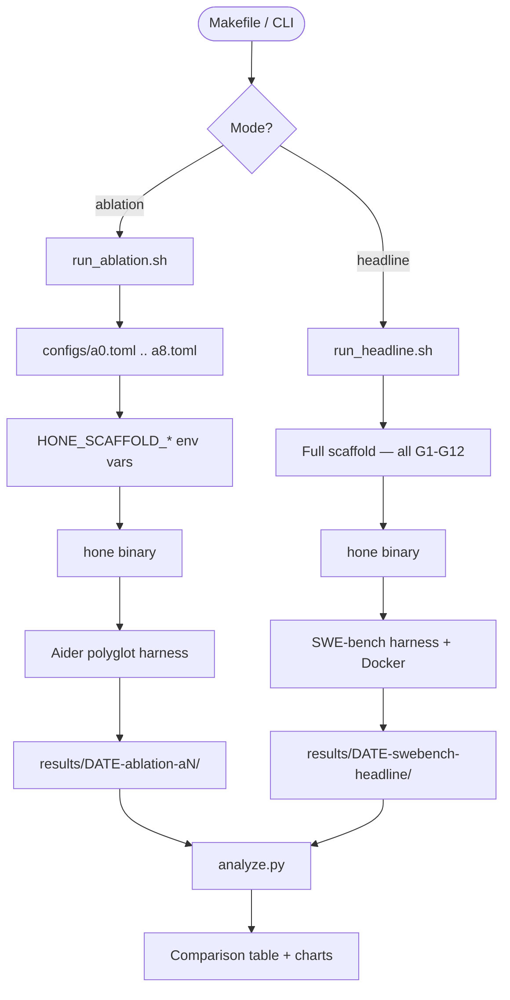
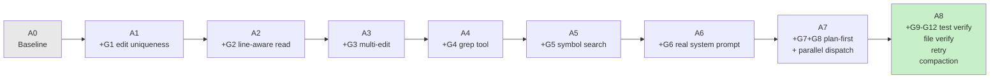
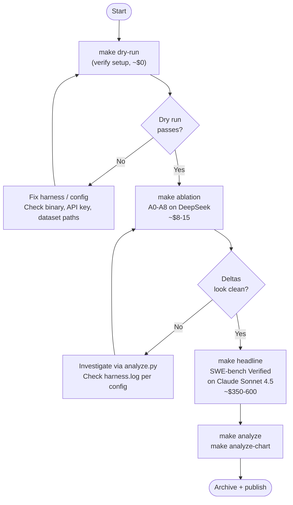
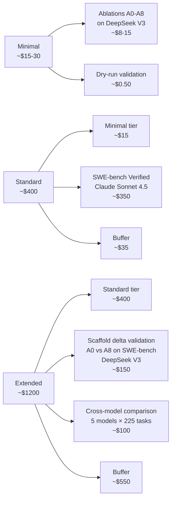

# Hone Benchmark Harness

This directory contains the benchmarking harness for Hone.  It implements the
protocol described in `priv/benchmarking-protocol.md` and the cheap-model
addendum in `priv/benchmarking-with-cheaper-models.md`.

---

## Overview

The harness supports two run modes:

| Mode | Script | Model | Purpose |
|------|--------|-------|---------|
| **Ablation** | `run_ablation.sh` | DeepSeek V3 (or any OpenAI-compat) | Isolate scaffold contribution of each improvement |
| **Headline** | `run_headline.sh` | Claude Sonnet 4.5 (fixed) | Publishable leaderboard number |

Ablations run on the **Aider polyglot benchmark** (225 tasks, 6 languages).
The headline run uses **SWE-bench Verified** (500 tasks).

---

## Architecture



---

## Ablation Configurations

Each configuration **cumulatively** adds one scaffold improvement.  A8 is the
full scaffold used for the headline run.



| Config | Tag | New features |
|--------|-----|--------------|
| A0 | `baseline` | None — pre-sprint behaviour |
| A1 | `+G1` | Edit uniqueness enforcement |
| A2 | `+G2` | Line-aware read with offset/limit |
| A3 | `+G3` | Multi-edit tool |
| A4 | `+G4` | Grep tool |
| A5 | `+G5` | Symbol search (LSP-backed index) |
| A6 | `+G6` | Full production system prompt |
| A7 | `+G7+G8` | Plan-first workflow, parallel tool dispatch |
| A8 | `+G9-G12` | Test verify, file verify, retry, context compaction |

---

## Decision Flow



---

## Prerequisites

### All runs

```bash
# 1. Build hone (pinned Cargo.lock, reproducible)
cargo build --release --locked
./target/release/hone --version

# 2. Python 3.11+ for harness scripts
python3.11 --version

# 3. Aider polyglot dataset (required for ablations)
git clone https://github.com/Aider-AI/polyglot-benchmark /data/bench/polyglot
cd /data/bench/polyglot && git checkout v0.75.0
```

### Ablation runs

```bash
# DeepSeek (recommended — cheapest, strong tool calling)
export OPENAI_API_KEY=sk-ds-...
export HONE_OPENAI_BASE_URL=https://api.deepseek.com
export HONE_OPENAI_MODEL=deepseek-chat

# Alternatively: OpenRouter (single key, many models)
export OPENAI_API_KEY=sk-or-...
export HONE_OPENAI_BASE_URL=https://openrouter.ai/api
export HONE_OPENAI_MODEL=deepseek/deepseek-v3
```

### Headline run (additional requirements)

```bash
# Claude Sonnet 4.5 API key
export ANTHROPIC_API_KEY=sk-ant-...

# Docker 24+ (SWE-bench Verified builds ~120 Docker images)
docker --version  # must be 24+

# SWE-bench Python tools
python3.11 -m venv /opt/benchvenv && source /opt/benchvenv/bin/activate
pip install 'swebench==3.0.13' 'sb-cli==0.2.*' 'datasets==2.21.*'

# Pre-download SWE-bench Verified dataset (~2 GB)
python3 -c "
from datasets import load_dataset
load_dataset('princeton-nlp/SWE-bench_Verified', split='test') \
    .save_to_disk('/data/bench/swebench_verified')
"

# Disk space: ~150 GB free required (100 GB for Docker images)
df -h .
```

---

## How to Run

### 1. Dry-run first (always)

```bash
# Verify setup without spending money or invoking the harness
make -f benchmarks/Makefile dry-run
```

Expected output: a list of `DRY-RUN:` prefixed commands for each of A0-A8.

### 2. Ablation suite (cheap model)

```bash
# Full ablation — all 9 configs, 225 tasks each (~$8-15, ~2-4 hours)
OPENAI_API_KEY=sk-... make -f benchmarks/Makefile ablation

# Single config (useful for debugging or spot-checking)
make -f benchmarks/Makefile ablation ABLATION_CONFIG=a6

# Resume after interruption (skips already-completed configs)
make -f benchmarks/Makefile ablation-resume

# Cap tasks for a quick sanity check (10 tasks per config)
make -f benchmarks/Makefile ablation TASK_LIMIT=10
```

### 3. Headline run (Claude Sonnet)

```bash
# Dry-run first — verify Docker, dataset, API key
make -f benchmarks/Makefile dry-run-headline

# Full 500-task run (~$350-600, ~8-16 hours on 4 concurrent workers)
ANTHROPIC_API_KEY=sk-ant-... make -f benchmarks/Makefile headline

# Resume after interruption
make -f benchmarks/Makefile headline-resume
```

### 4. Analyze results

```bash
# Pretty table of all runs
make -f benchmarks/Makefile analyze

# Ablation comparison only
make -f benchmarks/Makefile analyze BENCHMARK=aider_polyglot

# Generate PNG charts (requires matplotlib)
pip install matplotlib
make -f benchmarks/Makefile analyze-chart

# Export as CSV
make -f benchmarks/Makefile analyze-csv

# With 95% bootstrap confidence intervals (10k resamples, slower)
make -f benchmarks/Makefile analyze-ci
```

---

## Environment Variables Reference

| Variable | Default | Description |
|----------|---------|-------------|
| `OPENAI_API_KEY` | — | Required for ablation runs |
| `ANTHROPIC_API_KEY` | — | Required for headline run |
| `HONE_OPENAI_BASE_URL` | `https://api.deepseek.com` | Provider endpoint (any OpenAI-compat) |
| `HONE_OPENAI_MODEL` | `deepseek-chat` | Model name sent to the endpoint |
| `HONE_BENCH_USD_CAP` | `25` (ablation) / `600` (headline) | Hard USD cap per run |
| `HONE_BENCH_REQ_PER_MIN` | `50` | Client-side rate limit |
| `POLYGLOT_BENCH_DIR` | `/data/bench/polyglot` | Path to Aider polyglot repo |
| `SWEBENCH_DATASET_DIR` | `/data/bench/swebench_verified` | Path to SWE-bench dataset |
| `HONE_BIN` | `./target/release/hone` | Path to hone binary |
| `RESULTS_DIR` | `./benchmarks/results` | Root results directory |

### Scaffold feature flags (set automatically by the harness)

The harness translates each TOML config into `HONE_SCAFFOLD_*` environment
variables that `main.rs` reads at startup:

| Variable | Config range |
|----------|-------------|
| `HONE_SCAFFOLD_EDIT_UNIQUENESS` | A1+ |
| `HONE_SCAFFOLD_LINE_AWARE_READ` | A2+ |
| `HONE_SCAFFOLD_MULTI_EDIT` | A3+ |
| `HONE_SCAFFOLD_GREP_TOOL` | A4+ |
| `HONE_SCAFFOLD_SYMBOL_SEARCH` | A5+ |
| `HONE_SCAFFOLD_REAL_SYSTEM_PROMPT` | A6+ |
| `HONE_SCAFFOLD_PLAN_FIRST` | A7+ |
| `HONE_SCAFFOLD_PARALLEL_TOOLS` | A7+ |
| `HONE_SCAFFOLD_TEST_VERIFY` | A8 |
| `HONE_SCAFFOLD_FILE_VERIFY` | A8 |
| `HONE_SCAFFOLD_TOOL_RETRY` | A8 |
| `HONE_SCAFFOLD_CONTEXT_COMPACTION` | A8 |

---

## Cost Estimates



| Benchmark | Tasks | Model | Est. $/task | Total |
|-----------|-------|-------|------------|-------|
| Aider polyglot × 9 configs | 2,025 | DeepSeek V3 | $0.004 | ~$8 |
| Aider polyglot × 9 configs | 2,025 | Sonnet 4.5 | $0.08 | ~$160 |
| SWE-bench Verified | 500 | Sonnet 4.5 | $0.70-1.20 | ~$350-600 |

> Prompt caching (default: on for Anthropic) reduces effective input token
> cost by ~60% on repeat-access paths.  DeepSeek does not expose cache metrics;
> ablation cost tables use uncached rates.

---

## Results Directory Layout

```
benchmarks/results/
  2026-04-12-ablation-a0/
    metadata.yaml       # hone_sha, model, config, date, completed flag
    summary.csv         # one canonical row per the protocol schema
    tasks.jsonl         # per-task: id, resolved, usd, tokens, turns, wall_s
    events/<id>.jsonl   # full Hone event log per task
    harness.log         # stdout/stderr from the benchmark harness
    .completed          # sentinel written after successful run

  2026-04-12-swebench-headline/
    metadata.yaml
    summary.csv
    tasks.jsonl
    events/
    harness.log
    hone.sha            # binary SHA recorded before the run
    billing.json        # raw provider usage export (if available)
    .completed
```

### Canonical summary row format

```
hone_sha, model, benchmark, config, pass_at_1, resolved, total,
usd_total, usd_per_resolved, p50_wall_s, p95_wall_s, median_turns,
input_tok, output_tok, cache_hit_rate, run_date
```

---

## Reproducibility

An external contributor should be able to reproduce the Aider polyglot result
on a laptop in under 4 hours for under $25.

Checklist (per `priv/benchmarking-protocol.md` §9):

- [ ] Hardware: 8+ cores, 32 GB RAM, 200 GB SSD, macOS 14+ / Ubuntu 22.04
- [ ] Rust 1.85.0 via rustup: `rustup default 1.85.0`
- [ ] Docker 24+ (headline run only)
- [ ] Hone built with `--locked` at tagged SHA
- [ ] Dataset downloaded from pinned tag (`v0.75.0` for Aider polyglot)
- [ ] `OPENAI_API_KEY` / `ANTHROPIC_API_KEY` set, budget cap configured
- [ ] `make dry-run` passes on 5 tasks
- [ ] Full run completes within 2× published wall-clock
- [ ] `python3 benchmarks/analyze.py` shows pass@1 within ±2 pp of published

---

## Pinned Model IDs

Pin these **exact** model IDs in scripts and metadata.  Never use aliases like
`latest`, `deepseek-coder`, or `claude-sonnet` — they may silently route to
different model versions between runs.

| Model | Exact ID | Provider |
|-------|----------|----------|
| Headline run | `claude-sonnet-4-5-20250514` | Anthropic |
| Ablation default | `deepseek-chat` @ `https://api.deepseek.com` | DeepSeek |
| Ablation alternative | `deepseek/deepseek-v3` @ `https://openrouter.ai/api` | OpenRouter |
| Ablation alternative | `Qwen/Qwen3-Coder-480B-A35B-Instruct` @ `https://api.together.xyz` | Together |

---

## Related Documents

- `priv/benchmarking-protocol.md` — Full protocol, metric definitions, publication strategy
- `priv/benchmarking-with-cheaper-models.md` — Rationale for cheap-model ablations
- `priv/scaffold-gap-analysis.md` — The G1-G12 scaffold gap taxonomy
