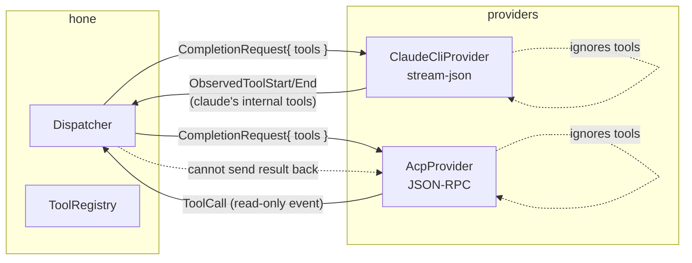
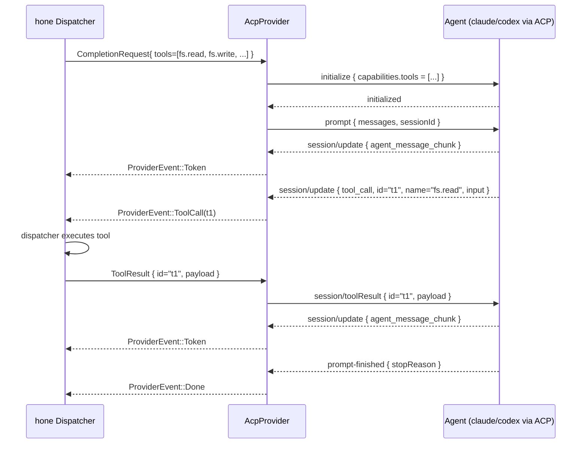

# ACP Tool-Call Dispatch — Implementation Plan

Status: **complete** — all 6 cycles landed; see `CHANGELOG.md` (Unreleased) and `crates/hone-providers/tests/acp_full_lifecycle.rs` for the end-to-end contract.

Last gap closing the Goose Generation 2 parity work for hone's CLI passthrough providers.

## Where we are today

| Provider | `request.tools` consumed? | Routes `ToolCall` to dispatcher? | Sends `ToolResult` back to agent? |
|---|---|---|---|
| `ClaudeCliProvider` (stream-json) | No | No (only `ObservedTool*`) | No |
| `AcpProvider` (JSON-RPC) | No | Emits `ProviderEvent::ToolCall` | **No — fire-and-forget** |

Both providers report `supports_tools: false` in their `ModelInfo` because hone-supplied tools cannot make a round-trip through them.

## What "full ACP tool-call dispatch" means

Three operations need to work end-to-end:

1. **Schema announcement** — `request.tools` must reach the agent process so the model knows what it can call.
2. **Tool-call surfacing** — when the model emits a tool call, the provider must yield a `ProviderEvent::ToolCall` carrying `id`, `name`, and parsed `arguments`.
3. **Result return** — hone's dispatcher executes the tool and the provider must transmit the `ToolResult` back into the agent's session so the model can continue.

The bold edge in the table — **sending `ToolResult` back** — is the missing leg. It requires:

- A control channel from `Dispatcher` back into the live `AcpProvider::complete()` call so a result can be injected mid-stream.
- An ACP method (`session/toolResult` or equivalent) wired through `AcpTransport`.
- A way for hone's runtime to *know* which tool calls require a result and which were terminal (currently `tool_call_update` is silently dropped).

## Three paths forward

### Path A — Extend `AcpProvider` with bidirectional tool dispatch (recommended)

Build out the existing ACP provider until it can complete a full tool round-trip. This is what Goose Gen 2 does. Estimated 4-6 TDD cycles:

1. **Cycle 1 — schema announcement**: serialize `request.tools` as ACP `Tool` objects and send during `initialize` or first `prompt`. Add `tool_dispatch_proof` mock agent that echoes back the schema list.
2. **Cycle 2 — bidirectional tool round-trip** (merged ex-2+3): extend `CompletionRequest` with a `ToolResultStream` (Clone via `Arc<Mutex<Receiver<ToolResult>>>`). When a `tool_call` notification arrives, the provider pulls a result from the channel and emits a `session/toolResult` JSON-RPC request. Mock agent verifies receipt and emits a follow-on token chunk. The channel and the JSON-RPC method are tightly coupled and only meaningful together — separating them produces anemic contracts.
3. **Cycle 3 — `tool_call` argument parsing**: the current `update_payload_to_provider_event` discards `arguments` and treats `kind` as the name. Fix the wire types to carry real input, and treat `title` as a user-facing label only.
4. **Cycle 4 — `tool_call_update` → `ObservedToolEnd`**: surface terminal status (success/failure) so the dispatcher can correlate.
5. **Cycle 5 — `supports_tools: true`**: flip the flag, integration-test against `mock_agent.rs`, and document the contract.

Pros:
- Cleanest separation. ACP is designed for this.
- Reuses existing transport.
- Goose-compatible.

Cons:
- Requires extending `CompletionRequest` (the `tool_results` channel).
- Mock agent grows.
- Real-world testing requires an actual ACP-speaking binary (`claude`/`codex`) to validate.

### Path B — MCP passthrough through `ClaudeCliProvider`

Wire hone's tool registry as an MCP server that `claude` connects to via `--mcp-config`. The CLI then routes tool calls through MCP automatically. Estimated 3-4 TDD cycles, but most of the work is *outside* the provider crate (MCP server hosting hone tools).

Pros:
- No provider-protocol changes.
- Reuses claude's existing MCP wiring.

Cons:
- Adds a runtime MCP-server dep.
- Doesn't generalize to non-claude ACP agents.
- Goose research doc explicitly recommends ACP over MCP for this exact use case.

### Path C — Both, with a feature flag

Bigger scope; defer.

## My recommendation

**Path A**, executed as 6 TDD cycles using the established `test-architect → rust-expert → code-reviewer` pipeline. Each cycle is bounded, individually committable, and incrementally raises the `AcpProvider` capability surface without touching `ClaudeCliProvider`.

The dispatcher-side wiring (how hone *uses* the new tool-result channel) is **out of scope** for this plan — it lives in `hone-core`'s dispatcher and would be a separate effort. This plan covers the provider contract only.

## Open scope questions

1. Do we want Path A only, or also Path B?
2. Should `request.cancel` (already added) compose with tool-call dispatch — i.e. does cancelling a turn also abort an in-flight tool execution? Implied yes, but worth stating.
3. Is hone's `ToolRegistry` shape stable enough that we can assume `name`/`arguments` schemas without round-tripping through `ToolSchema`? (Need to look at `hone-core/src/dispatcher.rs`.)
4. Is there a real ACP-speaking binary in CI we can integration-test against, or is the mock agent sufficient for now?
