# Aider vs Hone — Architecture & Feature Comparison

A code-grounded comparison of [Aider-AI/aider](https://github.com/Aider-AI/aider)
(Python CLI) and this repository (`hone`, Rust TUI workspace). The goal is
not a scorecard — it is to decide what, if anything, hone should port from
aider, what hone already does better, and what aider features would actively
hurt hone if copied.

Research date: 2026-04-21. Aider inspected from the full source checkout at
`benchmarks/aider-repo/` (main branch). Hone inspected from the working tree
on branch `main`.

---

## 1. Executive summary

Aider is a **terminal chat client optimised for diff-quality** on a fixed set
of files the user explicitly adds to the conversation. Its whole architecture
funnels the model towards generating a specific edit format — SEARCH/REPLACE
blocks, unified diffs, or OpenAI's patch syntax — which it then applies with
a cascade of fuzzy-match fallbacks. The user manages which files are in the
chat, and aider automatically commits every edit to git. It is single-agent,
single-model (with an optional second "editor" model in architect mode), and
explicitly *not* agentic in the tool-calling sense.

Hone is a **TUI coding assistant with an agent ensemble**: the LLM drives a
tool-calling loop (read/write/edit/grep/shell/LSP/MCP), with adaptive model
tiering, prompt caching, skeleton-first context strategy, TDD verification,
self-refine, and a live agent rail surfacing each ensemble member. Where
aider is a chat-with-files tool, hone is a Claude-Code-style agentic coder
with richer infrastructure (pgvector RAG, MCP, sandbox, encrypted memory) and
a more polished TUI.

**Aider wins on:** raw edit-apply robustness, ranked repo-map via tree-sitter
+ PageRank, voice input, a mature and battle-tested set of slash commands,
git-attribution semantics, `AI!`/`AI?` inline comment triggers, the "architect
+ editor" two-model pattern, chat-history saving/loading to reconstruct a
session, and lint/test feedback loops that surface errors back to the model.

**Hone wins on:** Rust performance and parallelism, agentic tool-calling,
adaptive complexity-based tier selection, prompt caching with multiple
breakpoints, MCP, TUI polish (agent rail, session switcher, prompt mirror,
command palette, vim mode, review mode, TDD mode), pgvector semantic RAG,
encrypted memory, sandbox, and provider breadth (Anthropic, OpenAI, Ollama,
Gemini CLI, Claude CLI).

The porting candidates worth hone's time: (1) aider's multi-strategy fuzzy
edit-applier, (2) ranked tree-sitter + PageRank repo map as a complement to
pgvector, (3) `AI!`/`AI?` inline trigger comments, (4) lint/test reflection
loop, (5) `/save` + `/load` session-as-commands for reproducibility.

---

## 2. Architecture comparison table

| Aspect | Aider | Hone |
|---|---|---|
| Language / runtime | Python 3, `litellm` for provider fan-out, `prompt_toolkit` for REPL, `rich` for rendering. | Rust 2024 workspace, `reqwest` + `tokio`, `ratatui` for TUI. |
| IO model | Blocking REPL (`Commands.run` dispatches on each input). Streaming via `litellm.completion(..., stream=True)`. `benchmarks/aider-repo/aider/coders/base_coder.py:1419` | Fully async agent loop (`Agent::run_turn`). Streaming events over `mpsc` channels. `crates/hone-core/src/agent.rs` |
| Chat entry-point | Single `Coder` subclass per run; mode switching via `/chat-mode` raises `SwitchCoder` exception. `benchmarks/aider-repo/aider/commands.py:138` | Single `Agent` handle; ensemble and review modes via orchestrator. `crates/hone-core/src/orchestrator.rs`, `crates/hone-core/src/ensemble.rs` |
| Context strategy | "In-chat" file set: user runs `/add` → full file contents are rebuilt into the prompt every turn as `ChatChunks.chat_files`; other files summarised via repo-map. `benchmarks/aider-repo/aider/coders/chat_chunks.py` | ContextManager with start/middle/recent zones, BM25 mid-zone reordering, hierarchical skeleton strategy for large repos, pgvector semantic retrieval. `crates/hone-core/src/context.rs`, `crates/hone-core/src/hierarchical_skeleton.rs`, `crates/hone-index/src/` |
| Primary edit strategy | **Multiple, model-selected**: `diff` (SEARCH/REPLACE), `udiff`, `whole`, `patch` (OpenAI's `*** Begin Patch` format), plus function-call variants. Model chooses by subclass. `benchmarks/aider-repo/aider/coders/__init__.py` | Single native edit tool: `edit_file` with unique-match enforcement, plus `multi_edit` and `write_file`. Model drives via tool-use. `crates/hone-tools/src/file/edit.rs` |
| Edit-apply resilience | Cascade of fuzzy strategies: exact → strip trailing whitespace → relative indent → diff-match-patch (`diff_match_patch`). `benchmarks/aider-repo/aider/coders/search_replace.py:541-562` | Strict exact-match with uniqueness check; returns `applied: false` when `old_str` not found; errors when ambiguous. No fuzzy fallback. `crates/hone-tools/src/file/edit.rs:71-101` |
| Repo map | Tree-sitter tag extraction + PageRank on symbol graph, personalised on mentioned idents/files, cached in SQLite via `diskcache`. `benchmarks/aider-repo/aider/repomap.py:470-545` | SQLite-backed symbol index (tree-sitter) plus pgvector semantic search; no PageRank ranking. `crates/hone-index/src/parser.rs`, `crates/hone-index/src/sqlite_index.rs` |
| Model support | Everything `litellm` supports (100+ providers via one abstraction). Per-model metadata drives edit-format + token limits. `benchmarks/aider-repo/aider/models.py` | Anthropic HTTP, OpenAI HTTP, Ollama, Gemini CLI, Claude CLI. Each adapter hand-written. `crates/hone-providers/src/adapters/` |
| Test integration | `/test` runs `self.test_cmd`; on failure, stderr is fed back as `reflected_message`. `benchmarks/aider-repo/aider/commands.py:993`, `aider/coders/base_coder.py:1616-1625` | TDD mode as a first-class verification loop; `test_loop.rs` orchestrates red-green cycles. `crates/hone-core/src/test_loop.rs`, `crates/hone-tui/src/tdd_mode.rs` |
| Git integration | Auto-commits after every edit; generates commit message via weak model; rich attribution (`--attribute-author`, `--attribute-committer`, `--attribute-co-authored-by`); `/undo` reverts last aider commit. `benchmarks/aider-repo/aider/repo.py:131-318` | Auto-commit + undo stack; per-file commit; branch/checkout/redo helpers as tools. No author-attribution flags. `crates/hone-tools/src/git/auto_commit.rs`, `crates/hone-tools/src/git/undo_stack.rs` |
| Lint integration | `auto_lint=True` by default; runs configured lint cmd (py_lint built-in), feeds errors back as reflected_message. `benchmarks/aider-repo/aider/linter.py` | LSP bridge (hone-tools/lsp) provides diagnostics as a tool; no automatic lint-after-edit reflection loop. `crates/hone-tools/src/lsp/` |
| Voice input | Built-in. `sounddevice` → `.wav` → Whisper via litellm. `benchmarks/aider-repo/aider/voice.py` | None. |
| Web scraping | `/web <url>` scrapes via Playwright and adds to chat. `benchmarks/aider-repo/aider/scrape.py`, `aider/commands.py:219` | None (MCP can provide, but not built-in). |
| File watcher | `AI!`/`AI?`/`AI` inline comments: file watcher detects comments in any tracked file and injects them as prompts. `benchmarks/aider-repo/aider/watch.py:257-281` | None. |
| Slash commands | ~40+ (`/add`, `/drop`, `/commit`, `/diff`, `/undo`, `/test`, `/lint`, `/map`, `/voice`, `/web`, `/save`, `/load`, `/architect`, `/ask`, `/code`, `/tokens`, `/clear`, `/reset`, `/ls`, `/copy`, `/paste`, `/editor`, `/think-tokens`, `/reasoning-effort`, etc.). `benchmarks/aider-repo/aider/commands.py` | TUI-native palette + commands: session switcher, review mode, vim mode, TDD mode, model switch, report generation. `crates/hone-tui/src/commands.rs`, `crates/hone-tui/src/render/command_palette.rs` |
| Session persistence | Chat history as markdown file (`.aider.chat.history.md`) + `/save` writes `/add` + `/read-only` commands to a file; `/load` replays them. No SQLite for CLI sessions. `benchmarks/aider-repo/aider/commands.py:1497-1522` | SQLite `cli_sessions` table (single JSON blob column per session); separate server-side store for daemon path. `bins/hone/src/session.rs` |
| Prompt caching | Anthropic ephemeral `cache_control` markers on examples/system, repo, chat_files, via `ChatChunks.add_cache_control_headers`. Up to 3 breakpoints. `benchmarks/aider-repo/aider/coders/chat_chunks.py:28-56` | Up to 4 Anthropic cache breakpoints wired through `anthropic.rs`; automatic placement on system + last tool schema. `crates/hone-providers/src/adapters/anthropic.rs` |
| Multi-agent | "Architect + editor" two-model pattern (`ArchitectCoder` calls another `Coder` instance with a different model/format). `benchmarks/aider-repo/aider/coders/architect_coder.py` | Full agent ensemble via `Orchestrator` (planner/worker/reviewer roles), reviewer pass, self-refine loop. `crates/hone-core/src/ensemble.rs`, `crates/hone-core/src/reviewer.rs`, `crates/hone-core/src/self_refine.rs` |
| Agent rail / observability | None. Token count display on `/tokens`. Cost accumulates in `self.total_cost`. `benchmarks/aider-repo/aider/commands.py:445` | Live TUI agent rail per ensemble member, prompt mirror, turn ledger, session anatomy view, cost accumulator, egress log, audit log. `crates/hone-tui/src/render/agent_rail.rs`, `crates/hone-tui/src/render/prompt_mirror.rs`, `crates/hone-core/src/egress_log.rs`, `crates/hone-core/src/audit.rs` |
| MCP / external tools | None. | `hone-mcp` client; MCP tools surface alongside native ones. `crates/hone-mcp/` |
| Sandbox | None (runs shell commands directly after user confirmation). | `hone-sandbox` crate for isolated exec. `crates/hone-sandbox/` |
| Memory | None persistent; chat history is the memory. | `hone-memory` crate with SQLite + encryption-at-rest. `crates/hone-memory/` |
| Lines of code (back-of-envelope) | `base_coder.py`: 2485 lines (single class). Coders directory: ~4500 lines. | Multi-crate, ~50+ source files in `hone-core` alone. Comparable total LOC; much more modular. |

---

## 3. What aider does notably well

1. **Multi-strategy fuzzy edit applier.**
   When a SEARCH block doesn't exactly match, aider falls through: exact →
   rstrip → strip → relative-indent normalised → `diff_match_patch` (Google's
   fuzzy matcher) → line-granularity dmp → reverse-line search. Each strategy
   is tried with and without blank-line stripping and with/without reverse
   search. This is the whole reason aider feels reliable on mid-sized edits
   even when the model's SEARCH block drifts by a space or an indent.
   `benchmarks/aider-repo/aider/coders/search_replace.py:541-608` (strategy
   table + `flexible_search_and_replace`),
   `benchmarks/aider-repo/aider/coders/editblock_coder.py:364-383` (`do_replace`
   as the single entry point that tries them).

2. **Repo map as ranked tree-sitter tags + PageRank.**
   `RepoMap` walks every file the user hasn't `/add`-ed, extracts definitions
   and references via tree-sitter query files (one per language under
   `aider/queries/`), builds a directed graph where edges go from referencer
   files to definer files weighted by identifier importance (snake/kebab/camel
   + length heuristics + "mentioned" boost × 10), runs NetworkX `pagerank`,
   then packs the highest-ranked tags into a token budget using a
   `TreeContext` that shows only the lines around each ranked definition.
   Crucially, the personalisation vector is recomputed every turn from the
   model's most recent message (mentioned idents and filenames), so the map
   *re-ranks itself based on what the conversation is about*.
   `benchmarks/aider-repo/aider/repomap.py:447-574` (tag extraction + graph
   + PageRank), `benchmarks/aider-repo/aider/repomap.py:576-640`
   (`get_ranked_tags_map` with caching).

3. **`AI!` / `AI?` inline trigger comments.**
   `FileWatcher` runs `watchfiles` across the project, filtered by gitignore
   plus a hardcoded list of editor-backup/vendor patterns, and scans changed
   files for comments matching `(?:#|//|--|;+) *(ai\b.*|.*\bai[?!]?) *$`.
   Comments ending `AI!` trigger a code request; `AI?` triggers an ask. The
   agent gets a message built via `TreeContext` with `mark_lois=True` and
   `loi_pad=3` so the model sees exactly the hot lines plus their enclosing
   scope, not the whole file. You never have to context-switch to the
   terminal — you write `# AI! add retries here` in your editor, save, and
   aider picks it up. `benchmarks/aider-repo/aider/watch.py:65-281`.

4. **Architect + editor model pattern.**
   `ArchitectCoder` is just `AskCoder` with `auto_accept_architect=False`;
   when the strong "architect" model finishes, `reply_completed` creates a
   *second* `Coder` instance using `main_model.editor_model` with a
   cheap/focused edit format and `map_tokens=0`. The architect's full prose
   reply is fed in as `with_message`, the editor model turns it into edits,
   and the architect's history is updated with a stub. This is exactly the
   "plan with a big model, apply with a small model" pattern that saves a
   meaningful fraction of token spend on long sessions.
   `benchmarks/aider-repo/aider/coders/architect_coder.py:11-48`.

5. **Lint and test reflection loop.**
   After edits, aider runs the configured linter per edited file, shows the
   error output, asks the user (or auto-confirms), then sets the lint output
   as `self.reflected_message` — which kicks `run_one` into another turn with
   the errors as the new user message. Same for `/test` when `auto_test=True`.
   This turns "edit → lint fail → fix" into a single autonomous cycle,
   capped by `max_reflections=3`. `benchmarks/aider-repo/aider/coders/base_coder.py:1596-1625`
   (the reflected_message orchestration), `aider/linter.py:47-80` (lint
   invocation), `aider/coders/base_coder.py:924-944` (`run_one`).

6. **`/save` and `/load` for session reproducibility.**
   `/save` writes a plain file containing `/drop` + one `/add <rel>` or
   `/read-only <path>` per file currently in the chat. `/load` replays those
   commands. This is essentially a declarative "chat context" format: check
   it into the repo, and any teammate can reconstruct the exact set of files
   a previous session was operating on. Hone has nothing equivalent — its
   sessions carry message history but not a portable manifest.
   `benchmarks/aider-repo/aider/commands.py:1465-1522`.

7. **Git attribution as a design surface.**
   The `commit` method has one of the longest docstrings in the codebase
   precisely *because* attribution is thoughtfully designed: separate flags
   for `--attribute-author`, `--attribute-committer`,
   `--attribute-co-authored-by`, and commit-message prefixing. The default is
   "mark AI commits by rewriting the author to `You (aider)`", with an
   opt-in `Co-authored-by: aider (<model>) <aider@aider.chat>` trailer. The
   whole thing is orchestrated via `contextlib.ExitStack` and temporary
   `GIT_COMMITTER_NAME` / `GIT_AUTHOR_NAME` env overrides, so it doesn't
   touch user config. `benchmarks/aider-repo/aider/repo.py:131-318`.

8. **Model-specific edit-format selection.**
   Each model has metadata in `models.py` that names its preferred
   `edit_format` (`diff`, `udiff`, `whole`, `patch`, `diff-fenced`, `udiff-simple`,
   function-call variants). Aider picks the coder subclass from that
   metadata. This is why aider hits the 80%+ edit-apply rate on SOTA models
   on its public benchmark — each model gets the format it's strongest at.
   `benchmarks/aider-repo/aider/coders/__init__.py:1-34` (the coder registry),
   `benchmarks/aider-repo/aider/models.py` (per-model defaults).

---

## 4. What hone does better

1. **Agentic tool-calling vs text-format edit extraction.**
   Aider's whole design predates reliable tool-use: the model generates a
   block of text in a specific format, and aider parses it. Hone uses the
   provider's native tool-calling API, so the model calls `edit_file(path,
   old_str, new_str)` directly and hone validates & applies atomically with
   a write-back verification step. The `applied: false` / error contract
   means mis-applied edits are impossible to silently accept.
   `crates/hone-tools/src/file/edit.rs:51-121`.

2. **Adaptive complexity-based tier selection + ensemble.**
   Aider picks one main model up front; hone has a complexity classifier
   that routes a turn to an appropriate tier, with `Orchestrator`/`Ensemble`
   coordinating planner/worker/reviewer roles. Aider's `ArchitectCoder` is
   a single-shot "big model → small model" handoff; hone's ensemble is a
   loop.
   `crates/hone-core/src/complexity.rs`, `crates/hone-core/src/orchestrator.rs`,
   `crates/hone-core/src/ensemble.rs`, `crates/hone-core/src/reviewer.rs`.

3. **Prompt caching with multiple breakpoints and explicit placement.**
   Aider's `ChatChunks.add_cache_control_headers` installs up to ~3 ephemeral
   markers on static chunks. Hone's Anthropic adapter wires up to 4
   breakpoints across system / last tool / context / user turn and does so
   outside the coder class (so caching works uniformly for every agent,
   ensemble member, and review pass).
   `crates/hone-providers/src/adapters/anthropic.rs`,
   compared with `benchmarks/aider-repo/aider/coders/chat_chunks.py:28-56`.

4. **TUI polish.**
   Aider is a REPL: line-oriented, streaming via `rich`. Hone has a full
   ratatui app with agent rail, command palette, session switcher, prompt
   mirror, vim mode, review mode, TDD mode, diff blocks, status bar, tool
   call surface. This is the difference between "chat that happens to do
   edits" and "coding environment with an LLM behind it".
   `crates/hone-tui/src/render/` (20+ view modules).

5. **MCP + semantic index + sandbox + encrypted memory.**
   Aider has none of these. Hone has first-class MCP client support,
   pgvector-backed semantic code search with a multi-repo index, a sandbox
   crate for isolated command exec, and an encrypted SQLite memory store.
   These are table stakes for a "production-ready" coding agent in 2026 and
   aider has consciously stayed out of that space.
   `crates/hone-mcp/`, `crates/hone-index/`, `crates/hone-sandbox/`, `crates/hone-memory/`.

---

## 5. Side-by-side flow diagram

```mermaid
flowchart LR
    subgraph Aider["Aider — text-format edit cycle"]
        A_in[User prompt + /add'd files]:::in
        A_chunks[ChatChunks: system, examples, repo-map,<br/>readonly, chat_files, cur, reminder]:::proc
        A_llm[litellm.completion<br/>stream=True]:::llm
        A_raw[partial_response_content<br/>text with SEARCH/REPLACE or udiff]:::proc
        A_parse[get_edits: regex parse<br/>into edit, path, original, updated tuples]:::proc
        A_apply[apply_edits -><br/>flexible_search_and_replace cascade]:::apply
        A_lint[auto_lint + auto_test]:::verify
        A_refl{errors?}:::decision
        A_commit[auto_commit<br/>weak model -> commit msg]:::apply
        A_in --> A_chunks --> A_llm --> A_raw --> A_parse --> A_apply --> A_lint --> A_refl
        A_refl -- yes --> A_chunks
        A_refl -- no --> A_commit
    end

    subgraph Hone["Hone — agentic tool-calling cycle"]
        H_in[User prompt]:::in
        H_ctx[ContextManager.build_messages<br/>+ skeleton + BM25 mid-zone + RAG]:::proc
        H_prov[provider.complete<br/>Anthropic/OpenAI/Ollama/CLI]:::llm
        H_stream[ProviderEvent stream:<br/>Token / ToolCall / Usage]:::proc
        H_disp[Dispatcher:<br/>edit_file / write / grep / shell / lsp / mcp]:::apply
        H_verify[write-back verify<br/>+ injection detector]:::verify
        H_refl{more tool calls?}:::decision
        H_commit[AutoCommitter per file]:::apply
        H_in --> H_ctx --> H_prov --> H_stream --> H_disp --> H_verify --> H_refl
        H_refl -- yes --> H_prov
        H_refl -- no --> H_commit
    end

    classDef in fill:#cfe,stroke:#093
    classDef proc fill:#eef,stroke:#339
    classDef llm fill:#fed,stroke:#930
    classDef apply fill:#fcd,stroke:#903
    classDef verify fill:#efe,stroke:#090
    classDef decision fill:#ffd,stroke:#660
```

The key structural difference: aider's loop is **one LLM call per turn**,
producing a text artifact that is parsed and applied; hone's loop has
**many LLM calls per turn**, interleaved with tool execution and observation.
Aider compensates for the single call by packing the whole edit into a
precise format + fuzzy fallbacks; hone compensates for the many calls with
prompt caching + adaptive tier routing.

---

## 6. Porting candidates, ranked

### P1: Multi-strategy fuzzy edit applier

**What.** When `edit_file` gets `applied: false` (exact `old_str` not found),
fall through to a cascade of increasingly lenient matchers: (a) rstrip each
line, (b) strip full whitespace, (c) relative-indent normalisation (see the
`RelativeIndenter` trick at `benchmarks/aider-repo/aider/coders/search_replace.py:18-80`),
(d) a diff-match-patch-equivalent fuzzy matcher. Return a concrete fix
(the approximate span that was matched + confidence) rather than a hard
error when confidence is high enough.

**Why it matters.** Hone's edit tool is currently strict: if the model's
`old_str` is off by a trailing space or a tab/space indent mismatch, the
model has to re-read the file and retry. That costs a tool-call roundtrip
and tokens. Aider's fuzzy cascade is the difference between 85% and 95%
first-attempt edit success on the same model. This is a *pure quality
improvement with no UX downside* if it's opt-in with a `confidence`
threshold.

**Where in hone.** `crates/hone-tools/src/file/edit.rs` (new
`fuzzy_apply` fn) and a new `crates/hone-tools/src/file/search_replace.rs`
module with the strategy table. Wire through as a fallback *after* the
current exact-match path: only engage when count == 0 and `old_str.len() >
N`. Tests in `crates/hone-tools/tests/`.

**Effort.** M. The algorithm is ~700 lines of Python in
`coders/search_replace.py`; porting to Rust is mostly mechanical but the
`diff_match_patch` dependency needs a Rust equivalent (the `diffy` or
`similar` crate does approximate matching). Add fuzz tests to catch
false-positive applies.

**Risk / tradeoff.** The biggest risk is silent wrong edits when fuzzy
match succeeds against the wrong location. Aider mitigates this by only
accepting matches that are *unique* after normalisation; hone must do the
same and expose a `confidence` value in the tool output so the model can
see how certain the match was. Do NOT fall back to diff-match-patch blindly
— the Python impl has documented false-positive modes on repeating
structural code (see aider issue tracker).

### P2: Ranked tree-sitter tag map with PageRank

**What.** Extend `hone-index` with a "repo map" view that extracts
definition/reference tags (one tree-sitter query per language), builds a
directed graph between files weighted by identifier salience, runs
PageRank, personalised on the idents/filenames mentioned in the current
turn. Render the top-k ranked definitions as a `TreeContext`-style
snippet packed into a token budget.

**Why it matters.** Hone's current retrieval is pgvector (semantic
nearest-neighbour) + SQLite symbol search. Both are excellent at "find me
code that looks/sounds like X" but they don't answer "what's structurally
important to this change". PageRank-on-symbol-graph is a different signal:
files that *define things other files call* bubble up. This is why aider's
repo map is the single most-cited reason people recommend it for large
repos. Adding it alongside (not replacing) pgvector gives hone a genuinely
better retrieval story.

**Where in hone.** New `crates/hone-index/src/repo_map.rs` next to
`sqlite_index.rs`. Dependency: `petgraph` (already in Rust ecosystem) for
the graph + PageRank. Reuse the tree-sitter grammars already present in
`hone-index/src/parser.rs` — aider has grammars for ~30 languages in
`aider/queries/`; hone currently supports Rust + Python. Start with the
top-5 by LOC in the target repo, expand later. Wire into
`context_injector.rs` as an extra context source for the first turn.

**Effort.** L. The query files need to be written per language (aider has
them under `benchmarks/aider-repo/aider/queries/tree-sitter-language-pack/`
— can be ported directly). Caching layer (aider uses `diskcache`, hone can
use sqlite via `hone-cache`) needed to avoid re-parsing on every turn. The
token-budget packing via `TreeContext` is a separate ~400-line algorithm
to port from `grep_ast.TreeContext`.

**Risk / tradeoff.** PageRank on very large monorepos is slow — aider hits
`RecursionError` cases and falls back. Hone needs to cap graph size and
surface a "repo too big, disabling" signal cleanly. Also: the personalised
PageRank is re-computed every turn; cache the base graph but redo pagerank
with the turn's mentions. Caching the whole output *per mentioned-set* (as
aider does) is the right design.

### P3: `AI!` / `AI?` inline trigger comments

**What.** Add a file watcher (using `notify` crate) that scans tracked
files for comments ending in `AI!` (request edit) or `AI?` (request
explanation). When detected, build a `TreeContext`-style snippet around
each hot line and inject it into hone as a new turn. The file is
automatically added to the in-chat set.

**Why it matters.** This is a genuinely different interaction model: you
stay in your editor, write a comment, save, and the AI reacts. For users
who live in vim/neovim or VS Code, this is *much* lower-friction than
alt-tabbing to a TUI. Hone already has a file watcher for `hone-index`
(`crates/hone-index/src/watcher.rs`), so the infrastructure exists.

**Where in hone.** New `crates/hone-core/src/ai_comment_watcher.rs` that
shares the watchfiles-equivalent infra with `hone-index`. Hook into the
TUI's event loop so the detected trigger interrupts the input prompt.
Prompts mirror aider's `watch_prompts.py`.

**Effort.** S. The pattern match is a single regex. Pathspec/gitignore
filtering is already in `hone-index`. TUI interrupt-input plumbing exists
via the session switcher. The only non-trivial bit is the `TreeContext`
equivalent — which, if P2 is done, is already there.

**Risk / tradeoff.** Can be surprising / spammy if a user accidentally
leaves `AI!` in a committed file. Aider mitigates with a `max_file_size =
1MB` check and hardcoded ignore patterns — hone should do the same. Also,
this conflicts slightly with hone's TUI-first identity; gate behind a
config flag (default off) so pure TUI users don't get surprised.

### P4: Lint/test reflection loop

**What.** After `edit_file` / `multi_edit` succeeds, automatically run the
configured linter (or LSP diagnostics, which hone already has) on the
edited file. If errors, feed them back as a synthetic user message in the
next turn — exactly aider's `reflected_message` mechanism. Cap at
`max_reflections = 3`. Same pattern for `/test` with a project-configured
test command.

**Why it matters.** This is the single biggest reason aider "just works"
on small edits: the model writes code, gets immediate lint feedback, fixes
it, without the user having to prompt "now run the linter". Hone has the
pieces (LSP via `hone-tools/src/lsp/`, TDD mode in `hone-core/test_loop.rs`)
but they're user-triggered, not automatic.

**Where in hone.** `crates/hone-core/src/agent.rs` — post-tool-call hook
in `run_turn` that, on successful write/edit, queues an LSP diagnostic
request or a `cargo check`/`pytest` invocation and appends failure output
to the next turn's messages. `crates/hone-core/src/recovery.rs` may already
have parts of this plumbing.

**Effort.** M. The plumbing exists; the policy layer is new. Needs:
per-language lint command config, a reflection counter, and a clear UI
signal in the agent rail ("reflecting on lint errors, attempt 2/3"). Must
not loop forever.

**Risk / tradeoff.** Linters with lots of warnings will flood the context.
Aider handles this by only surfacing errors for *edited* files — hone
should do the same. Also, the TDD loop already exists for tests; make sure
the lint reflection doesn't double-fire with TDD mode active.

### P5: `/save` and `/load` session-as-commands

**What.** A command-palette action that serialises the current context
(files being tracked, read-only files, active model, agent mode) to a
plain-text file of hone commands. The matching `/load` replays them.

**Why it matters.** Hone's session SQLite captures message history but
not context intent. For team sharing ("here's the set of files I had open
when I designed this refactor") or for reproducing benchmark runs, a
portable text manifest is much more useful than a SQLite blob. Especially
useful for the `benchmarks/` workflow, which currently has no way to
snapshot "what was in the chat".

**Where in hone.** `crates/hone-tui/src/commands.rs` (new `SaveChat`,
`LoadChat` actions) + `bins/hone/src/main.rs` for the non-TUI `hone save
<path>` subcommand. Format: one command per line, leading `/drop`, then
`/add <path>` and `/read-only <path>` lines; model + mode as metadata
comments.

**Effort.** S. Pure serialisation. No new dependencies.

**Risk / tradeoff.** None meaningful. The only design choice is whether
to also capture the full message history in the file (don't — keep the
manifest declarative; the SQLite session already has the history).

---

## 7. Anti-recommendations

These are aider features hone should NOT port, either because they're
solved better by hone's existing architecture or because they'd clash
with the TUI-agentic design.

### AR1: Multiple edit-format coder subclasses

Aider has ~8 edit-format variants (`diff`, `udiff`, `whole`, `patch`,
`diff-fenced`, `udiff-simple`, plus function-call equivalents) because
different models have different strengths in generating different text
formats. Hone uses tool-calling, which sidesteps the whole problem:
every model that supports function calls gets the same
`edit_file(path, old_str, new_str)` schema and the format negotiation is
handled by the provider's API. Porting the coder hierarchy would be
adding complexity to solve a problem hone doesn't have. The one useful
piece — the fuzzy applier — is already P1.

### AR2: Markdown chat history file (`.aider.chat.history.md`)

Aider writes every turn to a markdown file in the working directory as
its persistence mechanism. Hone has SQLite sessions. Adding a markdown
log would either (a) duplicate the SQLite data or (b) be another place
where sessions get out of sync. If users want exportable transcripts,
add a `/export <path>` command that dumps the current SQLite session to
markdown on demand — don't make it the primary store.

### AR3: Whole-file edit format

The `wholefile_coder.py` strategy — "model regenerates the entire file"
— is a last-resort fallback for weak models that can't produce a
reliable diff. Hone's provider set (Anthropic, OpenAI, plus CLI
pass-throughs) all support reliable tool-calling; there's no model in
hone's support matrix that would benefit from whole-file edits. The
cost is high (output tokens scale with file size) and the risk of
accidental deletions is real. Skip it.

### AR4: Voice input

Aider's `voice.py` is ~200 lines of `sounddevice` + `pydub` + Whisper-via-
litellm. For a TUI tool, voice input is a curious fit — you're typically
in the terminal because you want a keyboard-first interface. The
cross-platform audio setup (sound device detection, ffmpeg dependency)
is a persistent support burden. If a user wants voice, they can pipe
transcription from a system-level tool into hone's stdin. Not worth the
maintenance cost.

### AR5: OpenAI `patch` format coder

`patch_coder.py` implements OpenAI's `*** Begin Patch` / `*** Update File:`
format. It's specific to a subset of OpenAI models (gpt-4.1 family) and
the format is niche. Hone's tool-calling approach already covers the
same use case more cleanly. If OpenAI pushes this format as a preferred
tool interface in the future, revisit — for now, skip.

---

## 8. Summary: what to actually do

In order, if hone's goal is to close the "edit reliability" gap without
losing its architectural identity:

1. **Build P1 (fuzzy edit applier).** Biggest single-turn quality win.
   Low risk if the confidence threshold is strict. 1-2 weeks.
2. **Build P4 (lint reflection loop).** Closes the second-biggest gap:
   the "model forgot a semicolon, now it's broken" failure mode.
   ~1 week given LSP infra already exists.
3. **Build P5 (`/save` + `/load`).** Cheap, purely additive, immediately
   useful for the benchmarks/ workflow. ~2 days.
4. **Evaluate P2 (PageRank repo map).** Only if benchmark results show
   the current pgvector + symbol index is missing structurally
   important files. If yes, commit to the full tree-sitter grammar port.
   ~3-4 weeks.
5. **Evaluate P3 (`AI!` triggers).** Only if there's clear user demand.
   The feature is novel and polished in aider but it's a different
   interaction model than hone's TUI identity — don't build speculatively.

Everything in section 7 should stay explicitly out of scope.

---

## Sources

**Aider files inspected (all paths relative to `benchmarks/aider-repo/`):**

- `aider/coders/base_coder.py` — the 2485-line `Coder` class, `run_one`,
  `send_message`, `apply_updates`, `auto_commit`, reflection loop.
- `aider/coders/editblock_coder.py` — SEARCH/REPLACE parsing and `do_replace`.
- `aider/coders/udiff_coder.py` — unified diff coder.
- `aider/coders/patch_coder.py` — OpenAI patch format.
- `aider/coders/wholefile_coder.py` — whole-file regeneration coder.
- `aider/coders/search_replace.py` — `flexible_search_and_replace` and
  `RelativeIndenter`.
- `aider/coders/architect_coder.py` — architect + editor two-model pattern.
- `aider/coders/context_coder.py` — context-selection coder.
- `aider/coders/chat_chunks.py` — message-chunk structure and cache_control.
- `aider/repomap.py` — tree-sitter tag extraction + PageRank.
- `aider/repo.py` — `GitRepo.commit` with attribution logic, `get_commit_message`.
- `aider/commands.py` — all `cmd_*` slash commands, `/save`, `/load`, `/map`.
- `aider/watch.py` — `FileWatcher` and `AI!`/`AI?` detection.
- `aider/linter.py` — lint invocation and error formatting.
- `aider/voice.py` — voice input via `sounddevice` + Whisper.
- `aider/history.py` — `ChatSummary` for context compaction.

**Hone files inspected (all paths relative to repo root):**

- `crates/hone-tools/src/file/edit.rs` — the strict `edit_file` tool.
- `crates/hone-tools/src/git/auto_commit.rs` — per-file auto-commit.
- `crates/hone-index/src/parser.rs`, `lib.rs` — tree-sitter symbol
  extraction (Rust + Python only).
- `crates/hone-core/src/` directory listing — confirms the presence of
  `complexity.rs`, `ensemble.rs`, `orchestrator.rs`, `reviewer.rs`,
  `self_refine.rs`, `context.rs`, `hierarchical_skeleton.rs`,
  `test_loop.rs`, `injection_detector.rs`.
- `crates/hone-tui/src/render/` — 20+ view modules confirming TUI
  breadth.
- `bins/hone/src/session.rs` — SQLite CLI session store (referenced
  from prior `docs/goose-vs-hone-context-handling.md`).
- `docs/goose-vs-hone-context-handling.md` — style/tone reference.
