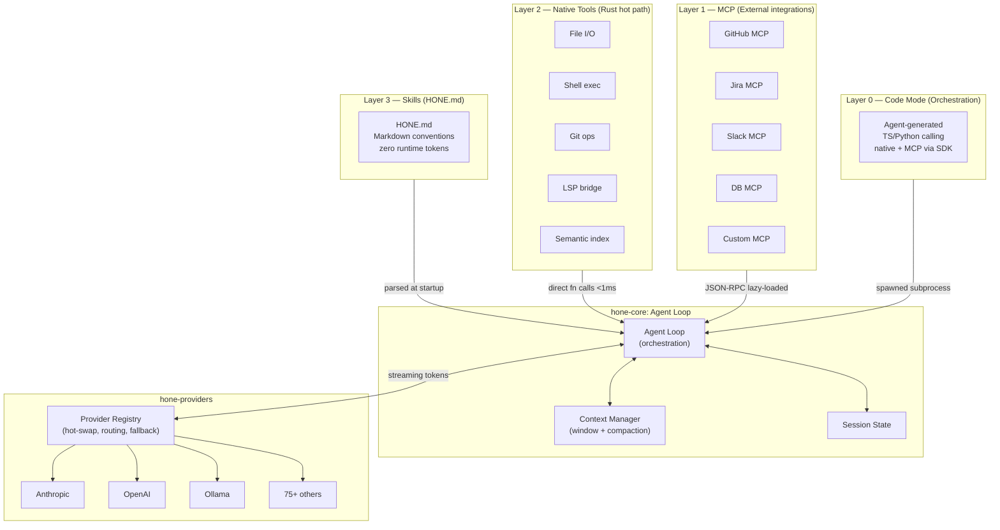
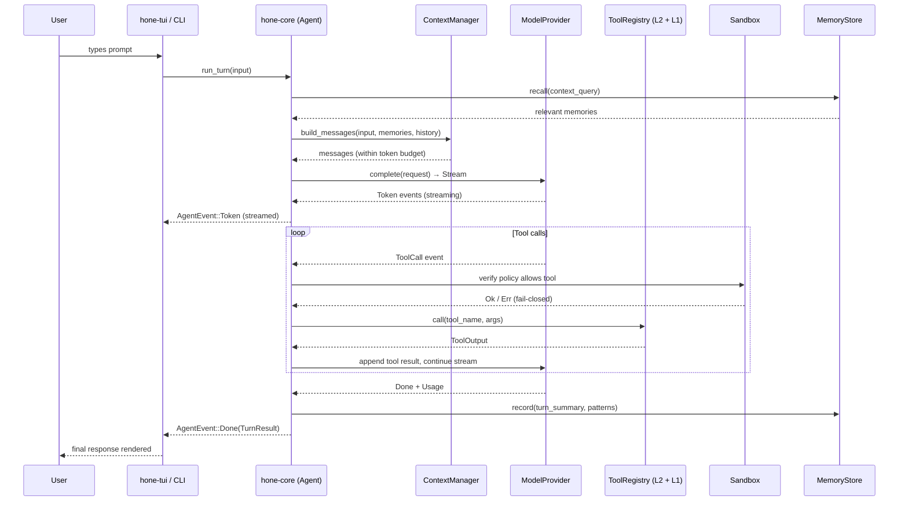
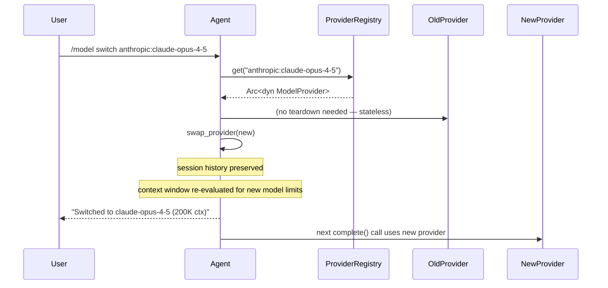
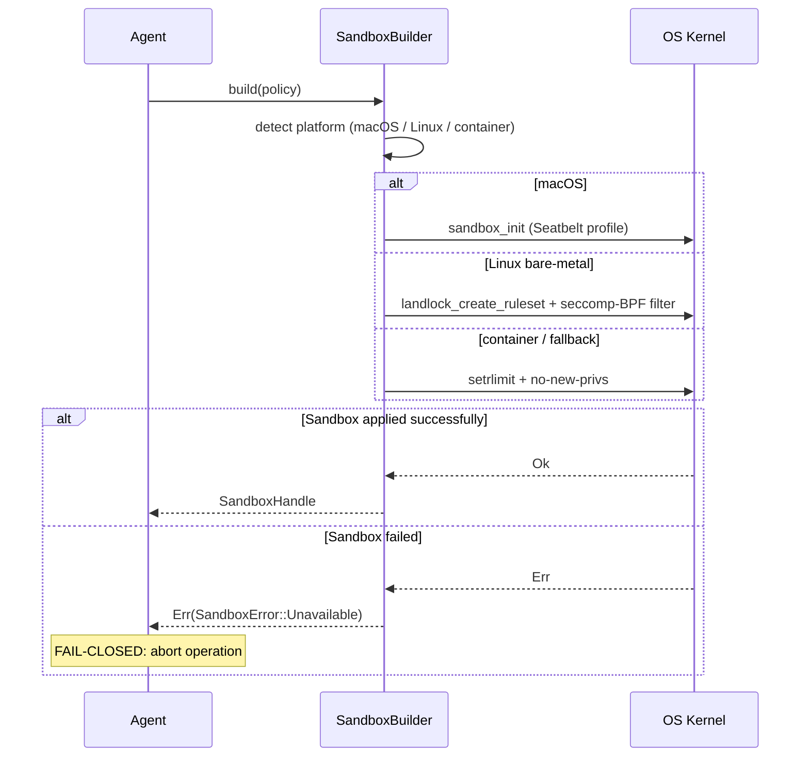
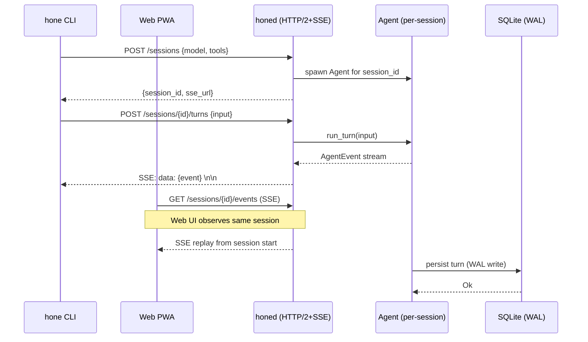
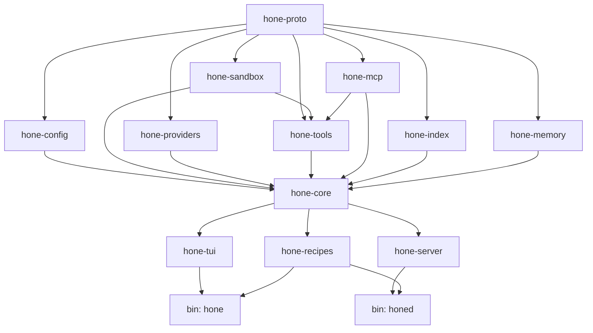
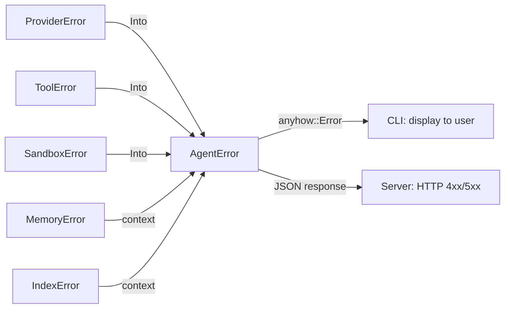
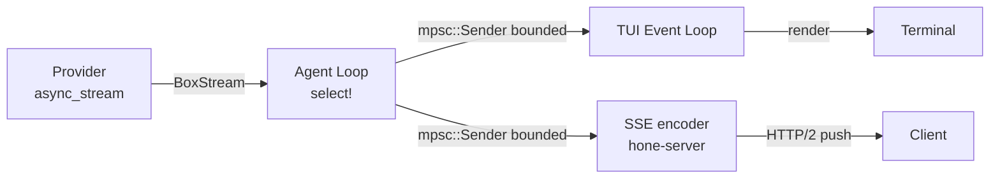
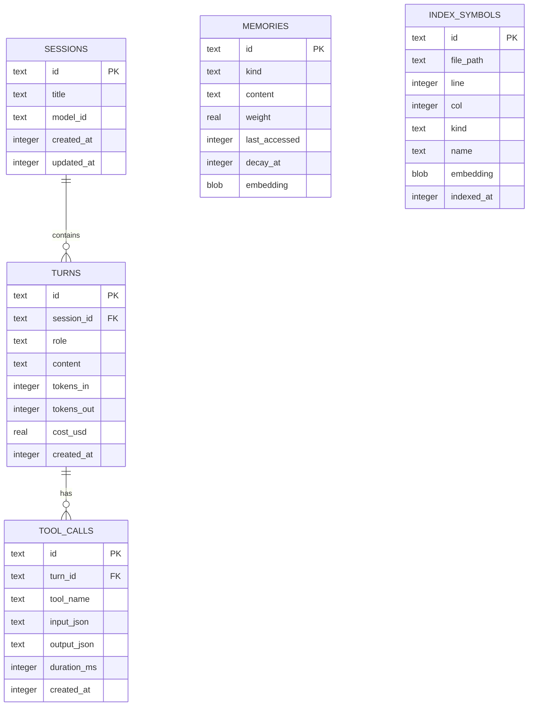
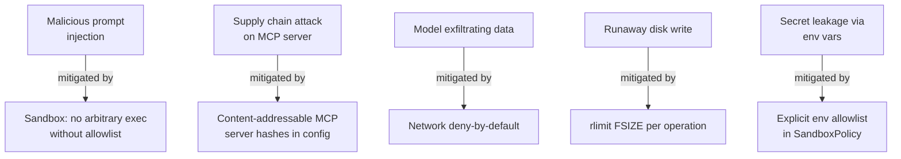

# Hone — Architecture Document

**Version:** 1.0  
**Date:** 2026-04-04  
**Status:** Working Draft

---

## Table of Contents

1. [Guiding Principles](#1-guiding-principles)
2. [Workspace & Crate Structure](#2-workspace--crate-structure)
3. [Layer Architecture](#3-layer-architecture)
4. [Core Trait Definitions](#4-core-trait-definitions)
5. [Data Flow Diagrams](#5-data-flow-diagrams)
6. [Crate Dependency Graph](#6-crate-dependency-graph)
7. [Error Handling Strategy](#7-error-handling-strategy)
8. [Async Runtime & Patterns](#8-async-runtime--patterns)
9. [Storage Architecture](#9-storage-architecture)
10. [Security Model](#10-security-model)
11. [Key Design Decisions](#11-key-design-decisions)

---

## 1. Guiding Principles

- **Zero-cost at the hot path.** Layer 2 native tools are direct Rust function calls — no IPC, no serialization.
- **Fail-closed security.** Sandbox setup failure aborts the operation, never silently degrades.
- **Trait-boundary isolation.** Every external integration (model provider, LSP, MCP server) is behind a `dyn Trait` so it can be mocked in tests.
- **Single writer, many readers.** The SQLite database uses WAL mode; only the daemon writes, clients read via the HTTP API.
- **Privacy by default.** Network access requires explicit user opt-in; telemetry is opt-in and off by default.

---

## 2. Workspace & Crate Structure

The repository uses a Cargo workspace. The root `Cargo.toml` declares the workspace; each subdirectory under `crates/` is an independent crate with a minimal, well-defined API surface.

```
hone/
├── Cargo.toml                  # workspace root
├── Cargo.lock
├── HONE.md                     # project constitution (Layer 3 skills)
├── deny.toml                   # cargo-deny: license + advisory policy
├── clippy.toml
├── rustfmt.toml
├── .github/
│   └── workflows/
├── crates/
│   ├── hone-core/              # agent loop, session state, orchestration
│   ├── hone-providers/         # model provider abstraction + all adapters
│   ├── hone-tools/             # Layer 2 native tools (file, shell, git, LSP bridge)
│   ├── hone-mcp/               # Layer 1 MCP client (JSON-RPC, lazy schema loading)
│   ├── hone-sandbox/           # kernel sandboxing (Seatbelt / Landlock / seccomp)
│   ├── hone-index/             # semantic indexer (tree-sitter AST + SQLite vectors)
│   ├── hone-memory/            # adaptive memory (encrypted SQLite, pattern learning)
│   ├── hone-server/            # honed daemon (HTTP/2 + SSE API)
│   ├── hone-tui/               # Ratatui terminal UI
│   ├── hone-recipes/           # YAML recipe runner
│   ├── hone-config/            # TOML + HONE.md config parsing
│   └── hone-proto/             # shared types, DTOs, serialization
├── bins/
│   ├── hone/                   # CLI entry point (thin shell over hone-core / hone-tui)
│   └── honed/                  # daemon entry point (thin shell over hone-server)
├── docs/
├── tests/                      # workspace-level integration tests
└── benches/                    # workspace-level benchmarks (criterion)
```

### Crate responsibilities

| Crate | Responsibility | Public surface |
|---|---|---|
| `hone-proto` | Shared DTOs, error types, serialization (serde) | Structs + enums only |
| `hone-config` | Parse `~/.config/hone/config.toml` and `HONE.md` | `Config`, `HoneMd` structs |
| `hone-providers` | `ModelProvider` trait + 75+ adapters | `ModelProvider`, `ProviderRegistry` |
| `hone-sandbox` | Kernel sandbox setup and enforcement | `Sandbox` trait, `SandboxBuilder` |
| `hone-tools` | Layer 2 native tools | `Tool` trait, tool registry |
| `hone-mcp` | MCP client, JSON-RPC transport, lazy schema | `McpClient`, `McpTool` |
| `hone-index` | AST parsing, embedding, semantic search | `SemanticIndex`, `IndexBuilder` |
| `hone-memory` | Encrypted SQLite adaptive memory | `MemoryStore`, `Pattern` |
| `hone-core` | Agent loop, session, context window management | `Agent`, `Session`, `ContextManager` |
| `hone-recipes` | YAML recipe parsing and execution | `Recipe`, `RecipeRunner` |
| `hone-server` | `honed` HTTP/2+SSE daemon | `Server`, REST handlers |
| `hone-tui` | Ratatui UI, input handling | `App`, `Ui` |

---

## 3. Layer Architecture



---

## 4. Core Trait Definitions

These trait definitions are the primary abstraction boundaries. All cross-crate interactions happen through these interfaces. Concrete types are hidden behind trait objects or generics with bounds.

### 4.1 `ModelProvider` — `hone-providers`

```rust
/// A streaming response item from a model.
pub enum ProviderEvent {
    Token(String),
    ToolCall(ToolCallRequest),
    Usage(TokenUsage),
    Done,
    Error(ProviderError),
}

/// Everything a provider needs to generate a response.
pub struct CompletionRequest {
    pub model: ModelId,
    pub messages: Vec<Message>,
    pub tools: Vec<ToolSchema>,
    pub temperature: Option<f32>,
    pub max_tokens: Option<u32>,
    pub stop: Vec<String>,
}

#[async_trait]
pub trait ModelProvider: Send + Sync + 'static {
    fn id(&self) -> &str;
    fn display_name(&self) -> &str;
    fn supported_models(&self) -> Vec<ModelInfo>;

    async fn complete(
        &self,
        request: CompletionRequest,
    ) -> Result<BoxStream<'static, ProviderEvent>, ProviderError>;

    /// Estimate token count without a network round-trip (best-effort).
    fn estimate_tokens(&self, messages: &[Message]) -> u32;

    /// Health check — used by the fallback chain.
    async fn health(&self) -> ProviderHealth;
}
```

### 4.2 `Tool` — `hone-tools`

```rust
pub struct ToolInput(serde_json::Value);
pub struct ToolOutput(serde_json::Value);

#[async_trait]
pub trait Tool: Send + Sync + 'static {
    fn name(&self) -> &str;
    fn description(&self) -> &str;
    fn schema(&self) -> serde_json::Value;      // JSON Schema for the model

    async fn call(
        &self,
        input: ToolInput,
        ctx: &ToolContext,
    ) -> Result<ToolOutput, ToolError>;

    /// Layer hint: L2 (native) or L1 (MCP).
    fn layer(&self) -> ToolLayer;
}

pub struct ToolContext {
    pub sandbox: Arc<dyn Sandbox>,
    pub working_dir: PathBuf,
    pub session_id: SessionId,
}
```

### 4.3 `Sandbox` — `hone-sandbox`

```rust
pub struct SandboxPolicy {
    pub allow_read: Vec<PathBuf>,
    pub allow_write: Vec<PathBuf>,
    pub allow_exec: Vec<PathBuf>,
    pub allow_network: bool,
    pub allow_env: Vec<String>,
}

#[async_trait]
pub trait Sandbox: Send + Sync + 'static {
    /// Apply the sandbox to the current process or a subprocess.
    /// Returns Err if the policy cannot be enforced — NEVER silently degrades.
    fn apply(&self, policy: &SandboxPolicy) -> Result<SandboxHandle, SandboxError>;

    /// Restrict an already-running child process.
    fn restrict_child(&self, child: &mut Command, policy: &SandboxPolicy)
        -> Result<(), SandboxError>;

    fn platform(&self) -> SandboxPlatform;
}
```

### 4.4 `MemoryStore` — `hone-memory`

```rust
#[async_trait]
pub trait MemoryStore: Send + Sync + 'static {
    async fn record(&self, event: MemoryEvent) -> Result<(), MemoryError>;
    async fn recall(&self, query: &MemoryQuery) -> Result<Vec<Memory>, MemoryError>;
    async fn decay(&self) -> Result<DecayReport, MemoryError>;
    async fn forget(&self, filter: &MemoryFilter) -> Result<u64, MemoryError>;
    async fn export(&self, path: &Path) -> Result<(), MemoryError>;
}
```

### 4.5 `SemanticIndex` — `hone-index`

```rust
#[async_trait]
pub trait SemanticIndex: Send + Sync + 'static {
    async fn index_path(&self, root: &Path) -> Result<IndexStats, IndexError>;
    async fn search(&self, query: &str, limit: usize) -> Result<Vec<IndexResult>, IndexError>;
    async fn symbol_at(&self, file: &Path, line: u32, col: u32)
        -> Result<Option<Symbol>, IndexError>;
    async fn invalidate(&self, paths: &[PathBuf]) -> Result<(), IndexError>;
}
```

### 4.6 `McpClient` — `hone-mcp`

```rust
#[async_trait]
pub trait McpClient: Send + Sync + 'static {
    async fn connect(&mut self) -> Result<McpServerInfo, McpError>;
    async fn list_tools(&self) -> Result<Vec<McpToolDef>, McpError>;
    async fn call_tool(
        &self,
        name: &str,
        args: serde_json::Value,
    ) -> Result<serde_json::Value, McpError>;
    fn tools_as_native(&self) -> Vec<Box<dyn Tool>>;
}
```

### 4.7 `Agent` — `hone-core`

```rust
pub struct AgentConfig {
    pub provider: Arc<dyn ModelProvider>,
    pub tools: Vec<Box<dyn Tool>>,
    pub sandbox: Arc<dyn Sandbox>,
    pub memory: Arc<dyn MemoryStore>,
    pub index: Arc<dyn SemanticIndex>,
    pub session: Session,
}

pub struct Agent {
    config: AgentConfig,
    context: ContextManager,
}

impl Agent {
    pub fn new(config: AgentConfig) -> Self { ... }

    /// Run one user turn, streaming events back through the channel.
    pub async fn run_turn(
        &mut self,
        user_input: &str,
        events: mpsc::Sender<AgentEvent>,
    ) -> Result<TurnResult, AgentError>;

    /// Hot-swap the provider without resetting session state.
    pub fn swap_provider(&mut self, provider: Arc<dyn ModelProvider>);
}
```

---

## 5. Data Flow Diagrams

### 5.1 Single Agent Turn



### 5.2 Provider Hot-Swap



### 5.3 Kernel Sandbox Lifecycle



### 5.4 Daemon Client-Server Flow



---

## 6. Crate Dependency Graph



**Rules enforced by `cargo-deny`:**
- `hone-proto` must have zero non-`serde` external dependencies.
- `hone-sandbox` must not depend on `hone-providers` or `hone-mcp` (avoids pulling network code into the sandbox enforcement path).
- `hone-tui` must not depend on `hone-server` (clean TUI/daemon separation).

---

## 7. Error Handling Strategy

### Per-crate errors with `thiserror`

Each crate defines its own error enum using `thiserror`. Cross-crate propagation uses the `#[from]` conversion where natural, otherwise explicit mapping. Library crates never use `anyhow`.

```rust
// hone-providers/src/error.rs
#[derive(Debug, thiserror::Error)]
pub enum ProviderError {
    #[error("provider '{provider}' returned HTTP {status}: {body}")]
    Http { provider: String, status: u16, body: String },

    #[error("provider '{provider}' stream interrupted: {source}")]
    Stream { provider: String, #[source] source: std::io::Error },

    #[error("rate limit exceeded for '{provider}', retry after {retry_after_secs}s")]
    RateLimit { provider: String, retry_after_secs: u64 },

    #[error("model '{model}' not found in provider '{provider}'")]
    ModelNotFound { model: String, provider: String },

    #[error("request serialization failed: {0}")]
    Serialization(#[from] serde_json::Error),
}
```

### Application binaries use `anyhow`

`bins/hone/main.rs` and `bins/honed/main.rs` return `anyhow::Result<()>` and use `context()` / `with_context()` to add user-visible detail to errors before display.

### Panic policy

- `unwrap()` and `expect()` are banned in all `crates/` code via a `clippy` rule.
- The only permitted `expect()` calls are in `build.rs` scripts and test code, with a comment explaining the invariant.
- Panics in async tasks are caught at the `tokio::spawn` boundary and converted to errors.

### Error propagation map



---

## 8. Async Runtime & Patterns

### Runtime: `tokio` (multi-thread scheduler)

- Both the CLI and daemon use `#[tokio::main]` with the multi-thread scheduler.
- CPU-bound work (AST parsing, embedding generation, sandbox setup) is dispatched to `tokio::task::spawn_blocking`.
- The TUI runs its event loop in a dedicated blocking thread communicating via `mpsc` channels.

### Concurrency patterns

```rust
// Concurrent provider health checks — JoinSet
let mut set = JoinSet::new();
for provider in registry.all() {
    set.spawn(async move { (provider.id(), provider.health().await) });
}
while let Some(Ok((id, health))) = set.join_next().await {
    results.insert(id, health);
}

// Racing a stream against a timeout — select!
tokio::select! {
    event = stream.next() => handle_event(event),
    _ = tokio::time::sleep(STREAM_TIMEOUT) => bail!("stream timeout"),
    _ = cancel_token.cancelled() => return Ok(()),
}

// Structured cancellation propagated through all tasks
let token = CancellationToken::new();
tokio::spawn(agent_loop(token.child_token()));
// Clean shutdown: token.cancel()
```

### Backpressure

All inter-component communication uses bounded `tokio::sync::mpsc` channels. The TUI rendering loop consumes `AgentEvent` tokens; if the TUI falls behind, the provider stream is paused (backpressure propagates via the bounded channel).

### Streaming architecture



---

## 9. Storage Architecture

### SQLite with WAL mode — single file per user

```
~/.local/share/hone/
├── hone.db               # main database (WAL mode)
├── hone.db-wal
├── hone.db-shm
├── index.db              # semantic index (separate file, large)
└── index.db-wal
```

### Schema overview



### Crate: `sqlx` with compile-time query checking

All queries use `sqlx::query!` or `sqlx::query_as!` macros for compile-time verification. Migration files live in `crates/hone-memory/migrations/` and `crates/hone-index/migrations/` and run automatically on startup via `sqlx::migrate!`.

### Memory encryption

`hone-memory` wraps SQLite via `sqlcipher` (behind a feature flag `encrypted-memory`). The encryption key is derived from a user passphrase using Argon2id and stored in the system keychain (via `keyring` crate).

---

## 10. Security Model

### Sandbox platform matrix

| Platform | Primary mechanism | Fallback |
|---|---|---|
| macOS | Seatbelt (`sandbox_init`) | `setrlimit` + `no-new-privs` |
| Linux bare-metal | Landlock + seccomp-BPF | `setrlimit` + `no-new-privs` |
| Container (Docker/K8s) | `seccomp` profile + `no-new-privs` | `setrlimit` |
| Windows (future) | Job Objects + AppContainer | Restricted token |

**Fail-closed invariant:** if the desired sandbox tier is unavailable and the policy requires it, the operation is aborted with `SandboxError::PolicyNotMet`. There is no silent downgrade.

### Network policy

- Default: network access denied for all tool calls.
- User enables per-domain allow-listing in `config.toml`.
- MCP servers requiring network are declared in config and subject to their own policy.

### Threat model summary



---

## 11. Key Design Decisions

### D1: Workspace over monolith

**Decision:** Multi-crate Cargo workspace rather than a single `src/` tree.

**Rationale:** Enables parallel compilation, enforces API boundaries (a crate cannot accidentally access another crate's private types), and allows publishing individual crates (e.g., `hone-providers` as a standalone library).

**Trade-off:** Slightly higher initial setup cost; longer cold compile times on a clean build. Mitigated by `sccache` in CI.

### D2: `async-trait` for object-safe async traits

**Decision:** Use `async-trait` (or the stabilized `async fn in traits` on edition 2024) for all cross-crate traits.

**Rationale:** `dyn Trait` is required for runtime polymorphism over providers and tools. Without `async-trait`, async methods cannot appear in object-safe traits.

**Edition 2024 note:** With Rust edition 2024 and the stabilized RPITIT feature, `async fn` in traits that return `impl Future` are object-safe when combined with the `#[async_trait]` shim for `dyn` dispatch. We default to using the `async_trait` crate until the edition 2024 `dyn*` feature is stable.

### D3: `BoxStream` for provider responses

**Decision:** `ModelProvider::complete` returns `BoxStream<'static, ProviderEvent>` rather than a concrete type.

**Rationale:** Each provider has a different underlying stream type. Erasing to `BoxStream` avoids the monomorphisation explosion that would occur if `Agent` were generic over `P: ModelProvider`.

### D4: Separate `index.db` from `hone.db`

**Decision:** The semantic index lives in a separate SQLite file.

**Rationale:** Index rebuilds (potentially gigabytes of writes) would stress WAL checkpointing if co-located with the main database that holds session and memory data. Separate files allow independent backup, vacuuming, and deletion.

### D5: Recipes as YAML, not Rust macros

**Decision:** The recipe system uses YAML definitions rather than a Rust DSL.

**Rationale:** Recipes must be shareable between users without recompilation. YAML files can be distributed via the marketplace and loaded at runtime. The trade-off is loss of compile-time verification, mitigated by JSON Schema validation of recipe files on load.

### D6: LSP bridge in Layer 2, not Layer 1

**Decision:** The LSP bridge is a native Rust tool (Layer 2), not an MCP server (Layer 1).

**Rationale:** LSP round-trips must complete in <500ms. The JSON-RPC + subprocess overhead of MCP would add ~50–100ms per call. The native bridge speaks LSP directly over stdin/stdout to the language server process, keeping the path entirely in-process.
