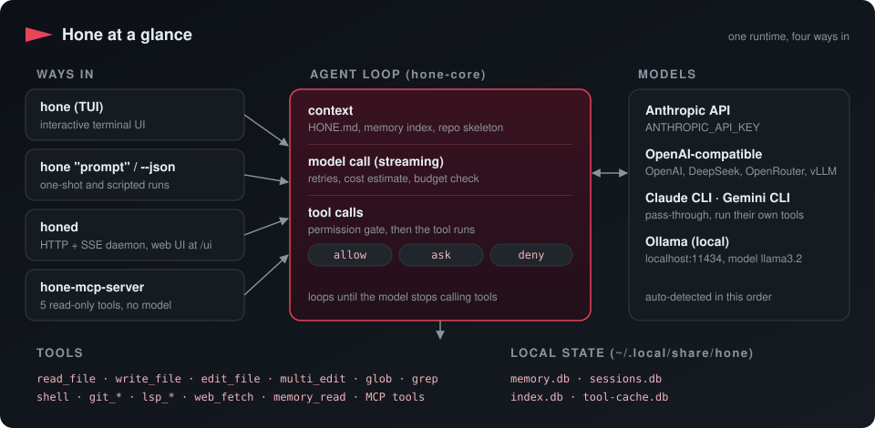
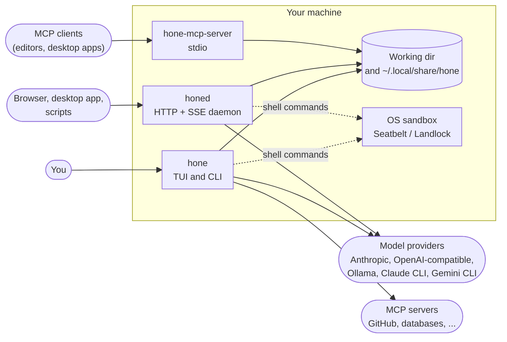
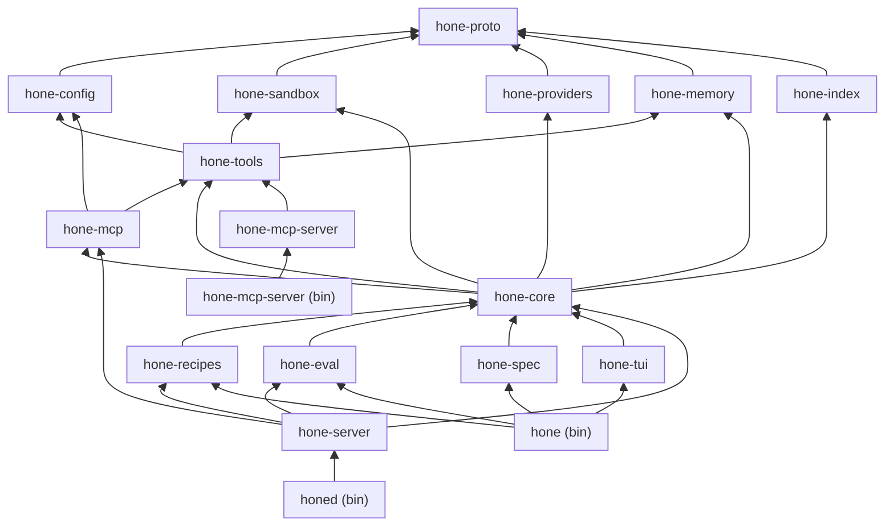
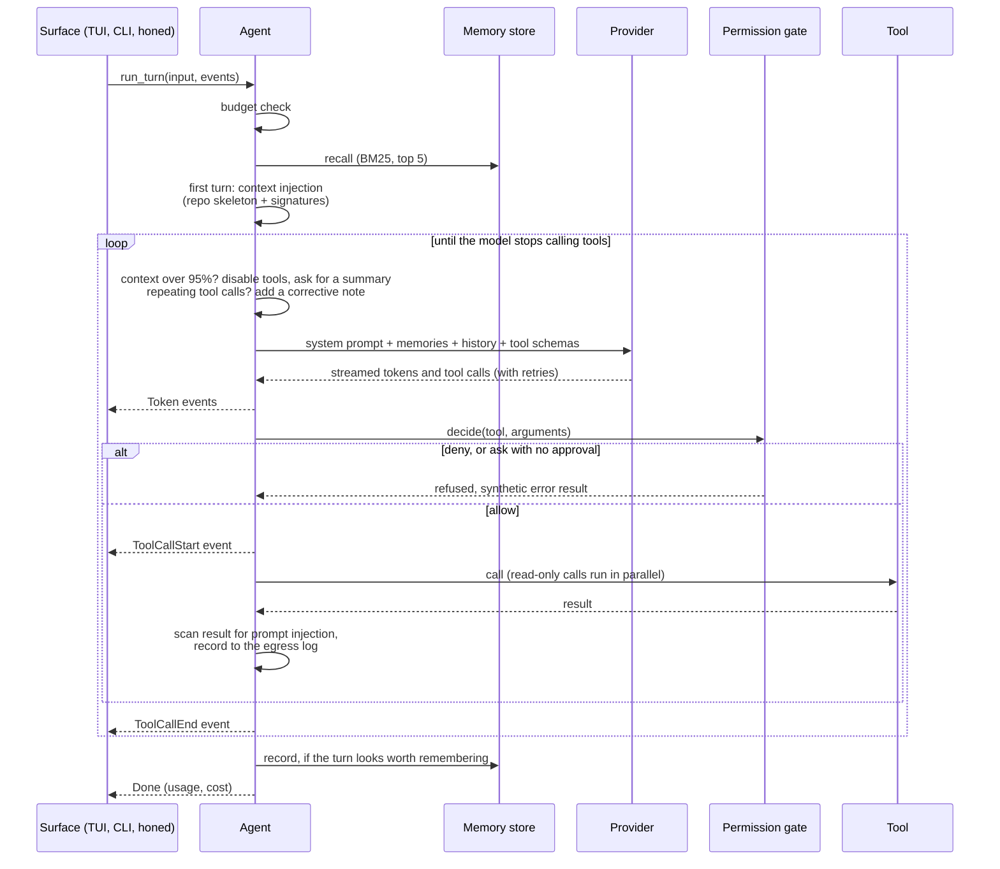
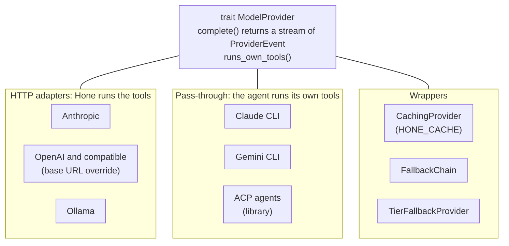
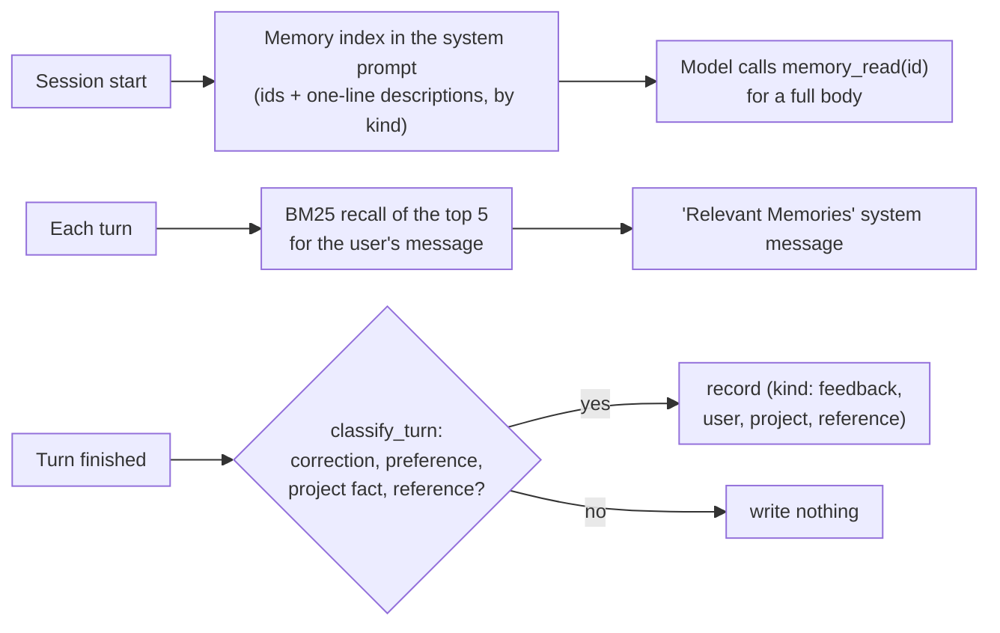
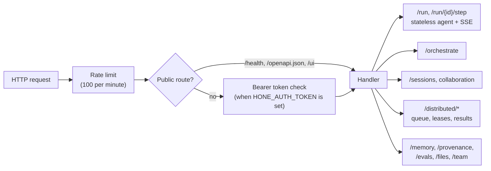
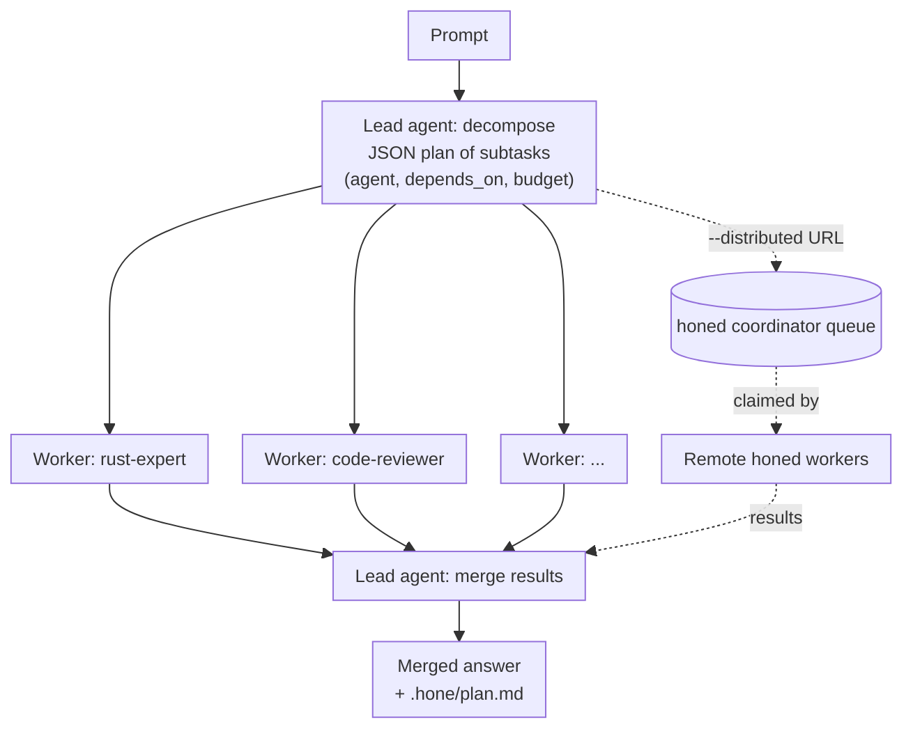

# Architecture

  
  
  
  

This page describes Hone as the code stands on `main`: which crate does what, how one
agent turn runs, where state lives, and how the daemon and the multi-agent features fit
in. Every diagram was drawn from the source, not from a design plan.

  

## 1. System context

## 2. Workspace map

The repository is one Cargo workspace (`resolver = "3"`, edition 2024, Rust 1.85+).

| Group | Crate | What it does |
|---|---|---|
| **Binaries** | `hone-cli` → `hone` | CLI, TUI, provider detection, subcommands (`bins/hone`) |
| | `honed` | Daemon: HTTP + SSE server, coordinator and worker roles (`bins/honed`) |
| | `hone-mcp-server-bin` → `hone-mcp-server` | Exposes five read-only tools over MCP stdio (`bins/hone-mcp-server`) |
| **Runtime** | `hone-core` | Agent loop, context manager, orchestrator, ensemble, self-refine, test loop, agent registry, memory index, egress log |
| | `hone-providers` | `ModelProvider` trait; Anthropic, OpenAI, Ollama, Claude CLI, Gemini CLI and ACP adapters; caching, fallback and tier-routing wrappers |
| | `hone-proto` | Shared types: messages, events, tool calls, model ids, pricing |
| | `hone-config` | `config.toml` schema, `HONE.md` merge, `mcp.json`, permission policy compiler |
| **Tools** | `hone-tools` | Native tools (files, shell, git, LSP, web, screen), subject extraction, the permission gate |
| | `hone-sandbox` | `Sandbox` trait with Seatbelt (macOS), Landlock (Linux) and null backends |
| | `hone-mcp` | MCP client: spawns servers, lists tools, wraps them as native tools |
| | `hone-mcp-server` | MCP server library with the policy check on `tools/call` |
| | `hone-acp-server` | Agent Client Protocol server library (stdio JSON-RPC) |
| **State** | `hone-memory` | Memory store trait; SQLite, in-memory and AES-256-GCM encrypted stores; BM25 recall |
| | `hone-index` | Tree-sitter symbol extraction into SQLite, with a file watcher |
| | `hone-cache` | Tool-result cache (SQLite or in-memory backends) |
| | `hone-provenance` | Tamper-evident SHA-256 hash chain over run events |
| **Surfaces** | `hone-tui` | Ratatui UI: Agent Rail, command palette, session switcher, plan preview, review mode |
| | `hone-server` | Axum routes, auth, rate limiting, sessions, `/run`, orchestration, distributed queue, web UI assets |
| | `hone-desktop` | Tauri 2 shell around `honed` and the web UI (`apps/hone-desktop`) |
| **Workflows** | `hone-recipes` | YAML recipes with steps, conditions and variables |
| | `hone-spec` | `hone spec`: requirements, design and task documents from a goal |
| | `hone-eval` | `hone eval`: deterministic task runner and report |
| | `hone-finetune` | Builds JSONL fine-tuning datasets from session outputs |

<b>Internal dependency graph</b>

Arrows point from a crate to what it depends on. `hone-proto` is the only crate everything
shares; `hone-providers` doesn't depend on `hone-tools`, so a provider can't call Hone's
tools behind the gate's back. (The Claude CLI, Gemini CLI and ACP providers run their own
tools instead; see [section 4](#4-providers).)

## 3. One agent turn

`Agent::run_turn` (`crates/hone-core/src/agent.rs`) is the heart of Hone. Every surface,
from the TUI to `honed` workers, drives the same function, usually through `AgentHandle`,
an actor that owns the agent and takes commands over a channel.

### Per-call pipeline

```mermaid
%%{init: {"themeVariables": {"fontSize": "13px"}, "flowchart": {"nodeSpacing": 25, "rankSpacing": 30, "padding": 8}, "sequence": {"actorMargin": 30, "messageMargin": 25, "boxMargin": 6}, "gantt": {"barHeight": 16, "barGap": 3}}}%%
flowchart LR
  H["PreToolUse hooks<br/>(library hook point)"] --> PG["Permission gate<br/>allow / ask / deny"]
  PG --> RB["Read-before-edit guard<br/>(injects a read_file)"]
  RB --> AP["Approval policy<br/>Auto / AskRisky / AlwaysAsk"]
  AP --> EX["Tool call"]
  EX --> SC["Shell checks +<br/>OS sandbox (shell only)"]
  SC --> PI["Prompt-injection scan<br/>of the result"]
  PI --> EG["Egress audit log<br/>(--audit)"]
```

| Stage | Where | Notes |
|---|---|---|
| Hooks | `hone-core/src/hooks.rs` | `UserPromptSubmit` and `PreToolUse` hook points exist; no binary loads hooks yet |
| Permission gate | `hone-tools/src/policy_gate.rs` | One `decide` shared by the agent, `honed` and `hone-mcp-server` |
| Read-before-edit | `hone-core/src/agent.rs` | An edit to a file the model hasn't read this turn gets a `read_file` first |
| Approval policy | `hone-proto/src/step_action.rs` | `Auto` for headless runs. The TUI sets `AskRisky` (or `AlwaysAsk` with `--step`) and an approval channel on the running session agent (`wire_tui_approvals` in `bins/hone/src/main.rs`). A closed or missing channel refuses the call; a closed event stream cancels the turn. `AgentMode::AutoApprove` skips this pause, never the permission policy. Orchestrator lead and worker agents have no tools, so they never pause |
| Shell checks, sandbox | `hone-tools/src/shell/` | See [Permissions and sandbox](permissions-and-sandbox.md) |
| Injection scan | `hone-core/src/injection_detector.rs` | Flagged results are prefixed with a warning telling the model to treat them as data |
| Egress log | `hone-core/src/egress_log.rs` | JSONL at `.hone/audit.jsonl`; read with `hone trace` |

### Context management

- **Budget.** `ContextConfig::for_model` uses a fraction of the advertised window, by model
  family: Claude 60% of 200k, GPT-4/o-series 55% of 128k, Gemini 50% of 1M, DeepSeek, Qwen
  and Kimi 45% of 128k, Llama 40% of 128k, anything else 50% of 128k.
  `HONE_CONTEXT_WINDOW` replaces the advertised window.
- **Compaction.** Old tool results are shortened first. When the history is still over
  budget, the oldest messages are dropped, the first user message is kept, and a
  `[session history: …]` note tells the model what was removed. Moving from exploration
  to editing compresses exploration results harder.
- **Injection.** On the first turn, the context injector adds a repository skeleton and the
  most relevant signatures. Strategies: `adaptive` (default), `call-graph`, `hybrid`,
  `dependency-graph`, `flat`. See [Context injection](context-injection.md).
- **Stable prefix.** The system prompt comes first and memories and skills follow as
  separate system messages, so the prompt prefix stays cache-friendly.

## 4. Providers

- Pass-through providers report `runs_own_tools() == true`. Wrappers forward it, and a
  chain is "ungated" if any member is. Under a non-empty permission policy, Hone refuses
  ungated providers unless `HONE_ALLOW_UNGATED_PROVIDER=1`.
- Transient errors (timeouts, 429, 502/503) get up to 3 attempts (2 retries) with
  exponential backoff starting at 500 ms.
- The CLI's cost line is an estimate. `hone` applies one rate ($3 input / $15 output per
  million tokens) to every model; `honed` looks models up in a pricing table.

## 5. Local state

| Store | Crate | File | Written when |
|---|---|---|---|
| Memory | `hone-memory` | `~/.local/share/hone/memory.db` | After turns the classifier keeps |
| Symbol index | `hone-index` | `~/.local/share/hone/index.db` | Background scan of `.rs` and `.py` files at startup, then a file watcher |
| CLI sessions | `bins/hone` | `~/.local/share/hone/sessions.db` | After one-shot and `--plan` runs (the TUI writes a report to `.hone/reports/` instead) |
| Tool cache | `hone-cache` | `~/.local/share/hone/tool-cache.db` | Read-only tool calls (`read_file`, `glob`, `grep`, `git_status`, `git_diff`, LSP tools, `symbol_search`, `symbol_at`); web tools are not cached; written even with `--ephemeral` |
| Daemon sessions | `hone-server` | `~/.local/share/hone/sessions.db` or `HONE_SESSION_DB` | `POST /sessions`; purged after 30 days |
| Distributed queue | `hone-server` | `HONE_DISTRIBUTED_DB` | Coordinator mode only |
| Provenance | `hone-provenance` | `HONE_PROVENANCE_DIR/*.jsonl` | Each `honed` `/run`, when the directory is set |
| Audit log | `hone-core` | `<cwd>/.hone/audit.jsonl` | Every tool call, with `--audit` |

Everything is SQLite or JSONL on local disk. There is no Postgres dependency: a
PostgreSQL + pgvector index was planned early on and is deferred.

### Memory flow

## 6. The daemon

One binary plays up to three roles, chosen by environment variables:

| Role | Enabled by | Does |
|---|---|---|
| Server | always | HTTP API, SSE, web UI, sessions |
| Coordinator | `HONE_DISTRIBUTED_DB` | Holds the task queue; a reaper re-queues expired leases (every 15 s, 3 attempts) |
| Worker | `HONE_WORKER_COORDINATOR` | Polls the coordinator, claims subtasks, runs them through an agent, posts results |

`POST /run` builds a fresh agent per request with the Anthropic provider
(`ANTHROPIC_API_KEY`), the file tools and `shell`, after checking that `working_dir`
resolves inside the workspace root (the daemon's working directory). Full reference:
`GET /openapi.json`; the older [HTTP API](api/http-api.md) and [SSE events](api/sse-events.md)
pages may be out of date.

## 7. Multi-agent features

| Feature | Entry point | How it works |
|---|---|---|
| Orchestrator | `--orchestrate`, TUI complex tier, `/plan` preview, `honed /orchestrate` | Decompose, run subtasks with agents from the registry (up to 4 at a time, dependencies first, 5-minute timeout each), merge |
| Distributed | `--orchestrate --distributed URL` | Subtasks go through a `honed` coordinator to remote workers |
| Ensemble | `--ensemble N` | N candidates at different temperatures, then a ranker run; candidates run headless |
| Complexity routing | TUI | Each message is classified as simple (one turn), medium (self-refine, 2 rounds) or complex (orchestrator). An adaptive classifier learns from past outcomes stored in memory. |
| Test loop | TUI | After a turn that used `write_file`, `edit_file` or `multi_edit`, runs the detected test command and feeds failures back, up to 3 times |
| Personas | `@name` in the TUI, orchestrator workers | 12 built-in agents plus your own `.md` files |

## 8. Design choices

| Choice | Why |
|---|---|
| One workspace, many small crates | Clear boundaries (providers can't reach tools), faster incremental builds, crates usable on their own |
| Trait objects at every edge (`ModelProvider`, `Tool`, `Sandbox`, `MemoryStore`) | Every integration can be mocked; tests run without network or kernel features. Providers can't reach Hone's tools (pass-through providers run their own) |
| One permission gate for every entry point | The CLI, daemon, workers and MCP server can't drift apart |
| SQLite for all local state | Zero setup, single user, easy to delete; the server can point at its own files |
| Actor (`AgentHandle`) around the agent | The TUI, orchestrator and server share an agent without locks across `await` |
| `thiserror` in libraries, `anyhow` in binaries | Typed errors at crate boundaries, readable messages at the top |
| Sandbox around child processes only | Hone's own process keeps its network and file access for providers and stores; risky work happens in `sh -c` children |

## Further reading

- [Permissions and sandbox](permissions-and-sandbox.md)
- [Configuration](configuration.md)
- [Core concepts](onboarding/concepts.md)
- [Multi-agent coordination and memory](architecture/multi-agent-and-memory.md) and [Memory layers](architecture/memory.md) (older deep dives; may be out of date)
- [Workspace structure](workspace-structure.md) (older; may be out of date)
