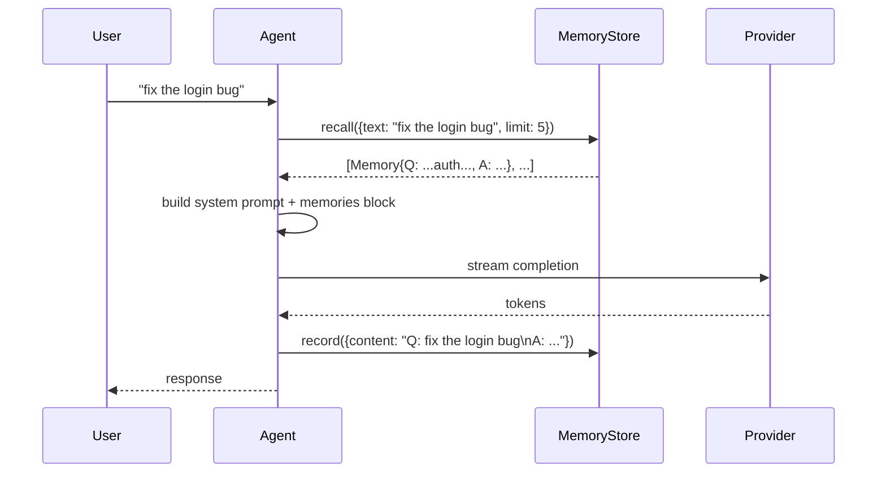
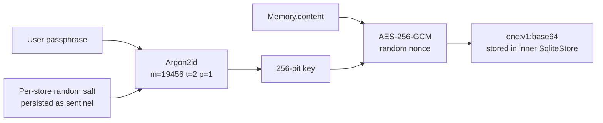
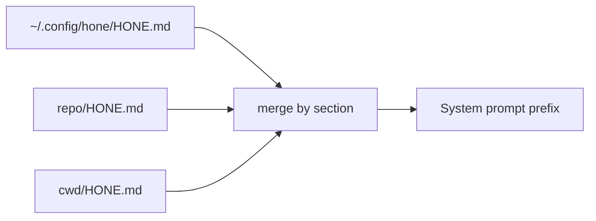
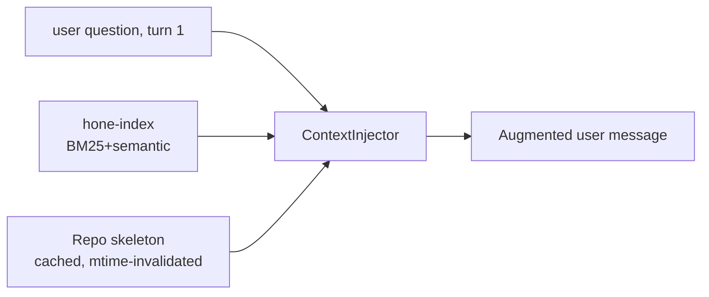
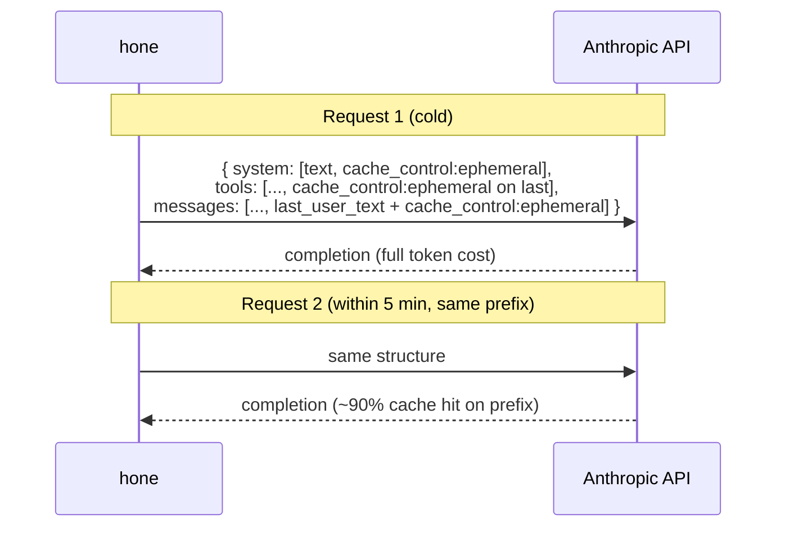
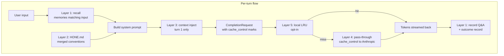

# Memory and Pass-Through Caching

This document describes the **four distinct caching/recall surfaces** that make up hone's memory subsystem, and how data flows through each. They are intentionally separate concerns; mixing them up is the most common source of confusion.

| Layer | What it stores | Where it lives | Lifetime |
|---|---|---|---|
| 1. Persistent memory store | Q&A pairs, learning outcomes, custom records | `~/.hone/memory.db` (SQLite) | Permanent (decay-aware) |
| 2. HONE.md conventions | Project rules, style preferences, domain notes | `HONE.md` files (merged 3 levels) | Versioned in git |
| 3. Context injection | Repo skeleton + relevant files | In-memory cache, `inject_context=true` | First turn only |
| 4. Prompt-cache pass-through | The exact prompt prefix sent upstream | Anthropic's prompt cache (server-side) | 5-minute TTL on Anthropic |
| 5. Local response cache | Cached completions | In-process LRU | Process lifetime |

Layers 1, 3, 4, and 5 are independent — they can be mixed and matched. Layer 2 is more of a configuration surface than a memory layer but is included because users often confuse it with layer 1.

## Layer 1: Persistent memory store (`hone-memory`)

The `hone-memory` crate is the canonical "memory" — a durable, content-searchable, decay-aware key-value store with optional encryption.

### Schema

A single `Memory` record:

```rust
pub struct Memory {
    pub id: String,           // UUID v7 (sortable by timestamp)
    pub content: String,      // free-form text; encrypted at rest if EncryptedStore is wrapped
    pub tags: Vec<String>,    // ["outcome", "tier:Simple", "success"]
    pub weight: f64,          // 0.0..1.0 — used by decay
    pub created_at: u64,      // Unix seconds
    pub decay_at: Option<u64>,// optional expiry; `decay()` deletes when t <= now
}
```

Backed by SQLite:

```sql
CREATE TABLE memories (
  id         TEXT    PRIMARY KEY,
  content    TEXT    NOT NULL,
  tags       TEXT    NOT NULL DEFAULT '[]',  -- JSON array
  weight     REAL    NOT NULL DEFAULT 1.0,
  created_at INTEGER NOT NULL,
  decay_at   INTEGER
)
```

### The `MemoryStore` trait

```rust
#[async_trait]
pub trait MemoryStore: Send + Sync {
    async fn record(&mut self, memory: Memory) -> Result<(), MemoryError>;
    async fn recall(&self, query: &MemoryQuery) -> Result<Vec<Memory>, MemoryError>;
    async fn forget(&mut self, filter: &MemoryFilter) -> Result<u32, MemoryError>;
    async fn decay(&mut self, factor: f64, now: u64) -> Result<u32, MemoryError>;
    async fn export(&self, path: &Path) -> Result<(), MemoryError>;
    async fn import(path: &Path) -> Result<Self, MemoryError> where Self: Sized;
}
```

Three implementations:

- `InMemoryStore` — `BTreeMap` backed; for tests.
- `SqliteStore` — production default. Opens or creates `~/.hone/memory.db` at startup.
- `EncryptedStore<S>` — wraps any `S: MemoryStore` with AES-256-GCM content encryption (see below).

### Per-turn recall

`Agent::run_turn` calls `fetch_relevant_memories(user_input)` before sending the prompt:

```rust
let memory_query = MemoryQuery { text: user_input.to_string(), limit: 5 };
let memories = store.lock().await.recall(&memory_query).await?;
```

The recall scoring is intentionally simple — case-insensitive substring match in SQL (`lower(content) LIKE ?1`), then ordered by recency. Up to 5 entries are appended to the system prompt as:

```
## Relevant context from memory:
- Q: how do I run the test suite? A: cargo test --workspace
- Q: which crate handles routing? A: hone-core::dispatcher
- ...
```



After the turn completes, the Q&A is recorded as a fresh memory (fire-and-forget — a store failure never breaks the loop).

### Adaptive learning

The `AdaptiveClassifier` (`crates/hone-core/src/learning.rs`) writes `OutcomeRecord` entries:

```rust
struct OutcomeRecord {
    tier: ComplexityTier,        // Simple | Medium | Complex
    model: String,
    success: bool,
    cost_usd: f64,
    total_tokens: u64,
    task_summary: String,
}
```

Stored as `outcome:tier=Medium|model=anthropic:...|success=true|...`. Tagged with `["outcome", "tier:Medium", "success"]`. Decays after 30 days.

`suggest_tier(task)` queries the last 100 outcomes and applies thresholds:
- Simple-tier success rate > 80% over ≥ 3 samples → downgrade Medium → Simple.
- Simple-tier success rate < 40% over ≥ 3 samples → upgrade Simple → Medium.
- < 5 outcomes total → no override (rule-based classifier wins).

Complex-tier classifications are never overridden.

### Decay

`store.decay(factor, now)` does two things:

1. Multiplies every `weight` by `factor` (e.g. `0.95` for daily decay).
2. Deletes every record whose `decay_at <= now`.

Returns the number of deleted records. Hone does not run decay automatically; if you want it, schedule a `cron` or systemd timer that calls a small CLI hook (or run it on session start).

### Encryption (`EncryptedStore`)

`EncryptedStore<S>` wraps any inner `MemoryStore` with content encryption:

- Cipher: AES-256-GCM, fresh 96-bit nonce per record.
- Wire format: `enc:v1:<base64(nonce ‖ ciphertext)>`.
- KDF: Argon2id, V0x13, m=19456 KiB, t=2, p=1, 32-byte output (pinned via `ARGON2_VERSION_MARKER`).
- Salt: random 16 bytes per store, persisted as a sentinel record `__encrypted_store_salt__`. Loaded on subsequent opens so the key is reproducible.

Search is unavoidably client-side (you can't index ciphertext): `recall` decrypts every record and filters in-memory. Acceptable up to ~10K records.



A wrong passphrase fails decrypt with a recognisable error rather than silent corruption.

### Wiring on startup

`bins/hone/src/main.rs::open_persistence`:

```rust
let memory_path = dir.join("memory.db");
let memory = match SqliteStore::open(&memory_path).await {
    Ok(s) => Some(Arc::new(Mutex::new(s)) as Arc<Mutex<dyn MemoryStore>>),
    Err(e) => return Err(...), // fail-fast unless --ephemeral
};
```

`--ephemeral` skips persistence entirely. The `EncryptedStore` wrapper exists as a programmatic API (`EncryptedStore::new(inner_store, passphrase)`) but is not yet exposed as a CLI flag. Embedders that want at-rest encryption wrap the store after `SqliteStore::open` in their own binary.

### TUI integration

Each recall is logged to the `TurnLedger`:

```rust
pub struct MemoryRecall {
    pub key: String,     // memory id
    pub snippet: String, // first 80 chars of content
}
```

Visible in:
- The status bar: `Ctrl+A` opens the session anatomy overlay; per-turn `memory_recalls` count is shown.
- The agent rail: every recall surfaces as a sub-event under the turn.
- The prompt mirror (`Ctrl+M`): see exactly which memories were prepended to the system prompt.

## Layer 2: HONE.md conventions

`HONE.md` is a markdown file describing project conventions. Three levels are merged at startup:

| Level | Path | Priority |
|---|---|---|
| User | `~/.config/hone/HONE.md` | lowest |
| Project | `<repo-root>/HONE.md` (nearest `.git`/`Cargo.toml`) | middle |
| Working dir | `<cwd>/HONE.md` | highest |

Sections are merged additively: each section (e.g. `## RULES`) accumulates content from all levels in priority order. Missing files are silently ignored — no error if you don't have one.

The merged result is prepended to the system prompt verbatim:



Use it for:
- "Always run `cargo clippy -- -D warnings` after changes."
- "Don't add Co-Authored-By Claude attribution."
- Project-specific architecture notes the agent should remember.

This is configuration, not memory — it's deterministic and version-controlled. Don't put per-conversation state here.

## Layer 3: Context injection

The `ContextInjector` (`crates/hone-core/src/context_injector.rs`) prepends two tiers of context **on the first turn only** when the agent is constructed with `inject_context: true`:

- **Tier 1 — repo skeleton**: file tree + function/type signatures. Cached with mtime + file-count invalidation. Built once per session in ~10 ms.
- **Tier 2 — relevant files**: top-K files retrieved from `hone-index` (BM25 + semantic) for the user's question.

Four skeleton strategies (`SkeletonStrategy`):

- `Compact` — file paths only, very cheap.
- `Symbols` — paths + top-level symbols.
- `Full` — paths + every public signature.
- `Adaptive` — automatically selects detail based on token budget.

Selected via `HONE_SKELETON_STRATEGY` env var or `--skeleton-strategy`.



The cache invalidates when:
1. Any source file's mtime is newer than the cached snapshot.
2. The total file count changed (file added or removed).
3. The skeleton strategy itself changed.

This is **not** memory — it's a deterministic projection of the current repo state into the prompt. It does not persist across sessions.

## Layer 4: Prompt-cache pass-through (Anthropic)

When using the Anthropic adapter, hone marks the prompt prefix with `cache_control: { type: "ephemeral" }`. Anthropic caches that prefix server-side for 5 minutes; subsequent requests with the same prefix skip re-tokenisation and re-attention, cutting cost (~10×) and latency (~3×).

What's marked as cacheable:



The three cache breakpoints are:

1. **System prompt** — `system` is emitted as a text-block array, with `cache_control` on the last block.
2. **Tool schemas** — `cache_control` on the last tool entry, so the entire tool array is one cached unit.
3. **Last user message** — promoted to a content-block array if it was a bare string, with `cache_control` on the last block.

This is "pass-through" because hone does not store anything locally — it only marks the request so the upstream service caches. Cancel a turn, restart hone, drop the network — the cache is on Anthropic's side and persists for ~5 minutes regardless.

For other providers (OpenAI, Ollama, ACP), no cache markers are emitted. ACP providers, in particular, are pass-through in a different sense: they forward the prompt verbatim to the agent process and don't second-guess the upstream's caching strategy.

## Layer 5: Local response cache (`CachingProvider`)

Wraps any `ModelProvider` with an in-process LRU keyed on a hash of `CompletionRequest`:

```rust
let cached = CachingProvider::new(inner, max_entries = 1024);
```

On hit: replays the stored event sequence (tokens, tool calls, finish reason).
On miss: forwards to the inner provider, collects the stream, caches it, returns.

Notable design details:
- The hash excludes the `CancellationToken` (not `Hash`-able and not semantically a cache key).
- Process-local: dies with the process. Not persistent.
- Off by default — opt in via the `caching` feature in the provider's config.

Useful in deterministic test runs or replay scenarios. Not useful in production where every turn carries unique context.

## Cross-layer interactions



A turn touches every layer in sequence. Each can be disabled independently:

- `--ephemeral` → no Layer 1.
- No `HONE.md` files → empty Layer 2.
- `inject_context: false` → no Layer 3.
- Non-Anthropic provider → no Layer 4 markers (other providers may have their own).
- No `CachingProvider` wrapper → no Layer 5.

## Failure modes and recovery

| Failure | Layer | Behaviour |
|---|---|---|
| `memory.db` corrupt | 1 | Startup fails fast; `--ephemeral` skips |
| Wrong encryption passphrase | 1 | Decrypt error on first recall |
| Sentinel salt missing but encrypted records exist | 1 | Returns error directing user to migration tool |
| `HONE.md` malformed | 2 | Section parse fails; remaining sections still merged |
| `hone-index` unavailable | 3 | Tier-2 retrieval skipped; Tier-1 still injected |
| Anthropic 429 rate limit | 4 | Cache breakpoints don't help (the upstream rejected); retry with backoff |
| LRU full | 5 | Oldest entry evicted; no error |

Layer 1 is the only one that fails the session by default; the others degrade gracefully.

## Source map

| Concept | File |
|---|---|
| `MemoryStore` trait | `crates/hone-memory/src/store.rs` |
| `Memory` type | `crates/hone-memory/src/types.rs` |
| `SqliteStore` | `crates/hone-memory/src/sqlite_store.rs` |
| `EncryptedStore` | `crates/hone-memory/src/encrypted.rs` |
| Per-turn recall | `crates/hone-core/src/agent.rs::fetch_relevant_memories` |
| Q&A persistence | `crates/hone-core/src/agent.rs::record_memory` |
| `AdaptiveClassifier` | `crates/hone-core/src/learning.rs` |
| `HONE.md` parsing | `crates/hone-config/src/hone_md.rs` |
| `ContextInjector` | `crates/hone-core/src/context_injector.rs` |
| Skeleton cache | `crates/hone-core/src/context_injector.rs::SkeletonCache` |
| Hierarchical skeleton | `crates/hone-core/src/hierarchical_skeleton.rs` |
| Anthropic cache_control | `crates/hone-providers/src/adapters/anthropic.rs::inject_cache_control_into_user_message` |
| `CachingProvider` | `crates/hone-providers/src/caching_provider.rs` |
| Startup wiring | `bins/hone/src/main.rs::open_persistence` |
| TUI ledger | `crates/hone-tui/src/turn_ledger.rs::MemoryRecall` |

## Related

- [`docs/tutorials/memory.md`](../tutorials/memory.md) — task-oriented walkthrough (enable, query, encrypt, clear, debug).
- [`docs/architecture/multi-agent-and-memory.md`](multi-agent-and-memory.md) — coordination patterns that also exercise the memory store.
- [`docs/tutorials/security.md`](../tutorials/security.md) — passphrase management, ephemeral mode, audit logging.
- [`docs/tutorials/providers.md`](../tutorials/providers.md) — which providers honor cache_control, fallback chains.
