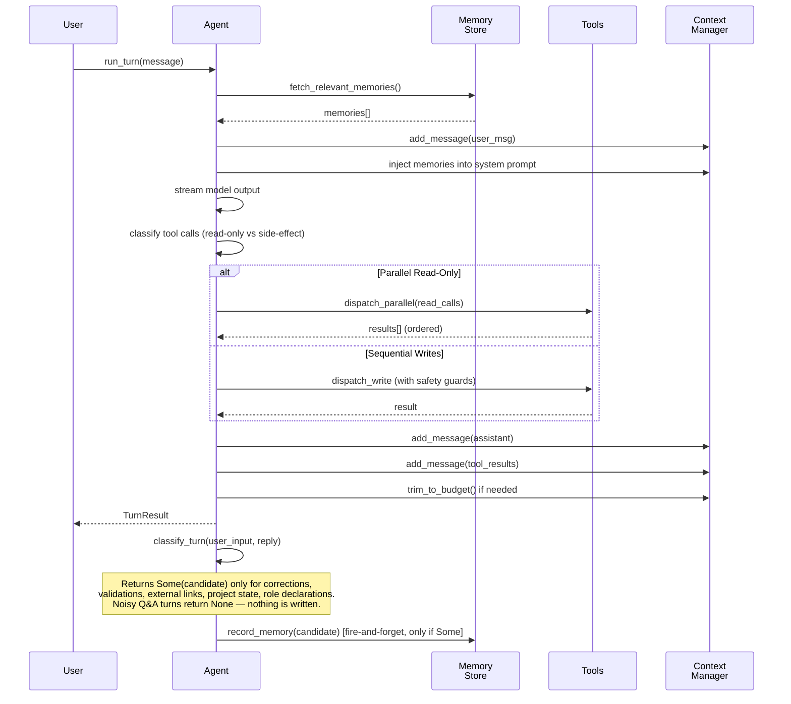
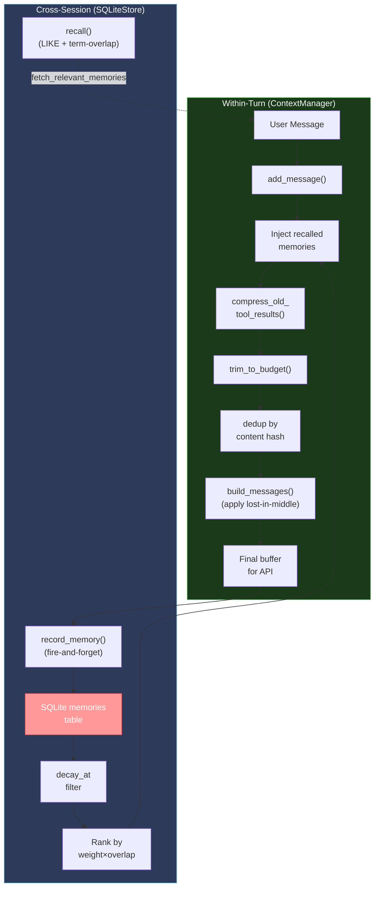

# Multi-Agent Coordination and Memory Management

## Overview

Hone's intelligence stack rests on two foundational subsystems: **multi-agent coordination** for decomposing and executing complex tasks in parallel, and **memory management** spanning both within-turn context trimming and cross-session pattern learning. Together, they enable iterative improvement, ensemble voting, and adaptive complexity routing while maintaining strict invariants around message ordering, context budgets, and edit safety.

## Multi-Agent Coordination

### Architecture

Dual architecture: synchronous `Agent` for single-turn execution with built-in concurrency guards, and an actor-based `AgentHandle` for safe concurrent access via a serialized command channel.

**Entry point:** `Agent::run_turn()` at `crates/hone-core/src/agent.rs:286`. The turn fetches relevant memories via `fetch_relevant_memories()` (`agent.rs:230-250`), appends them to the system prompt, then streams model output. Tool calls are classified as read-only (`agent.rs:895`) or side-effecting:

- **Read-only tools** (`read_file`, `glob`, `grep`, `git_status`, `git_diff`, `lsp_*`, `symbol_*`) are batched and dispatched in parallel via `dispatch_parallel()` (`agent.rs:916-960`), with results returned in original request order.
- **Side-effecting writes** trigger sequential dispatch with safety guards: must-read-before-edit (`agent.rs:576-626`) auto-injects `read_file` if a file hasn't been read in the current turn; edit-streak limit (`agent.rs:629-651`) injects a hint after 3 consecutive edits without shell or read.

After turn completion, `classify_turn(user_input, assistant_reply)` heuristically decides whether the turn produced a memory-worthy fact (correction, validation, external link, project state, or role declaration). If it returns `Some(candidate)`, the candidate is forwarded to `record_memory(candidate)` (`agent.rs:278+`). Noisy turns — plain Q&A with no trigger — return `None` and nothing is written.

### Actor Model: AgentHandle

`AgentHandle` at `agent.rs:1036-1086` spawns a background tokio task owning one `Agent` and processing commands from an `mpsc` channel, serializing all access to context and state. Multiple clones of the handle can safely submit commands; the actor guarantees sequential execution.

**Spawn pattern:**
```rust
let handle = AgentHandle::spawn(agent_config)?;
let result = handle.run_turn(user_message).await?;
```

Shutdown via `shutdown()` returns `Cancelled` on subsequent turns (`agent_turn.rs::test_agent_handle_shutdown`, line 357).

### Orchestrator: Decompose → Execute → Merge

`Orchestrator` at `crates/hone-core/src/orchestrator.rs:19` encapsulates the pipeline:

1. **Decompose** (`orchestrator.rs:113`): breaks a user request into dependency-ordered subtasks
2. **Execute** (`orchestrator.rs:131`): spawns worker agents in parallel, subject to concurrency and budget caps
3. **Merge** (`orchestrator.rs:142`): combines results into a coherent response

**Concurrency control:**
- Semaphore-gated dispatch: `tokio::sync::Semaphore` (`orchestrator.rs:26, 77-79`)
- Per-worker timeout default 300s (`orchestrator.rs:32`); yields `TimedOut` on expiry (`orchestrator.rs:87`)
- Budget tracking: `worker_budget` enforced per subtask

**Resumption:** `Orchestrator::resume()` (`orchestrator.rs:164-200`) requires a `checkpoint_store`; without one, returns `Cancelled` (`orchestrator.rs:172`).

### Specialized Loops

**Ensemble** (`crates/hone-core/src/ensemble.rs`):
- Runs N candidates with varied temperatures
- `EnsembleResult` (`ensemble.rs:35`): `winner`, `winner_index`, `all_candidates`, `ranker_response`, `total_cost_usd`
- Ranker runs at temperature 0.0 (`ensemble.rs:149`)

**Self-Refine** (`crates/hone-core/src/self_refine.rs`):
- Iterative improvement with reviewer feedback
- `RefineResult` (`self_refine.rs:16`): `rounds`, `final_response`, `usage`
- Early exit on `"APPROVED"` sentinel (`self_refine.rs:26`)

**RALPH** (`crates/hone-core/src/ralph_loop.rs`):
- Config-driven loop: Review → Analyze → Learn → Plan → Heal
- `RalphLoop` (`ralph_loop.rs:105`) stages feedback with test verification

### Provider Routing

Model dispatch via adapter layer: `crates/hone-core/src/providers/`. Each adapter (Anthropic, OpenAI, Ollama, ACP) implements tool-calling protocol. Fall-through to OpenAI-compatible via `HONE_OPENAI_BASE_URL` for DeepSeek, Qwen, OpenRouter, etc.

### Key Types

| Type | Location | Purpose |
|------|----------|---------|
| `Agent` | `agent.rs:157` | Holds `config`, `context: ContextManager`, `cost`, `turn_count`, `guards` |
| `AgentConfig` | `agent.rs:28-68` | Provider, tools, sandbox, system prompt, model, budget, memory store, retry |
| `TurnResult` | `crates/hone-core/src/turn.rs:6` | `response`, `usage`, `cost_usd`, `tool_calls_count` |
| `Orchestrator` | `orchestrator.rs:20` | `lead_config`, `registry`, `max_workers`, `max_concurrent`, `worker_budget` |
| `EnsembleResult` | `ensemble.rs:35` | Voting outcome with cost tracking |
| `RefineResult` | `self_refine.rs:16` | Rounds and final response |

### Invariants (with test citations)

1. Read-only tools dispatched in parallel; results returned in original request order — `agent_turn.rs::test_parallel_read_only_tools_complete_in_order` (line 438)
2. Writes execute sequentially — `agent_turn.rs::test_mixed_sequential_preserves_all_results` (line 520)
3. Must-read-before-edit: if agent tries to edit a file it hasn't read this turn, `read_file` is auto-injected (`agent.rs:576-626`)
4. Edit-streak limit: after 3 consecutive edits without shell or read, hint message is injected (`agent.rs:629-651`)
5. Actor serializes concurrent clones — `agent_turn.rs::test_agent_handle_concurrent_clones_serialize` (line 315)
6. After shutdown, `run_turn` returns `Cancelled` — `agent_turn.rs::test_agent_handle_shutdown` (line 357)
7. Memory injection at turn start (`agent.rs:230-250`); fire-and-forget if store absent
8. Orchestrator concurrency capped via semaphore; timeouts default 300s, yield `TimedOut` (`orchestrator.rs:87`)
9. Ensemble ranker runs at temperature 0.0 (`ensemble.rs:149`)
10. Self-refine terminates early on `"APPROVED"` sentinel (`self_refine.rs:26`)

### Known Limitations

- Tool dispatch batching (`agent.rs:467-569`) is greedy; a write sandwiched between reads loses surrounding parallelism
- `Orchestrator::resume()` requires a `checkpoint_store`; without one, returns `Cancelled` (`orchestrator.rs:172`)
- `EnsembleResult` does not expose individual ranker diagnostics

### Turn Lifecycle



## Memory Management

### In-Turn Context: ContextManager

`ContextManager` at `crates/hone-core/src/context.rs` (~48 KB) maintains a message buffer with strict budget controls, compression, and deduplication.

**Data flow:**
1. `add_message()` appends to buffer
2. `trim_to_budget()` removes old messages in LRU order, except protected ones (system prompt, first user, recent window)
3. `compress_old_tool_results()` progressively compresses tool results older than `tool_compress_age` (5 turns, `context.rs:69`)
4. `build_messages()` always prepends system prompt, applies lost-in-the-middle reordering, returns final buffer for API call

**Compression schedule:**
- Age ≤ 5 turns: kept verbatim
- Age 5–10 turns: compressed to structural summary
- Age > 10 (after `tool_oneliner_age()`, `context.rs:81-82`): reduced to one-liner placeholder

**Deduplication:** tool results with identical content (by hash) are replaced with a pointer on second occurrence (`context.rs:167-200`). Small results (<512 bytes, `context.rs:173`) are excluded.

### ContextConfig

Per-model defaults via `ContextConfig::for_model()` (`context.rs:45-73`):
- Claude: 0.60 effective budget ratio
- Others: 0.40–0.55

Key fields:
- `effective_budget_ratio`: % of advertised context length reserved for input
- `recent_window`: number of recent messages protected from compression
- `tool_compress_age`: turns before first compression pass
- `reorder_middle_zone`: lost-in-the-middle window size

**Phase tracking** (`TaskPhase`, `context.rs:109-116`): transitions (Exploration → Editing → Verification) trigger structural trimming (`context.rs:134-150`).

### Cross-Session Memory: hone-memory

SQLite-backed persistent store with relevance scoring and optional decay.

**Schema:**
```
memories {
  id: UUID,
  content: TEXT,
  tags: JSON,
  weight: REAL,
  created_at: TIMESTAMP,
  decay_at: OPTION<TIMESTAMP>
}
```

**Recall flow** (`crates/hone-memory/src/sqlite_store.rs:100-145`):
1. Fetch candidates via `LIKE` substring match
2. Score by term overlap × `Memory::weight` (`sqlite_store.rs:123-134`)
3. Apply decay (if `decay_at ≤ now`, drop)
4. Return top-k

### Key Types

| Type | Location | Purpose |
|------|----------|---------|
| `ContextManager` | `context.rs` (~48 KB) | Message buffer, trimming, compression, dedup |
| `ContextConfig` | `context.rs:21-97` | Budget ratios, compress ages, phase config |
| `Memory` | `crates/hone-memory/src/types.rs:4-11` | Persistent record: id, content, tags, weight, decay_at |
| `MemoryStore` trait | `crates/hone-memory/src/store.rs:9-25` | record, recall, forget, decay, export, import |
| `SqliteStore` | `crates/hone-memory/src/sqlite_store.rs:10-73` | Async SQLite backend |

### Invariants (with test citations)

1. System prompt always present — `context_manager.rs::test_system_message_always_present` (line 54)
2. System + first user message survive trimming — `context_manager.rs::test_preserves_system_prompt_and_first_user_message` (line 146)
3. Recent window protected from compression — `context_manager.rs::test_context_keeps_recent_messages` (line 125)
4. Lost-in-the-middle ordering — `context_manager.rs::test_message_ordering_respects_lost_in_the_middle` (line 382)
5. Tool results older than 5 turns compressed — `context_manager.rs::test_old_tool_results_compressed` (line 209)
6. Recent tool results not compressed — `context_manager.rs::test_recent_tool_results_not_compressed` (line 259)
7. Duplicate tool results replaced with pointer — `context_manager.rs::test_duplicate_tool_results_replaced_with_pointer` (line 293)
8. Small tool results excluded from dedup — `context_manager.rs::test_small_tool_results_not_deduped` (line 337)
9. Trim marker inserted where messages dropped — `context_manager.rs::test_context_inserts_trim_marker` (line 109)
10. Memory decay via `decay_at` (`sqlite_store.rs:18, 147+`)
11. Relevance = term overlap × `Memory::weight` (`sqlite_store.rs:123-134`)
12. Memory recording is fire-and-forget — errors silenced (`agent.rs:274`)

### Known Limitations

- No learned compaction strategy — age/size heuristics only
- `SqliteStore::recall()` uses `LIKE` + term-overlap; no embedding-based or BM25 retrieval
- Token estimation via tiktoken; no online counting, so budget may drift
- No in-process caching layer for recalled memories

### Orchestrator Decompose-Execute-Merge Flow

```mermaid
graph LR
    User["User Request"]
    
    Decompose["decompose()<br/>Break into subtasks<br/>with dependencies"]
    
    subgraph Exec["execute_plan()"]
        Sem["Semaphore<br/>(max_concurrent)"]
        W1["Worker Agent 1<br/>(timeout=300s)"]
        W2["Worker Agent 2"]
        WN["Worker Agent N"]
    end
    
    Merge["merge_results()<br/>Combine outputs"]
    Response["Final Response"]
    
    User -->|orchestrate()| Decompose
    Decompose -->|Plan| Sem
    Sem --> W1 & W2 & WN
    W1 & W2 & WN -->|Results| Merge
    Merge --> Response
    
    style Exec fill:#8b5a00,stroke:#d9a,color:#fff
    style Sem fill:#ff6600,stroke:#f90,color:#fff
    style User fill:#2d5f7f,stroke:#5ac,color:#fff
    style Response fill:#2d5f7f,stroke:#5ac,color:#fff
```

### ContextManager Message Pipeline and Memory Flow



## Related Files Index

| File | Purpose |
|------|---------|
| `crates/hone-core/src/agent.rs` | `Agent`, `AgentHandle`, tool dispatch, memory injection, turn lifecycle |
| `crates/hone-core/src/turn.rs` | `TurnResult` struct and turn outcome types |
| `crates/hone-core/src/context.rs` | `ContextManager`, `ContextConfig`, message trimming, compression, dedup, lost-in-middle |
| `crates/hone-core/src/orchestrator.rs` | `Orchestrator`, decompose/execute/merge pipeline, semaphore, timeouts |
| `crates/hone-core/src/ensemble.rs` | `EnsembleLoop`, `EnsembleResult`, parallel candidate generation and ranking |
| `crates/hone-core/src/self_refine.rs` | `SelfRefineLoop`, `RefineResult`, iterative improvement with reviewer |
| `crates/hone-core/src/ralph_loop.rs` | `RalphLoop`, Review/Analyze/Learn/Plan/Heal phases |
| `crates/hone-memory/src/store.rs` | `MemoryStore` trait: record, recall, forget, decay, export, import |
| `crates/hone-memory/src/types.rs` | `Memory`, `MemoryQuery`, `MemoryStats` type definitions |
| `crates/hone-memory/src/sqlite_store.rs` | `SqliteStore` async SQLite implementation |
| `tests/agent_turn.rs` | Turn lifecycle, parallelism, actor, safety guard tests |
| `tests/context_manager.rs` | Budget trimming, compression, dedup, lost-in-middle, phase transition tests |
