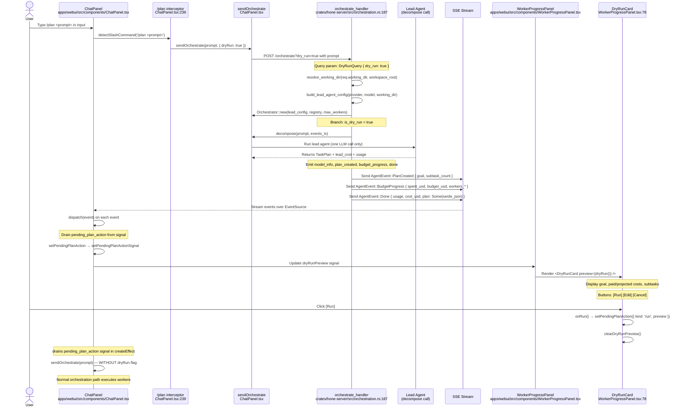

# Orchestration GUI Flow Architecture

This document visualizes the end-to-end `/plan` command flow across Hone's TUI and web UI surfaces. The web UI calls the daemon's `/orchestrate?dry_run=true` endpoint; the TUI plans in-process. They differ in how they dispatch the decomposition, render the preview, and handle user actions.

The TUI path runs the orchestrator in-process (`Orchestrator::decompose`), while the web UI streams SSE events from the daemon. Both paths surface the same state shape: goal, cost estimates, and subtask list.

---

## TUI Flow: Local Decomposition

```mermaid
%%{init: {"themeVariables": {"fontSize": "13px"}, "flowchart": {"nodeSpacing": 25, "rankSpacing": 30, "padding": 8}, "sequence": {"actorMargin": 30, "messageMargin": 25, "boxMargin": 6}, "gantt": {"barHeight": 16, "barGap": 3}}}%%
sequenceDiagram
    actor User
    participant App as App State<br/>hone_tui/src/app.rs
    participant TUI as TUI loop<br/>bins/hone/src/main.rs
    participant Orch as Orchestrator<br/>hone_core/src/orchestrator.rs
    participant LLM as Lead Agent

    User->>App: /plan <prompt>
    App->>App: "Planning: …", state WaitingForResponse,<br/>pending_plan_prompt = prompt
    TUI->>App: take_pending_plan_prompt()
    TUI->>Orch: spawn dispatch_plan_decompose (background task)
    Note over TUI: keeps drawing; Esc cancels like a turn,<br/>and a late result is dropped
    Orch->>LLM: decompose (one lead call)
    LLM-->>Orch: TaskPlan
    Orch-->>TUI: (plan, lead_cost, usage)
    TUI->>App: set_plan_preview(PlanPreviewState::from_decompose(…))
    Note over App: overlay open, state Idle;<br/>on error: plan_failed(msg)

    alt r / Enter
        User->>App: handle_key_plan_preview
        App->>App: user message, state WaitingForResponse,<br/>pending_plan_run = preview
        TUI->>App: take_pending_plan_run() (after every key event)
        TUI->>Orch: spawn_orchestrated_turn(…, Some(plan)) → run_plan
        Note over Orch: no second decompose: runs the plan shown,<br/>with the Complex turn's model, /budget and /permit
    else e
        App->>App: input bar = prompt, cursor at end
    else c / Esc
        App->>App: overlay closed, plan dropped
    end
```

`/plan` while a turn (or another plan) is running is refused with a message.

**Key functions and files:**
- `hone_tui/src/app.rs` — `/plan` command handling, `handle_key_plan_preview`, `set_plan_preview`, `plan_failed`, `take_pending_plan_prompt`, `take_pending_plan_run`
- `bins/hone/src/main.rs:dispatch_plan_decompose` — in-process decompose, spawned as a task
- `bins/hone/src/main.rs:spawn_orchestrated_turn` — runs a Complex turn, or a given plan
- `hone_core/src/orchestrator.rs` — `Orchestrator::decompose`, `Orchestrator::run_plan`
- `hone_tui/src/render/plan_preview.rs:render_plan_preview` — overlay rendering
- `hone_tui/src/plan_preview.rs` — `PlanPreviewState` (keeps the full `TaskPlan`)

---

## Web UI Flow: SSE Streaming Decomposition



**Key functions and files:**
- `apps/webui/src/components/ChatPanel.tsx:239` — slash-command interception
- `crates/hone-server/src/orchestration.rs:187` (line 187) — `orchestrate_handler` endpoint
- `crates/hone-server/src/orchestration.rs:251-322` — dry-run branch logic
- `crates/hone-server/src/orchestration.rs:DryRunQuery` (line 76) — query parameter shape
- `apps/webui/src/components/WorkerProgressPanel.tsx:78` — `<DryRunCard>` component
- `hone_core/src/lib.rs:89` — `DEFAULT_WORKER_COST_USD = 0.05` constant

---

## Governance Overrides: `/budget` and `/permit`

Both surfaces feed governance flags into the next turn's dispatch:

```mermaid
%%{init: {"themeVariables": {"fontSize": "13px"}, "flowchart": {"nodeSpacing": 25, "rankSpacing": 30, "padding": 8}, "sequence": {"actorMargin": 30, "messageMargin": 25, "boxMargin": 6}, "gantt": {"barHeight": 16, "barGap": 3}}}%%
sequenceDiagram
    actor User
    participant CLI as hone (TUI)
    participant App as App State
    participant Cmd as handle_command<br/>hone_tui/src/user_commands.rs
    participant Gov as PendingGovernance<br/>hone_tui/src/governance.rs

    User->>CLI: Type /budget 0.50
    CLI->>Cmd: parse Command::Budget(0.50)
    Cmd->>App: set_pending_governance(PendingGovernance { budget_usd: Some(0.50), permits: [] })
    
    User->>CLI: Type /permit shell
    CLI->>Cmd: parse Command::Permit("shell")
    Cmd->>App: append to pending_governance.permits
    
    User->>CLI: Type /plan ...
    Note over CLI: ... plan preview shown ...
    
    User->>CLI: Press 'r' (run)
    Note over CLI: Main loop drains pending_governance before dispatching
    
    CLI->>App: take_pending_governance()
    CLI->>CLI: agent.set_budget_limit(Some(0.50)), agent.approve_tools(["shell"])
    CLI->>CLI: same budget and policy on the orchestrated run's config
    
    Note over App: Pending governance drained; the agent keeps<br/>the budget and permits for the rest of the session
    Note over CLI: Workers take the agent's approval policy (with /permit)<br/>and mode when the run starts; the lead has no tools.<br/>/budget caps only the lead's calls (workers use worker_budget)
```

**Key types and functions:**
- `hone_tui/src/governance.rs:PendingGovernance` (line 6) — state struct
- `bins/hone/src/main.rs:run_tui` — drain point in the main loop, at turn start (also for a `/plan` Run)
- `hone_core/src/agent.rs` (AgentHandle) — `set_budget_limit`, `approve_tools` setters
- `hone_proto::ToolApprovalPolicy::approve_always` — per-tool allowlist API

---

## Cost Estimate Formula

Both TUI and web UI use the same formula:

```
projected_cost_usd = lead_cost_usd + subtask_count × DEFAULT_WORKER_COST_USD
```

Where `DEFAULT_WORKER_COST_USD = 0.05` (defined at `hone_core/src/lib.rs:89`).

The lead cost is the real, measured cost from the decomposition LLM call. The worker estimates are heuristic (not measured) and based on the constant above. Users can set a cap with `/budget <usd>` (TUI; it doesn't cap orchestrator workers yet) or `POST /orchestrate` with `total_budget_usd` (web UI).

---

## See Also

- `docs/tutorials/orchestration-gui.md` — User-facing guide for `/plan`, `/budget`, `/permit`, `/workflows`
- `docs/plans/orchestration-gui-tdd-2026-05.md` — Implementation roadmap and slice definitions
- `docs/research/gui-for-non-cli-users-2026-05.md` — Audience analysis and UX research
- `docs/research/tui-orchestration-integration-2026-05.md` — TUI-specific integration patterns
