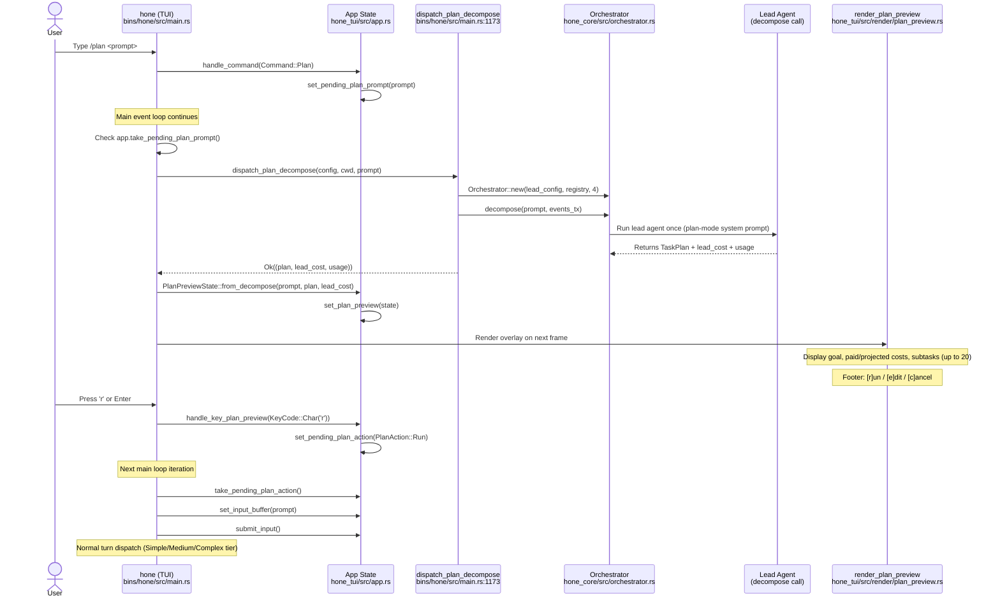
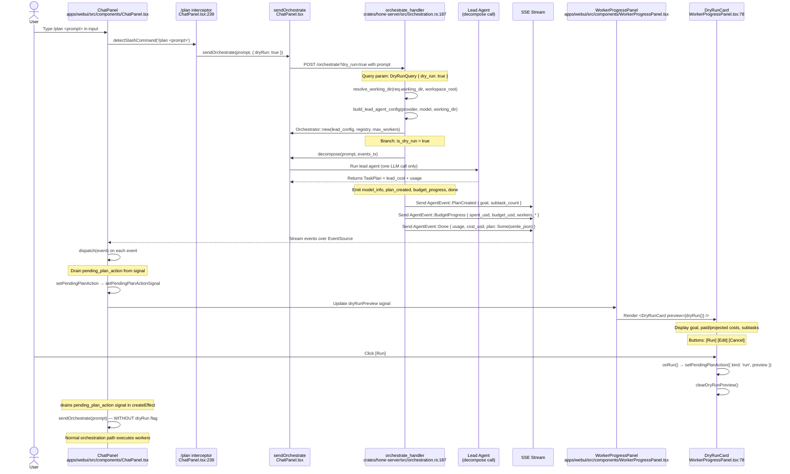
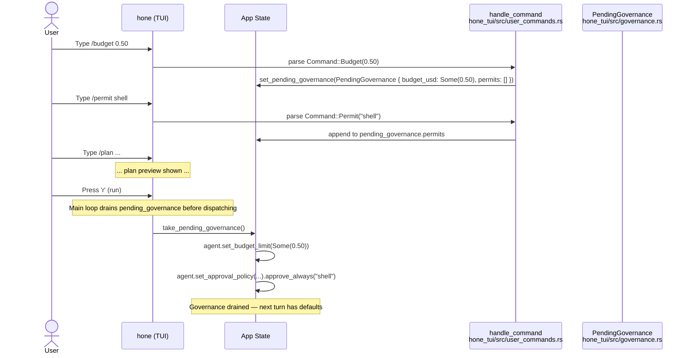

# Orchestration GUI Flow Architecture

This document visualizes the end-to-end `/plan` command flow across Hone's TUI and web UI surfaces. Both surfaces reuse the same backend `/orchestrate?dry_run=true` endpoint; the difference lies in how they dispatch the decomposition, render the preview, and handle user actions.

The TUI path runs the orchestrator in-process (`Orchestrator::decompose`), while the web UI streams SSE events from the daemon. Both paths surface the same state shape: goal, cost estimates, and subtask list.

---

## TUI Flow: Local Decomposition



**Key functions and files:**
- `bins/hone/src/main.rs:handle_command` (line ~2800) — intercepts `/plan` slash command
- `bins/hone/src/main.rs:dispatch_plan_decompose` (line 1173) — in-process orchestrator call
- `hone_tui/src/app.rs` — state holders: `pending_plan_prompt`, `set_plan_preview`
- `hone_core/src/orchestrator.rs:Orchestrator::decompose` — decomposition-only path
- `hone_tui/src/render/plan_preview.rs:render_plan_preview` (line 20) — overlay rendering
- `hone_tui/src/plan_preview.rs` — `PlanPreviewState` and `PlanAction` types

---

## Web UI Flow: SSE Streaming Decomposition



**Key functions and files:**
- `apps/webui/src/components/ChatPanel.tsx:239` — slash-command interception
- `crates/hone-server/src/orchestration.rs:187` (line 187) — `orchestrate_handler` endpoint
- `crates/hone-server/src/orchestration.rs:251-322` — dry-run branch logic
- `crates/hone-server/src/orchestration.rs:DryRunQuery` (line 76) — query parameter shape
- `apps/webui/src/components/WorkerProgressPanel.tsx:78` — `<DryRunCard>` component
- `hone_core/src/lib.rs:89` — `DEFAULT_WORKER_COST_USD = 0.05` constant

---

## Governance Overrides: `/budget` and `/permit`

Both surfaces feed per-run governance flags into the turn dispatch:



**Key types and functions:**
- `hone_tui/src/governance.rs:PendingGovernance` (line 6) — state struct
- `bins/hone/src/main.rs:2980` — drain point in main loop
- `hone_core/src/agent.rs` (AgentHandle) — `set_budget_limit`, `set_approval_policy` setters
- `hone_proto::ToolApprovalPolicy::approve_always` — per-tool allowlist API

---

## Cost Estimate Formula

Both TUI and web UI use the same formula:

```
projected_cost_usd = lead_cost_usd + subtask_count × DEFAULT_WORKER_COST_USD
```

Where `DEFAULT_WORKER_COST_USD = 0.05` (defined at `hone_core/src/lib.rs:89`).

The lead cost is the real, measured cost from the decomposition LLM call. The worker estimates are heuristic (not measured) and based on the constant above. Users can override per-run with `/budget <usd>` (TUI) or `POST /orchestrate` with `total_budget_usd` (web UI).

---

## See Also

- `docs/tutorials/orchestration-gui.md` — User-facing guide for `/plan`, `/budget`, `/permit`, `/workflows`
- `docs/plans/orchestration-gui-tdd-2026-05.md` — Implementation roadmap and slice definitions
- `docs/research/gui-for-non-cli-users-2026-05.md` — Audience analysis and UX research
- `docs/research/tui-orchestration-integration-2026-05.md` — TUI-specific integration patterns
