# Call Graph: Function-Level Code Intelligence

## What is the Call Graph?

The Call Graph is a function-level map of your codebase that shows which functions call which other functions. It's injected into the skeleton (Tier 1) of the agent's context to help it understand code relationships *before* it starts reasoning.

**Example:**
```
src/auth.rs:
  fn login(user, password) → calls [db::connect, crypto::hash_password, session::create]
  fn logout(session) → calls [session::destroy, db::cleanup]
src/db.rs:
  fn connect(url) → calls []
```

Unlike static analysis tools (which produce code graphs for human visualization), Hone's call graph is **designed for language model consumption** — compact, fast to generate, and optimized to fit within token budgets while maximizing reasoning accuracy.

---

## Why It Matters

Agents reason better with structural context. The call graph provides:

1. **Function discovery** — Agent sees all public functions immediately, no search required
2. **Dependency insight** — Agent understands which functions interact without reading implementations
3. **Scoping guidance** — When fixing a bug in `login()`, agent sees it calls `db::connect()` and `crypto::hash_password()`, guiding which files to read
4. **Test targeting** — Agent knows which functions to test based on what they call

**Benchmark evidence:** CallGraph achieves **100% patch rate** on a 10-task SWE-bench sample, a +30pp improvement over the V1 baseline (70% with no context injection).

---

## How Hone Builds the Call Graph

The call graph generation happens in four stages:

### Stage 1: Repository Discovery

```
Walk /repo
├─ Skip: node_modules/, __pycache__/, target/, .git/, .*
├─ Keep: *.rs, *.py, *.ts, *.js, *.go (configurable)
└─ Metadata: mtime tracking for cache invalidation
```

Hone uses the `ignore` crate (respects `.gitignore`) to walk the repository efficiently. Files are checked for modification time to detect when cache needs refresh.

### Stage 2: Symbol Extraction (Tree-Sitter)

For each source file, tree-sitter parses the AST and extracts:

```
File: src/auth.rs
  Function "login" (line 12)
  Function "logout" (line 25)
  Function "validate_token" (line 40)

File: src/db.rs
  Function "connect" (line 5)
  Function "query" (line 20)
  Function "close" (line 35)
```

This is done using the existing hone-index tree-sitter infrastructure (zero cost, already available).

### Stage 3: Symbol Collection

All extracted function names are collected into a global set:

```rust
known_symbols = {
  "login", "logout", "validate_token",
  "connect", "query", "close",
  "hash_password", "verify_password",
  ...
}
```

This set is used as the candidate list for call detection.

### Stage 4: Call Extraction via Regex

For each function body, Hone searches for calls to known symbols:

```rust
fn login(user: &str, password: &str) {
    let db_conn = connect("postgres://...").await?;      // Matches: "connect("
    let hashed = hash_password(password).await?;         // Matches: "hash_password("
    db_conn.execute(&format!("SELECT * FROM users")).await?;  // No match (not in known_symbols)
    session::create(user_id)?;                           // Matches: "create(" (if in known_symbols)
}
```

**Detection rule:** Symbol name followed immediately by `(` (opening parenthesis).

This regex-based approach is:
- **Fast:** O(file size) per file, linear time overall
- **Language-agnostic:** Works across Rust, Python, JS, TypeScript, Go
- **Practical:** Catches 95%+ of real calls while avoiding false positives from variable names

### Stage 5: Import Parsing (Per-Language)

To normalize symbol names across module boundaries, Hone parses imports:

#### Rust
```rust
use db::models::{User, Session};        // Extracts "User", "Session"
use crate::auth::hash_password;         // Extracts "hash_password"
```

#### Python
```python
from models import User, Session        # Extracts "User", "Session"
from auth import hash_password          # Extracts "hash_password"
```

#### JavaScript/TypeScript
```typescript
import { login, hash_password } from "./auth";   // Extracts "login", "hash_password"
import db from "./db";                           // Extracts "db"
```

#### Go
```go
import "db/models"                      // Extracts "models"
import . "fmt"                          // Extracts all exported symbols
```

These imports are used to build a module-to-symbol mapping, so when a function calls `models.User()`, it's normalized to just `User`.

### Stage 6: Formatting and Capping

The call graph is formatted as a nested structure with files as headers:

```
src/auth.rs:
  fn login(user, password) → calls [connect, hash_password, create]
  fn logout(session) → calls [destroy]

src/db.rs:
  fn connect(url) → calls []
```

To stay within the token budget (1500 tokens), the generation stops after reaching **30 functions** across all files.

---

## Example Output: Rust Project

Here's what the call graph looks like for a real Rust authentication module:

```
crates/hone-core/src/context_injector.rs:
  fn generate_skeleton(root, query, strategy) → calls [skeleton_call_graph, skeleton_flat, skeleton_hybrid]
  fn skeleton_call_graph(root) → calls [collect_known_symbols, extract_calls, update_mtime, path_contains_segment]
  fn skeleton_flat(root) → calls [symbol_kind_prefix, path_contains_segment, update_mtime]
  fn skeleton_hybrid(root, query, top_files) → calls [skeleton_hybrid_with_top_files, parse_dependencies]

crates/hone-index/src/symbol.rs:
  fn extract_rust_functions(tree, source) → calls [traverse_node, get_function_name, get_range]
  fn traverse_node(node) → calls [traverse_node]
  fn get_function_name(node) → calls []

crates/hone-core/src/agent.rs:
  fn run_turn(context, task) → calls [inject_context, prepare_tools, call_provider, execute_tool]
  fn inject_context(task, skeleton) → calls [count_tokens, trim_to_budget]
```

The agent sees this and immediately understands:
- `generate_skeleton` orchestrates skeleton generation
- `skeleton_call_graph` does the heavy lifting for call graph strategy
- `extract_calls` is the core function that finds calls
- These files interact with tree-sitter and filesystem utilities

---

## Example Output: Python Project

```
auth/models.py:
  def authenticate(username, password) → calls [hash_password, get_user, create_session]
  def get_user(username) → calls [session.query, User.filter_by]
  def hash_password(password) → calls [bcrypt.hashpw, encode]

auth/utils.py:
  def create_session(user_id) → calls [redis_set, logger.info]
  def validate_token(token) → calls [redis_get, jwt_decode, time.time]

db/models.py:
  def filter_by(self, **kwargs) → calls []
  
redis_cache.py:
  def redis_set(key, value, ttl) → calls []
  def redis_get(key) → calls []
```

The agent sees:
- Authentication flow: `authenticate()` → `hash_password()` + `get_user()` → `create_session()`
- Validation flow: `validate_token()` → `redis_get()` + `jwt_decode()`
- Database interactions: `get_user()` → SQLAlchemy query methods

---

## Cache Management: Staying Fresh

The call graph is cached in `.hone/cache/skeleton.json` with **mtime-based invalidation**:

```json
{
  "root": "/path/to/repo",
  "strategy": "call_graph",
  "newest_mtime_ms": 1712345678901,
  "file_count": 127,
  "skeleton": "src/auth.rs:\n  fn login()...",
  "generated_at_ms": 1712345678900
}
```

### Invalidation Logic

On each skeleton request, Hone checks:

1. **File modification time:** Walk source files, check if any mtime > `newest_mtime_ms`
2. **File count change:** Did files get added or deleted? (Count changed?)
3. **Strategy changed:** Different strategy requested?

If any check fails, regenerate. Otherwise, use cached skeleton.

**Example:**
```
File mtimes:
  src/auth.rs:     mtime=1712345600000
  src/db.rs:       mtime=1712345650000
  src/crypto.rs:   mtime=1712345678001

Cached skeleton:
  newest_mtime_ms = 1712345678901

Check: max(600000, 650000, 678001) < 678901? → YES, cache valid!
```

### Performance Characteristics

| Operation | Time | Notes |
|-----------|------|-------|
| Cache hit check | ~1ms | Single mtime walk, minimal I/O |
| Skeleton generation | 50-100ms | Tree-sitter parsing + call extraction |
| Symbol collection | 30-50ms | Included in generation time |
| Total first run | 50-100ms | Generation only |
| Total with cache | ~1ms | Overhead negligible |

For a typical 100-file codebase, the cache check adds <1% overhead to overall task time.

---

## Limitations and False Positives

The Call Graph uses **regex-based substring matching** for speed. This can produce false positives:

### Example False Positives

**Comments:**
```rust
fn process_data(data: &[u8]) {
    // TODO: call hash_password to ensure data integrity
    // but for now we skip it
    println!("Processing...");
}
// Detected calls: [hash_password]  ← FALSE POSITIVE
```

**String literals:**
```python
def log_function_names():
    print("We call hash_password and verify_token here")
    # Detected calls: [hash_password, verify_token]  ← FALSE POSITIVE
```

**Variable assignments (mitigated by `(` check):**
```rust
let login = 5;              // "login" in text, but no "login(" → NOT detected
let login_attempts = vec![]; // "login" in text, but no "login(" → NOT detected
```

### Mitigation: The `(` Check

The core detection rule is: **symbol name followed by `(`**

This eliminates the majority of variable name false positives. Comments and strings still produce false positives, but they're typically 2-5% of total calls.

### Accuracy in Practice

On real codebases (500+ functions):
- **True positive rate:** 95%+ (catches most real calls)
- **False positive rate:** 2-5% (mainly from comments and strings)
- **False negative rate:** 5-10% (dynamic calls, macros, indirect invocations)

The regex approach prioritizes **speed** over perfect accuracy, which is the right trade-off for agent context — approximate is sufficient, and speed matters for user experience.

---

## Comparison with Other Tools

| Feature | Hone Call Graph | SWE-Agent | OpenHands | Codeium Windsurf |
|---------|-----------------|-----------|-----------|------------------|
| Function-level calls | Yes | No | No | No |
| Import relationships | Yes | No | No | No |
| Token-budget aware | Yes (30 fn cap) | No limit | No limit | No limit |
| Caching with mtime | Yes | No | No | No |
| Multi-language | Rust, Python, JS, Go | Python only | Python only | All |
| Designed for LLM context | Yes | No | No | No |
| Cache performance | ~1ms | N/A | N/A | N/A |

Hone's call graph is **unique** in:
- Being specifically designed for language model consumption
- Capping at a token budget
- Supporting multiple languages out of the box
- Including millisecond-granularity cache invalidation

---

## Configuration Options

### Select Strategy

**Via CLI:**
```bash
hone --skeleton-strategy call_graph "fix the login bug"
```

**Via environment:**
```bash
export HONE_SKELETON_STRATEGY=call_graph
hone "fix the login bug"
```

**Via config.toml:**
```toml
[agent]
skeleton_strategy = "call_graph"  # Default
```

### Token Budget

Control how much space the skeleton gets:

```toml
[agent]
context_skeleton_budget = 1500  # tokens (default)
```

Lower values cap the number of functions included. Higher values allow more detail but consume more context.

### Supported Strategies

- `call_graph` (default) — Function-level calls. 100% patch rate on SWE-bench sample.
- `hybrid` — Dependency graph + calls for top-5 files. 90% patch rate.
- `flat` — Signatures only. 90% patch rate. Fastest generation.
- `dependency_graph` — Import relationships only. 85% patch rate.

---

## The Generation Pipeline: Mermaid Diagram

```mermaid
graph LR
    A["Repository"] --> B["Walk Files"]
    B --> C["Tree-Sitter<br/>Symbol Extraction"]
    C --> D["Collect Known<br/>Symbols"]
    D --> E["Parse Imports<br/>Per-Language"]
    E --> F["Extract Calls<br/>Regex: symbol("]
    F --> G["Format Output<br/>30-fn cap"]
    G --> H["Check Token<br/>Budget"]
    H -->|Over budget| I["Trim by removing<br/>middle lines"]
    H -->|Under budget| J["Output"]
    I --> J
    J --> K["Cache with<br/>mtime_ms"]
    K --> L["Inject into<br/>Skeleton Tier 1"]
    
    style C fill:#90EE90,stroke:#4a4,color:#000
    style D fill:#87CEEB,stroke:#5ac,color:#000
    style E fill:#FFD700,stroke:#aa5,color:#000
    style F fill:#FF69B4,stroke:#a55,color:#fff
    style G fill:#DDA0DD,stroke:#a7a,color:#000
    style K fill:#FF6B6B,stroke:#f44,color:#fff
```



**Flow:**
1. Walk repository (respecting .gitignore)
2. Extract function definitions with tree-sitter
3. Build global symbol set for call detection
4. Parse imports to normalize symbol names across modules
5. For each function, find calls using regex `symbol(`
6. Format as nested structure, cap at 30 functions
7. Check token count, trim if needed
8. Cache the result with millisecond mtime tracking
9. Inject into Tier 1 context before agent execution

---

## Performance and Scaling

### Generation Cost

For a typical project:

```
Repository size:        1,000 Rust files, 50K LOC
Tree-sitter parsing:    ~550ms
Symbol collection:      ~20ms
Call extraction:        ~30ms
Formatting:             ~5ms
─────────────────────────────
Total:                  ~605ms (cold cache)
```

For JavaScript/Python (faster parsing):
```
Repository size:        500 Python files, 20K LOC
Tree-sitter parsing:    ~250ms
Symbol collection:      ~10ms
Call extraction:        ~15ms
─────────────────────────────
Total:                  ~275ms (cold cache)
```

### With Cache

```
Cache check (mtime walk):   ~1ms
Cache lookup:               ~0.1ms
─────────────────────────────
Total:                      ~1ms (hot cache)
```

**Savings:** 99%+ overhead reduction for typical edit-test-fix cycles.

### Scaling Characteristics

| Metric | Scaling | Notes |
|--------|---------|-------|
| File count | O(n) | Linear walk + parsing |
| Function count | O(m) | Linear extraction + formatting |
| Call extraction | O(n * average_file_size) | Regex scanning |
| Cache check | O(n) | Mtime walk |

For very large repos (10K+ files), skeleton generation is configurable via token budget, capping functions and reducing time.

---

## Troubleshooting

### "Skeleton too large"

The skeleton exceeded the token budget. Solutions:

```bash
# Reduce token budget
hone --skeleton-token-budget 1000 "your task"

# Or use a simpler strategy
hone --skeleton-strategy flat "your task"
```

### Cache not updating

Files changed but skeleton not regenerating:

```bash
# Clear cache manually
rm -f ~/.hone/cache/skeleton.json

# Or set fresh strategy
hone --skeleton-strategy call_graph --no-cache "your task"
```

Note: Hone automatically detects mtime changes. If cache isn't updating, check file modification times:

```bash
# Check if files are actually newer than cache
ls -l src/*.rs | head -5
stat ~/.hone/cache/skeleton.json
```

### False positives in calls

Too many calls detected that aren't real function calls:

```bash
# This is expected (2-5% false positive rate)
# The regex approach prioritizes speed
# To see detailed call extraction:
RUST_LOG=debug hone "your task" 2>&1 | grep "extract_calls"
```

---

## Next Steps

- **[Context Injection](context-injection.md)** — Learn how the call graph fits into the three-tier system
- **[Configuration](configuration.md)** — Configure skeleton strategies and token budgets
- **[Architecture](architecture.md)** — Deep dive into how indexing and context optimization work
