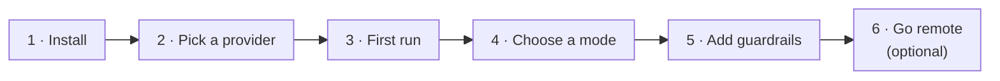
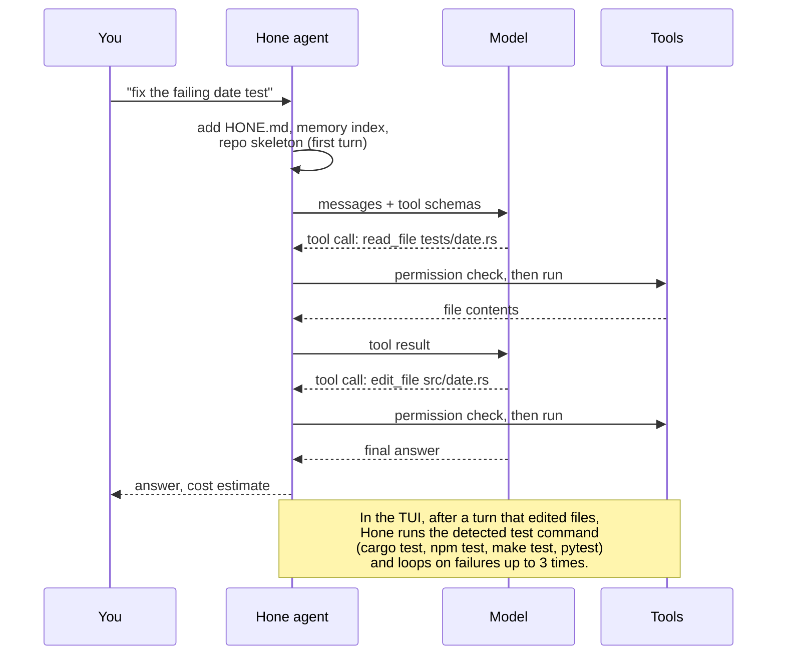
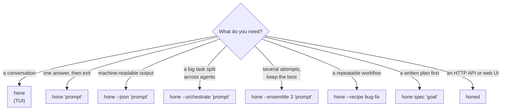
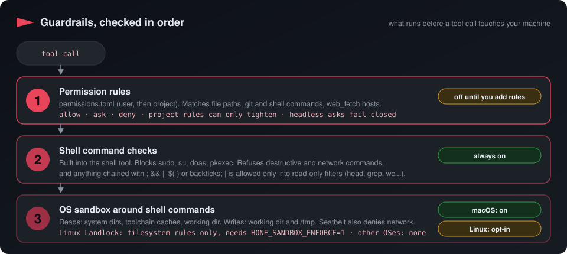
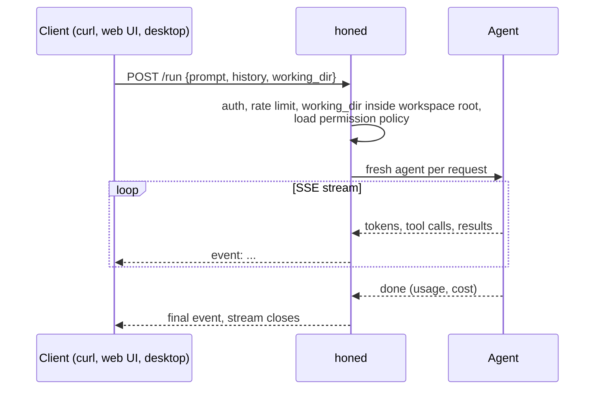

# Getting started with Hone

<p align="center">
  
</p>

<p align="center">
  
  
  
  
</p>

Hone is an agent runtime for the terminal, written in Rust. You give it a task in plain
language; it reads, edits, runs commands, fetches pages and calls MCP tools until the task
is done. It is strongest on code, but nothing in the loop is code-specific. This guide
takes you from install to a first run, then to guardrails and the daemon.



<details>
<summary><b>Contents</b></summary>

1. [Install](#1-install)
2. [Pick a provider](#2-pick-a-provider)
3. [First run](#3-first-run)
4. [Choose a mode](#4-choose-a-mode)
5. [Sessions and memory](#5-sessions-and-memory)
6. [Make it yours](#6-make-it-yours)
7. [Add guardrails](#7-add-guardrails)
8. [Run the daemon](#8-run-the-daemon-honed)
9. [Troubleshooting](#9-troubleshooting)

</details>

## 1. Install

| You need | Check |
|---|---|
| Rust 1.85 or newer | `rustc --version` ([rustup.rs](https://rustup.rs)) |
| A C toolchain and OpenSSL headers (tree-sitter grammars are C; `git2` links OpenSSL on Linux) | macOS: `xcode-select --install` · Debian/Ubuntu: `build-essential pkg-config libssl-dev` |
| macOS or Linux | Windows is not supported yet |
| Optional: Node.js 18+ | for MCP servers launched with `npx`, and to build the web UI |

| Channel | Command | Status |
|---|---|---|
| crates.io | `cargo install hone-cli honed` | published; may lag `main` |
| From source | `git clone https://github.com/wojciechkpl/hone && cd hone && make install` | always current |
| Homebrew | `brew install --build-from-source ./packaging/homebrew/Formula/hone.rb` | from a checkout; tap not published yet |
| pip | `pip install ./packaging/python` | from a checkout; wheels not published yet |

`make install` runs `cargo install --path bins/hone` and `cargo install --path bins/honed`.
Check the install:

```bash
hone --version
honed --version
```

## 2. Pick a provider

Hone detects a provider at startup. Set **one** of these and you're done:

| Option | Set this | Tool calling | Cost |
|---|---|---|---|
| Anthropic | `export ANTHROPIC_API_KEY=sk-ant-...` | yes | paid API |
| OpenAI | `export OPENAI_API_KEY=sk-...` | yes | paid API |
| DeepSeek, OpenRouter, Qwen, vLLM, ... | `OPENAI_API_KEY` + `HONE_OPENAI_BASE_URL` + `HONE_OPENAI_MODEL` | yes | varies |
| Ollama (local) | `ollama serve` and `ollama pull llama3.2` | yes | free, on your machine |
| Claude CLI | have `claude` on `PATH` | Claude's own tools, not Hone's | your Claude plan |
| Gemini CLI | have `gemini` on `PATH` | Gemini's own tools, not Hone's | your Gemini plan |

Or run the wizard, which writes `~/.config/hone/config.toml`:

```bash
hone configure
```

```text
Welcome to the Hone configuration wizard.

Step 1: Select a provider

  1. Anthropic (Claude)
  2. OpenAI
  3. DeepSeek
  4. OpenRouter
  5. Ollama (local)
  6. Claude CLI (claude binary)
```

> [!NOTE]
> At startup Hone only reads the wizard's Anthropic key and its OpenAI, DeepSeek and
> OpenRouter settings (key, base URL, model). Choosing Ollama or Claude CLI, or picking an
> Anthropic model, currently has no effect: Ollama and `claude` are found by auto-detection,
> and you pick an Anthropic model with `--model`.

> [!TIP]
> Environment variables always win over the wizard's file. The detection order, the
> `--model` prefixes and the full provider table are in
> [Configuration → Choosing a provider](configuration.md#choosing-a-provider-and-model).

Example: DeepSeek through its OpenAI-compatible API.

```bash
export OPENAI_API_KEY=sk-...
export HONE_OPENAI_BASE_URL=https://api.deepseek.com
export HONE_OPENAI_MODEL=deepseek-chat
hone
```

## 3. First run

```bash
cd your-project
hone                                   # interactive TUI
hone "why does test_parse_date fail?"   # one-shot: answer, then exit
hone --json "list the TODOs in src/"    # structured output for scripts and CI
hone --image screenshot.png "what is wrong with this layout?"
```

<p align="center">
  
  <br><sub>The Agent Rail (<kbd>Ctrl</kbd>+<kbd>R</kbd>) shows each tool call of the turn as it runs.</sub>
</p>

<a id="81-plan-preview-gate-plan"></a>

**TUI essentials**

| Key / input | Does |
|---|---|
| <kbd>Enter</kbd> · <kbd>Shift</kbd>+<kbd>Enter</kbd> | send · new line |
| <kbd>Esc</kbd> | mid-turn: cancel the turn · while typing: clear input |
| <kbd>Ctrl</kbd>+<kbd>K</kbd> | command palette |
| <kbd>Ctrl</kbd>+<kbd>O</kbd> | session switcher: pick a session, and the TUI exits and prints `hone session resume <name>` |
| <kbd>F1</kbd> | all keybindings |
| `/model anthropic:claude-opus-4-5` | change the model from the next turn (same provider) |
| <kbd>Shift</kbd>+<kbd>Tab</kbd> | cycle Build (asks before writes and shell) → Plan (read-only) → AutoApprove (doesn't ask; permission rules still apply) |
| `/plan <task>` | preview the orchestrator's plan without running workers |
| `@debugger <task>` | send one message to a built-in persona |
| `!cargo test` | run a shell command yourself, outside the agent |

The full list is in the [cheatsheet](onboarding/cheatsheet.md).

### What happens in one turn



## 4. Choose a mode



| Mode | Command | Good for |
|---|---|---|
| TUI | `hone` | Day-to-day work. Each message is classified as simple (one agent turn), medium (a self-refine pass) or complex (the orchestrator). |
| One-shot | `hone "…"` | Quick questions and small fixes. Ambiguous prompts print clarifying questions to stderr (turn off with `--no-clarify`). |
| JSON | `hone --json "…"` | CI and scripts: response, tool calls, usage, cost and exit status. |
| Orchestrate | `hone --orchestrate "…"` | Large tasks: a lead model writes a plan, worker agents run the subtasks (up to 4 at a time, in dependency order), and the results are merged. Progress goes to `.hone/plan.md`. |
| Ensemble | `hone --ensemble N "…"` | Hard one-off answers: N candidates (2–10) at different temperatures, then a ranker picks one. |
| Recipe | `hone --recipe <name> [--var k=v]` | Built-in multi-step workflows: `tdd-feature`, `bug-fix`, `code-review`, `refactor`, `security-audit`, `performance`, `migration`, `documentation`, `onboarding`. |
| Spec | `hone spec "goal"` | Writes requirements, design and tasks to `.hone/specs/<slug>/`. |
| Daemon | `honed` | HTTP + SSE API, web UI, remote and distributed runs. See [§8](#8-run-the-daemon-honed). |

> [!NOTE]
> `--orchestrate` and `--ensemble` need a provider with tool calling (Anthropic,
> OpenAI-compatible or Ollama). With the Claude or Gemini CLI, Hone warns that results may
> be degraded.

## 5. Sessions and memory

```bash
hone --session auth-refactor "map the auth module"   # one-shot, saved as auth-refactor
hone session list                                    # all saved sessions
hone session resume auth-refactor                    # load it into the TUI
hone reports list                                    # TUI session reports
hone memory ls --kind feedback                       # what Hone remembered
hone --ephemeral                                     # no memory, index or session writes
```

- One-shot runs are saved to `sessions.db` (under a generated name unless you pass
  `--session`). The TUI doesn't save sessions yet; on exit it writes a session report to
  `.hone/reports/`.
- Memory is a local SQLite file. After a turn, a heuristic keeps only what looks worth
  remembering: corrections, stated preferences, project facts and references. Each new
  session starts with an index of those memories, each turn recalls the closest matches,
  and the model reads full entries with the `memory_read` tool.
- `--encrypted-memory` with `HONE_MEMORY_PASSPHRASE` encrypts memory content with
  AES-256-GCM, using a key derived with Argon2id.

More in [Core concepts → Memory](onboarding/concepts.md#5-memory).

## 6. Make it yours

| Want to | Do this |
|---|---|
| Teach project conventions | Add `HONE.md` with `##` sections at the repo root |
| Connect GitHub, a database, ... | Add MCP servers to `.hone/mcp.json` (same format as Claude Code) |
| Add a persona | Drop a Markdown file into `.hone/agents/` and call it with `@name` |
| Add a slash command | Drop a Markdown file into `.hone/commands/` |
| Change colours | `HONE_THEME=neon`, or keys in `~/.config/hone/theme.toml` |

Formats and locations: [Configuration](configuration.md).

## 7. Add guardrails

Hone runs three independent checks on tool calls. The shell checks are always on; the
Seatbelt sandbox is on by default on macOS (Landlock on Linux is opt-in):

<p align="center">
  
</p>

Turn on the third, your own permission rules, with one file:

```toml
# ~/.config/hone/permissions.toml
[[rules]]
id = "no-push"
command = "git push*"
decision = "deny"

[[rules]]
id = "no-env"
path = "**/.env"
decision = "deny"
```

> [!NOTE]
> `ask` rules prompt in the TUI. In headless runs (`hone "prompt"`, `--json`, `--recipe`, …)
> there is no one to ask, so an `ask` is refused unless you pass `--approve <id>`.

> [!WARNING]
> On Linux, the Landlock sandbox for shell commands is **opt-in** while it is validated on
> a Landlock kernel. Set `HONE_SANDBOX_ENFORCE=1` to enable it. On macOS, Seatbelt is on
> by default.

The full guide: [Permissions and sandbox](permissions-and-sandbox.md).

<a id="12-remote-access-honed"></a><a id="14-remote-access-honed"></a>

## 8. Run the daemon (`honed`)

`honed` serves the same agent over HTTP with Server-Sent Events, plus a web UI.

```bash
export ANTHROPIC_API_KEY=sk-ant-...      # POST /run uses the Anthropic API

# Loopback only: no token needed
HONE_BIND=127.0.0.1 honed               # http://127.0.0.1:3117

# Reachable from other machines: a token is required
HONE_AUTH_TOKEN="$(openssl rand -hex 32)" honed 3117
```

> [!IMPORTANT]
> `honed` binds `0.0.0.0` by default and **refuses to start** (exit code 2) without
> `HONE_AUTH_TOKEN` unless you bind to loopback (`HONE_BIND=127.0.0.1`) or set
> `HONE_ALLOW_UNAUTH=1`. The check runs before any role is chosen, so it applies to
> coordinators and workers too.

```bash
curl -N -X POST http://127.0.0.1:3117/run \
  -H 'Content-Type: application/json' \
  -d '{"prompt": "list the TODOs in src/"}'
```



<a id="enable-the-gui"></a>

| Surface | How |
|---|---|
| Web UI | `make webui`, rebuild `honed`, then open `http://127.0.0.1:3117/ui` |
| Web UI development | `make webui-dev`: Vite dev server with hot reload at `http://127.0.0.1:5174`, proxying to `honed` on `:3117` |
| Desktop app (Tauri 2) | `cargo run -p hone-desktop` with `honed` on `PATH`; it can supervise its own `honed` or connect to a remote one. Linux packages, `cargo tauri dev` / `cargo tauri build`: [apps/hone-desktop/README.md](../apps/hone-desktop/README.md) |
| Distributed orchestration | Every command needs the same token: coordinator `HONE_AUTH_TOKEN=… HONE_DISTRIBUTED_DB=queue.db honed`, workers `HONE_AUTH_TOKEN=… HONE_WORKER_COORDINATOR=http://host:3117 honed`, client `HONE_AUTH_TOKEN=… hone --orchestrate --distributed http://host:3117 "…"` |
| API reference | `GET /openapi.json` (generated from the code); [HTTP API](api/http-api.md) and [SSE events](api/sse-events.md) (written earlier; may be out of date) |

Daemon variables are listed in [Configuration](configuration.md#environment-variables).
Older tutorials with more detail (they may be out of date; the reference pages win):
[Server and remote](tutorials/server-and-remote.md), [HTTP API](api/http-api.md).

## 9. Troubleshooting

<details>
<summary><b>"No AI provider detected"</b></summary>

None of Anthropic, OpenAI, `claude`, `gemini` or Ollama was available. Set an API key, or
start Ollama and pull `llama3.2`. Ollama is detected only on `localhost:11434` and only
when `llama3.2` is installed; for another model use `--model ollama:<name>`.

</details>

<details>
<summary><b>"ANTHROPIC_API_KEY doesn't start with 'sk-ant-'"</b></summary>

A warning only; Hone still uses the key. Check for a stray quote or a key from another
provider.

</details>

<details>
<summary><b><code>honed: refusing to start: no HONE_AUTH_TOKEN set</code></b></summary>

Set `HONE_AUTH_TOKEN`, or bind to loopback with `HONE_BIND=127.0.0.1`.

</details>

<details>
<summary><b><code>requires approval (rule ...)</code></b></summary>

A permission rule said `ask` and the run couldn't prompt: a headless run (`hone "prompt"`,
`--json`, `--recipe`, …). Re-run with `--approve <rule id>`. See [Permissions and sandbox](permissions-and-sandbox.md#asks-interactive-vs-headless).

</details>

<details>
<summary><b><code>command blocked (requires approval): ...</code></b></summary>

The shell tool refuses destructive, network and chained commands (`;`, `&&`, `$(…)`,
and `|` except into a read-only filter such as `head`, `grep` or `wc`). Split the command,
or use `read_file`, `grep`, `git_*` or `web_fetch`. (`sudo` and friends give
`command blocked: privilege escalation …` instead.)

</details>

<details>
<summary><b>The model forgets things or the context overflows on a local model</b></summary>

Hone infers the context window from the model name. If your server uses a smaller window,
set it: `HONE_CONTEXT_WINDOW=32768`.

</details>

<details>
<summary><b>Memory or session database errors</b></summary>

Run with `--ephemeral` to skip the stores, or move `~/.local/share/hone/memory.db` aside.
`hone memory forget --before 2026-01-01T00:00:00Z` prunes old entries.

</details>

## Next steps

| Read | For |
|---|---|
| [Core concepts](onboarding/concepts.md) | How the loop, tools, memory and agents fit together |
| [Cheatsheet](onboarding/cheatsheet.md) | Every flag, key and slash command on one page |
| [Configuration](configuration.md) | Files and environment variables |
| [Permissions and sandbox](permissions-and-sandbox.md) | Guardrails in depth |
| [Architecture](architecture.md) | Crates and data flow |
| [Migration guides](onboarding/README.md) | Coming from Claude Code, Aider, Goose, Codex CLI or OpenCode |
| [TUI keybindings and themes](tutorials/tui-keybindings-and-themes.md) | More on the TUI (older tutorial; may be out of date) |
| [Observability](observability.md), [Session reports](session-reports.md) | Audit log, traces and the reports the TUI writes on exit |
