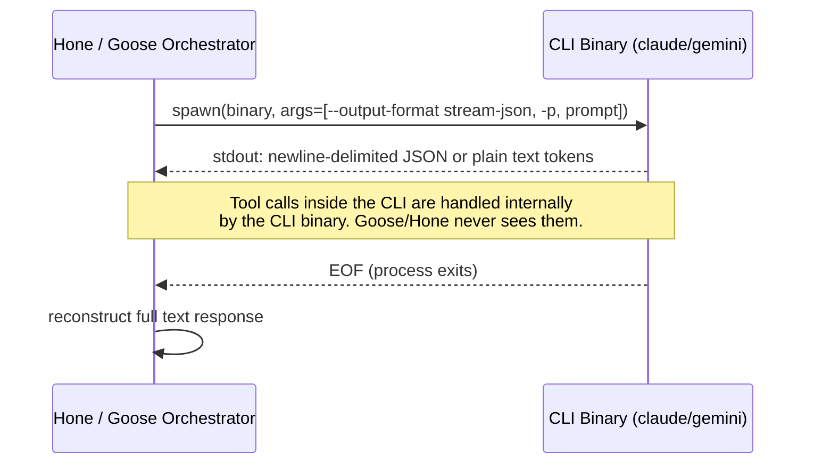
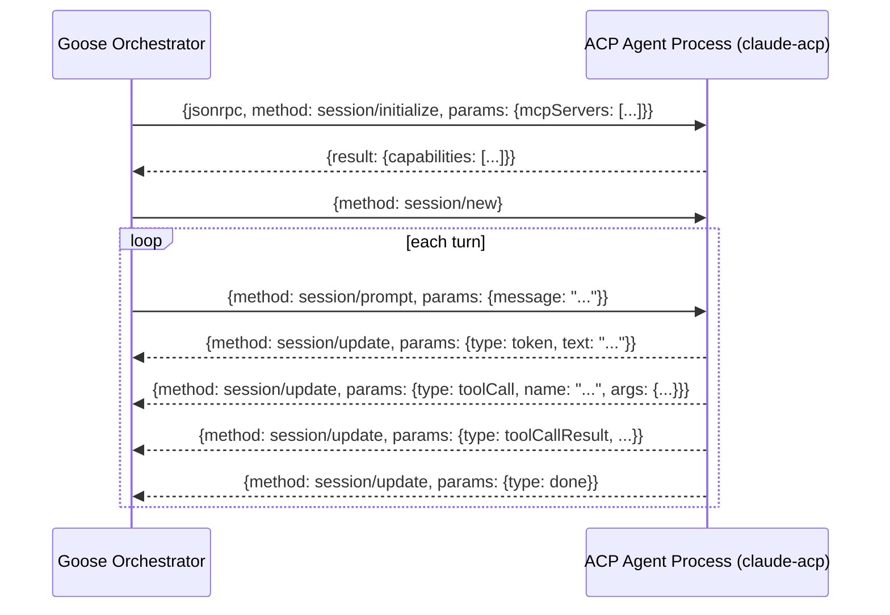

# Goose Pass-Through Provider Research

**Date:** 2026-04-05
**Context:** Research into Goose's (block/goose) CLI provider pattern to inform Hone's `ClaudeCliProvider` and `GeminiCliProvider` implementation strategy.

---

## 1. How the Pattern Works

Goose's CLI provider pattern is a two-generation design. Understanding both generations is essential because the first generation (which Hone currently mirrors) has been deprecated.

### Generation 1: Raw stdin/stdout subprocess (deprecated)

The original `claude-code`, `gemini-cli`, and `codex` providers in Goose work exactly as Hone's current implementation does:

- Spawn the CLI binary as a child process with piped stdin/stdout.
- A `CliProcess` struct owns the child process lifecycle.
- Messages are serialised into a flat text prompt with role prefixes (`Human:` / `Assistant:` for Claude Code, plain text for Gemini CLI).
- Streaming responses are read line-by-line from stdout:
  - **Claude Code** — parses newline-delimited JSON events (`--output-format stream-json`).
  - **Codex** — parses newline-delimited JSON events.
  - **Gemini CLI** — reads plain text; no structured envelope.
  - **Cursor Agent** — parses a JSON response envelope.
- Communication is one-shot per turn: one prompt in, streamed text out. There is no bidirectional channel.

**Critical limitation:** Goose's own extension system (MCP tool servers) is silently stripped from the system prompt before sending to the subprocess, because the CLI tool has its own internal tool ecosystem. **No tool calls issued by the model are relayed back to the Goose orchestrator.** The subprocess either handles them internally (Claude CLI's built-in tools) or they are lost.

### Generation 2: Agent Client Protocol / ACP (current)

Goose replaced the raw subprocess approach with the **Agent Client Protocol (ACP)**, which is now the default via providers named `claude-acp`, `codex-acp`, and `gemini-acp`.

ACP is a JSON-RPC 2.0 protocol over stdio (with WebSocket and HTTP planned). The agent binary runs as a local subprocess that stays alive across turns, and the orchestrator communicates with it via structured JSON-RPC messages:

| Method | Direction | Purpose |
|---|---|---|
| `session/initialize` | orchestrator → agent | declare capabilities, pass MCP server list |
| `session/new` | orchestrator → agent | start a new conversation session |
| `session/prompt` | orchestrator → agent | send a user turn |
| `session/update` | agent → orchestrator | stream response tokens / tool call events |
| `session/cancel` | orchestrator → agent | abort in-flight request |

Because ACP is bidirectional and the subprocess is long-lived, the orchestrator can now pass its own MCP tool servers to the agent at initialization. Tool calls that the agent model makes can be surfaced back through `session/update` notifications and routed to the correct tool executor.

---

## 2. Key Architectural Decisions in Goose

1. **Per-CLI adapters, not a generic wrapper.** Each CLI binary gets its own adapter struct because the output format varies significantly (JSON-RPC vs. newline-delimited JSON vs. plain text). There is no single generic "CLI provider" abstraction.

2. **System prompt filtering is mandatory.** The CLI tools run their own agent loop internally. Injecting Goose's MCP tool definitions into the system prompt causes conflicts. Goose filters them out entirely for Generation 1 providers.

3. **ACP is the answer to tool passthrough.** The only way Goose solved the tool-call problem is by moving to a protocol (ACP) where the subprocess declares its capabilities and the orchestrator can inspect or relay tool events. Raw stdio line-reading cannot carry structured bidirectional tool-call/result pairs reliably.

4. **Generation 1 is a convenience shim, not a production integration.** Goose's own documentation describes the deprecated CLI providers as included "purely as a convenience" and explicitly states they do not give access to the extension ecosystem. The GitHub maintainers noted that using them means you "don't get most of the features."

---

## 3. What Hone Should Adopt or Change

### Where Hone currently stands

Hone's `ClaudeCliProvider` and `GeminiCliProvider` in `crates/hone-providers/src/adapters/` implement Generation 1 faithfully:

- `/adapters/cli_common.rs` — `spawn_cli_stream` reads stdout line-by-line and emits `ProviderEvent::Token` for every non-empty line.
- `/adapters/claude_cli.rs` — passes `--output-format stream-json` and a flat text prompt; `supports_tools: false` is correctly set.
- `/adapters/gemini_cli.rs` — similar pattern.

The `supports_tools: false` flag is accurate: the current design cannot relay tool calls back to Hone's tool dispatcher.

### Recommendations

**Option A — Accept Generation 1 as a subscription-cost shortcut only (low effort)**

Keep the current implementation as-is, make the limitation explicit in documentation, and do not wire these providers into Hone's tool-call dispatch path. Use them solely for conversational turns where the model's built-in tools (file read/write inside `claude`) are sufficient and Hone's own tools are not needed. This matches Goose's own positioning of these providers before deprecation.

**Option B — Implement ACP for Claude Code and Gemini CLI (high value)**

Implement the `session/initialize` → `session/prompt` → `session/update` JSON-RPC-over-stdio protocol in a new `AcpCliProvider` (or per-CLI variants). This would:

- Keep the subprocess alive across turns (no re-spawn overhead).
- Allow passing Hone's MCP tool server list to the agent at initialization.
- Surface `toolCall` and `toolCallResult` events so Hone's `Dispatcher` can handle them.
- Mirror exactly what Goose does with `claude-acp` / `gemini-acp`.

The ACP spec is public at [agentclientprotocol.com](https://agentclientprotocol.com) and Goose's source is open for reference.

**Option C — Use Claude's `--output-format json` with print mode for richer tool events (medium effort)**

Rather than flat text prompts, drive `claude --print --output-format stream-json` in a loop, parsing the structured JSONL envelope that includes `tool_use` and `tool_result` content blocks. This does not require ACP but does require Hone to manage conversation state externally and re-invoke the binary each turn with the full history. It gives tool-call visibility without the persistent-process complexity of ACP. This is likely sufficient for Hone's near-term needs if full ACP implementation is too costly.

---

## 4. Limitations of the Pass-Through Approach (Any Generation)

| Limitation | Generation 1 | Generation 2 (ACP) |
|---|---|---|
| Tool calls visible to orchestrator | No | Yes (via notifications) |
| Hone's own MCP tools usable | No | Yes (declared at init) |
| Long-lived session / no re-spawn | No | Yes |
| Structured token cost reporting | Partial (JSON parsing) | Yes |
| Cancellation mid-stream | Process kill only | `session/cancel` message |
| Platform support | macOS/Linux only | macOS/Linux (Windows untested) |
| CLI binary authentication state | Inherited from user shell | Inherited from user shell |
| Model selection flexibility | Binary flag | Declared capability |
| Rate limits / billing | Via user's subscription | Via user's subscription |
| Debuggability | Low (opaque subprocess) | Medium (structured logs) |

The fundamental constraint that neither generation fully resolves: **the CLI binary is an opaque agent**. It has its own planning loop, its own context window management, and its own tool set. When Hone delegates to it, Hone surrenders control of the agent loop. For simple "use your subscription credits" use cases this is acceptable. For workflows where Hone needs precise control over tool dispatch, context injection, or multi-step orchestration, the direct API providers (`anthropic`, `openai`) remain the correct choice.

---

## Sources

- [CLI Providers | goose](https://block.github.io/goose/docs/guides/cli-providers/)
- [Provider Configuration | block/goose | DeepWiki](https://deepwiki.com/block/goose/2.2-provider-configuration)
- [Intro to Agent Client Protocol (ACP) | goose blog](https://block.github.io/goose/blog/2025/10/24/intro-to-agent-client-protocol-acp/)
- [Agent Client Protocol (ACP) | Mintlify / Goose docs](https://www.mintlify.com/block/goose/advanced/acp-protocol)
- [Add OpenAI Codex CLI as CLI Provider · Issue #4181 · block/goose](https://github.com/block/goose/issues/4181)
- [goose Architecture | goose](https://block.github.io/goose/docs/goose-architecture/)
- [GitHub - block/goose](https://github.com/block/goose)
