# Product Requirements Document: Hone

## The Universal Terminal AI Code Agent

**Version:** 1.1  
**Date:** April 4, 2026  
**Status:** Draft for Review — Architecture Revised  
**Classification:** Confidential

---

## Table of Contents

1. [Executive Summary](#1-executive-summary)
2. [Problem Statement](#2-problem-statement)
3. [Vision & Positioning](#3-vision--positioning)
4. [Target Users](#4-target-users)
5. [Competitive Landscape](#5-competitive-landscape)
6. [Architecture](#6-architecture)
7. [Core Requirements](#7-core-requirements)
8. [Feature Specifications](#8-feature-specifications)
9. [Security Model](#9-security-model)
10. [Privacy Architecture](#10-privacy-architecture)
11. [Adaptive Learning System](#11-adaptive-learning-system)
12. [Remote Access & Multi-Surface](#12-remote-access--multi-surface)
13. [Performance Requirements](#13-performance-requirements)
14. [Extensibility & Ecosystem](#14-extensibility--ecosystem)
15. [Developer Experience](#15-developer-experience)
16. [Monetization & Licensing](#16-monetization--licensing)
17. [Success Metrics](#17-success-metrics)
18. [Roadmap](#18-roadmap)
19. [Risks & Mitigations](#19-risks--mitigations)
20. [Appendix: Competitive Feature Matrix](#20-appendix-competitive-feature-matrix)

---

## 1. Executive Summary

**Hone** is an open-source, privacy-first, terminal-native AI coding agent designed to unify the best capabilities from every existing tool in the category — while filling the critical gaps none of them address.

The terminal AI coding agent market has exploded to 15+ serious contenders serving millions of developers daily. Yet no single tool combines provider-agnostic model support, kernel-level sandboxing, LSP code intelligence, a layered tool architecture that uses native CLI for speed and MCP for extensibility, adaptive pattern learning, and secure remote access. Developers are forced to juggle 2–3 tools, fragmenting context and compounding costs.

Hone eliminates this fragmentation. It is built on three foundational principles:

1. **Your models, your machine, your rules.** Run any model — local or cloud, any provider — with data that never leaves your control unless you explicitly choose otherwise.
2. **Intelligence compounds.** Hone learns your patterns, preferences, and project conventions through a local-first adaptive memory system that gets smarter with every session.
3. **Work from anywhere.** A secure client-server architecture lets you start a task in the terminal and seamlessly continue from your phone, tablet, or browser — all through an encrypted tunnel with zero cloud dependency.

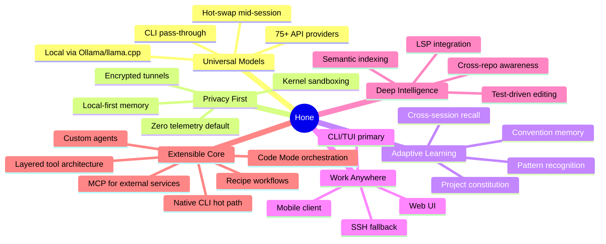

---

## 2. Problem Statement

### 2.1 The Fragmentation Tax

Developers in 2026 use an average of 2.3 terminal AI coding agents. Each tool excels in one dimension but forces painful trade-offs in others:

| Pain Point | Cause | Impact |
|---|---|---|
| Vendor lock-in | Claude Code (Anthropic only), Codex (OpenAI only), Gemini CLI (Google only) | Developers can't use the best model for each task |
| No real security | OpenCode admits its permissions are "not designed to provide security isolation" | Autonomous mode is a liability |
| No pattern memory | Most tools start fresh each session; config files are manual | Repeated explanations, inconsistent output |
| No remote access | Only OpenCode has client-server; no tool has a mobile-optimized UI | Can't monitor or intervene from a phone |
| Context amnesia | Auto-compaction loses early instructions; no persistent semantic index | Agents forget what matters mid-session |
| Cost opacity | No tool shows real-time token consumption before executing | $50+ surprise sessions are common |
| No test-driven loop | Agents guess at correctness instead of iterating against a test contract | Bugs shipped to production |

### 2.2 The Unserved Quadrant

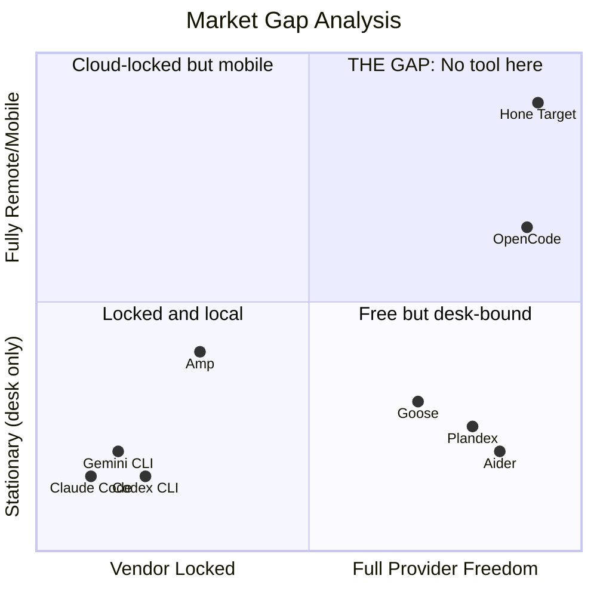

**Hone occupies the top-right quadrant** — full provider freedom with full remote access — while also delivering the security, intelligence, and learning that no tool in any quadrant currently provides.

---

## 3. Vision & Positioning

### 3.1 Product Vision

> Hone is the last terminal coding agent you'll ever need — an open-source, self-hosted, privacy-respecting AI development partner that learns your style, runs any model, works from any device, and gets smarter every day.

### 3.2 Positioning Statement

For professional developers who demand privacy, model freedom, and mobility, Hone is the terminal AI coding agent that unifies kernel-enforced security, LSP code intelligence, a layered tool architecture (native CLI + MCP + Code Mode), and adaptive pattern learning into a single open-source tool. Unlike Claude Code, Codex CLI, or OpenCode, Hone never locks you to a vendor, never sends data without consent, and never forgets what it learned about your codebase.

### 3.3 Design Principles


1. **Privacy by Default** — Local-first. No telemetry. No data leaves the machine unless the user opts in. Encrypted at rest and in transit.
2. **Intelligence Compounds** — Every session makes the next one better. Memory, conventions, and learnings persist locally and improve over time.
3. **Extensibility over Features** — Build the platform, not every feature. A layered tool architecture — native CLI for hot-path operations, MCP for external integrations, Code Mode for complex orchestration, Skills for guidance — means each layer does what it does best without taxing the others.
4. **Speed is a Feature** — Sub-100ms startup. Streaming responses. Rust core for hot paths. Never make the developer wait for the tool.
5. **Terminal First, Multi-Surface** — The CLI is the primary interface. Web, mobile, and IDE are secondary surfaces consuming the same backend.
6. **Open Source, Open Governance** — Apache 2.0 license. Community-driven roadmap. Aiming for Linux Foundation / AAIF membership alongside Goose and MCP.

---

## 4. Target Users

### 4.1 Primary Personas

**The Privacy-Conscious Professional** — Senior engineer at a regulated company (finance, healthcare, government). Needs local model support, audit trails, and zero data leakage. Currently uses Aider + Ollama but lacks intelligence and remote access.

**The Multi-Stack Polyglot** — Full-stack developer working across 3–5 languages and repositories. Needs the best model for each task (Claude for architecture, GPT for speed, local for sensitive code). Currently switches between Claude Code and OpenCode depending on task.

**The Mobile-First Operator** — DevOps/SRE or indie developer who monitors and manages deployments from a phone. Needs to kick off tasks, review diffs, and approve changes remotely. Currently SSH-es into a tmux session as a workaround.

**The Team Lead** — Manages 5–15 developers and needs governance: spend caps, model policies, approved extensions, audit logs. Currently has no visibility into team AI usage.

### 4.2 Secondary Personas

**The Open-Source Contributor** — Wants to extend Hone with MCP servers, custom agents, and recipes. Values documentation, plugin APIs, and community.

**The Student/Hobbyist** — Budget-constrained. Needs the free tier (local models) to be genuinely capable, not a teaser for paid features.

---

## 5. Competitive Landscape

### 5.1 Market Map

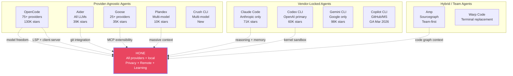

### 5.2 Competitive Advantage Summary

| Dimension | Best Current Tool | Their Limitation | Hone Advantage |
|---|---|---|---|
| Model freedom | OpenCode (75+) | No sandboxing, heavy runtime | 75+ providers with kernel sandboxing |
| Security | Codex CLI (kernel) | OpenAI-locked, no LSP | Kernel sandbox + any model |
| Code intelligence | OpenCode (LSP) | No persistent index | LSP + persistent semantic index |
| Extensibility | Goose (MCP-native) | No phone access, rough polish; MCP context overhead on hot-path ops | Layered: native CLI hot path + MCP for external only + Code Mode orchestration |
| Pattern learning | Claude Code (auto-memory) | Anthropic-locked, cloud-stored | Local-first adaptive memory |
| Remote access | OpenCode (client-server) | No mobile UI, 1GB+ RAM | Lightweight Rust server + mobile app |
| Large codebases | Plandex (2M tokens) | Limited autonomy tooling | Tree-sitter indexing + smart context loading |
| Git workflow | Aider (commit-per-edit) | No LSP, no remote | Git-first with LSP validation |
| Team governance | Amp (shared threads) | Cloud-stored, no self-host | Self-hosted with audit logs |
| Cost transparency | None | All tools lack this | Real-time cost estimation before execution |

---

## 6. Architecture

### 6.1 High-Level Architecture

```mermaid
graph TB
    subgraph "Client Layer"
        CLI[CLI / TUI<br/>Primary interface<br/>Rust + Ratatui]
        WEB[Web UI<br/>Lightweight SPA<br/>Accessible from phone]
        MOB[Mobile PWA<br/>Touch-optimized<br/>Push notifications]
        IDE[IDE Extension<br/>VS Code / JetBrains]
        SSH[SSH Terminal<br/>Fallback access]
    end
    
    subgraph "Hone Server (honed)"
        API[HTTP/SSE API<br/>Session management]
        AGENT[Agent Engine<br/>Planning + Execution loop]
        MEM[Memory Engine<br/>Local adaptive learning]
        CTX[Context Engine<br/>Semantic index + LSP]
        SAND[Sandbox Manager<br/>Kernel enforcement]
        COST[Cost Estimator<br/>Real-time token tracking]
    end

    subgraph "Tool Layers"
        direction TB
        subgraph "Layer 3: Skills — HONE.md"
            SK[Conventions, workflows<br/>Loaded on demand<br/>Zero runtime tokens]
        end
        subgraph "Layer 2: Native Tools — Rust hot path"
            NT[File I/O, Shell, Git<br/>LSP Bridge, Semantic Index<br/>Direct function calls, sub-ms]
        end
        subgraph "Layer 1: MCP — External integrations"
            MCP_T[GitHub, Jira, Slack, DBs<br/>Auth, state, audit<br/>Lazy-loaded schemas]
        end
        subgraph "Layer 0: Code Mode — Orchestration"
            CM[Agent writes TS/Python<br/>Calls native + MCP via SDK<br/>1 pass replaces N tool calls]
        end
    end
    
    subgraph "Intelligence Layer"
        LSP_S[LSP Servers<br/>20+ languages]
        IDX[Semantic Indexer<br/>Embeddings + call graphs]
        TREE[Tree-sitter<br/>AST parsing]
    end
    
    subgraph "Model Layer"
        LOCAL[Local Models<br/>Ollama / llama.cpp / vLLM]
        CLOUD[Cloud APIs<br/>Anthropic / OpenAI / Google / 75+]
        PASS[CLI Pass-through<br/>Claude Code / Codex / Gemini CLI]
    end
    
    subgraph "Security Layer"
        SB_MAC[macOS Seatbelt<br/>Profile generator]
        SB_LIN[Linux Landlock<br/>+ seccomp-BPF]
        SB_CON[Container Mode<br/>OCI isolation]
        AUDIT[Audit Logger<br/>Every action recorded]
    end
    
    CLI --> API
    WEB --> API
    MOB --> API
    IDE --> API
    SSH --> CLI
    
    API --> AGENT
    AGENT --> MEM
    AGENT --> CTX
    AGENT --> SAND
    AGENT --> COST
    
    AGENT --> SK
    AGENT --> NT
    AGENT --> MCP_T
    AGENT --> CM
    
    CTX --> LSP_S
    CTX --> IDX
    CTX --> TREE
    
    AGENT --> LOCAL
    AGENT --> CLOUD
    AGENT --> PASS
    
    SAND --> SB_MAC
    SAND --> SB_LIN
    SAND --> SB_CON
    
    style CLI fill:#E94560,color:#fff
    style AGENT fill:#0F3460,color:#fff
    style MEM fill:#533483,color:#fff
    style SAND fill:#2B2D42,color:#fff
    style NT fill:#E94560,color:#fff
    style MCP_T fill:#0F3460,color:#fff
    style CM fill:#533483,color:#fff
    style SK fill:#059669,color:#fff
```

### 6.2 Technology Stack

| Component | Technology | Rationale |
|---|---|---|
| Core runtime | Rust | Performance, safety, single binary distribution |
| TUI framework | Ratatui | Native Rust TUI, fast rendering, low memory |
| Web UI | SolidJS + Tailwind | Lightweight, reactive, no virtual DOM overhead |
| Mobile | PWA (Progressive Web App) | Cross-platform, no app store dependency, push notifications |
| Server protocol | HTTP/2 + SSE (Server-Sent Events) | Streaming responses, reconnection resilience |
| Semantic indexing | SQLite + embedded vectors | Local-first, no external DB dependency |
| AST parsing | Tree-sitter | Incremental parsing, 30+ language grammars |
| Sandboxing | Platform-native (Seatbelt/Landlock/seccomp) | Kernel-level enforcement, not permission theater |
| MCP runtime | Rust MCP SDK | For external integrations only; native tools bypass MCP entirely |
| Configuration | TOML + Markdown (HONE.md) | Human-readable, version-controllable |

### 6.3 Client-Server Split

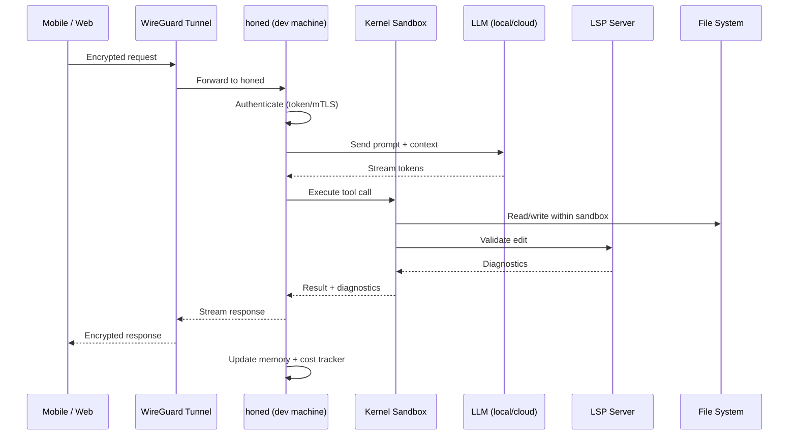

The `honed` daemon runs on the developer's machine (or a self-hosted server). All clients — CLI, web, mobile, IDE — connect to the same instance. Sessions persist across disconnects. The server holds all state; clients are stateless renderers.

---

## 7. Core Requirements

### 7.1 Requirement Categories

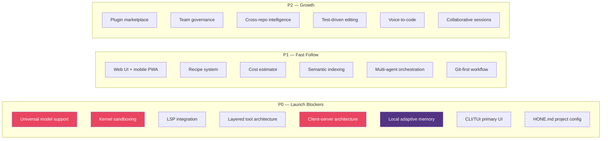

### 7.2 Requirements Table

| ID | Requirement | Priority | Category | Derived From |
|---|---|---|---|---|
| R1 | Support 75+ LLM providers including all major APIs and local inference | P0 | Model | OpenCode, Aider |
| R2 | Kernel-enforced sandboxing on macOS (Seatbelt) and Linux (Landlock + seccomp) | P0 | Security | Codex CLI |
| R3 | LSP integration with 20+ language servers for diagnostics, hover, go-to-def | P0 | Intelligence | OpenCode |
| R4 | Layered tool architecture: native Rust tools for hot path, MCP client for external integrations, Code Mode for multi-tool orchestration, Skills for guidance | P0 | Architecture | Goose (MCP), Codex (CLI), Anthropic (Code Mode) |
| R5 | Client-server architecture with HTTP/SSE API supporting multiple simultaneous clients | P0 | Architecture | OpenCode |
| R6 | Local-first adaptive memory system that learns patterns across sessions | P0 | Learning | Claude Code, Goose |
| R7 | Rust-based CLI/TUI with sub-100ms startup and streaming output | P0 | Performance | Codex CLI |
| R8 | HONE.md hierarchical project constitution (project, directory, user levels) | P0 | Configuration | Claude Code CLAUDE.md |
| R9 | Lightweight web UI accessible from any browser including mobile | P1 | Remote Access | OpenCode |
| R10 | YAML-based recipe system for declarative multi-step workflows | P1 | Extensibility | Goose Recipes |
| R11 | Real-time cost estimation showing projected spend before executing actions | P1 | Cost | Novel |
| R12 | Persistent incremental semantic index (embeddings + call graphs) surviving across sessions | P1 | Intelligence | Novel |
| R13 | Multi-agent orchestration with lead-worker model and parallel subagents | P1 | Agentic | Claude Code Agent Teams, Goose |
| R14 | Git-first workflow with automatic commits per edit and branch management | P1 | Workflow | Aider |
| R15 | Extension marketplace for discovering and installing MCP servers and recipes | P2 | Ecosystem | Novel |
| R16 | Team governance: spend caps, model policies, approved extensions, audit logs | P2 | Enterprise | Claude Code Enterprise |
| R17 | Cross-repository intelligence understanding impacts across multiple repos | P2 | Intelligence | Novel |
| R18 | Test-driven editing mode: accept test spec, iterate code until tests pass | P2 | Workflow | Novel |
| R19 | Voice-to-code input with local transcription (Whisper) | P2 | Input | Aider |
| R20 | Collaborative multi-user sessions for pair programming with AI | P2 | Collaboration | Novel |

---

## 8. Feature Specifications

### 8.1 Universal Model Support

Hone must treat LLM providers as interchangeable backends. No model provider receives special treatment or tighter integration than any other.

**Provider abstraction layer:**

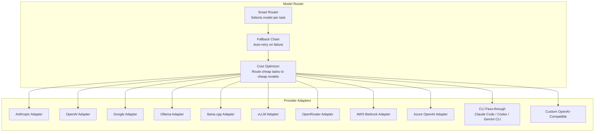

**Key capabilities:**

- Hot-swap models mid-session without losing context (conversation history is model-agnostic)
- Per-agent model configuration: define a "fast-local" agent using Qwen 3 via Ollama and a "deep-cloud" agent using Claude Opus 4.6
- Model routing rules: "Use local model for file reads; use cloud model for multi-file refactors"
- Fallback chains: if primary model is rate-limited, auto-switch to secondary
- CLI pass-through providers: piggyback on existing Claude Code, Codex, or Gemini CLI subscriptions
- Custom OpenAI-compatible endpoint support for self-hosted or enterprise deployments

**Configuration example (hone.toml):**

```
[models.default]
provider = "ollama"
model = "qwen3:32b"
context_length = 131072

[models.deep]
provider = "anthropic"
model = "claude-opus-4-6"
context_length = 1000000
api_key_env = "ANTHROPIC_API_KEY"

[models.fast]
provider = "openai"
model = "gpt-5.3-codex-spark"
context_length = 256000

[routing]
file_read = "default"          # cheap local model
multi_file_edit = "deep"       # powerful cloud model
test_generation = "fast"       # speed-optimized
planning = "deep"
code_review = "deep"
```

### 8.2 Kernel-Enforced Sandboxing

The sandbox is not a permission prompt. It is a kernel-level enforcement boundary that the agent cannot bypass.

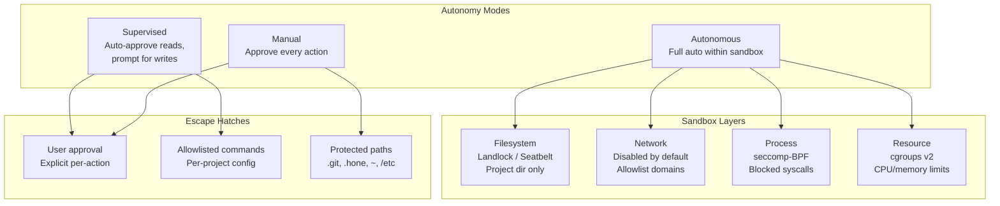

**Implementation details:**

- **macOS:** Dynamic Apple Seatbelt profiles generated at runtime based on project directory and configured permissions. Profiles are compiled and enforced by the kernel.
- **Linux:** Three-layer defense — Bubblewrap (user namespace isolation) + Landlock (filesystem access control) + seccomp-BPF (syscall filtering). A dedicated `hone-sandbox` helper binary with minimal privileges.
- **Container mode:** For environments without kernel sandbox support, spawn tool execution inside an OCI container (Podman/Docker) with volume-mounted project directory. Zero runtime dependencies beyond the container engine.
- **Network policy:** Network is OFF by default in Autonomous mode. Users define domain allowlists in `hone.toml`. DNS resolution is filtered through the sandbox.
- **Protected paths:** `.git/`, `.hone/`, home directory, system directories are NEVER writable in any autonomous mode. Modifications require explicit user approval regardless of mode.
- **Fail-closed design:** If the sandbox cannot be initialized (missing kernel support, permission denied), Hone refuses to enter Autonomous mode and falls back to Manual.

### 8.3 LSP-Powered Code Intelligence

Every file edit is validated by the actual language toolchain, not by pattern matching or the LLM's judgment.

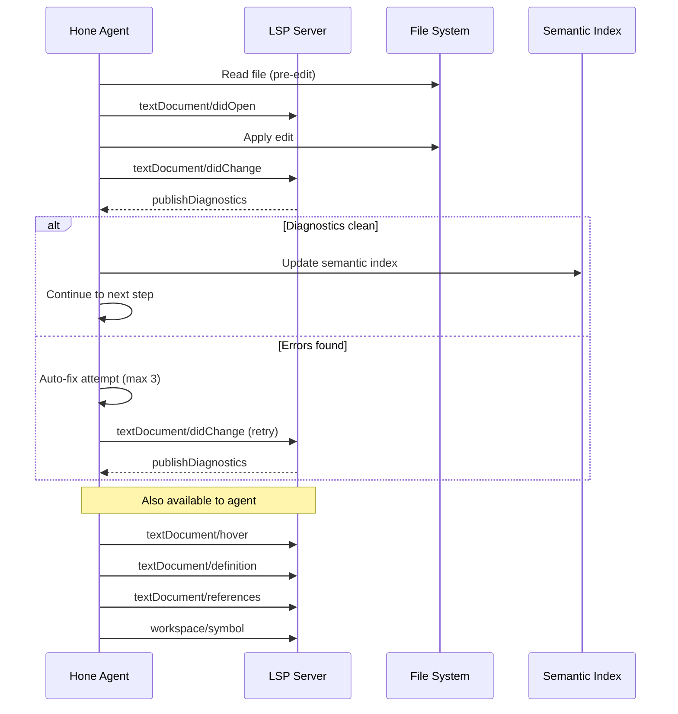

**Supported language servers (P0 launch):**

TypeScript (tsserver), Go (gopls), Python (Pyright), Rust (rust-analyzer), Java (Eclipse JDT), C/C++ (clangd), PHP (Intelephense), Ruby (Solargraph), Elixir (ElixirLS), Zig (zls)

**Additional servers (P1):**

Kotlin, Swift, C#, Haskell, OCaml, Lua, Terraform, SQL, YAML, Dockerfile

**Auto-detection:** Hone scans the project for language markers (package.json, go.mod, Cargo.toml, etc.) and automatically starts the appropriate LSP servers. No configuration required for standard setups.

### 8.4 Layered Tool Architecture

Hone's most critical architectural decision: **core tools are native, external tools use MCP, complex flows use Code Mode, and guidance uses Skills.** This is a deliberate rejection of the "MCP everything" approach (used by Goose) based on hard production data showing that MCP schema overhead can consume 55,000–143,000 tokens before a conversation even starts, degrading both cost and LLM response quality.

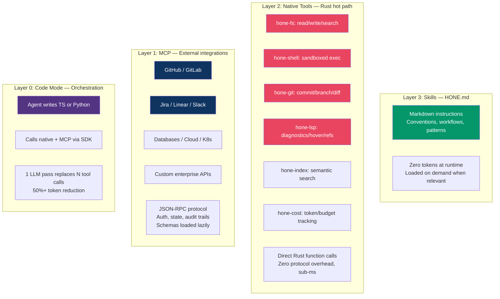

**Why not MCP for everything?** Production evidence is clear:

- A five-MCP-server setup with 58 tools consumes ~55,000 tokens of context before the user types anything (StackOne production data)
- Some deployments report 70,000–90,000 tokens consumed by tool schemas alone — up to 72% of the context window
- LLM instruction-following quality degrades as tool definitions fill the context window
- Perplexity, Cloudflare, and multiple Y Combinator companies have independently moved core operations away from MCP to direct CLI approaches in 2026
- Anthropic's own engineering blog recommends Code Mode — having the agent write code to call tools rather than invoking them directly via MCP

**Why not CLI for everything?** CLI tools assume shell access, which mobile clients, browser extensions, and non-technical integrations cannot provide. CLI has no standardized discovery, authentication, or audit trail. External services with OAuth flows, connection pooling, and state management genuinely benefit from MCP infrastructure.

**The layered approach — which layer handles what:**

| Task | Layer | Why This Layer |
|---|---|---|
| Read/write project files | **Native (L2)** | Direct Rust `fs` calls, zero overhead, sub-ms |
| Run tests, build, lint | **Native (L2)** | Shell execution, structured output, already exists |
| Git operations | **Native (L2)** | `git` CLI is battle-tested, agents parse it well |
| LSP diagnostics after edit | **Native (L2)** | Direct IPC to language server, latency-critical |
| Search codebase (grep/ripgrep) | **Native (L2)** | Text search + tree-sitter AST, fast and precise |
| Coding conventions and style | **Skills (L3)** | Loaded contextually from HONE.md, zero tokens when unused |
| Connect to GitHub API | **MCP (L1)** | OAuth, pagination, webhooks — needs infrastructure |
| Post to Slack / update Jira | **MCP (L1)** | External service with auth and audit requirements |
| Query a database | **MCP (L1)** | Connection pooling, credentials, type-safe results |
| Multi-tool orchestration (5+ steps) | **Code Mode (L0)** | Agent writes a script calling both native + MCP tools; 1 LLM pass |

**Practical result:** A task like "read the auth module, find the bug, fix it, run tests, commit" hits **zero MCP overhead** — all native Layer 2. A task like "find the Jira ticket, update it, post to Slack, create a PR on GitHub" uses MCP for external integrations but orchestrates them via Code Mode in a single inference pass.

**MCP extension management (Layer 1):**

- `hone ext list` — show installed and available MCP servers
- `hone ext add <name>` — install from registry or URL
- `hone ext remove <name>` — uninstall
- **Lazy schema loading:** MCP tool schemas are NOT loaded into context at session start. They load only when the agent determines a task requires an external integration, and only the relevant server's tools are loaded.
- Per-project extensions in `hone.toml`; global extensions in `~/.config/hone/extensions.toml`
- Extension permissions are sandboxed: an MCP server for Slack cannot access the filesystem unless explicitly granted

**Code Mode implementation (Layer 0):**

When the agent detects a task requiring 3+ tool calls across multiple services, it switches to Code Mode:

1. Agent receives the task description
2. Agent generates a TypeScript/Python script importing a Hone SDK
3. Script calls both native tools (`hone.fs.read()`, `hone.git.commit()`) and MCP tools (`hone.mcp.github.createPR()`) programmatically
4. Script executes inside the kernel sandbox
5. Only the final result returns to LLM context — intermediate data stays in script memory

This avoids the anti-pattern where intermediate results (e.g., a full document body from Google Drive) pass through the LLM context multiple times, compounding token costs.

### 8.5 File Editing System

Hone uses a hybrid editing approach that combines the best of each competitor:

| Technique | Used When | Derived From |
|---|---|---|
| Exact string replacement | Small, targeted edits | OpenCode |
| Patch/diff application | Multi-line changes | Codex CLI |
| Full file write | New files or complete rewrites | Claude Code |
| AST-aware transforms | Rename symbol, extract function | Novel |

**Every edit passes through:**

1. **Pre-edit snapshot** — Git stash or internal checkpoint
2. **Edit application** — Using the most token-efficient method
3. **LSP validation** — Diagnostics check for errors
4. **Auto-fix loop** — Up to 3 retry attempts if errors found
5. **Post-edit index update** — Semantic index refreshed incrementally
6. **Git commit** — Automatic commit with descriptive message (configurable)

**Undo/redo:** Full git-backed undo (`/undo`) and redo (`/redo`) at any point. Branching for exploratory edits (`/branch experiment-name`).

### 8.6 Cost Estimation Engine

Before every action that consumes tokens, Hone displays an estimated cost:

```
┌─────────────────────────────────────────────────┐
│  Estimated cost for this operation:              │
│                                                  │
│  Input tokens:  ~45,000  ($0.34)                │
│  Output tokens: ~12,000  ($0.18)                │
│  Total:                   $0.52                  │
│                                                  │
│  Session total so far:    $3.27                  │
│  Daily budget remaining:  $16.73                 │
│                                                  │
│  [Enter] Proceed  [c] Cheaper model  [s] Skip   │
└─────────────────────────────────────────────────┘
```

**Implementation:**

- Token estimation based on context window state + planned tool calls
- Per-provider pricing tables updated weekly via a lightweight config fetch
- Configurable daily/weekly/monthly budget caps with hard enforcement
- Budget alerts at 50%, 80%, and 95% thresholds
- Cost breakdown per session, per day, per project in `hone stats`

---

## 9. Security Model

### 9.1 Security Layers

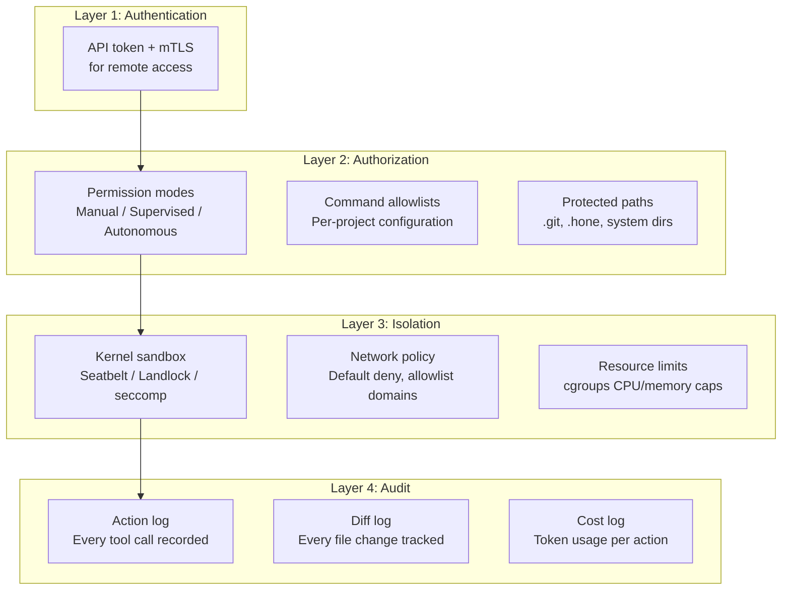

### 9.2 Threat Model

| Threat | Mitigation |
|---|---|
| Malicious model output (prompt injection via code) | Kernel sandbox prevents execution outside project dir; network deny-by-default |
| Supply chain attack via MCP server | MCP servers (Layer 1 only) run in isolated processes with declared permissions; sandboxed filesystem access; core tools are native Rust and not exposed to MCP attack surface |
| Credential leakage | API keys stored in OS keychain, never in config files; environment variables cleared from sandbox |
| Remote access interception | WireGuard/Tailscale encrypted tunnel; mTLS for API authentication; no plaintext HTTP |
| Runaway cost | Hard budget caps enforced at the server level; auto-pause at threshold |
| Data exfiltration | Network deny-by-default in Autonomous mode; DNS filtering; audit log for all network requests |

---

## 10. Privacy Architecture

### 10.1 Data Flow Classification

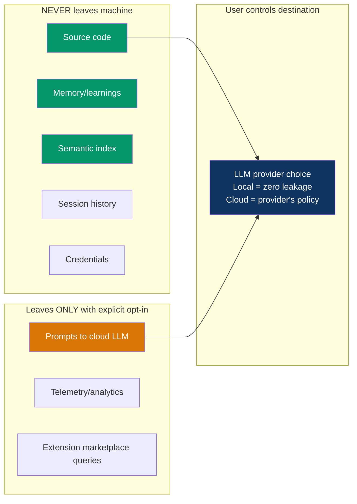

### 10.2 Privacy Guarantees

1. **Zero telemetry by default.** No usage data, crash reports, or analytics are sent unless the user explicitly enables them in settings.
2. **Memory is local-only.** The adaptive learning system stores all data in an encrypted SQLite database on the user's machine. No cloud sync. No Sourcegraph-style server storage.
3. **Model choice = privacy choice.** Using Ollama/llama.cpp means literally zero data leaves the machine. Using a cloud API means data goes to that provider under their terms. Hone makes this trade-off explicit and visible.
4. **Encrypted at rest.** The memory database, session history, and semantic index are encrypted with a user-provided passphrase or OS keychain integration.
5. **Ephemeral mode.** `hone --ephemeral` starts a session that retains nothing — no memory updates, no session history, no index changes. For sensitive one-off tasks.
6. **Audit trail.** Every piece of data sent to any external service is logged locally. Users can review exactly what was transmitted.

---

## 11. Adaptive Learning System

### 11.1 How Hone Learns

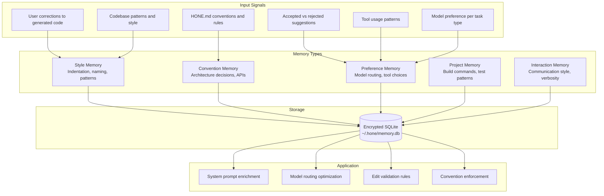

### 11.2 Memory Hierarchy

```
~/.hone/memory.db              # Global: your cross-project preferences
├── style/                      # How you like code formatted
├── preferences/                # Model choices, verbosity, etc.
└── interactions/               # Communication patterns

project/.hone/memory.db        # Project: this codebase's specifics
├── conventions/                # Architecture decisions, API patterns
├── build/                      # Build commands, test patterns
└── context/                    # Key files, important decisions

project/.hone/HONE.md         # Explicit: user-written constitution
├── Root HONE.md               # Project-wide rules
├── src/HONE.md                # Directory-specific rules
└── ~/.hone/HONE.md           # User-level defaults
```

### 11.3 Learning Loop

1. **Observe:** Track which edits the user accepts, modifies, or rejects
2. **Extract:** Identify patterns (naming conventions, import ordering, error handling style)
3. **Hypothesize:** Formulate a convention ("this user prefers early returns over nested if/else")
4. **Verify:** On the next relevant edit, apply the convention and check if accepted
5. **Solidify:** After 3+ consistent confirmations, promote to active memory
6. **Surface:** Periodically suggest adding solidified patterns to HONE.md for explicitness

**Memory decay:** Patterns not confirmed in 30+ days gradually decay in priority. This prevents stale conventions from persisting after code style evolves.

**User control:** `hone memory list`, `hone memory show <id>`, `hone memory forget <id>`, `hone memory export`, `hone memory import`. Full transparency and control over what Hone has learned.

---

## 12. Remote Access & Multi-Surface

### 12.1 Architecture

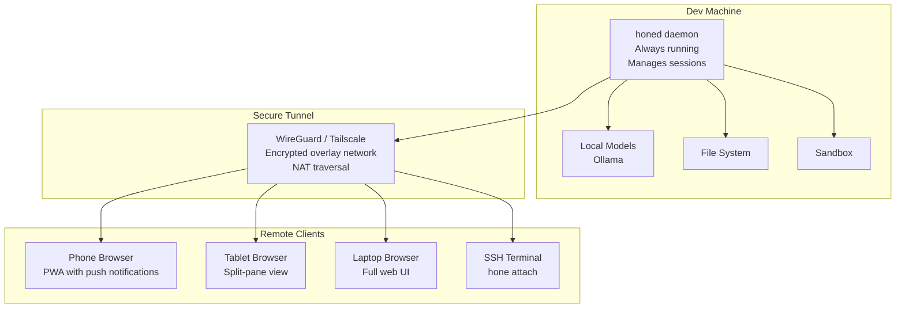

### 12.2 Mobile Experience

The mobile PWA is not a dumbed-down view. It is a touch-optimized surface for the full Hone experience:

- **Session list:** See all active and recent sessions with status (running, waiting for input, completed)
- **Live streaming:** Watch the agent work in real-time with syntax-highlighted diffs
- **Approve/reject:** Swipe to approve or reject pending actions
- **Voice input:** Dictate instructions via phone microphone with local Whisper transcription
- **Push notifications:** "Task completed," "Approval needed," "Budget threshold reached"
- **Cost dashboard:** Real-time spend tracking per session and per day
- **Quick actions:** Start new session, resume last session, run a saved recipe

### 12.3 Session Persistence

Sessions survive disconnects, sleep, and reconnects. The `honed` daemon maintains all state server-side. Clients are ephemeral renderers.

- `hone attach` — reconnect to the most recent active session
- `hone attach <session-id>` — reconnect to a specific session
- `hone sessions` — list all sessions with status and last activity
- `hone sessions gc` — garbage-collect completed sessions older than N days

---

## 13. Performance Requirements

| Metric | Target | Rationale |
|---|---|---|
| CLI startup time | < 100ms | Faster than typing the next command |
| First token latency (local model) | < 500ms | Perceived instant response |
| First token latency (cloud model) | < 1.5s | Network + model latency |
| Memory footprint (idle) | < 50MB | Rust binary, not a Node.js/Electron app |
| Memory footprint (active session) | < 200MB | Excluding model VRAM |
| Semantic index build (50K LOC) | < 30s | Background, non-blocking |
| Semantic index incremental update | < 2s | After single file change |
| LSP diagnostic round-trip | < 500ms | After edit application |
| Session reconnect | < 1s | From any client surface |
| Web UI initial load | < 500KB | PWA, aggressive code splitting |

### 13.1 Performance Architecture

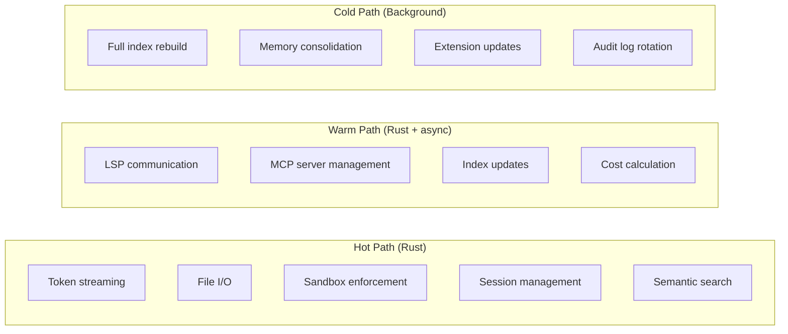

---

## 14. Extensibility & Ecosystem

### 14.1 Recipe System

Recipes are declarative YAML workflows that encode repeatable multi-step tasks. They are Goose's best idea, refined with type-safe parameters and composability.

**Example recipe — Feature Implementation with TDD:**

```yaml
name: tdd-feature
description: Implement a feature using test-driven development
parameters:
  - name: feature_description
    type: string
    required: true
  - name: test_framework
    type: enum
    values: [jest, pytest, go-test, cargo-test]
    default: auto-detect
  - name: review_model
    type: model
    default: deep

steps:
  - name: plan
    agent: planner
    model: deep
    prompt: |
      Analyze the following feature request and create an implementation plan.
      Feature: {{ feature_description }}
      Output: list of files to create/modify, test cases to write

  - name: write-tests
    agent: coder
    model: default
    prompt: |
      Write failing tests for the planned feature using {{ test_framework }}.
      Plan: {{ steps.plan.output }}

  - name: run-tests
    tool: hone-shell
    command: "{{ test_command }}"
    expect: failure  # Tests should fail (TDD red phase)

  - name: implement
    agent: coder
    model: default
    prompt: |
      Implement the minimum code to make all tests pass.
      Tests: {{ steps.write-tests.output }}
    validate:
      - tool: hone-shell
        command: "{{ test_command }}"
        expect: success

  - name: refactor
    agent: coder
    model: deep
    prompt: |
      Refactor the implementation for clarity and performance.
      Ensure all tests still pass.
    validate:
      - tool: hone-shell
        command: "{{ test_command }}"
        expect: success

  - name: review
    agent: reviewer
    model: "{{ parameters.review_model }}"
    prompt: |
      Review all changes for correctness, style, and potential issues.
      Output: review comments and approval/rejection
```

### 14.2 Custom Agents

Agents are defined as Markdown files in `.hone/agents/`:

```markdown
# .hone/agents/security-reviewer.md

## Role
You are a security-focused code reviewer. You specialize in identifying
vulnerabilities, injection risks, authentication flaws, and data leakage.

## Model
deep

## Temperature
0.2

## Tools
- hone-fs (read-only)
- hone-index
- hone-web (for CVE lookups)

## Instructions
- Check every user input for sanitization
- Verify authentication on all endpoints
- Flag any hardcoded secrets or credentials
- Reference OWASP Top 10 where applicable
```

### 14.3 Extension Marketplace

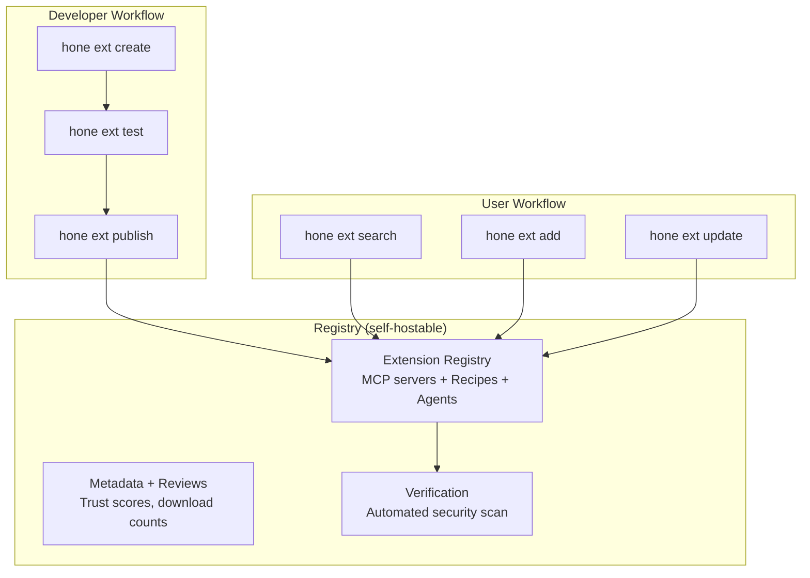

---

## 15. Developer Experience

### 15.1 First-Run Experience

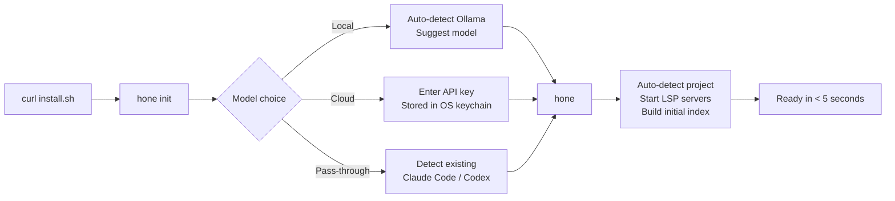

**Target: zero to productive in under 60 seconds.** One-line install, one command to start, auto-detection handles the rest. No configuration required for basic usage.

### 15.2 Command Interface

```
hone                       # Start interactive session
hone "fix the auth bug"    # One-shot task
hone --resume              # Resume last session
hone --ephemeral           # No memory, no history
hone --model deep          # Override model for this session
hone --recipe tdd-feature  # Run a recipe

# In-session commands
/plan                       # Toggle plan mode (read-only)
/auto                       # Toggle autonomous mode
/model <name>               # Switch model
/agent <name>               # Switch to custom agent
/cost                       # Show session cost breakdown
/memory                     # Show what Hone remembers
/undo                       # Git-backed undo last change
/redo                       # Redo last undone change
/branch <name>              # Create exploratory branch
/recipe <name>              # Run a recipe
/compact                    # Manual context compaction
/attach                     # Show session ID for remote attach

# Management commands
hone sessions              # List all sessions
hone memory list           # Show learned patterns
hone stats                 # Usage statistics
hone ext search <query>    # Find extensions
hone doctor                # Diagnose setup issues
```

### 15.3 Configuration Hierarchy

```
CLI flags                    # Highest priority
├── Environment variables
├── Project .hone/config.toml
├── Project HONE.md
├── User ~/.config/hone/config.toml
├── User ~/.hone/HONE.md
└── Hone defaults           # Lowest priority
```

---

## 16. Monetization & Licensing

### 16.1 Open-Source Core

Hone core is Apache 2.0 licensed. This includes the agent engine, CLI/TUI, all built-in MCP servers, sandbox, LSP integration, memory system, and client-server architecture. The full product is usable without paying anything — bring your own API keys or use local models.

### 16.2 Revenue Streams

| Stream | Description | Target |
|---|---|---|
| Hone Cloud (optional) | Managed `honed` hosting with secure tunnel, push notifications, web UI hosting | Individual developers who don't want to self-host |
| Hone Teams | Centralized governance dashboard, spend analytics, SSO, audit log aggregation | Engineering teams (5–50 developers) |
| Hone Enterprise | On-premise deployment, dedicated support, SLA, custom integrations | Large organizations (50+ developers) |
| Marketplace cut | 15% commission on paid MCP servers and recipes in the marketplace | Extension developers |
| Model partnerships | Revenue share with model providers for default/recommended routing | Model providers |

### 16.3 Pricing Targets

| Tier | Price | Includes |
|---|---|---|
| Open Source | Free forever | Full CLI, all features, self-hosted |
| Cloud Individual | $10/month | Managed hosting, mobile PWA, push notifications |
| Cloud Team | $25/user/month | Governance, shared recipes, audit logs, SSO |
| Enterprise | Contact sales | On-premise, SLA, dedicated support |

---

## 17. Success Metrics

### 17.1 North Star Metric

**Weekly active sessions per developer** — measures both adoption and engagement depth. Target: 25+ sessions/week within 6 months of launch (indicating it has become the developer's primary coding tool).

### 17.2 Key Metrics

| Category | Metric | 6-Month Target | 12-Month Target |
|---|---|---|---|
| Adoption | GitHub stars | 25K | 75K |
| Adoption | Weekly active users | 50K | 250K |
| Engagement | Sessions per user per week | 15 | 25 |
| Engagement | Avg session duration | 20 min | 30 min |
| Quality | Edit acceptance rate | 75% | 85% |
| Quality | LSP error catch rate (pre-commit) | 90% | 95% |
| Retention | Week 4 retention | 40% | 55% |
| Ecosystem | Published MCP extensions | 100 | 500 |
| Ecosystem | Published recipes | 200 | 1000 |
| Revenue | Cloud subscribers (individual) | 2K | 15K |
| Revenue | Team accounts | 50 | 300 |
| Performance | P95 startup time | < 100ms | < 80ms |
| Performance | P95 memory (idle) | < 50MB | < 40MB |

---

## 18. Roadmap

### 18.1 Phase Overview

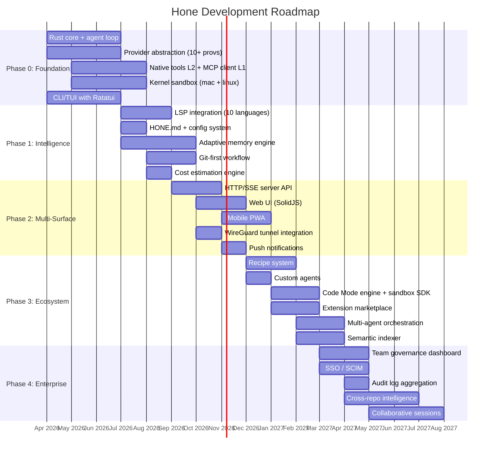

### 18.2 Milestones

| Milestone | Date | Deliverable |
|---|---|---|
| M0: First Light | July 2026 | CLI works end-to-end: prompt → plan → edit → sandbox → commit. Native tools (L2) for file/shell/git. MCP client (L1) for GitHub. 10+ providers. macOS + Linux sandbox. |
| M1: Intelligence | September 2026 | LSP validation, adaptive memory, cost estimation, HONE.md. Usable as daily driver. |
| M2: Multi-Surface | December 2026 | Web UI, mobile PWA, remote access via tunnel. "Work from anywhere" promise delivered. |
| M3: Ecosystem | February 2027 | Recipes, custom agents, Code Mode (L0) orchestration engine, marketplace. Community can extend Hone without core changes. |
| M4: Enterprise | May 2027 | Team governance, SSO, audit logs, cross-repo. Ready for enterprise pilot deployments. |
| M5: Foundation | July 2027 | Submit to Linux Foundation AAIF for neutral governance alongside MCP and Goose. |

---

## 19. Risks & Mitigations

### 19.1 Risk Matrix

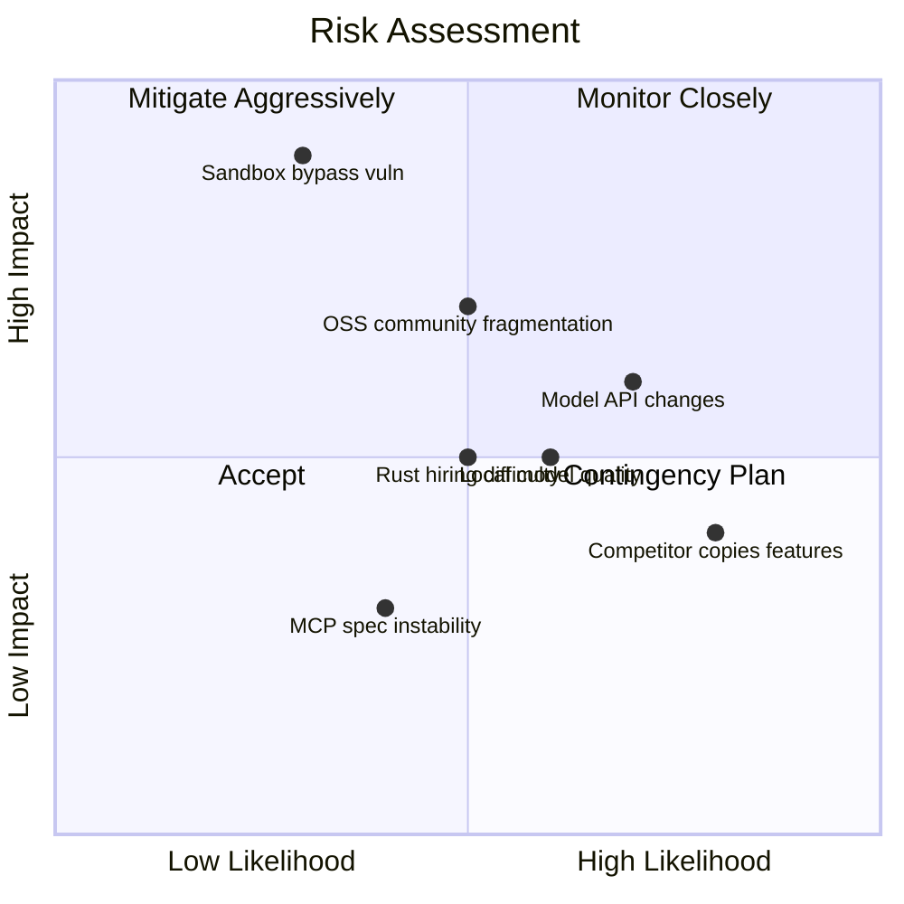

### 19.2 Detailed Risks

| Risk | Likelihood | Impact | Mitigation |
|---|---|---|---|
| **Model providers change APIs frequently** | High | Medium | Provider abstraction layer isolates core from API changes; community-maintained adapters |
| **Kernel sandbox bypass vulnerability** | Low | Critical | Security bounty program; formal verification of sandbox profiles; defense-in-depth (container mode as fallback) |
| **Rust talent scarcity** | Medium | Medium | Hybrid architecture — Rust for hot paths, TypeScript for UI and extensions; invest in contributor onboarding |
| **Competitor clones Hone's feature combination** | High | Low | Speed of execution + community moat; features are table stakes, the adaptive learning system is the defensible moat |
| **MCP specification instability** | Medium | Low | MCP is used only for external integrations (Layer 1), not core operations. Core tools are native Rust and unaffected by MCP spec changes. Abstraction layer isolates MCP version changes. |
| **Open-source community fragmentation** | Medium | High | Strong governance (AAIF), clear contributor guidelines, regular community calls, responsive maintainership |
| **Local models not capable enough for tool calling** | Medium | Medium | Model routing rules auto-escalate to cloud for complex tool use; invest in Ollama tool-calling support; contribute upstream improvements |
| **Privacy regulations (GDPR, CCPA) compliance** | Medium | Medium | Privacy-by-design architecture already exceeds requirements; data never leaves machine by default |
| **Monetization insufficient for sustainability** | Medium | High | Multiple revenue streams; open-source core ensures survival even without commercial success; consider VC funding for Phase 2–4 |

---

## 20. Appendix: Competitive Feature Matrix

| Feature | Hone | Claude Code | Codex CLI | OpenCode | Goose | Aider | Gemini CLI | Amp | Plandex |
|---|---|---|---|---|---|---|---|---|---|
| **Open source** | Apache 2.0 | No | Apache 2.0 | MIT | Apache 2.0 | Apache 2.0 | Apache 2.0 | Partial | MIT |
| **Model providers** | 75+ | 1 (Anthropic) | 1 (OpenAI) | 75+ | 25+ | All | 1 (Google) | 3 | Multi |
| **Local models** | Full | No | Via Ollama | Via Ollama | Via Ollama | Via Ollama | No | No | Via OpenRouter |
| **Kernel sandbox** | Yes | No | Yes | No | Optional | No | Yes | No | No |
| **LSP integration** | 20+ langs | No | No | 20+ langs | No | No | No | No | No |
| **Tool architecture** | Layered (native + MCP + Code Mode) | Native tools | Native tools | Native + MCP client | MCP-everything | No | MCP client | No | No |
| **Adaptive memory** | Local-first | Cloud-stored | No | No | MCP server | No | Yes | Cloud-stored | No |
| **Remote/mobile** | PWA + Web | No | macOS app | Web UI | No | Browser | No | No | No |
| **Client-server** | Yes | No | No | Yes | Partial | No | No | No | Yes |
| **Cost estimation** | Real-time | No | No | No | No | No | No | No | No |
| **Recipes/workflows** | YAML | No | No | No | YAML | No | No | No | No |
| **Semantic index** | Persistent | No | No | No | On-demand | Repo map | No | Code graph | Tree-sitter |
| **Git-first** | Auto-commit | Manual | Manual | Undo/redo | Manual | Auto-commit | Manual | Manual | Auto-commit |
| **Multi-agent** | Lead-worker | Agent Teams | No | Parallel | Subagents | No | Subagents | Sub-agents | No |
| **Voice input** | Local Whisper | No | No | No | No | Yes | No | No | No |
| **Test-driven mode** | First-class | Promptable | Promptable | No | Via recipe | No | No | No | Via autonomy |
| **Cross-repo** | Planned | No | No | No | No | No | No | Yes | No |
| **Team governance** | Planned | Enterprise | No | Enterprise | No | No | Enterprise | Yes | No |
| **Startup time** | < 100ms | ~2s | ~200ms | ~1.5s | ~1s | ~3s | ~2s | ~1.5s | ~2s |
| **Memory footprint** | < 50MB | ~200MB | ~80MB | ~1GB | ~150MB | ~100MB | ~200MB | ~200MB | ~150MB |

---

*This document is a living artifact. It will be updated as competitive intelligence evolves, user research refines requirements, and technical prototyping validates or invalidates assumptions.*

*Next steps: Technical design review → Architecture Decision Records → Phase 0 sprint planning*

---

## Changelog

| Version | Date | Changes |
|---|---|---|
| 1.0 | April 4, 2026 | Initial draft with MCP-native architecture for all tools |
| 1.1 | April 4, 2026 | **Major architecture revision:** Replaced "MCP everything" approach with four-layer tool architecture (Native CLI → MCP → Code Mode → Skills) based on production data showing 55K–143K token overhead from MCP schema loading. Core tools (file I/O, shell, git, LSP, semantic index) are now native Rust with zero protocol overhead. MCP reserved for external integrations only with lazy schema loading. Added Code Mode (Layer 0) for multi-tool orchestration reducing tokens by 50%+. Updated requirements R4, risk assessments, roadmap, competitive matrix, and all architecture diagrams. |
