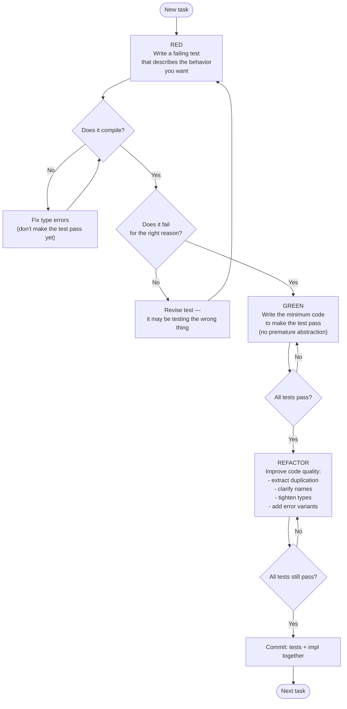
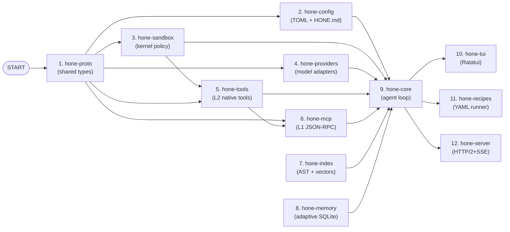
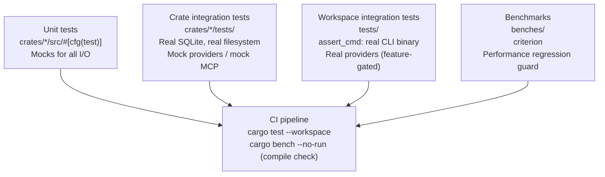
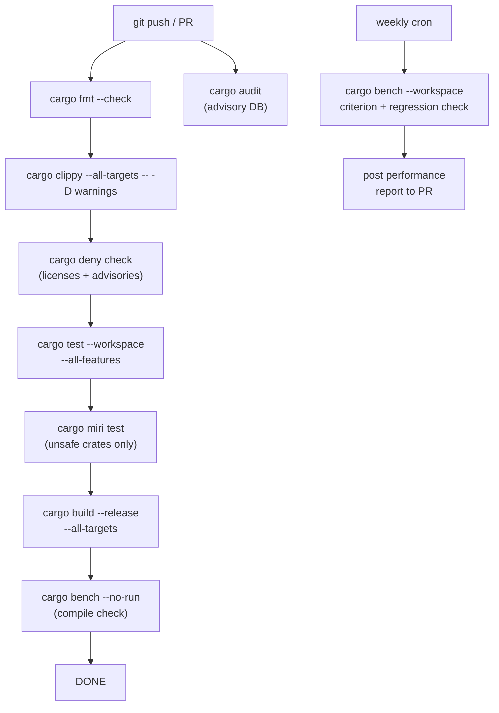
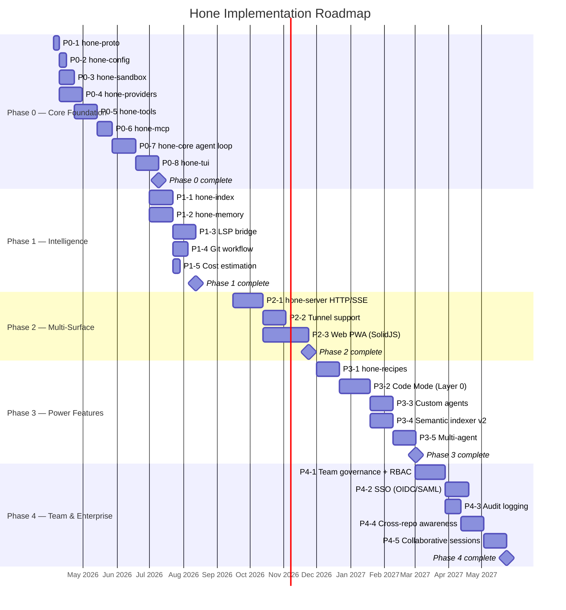

# Hone — TDD Implementation Plan

**Version:** 1.0  
**Date:** 2026-04-04  
**Status:** Working Draft

---

## Table of Contents

1. [TDD Workflow Overview](#1-tdd-workflow-overview)
2. [Dependency Order & Crate Build Sequence](#2-dependency-order--crate-build-sequence)
3. [Phase 0 — Core Foundation (Apr–Jun 2026)](#3-phase-0--core-foundation-aprjun-2026)
4. [Phase 1 — Intelligence Layer (Jul–Sep 2026)](#4-phase-1--intelligence-layer-julsep-2026)
5. [Phase 2 — Multi-Surface (Sep–Dec 2026)](#5-phase-2--multi-surface-sepdec-2026)
6. [Phase 3 — Power Features (Dec 2026–Feb 2027)](#6-phase-3--power-features-dec-2026feb-2027)
7. [Phase 4 — Team & Enterprise (Mar–Jul 2027)](#7-phase-4--team--enterprise-marjul-2027)
8. [Integration Test Strategy](#8-integration-test-strategy)
9. [Property-Based Testing Plan](#9-property-based-testing-plan)
10. [Benchmark Plan](#10-benchmark-plan)
11. [CI/CD Pipeline](#11-cicd-pipeline)
12. [Key Dependencies](#12-key-dependencies)
13. [Gantt Chart](#13-gantt-chart)

---

## 1. TDD Workflow Overview

Every task in this plan follows the same Red → Green → Refactor cycle. The flow below applies at every level: unit, integration, and property-based tests.



### Testing levels per crate

| Level | Location | Tools | When |
|---|---|---|---|
| Unit | `crates/*/src/` — `#[cfg(test)]` | `std` test harness, `mockall` | Every public fn |
| Integration | `crates/*/tests/` | `tokio::test`, real dependencies | Every trait impl |
| Property | `crates/*/tests/` | `proptest` | Parsing, encoding, index ops |
| Benchmark | `benches/` | `criterion` | Hot paths, performance targets |
| Workspace integration | `tests/` | `assert_cmd`, `tempfile` | Full CLI commands |

---

## 2. Dependency Order & Crate Build Sequence

Crates must be built in dependency order. The graph below is the canonical implementation sequence — never start a crate until all its dependencies have green test suites.



---

## 3. Phase 0 — Core Foundation (Apr–Jun 2026)

### 3.1 Task P0-1: `hone-proto` — Shared Types

**Goal:** All shared DTOs, IDs, and serialization. Zero logic — pure data.

#### RED — Write these tests first

```
crates/hone-proto/tests/serialization.rs
```

- `test_message_roundtrip`: serialize `Message` to JSON, deserialize back, assert equality.
- `test_model_id_display`: `ModelId::from("anthropic:claude-opus-4-5")` renders as `"anthropic:claude-opus-4-5"`.
- `test_token_usage_add`: `TokenUsage` addition is associative (property test).
- `test_session_id_is_uuid`: `SessionId::new()` produces a valid UUID v7.

#### GREEN — Implement

- `Message { role: Role, content: Content, tool_calls: Vec<ToolCallRequest> }`
- `ModelId(String)` newtype with `Display`, `FromStr`
- `TokenUsage { input: u32, output: u32, cache_read: u32 }` + `Add` impl
- `SessionId(Uuid)` newtype
- `ToolCallRequest`, `ToolResult`, `ToolSchema`
- All types: `#[derive(Debug, Clone, PartialEq, serde::Serialize, serde::Deserialize)]`

#### REFACTOR

- Ensure `Content` handles both `String` and `Vec<ContentPart>` (text + images).
- Add `#[serde(deny_unknown_fields)]` on wire types.

**Dependencies:** `serde`, `serde_json`, `uuid` (v7 feature), `time`

---

### 3.2 Task P0-2: `hone-config` — Configuration Parsing

**Goal:** Parse `~/.config/hone/config.toml` and project-local `HONE.md`.

#### RED — Write these tests first

```
crates/hone-config/tests/config.rs
```

- `test_default_config_is_valid`: `Config::default()` passes validation.
- `test_parse_minimal_toml`: parse a minimal TOML string, assert required fields present.
- `test_parse_provider_block`: TOML with `[provider.anthropic]` sets the API key field.
- `test_hone_md_extracts_sections`: a markdown string with `## TOOLS` and `## STYLE` headings is correctly sectioned.
- `test_unknown_toml_key_errors`: extra unknown field returns `ConfigError::UnknownField`.
- `test_merge_project_over_global`: project config overrides global config for shared keys.

#### GREEN — Implement

- `Config` struct with `providers: HashMap<String, ProviderConfig>`, `sandbox: SandboxConfig`, `model_routing: Vec<RoutingRule>`
- `HoneMd` struct with `sections: HashMap<String, String>` parsed from markdown headings
- `Config::load(global: &Path, project: &Path) -> Result<Config, ConfigError>`
- `ConfigError` enum with `thiserror`

#### REFACTOR

- Add `figment` for layered config (env vars override file, which overrides defaults).

**Dependencies:** `toml`, `figment`, `pulldown-cmark`, `dirs`

---

### 3.3 Task P0-3: `hone-sandbox` — Kernel Policy Enforcement

**Goal:** Platform-specific sandbox with fail-closed semantics.

#### RED — Write these tests first

```
crates/hone-sandbox/tests/sandbox.rs
```

- `test_null_sandbox_always_succeeds`: `NullSandbox` (test double) always returns `Ok`.
- `test_policy_builder_rejects_empty_allowlist`: `SandboxPolicyBuilder::build()` with no paths returns `Err`.
- `test_seatbelt_profile_renders_correctly`: `SeatbeltProfile::from_policy(policy)` produces valid profile syntax (snapshot test).
- `test_landlock_rules_from_policy`: `LandlockRuleset::from_policy(policy)` produces the expected rule count.
- `test_child_process_cannot_write_outside_allowlist`: spawn a subprocess that tries to write `/tmp/evil`; assert it gets `EPERM` (integration test, Linux only, `#[cfg(target_os = "linux")]`).
- `test_sandbox_error_on_unsupported_platform`: `ContainerSandbox::apply` on a platform that doesn't support it returns `SandboxError::Unavailable` (not a panic).

#### GREEN — Implement

- `SandboxPolicy` and `SandboxPolicyBuilder`
- `Sandbox` trait
- `NullSandbox` (always-allow, for tests)
- `SeatbeltSandbox` (macOS — `sandbox_init` via FFI)
- `LandlockSandbox` (Linux — `rustix` + `seccompiler`)
- `ContainerSandbox` (setrlimit fallback)
- `SandboxBuilder::detect() -> Box<dyn Sandbox>` — selects strongest available

#### REFACTOR

- Extract the profile DSL for Seatbelt into a separate module with its own tests.
- Add the `fail_closed` invariant as a documented contract in the trait doc comment.

**Dependencies:** `rustix`, `seccompiler`, `libc`, `cfg-if`

---

### 3.4 Task P0-4: `hone-providers` — Model Provider Abstraction

**Goal:** `ModelProvider` trait + concrete adapters for Anthropic, OpenAI, Ollama. Router and fallback chain.

#### RED — Write these tests first

```
crates/hone-providers/tests/
├── provider_contract.rs   # trait contract tests run against every adapter
├── anthropic.rs
├── openai.rs
├── ollama.rs
├── router.rs
└── fallback.rs
```

- `test_anthropic_request_serializes_correctly`: build a `CompletionRequest`, call the serializer, assert the JSON body matches Anthropic's API format (no network).
- `test_openai_request_serializes_correctly`: same for OpenAI.
- `test_stream_events_parse_from_sse_bytes`: feed raw SSE bytes into the parser, assert `ProviderEvent` sequence matches expected tokens.
- `test_estimate_tokens_is_under_actual`: `estimate_tokens` returns a value ≤ the actual token count returned by the API (property: never over-estimate).
- `test_router_selects_by_model_id_prefix`: routing rule `anthropic:*` routes to `AnthropicProvider`.
- `test_fallback_chain_tries_next_on_rate_limit`: when provider 1 returns `RateLimit`, the chain tries provider 2.
- `test_provider_registry_hot_swap`: swap the active provider, assert next `complete()` call goes to new provider.

#### GREEN — Implement

- `ModelProvider` trait (see architecture doc)
- `AnthropicProvider`, `OpenAiProvider`, `OllamaProvider`, `CliPassthroughProvider`
- `ProviderRegistry` with `register`, `get`, `swap`
- `ModelRouter` with routing rules from config
- `FallbackChain(Vec<Arc<dyn ModelProvider>>)`
- `MockProvider` (in `#[cfg(test)]` module) — deterministic, no network

#### REFACTOR

- Abstract the HTTP client into a `HttpClient` trait so tests can inject a mock transport.
- Add retry logic with exponential backoff for `RateLimit` errors.

**Dependencies:** `reqwest` (rustls-tls feature), `eventsource-stream`, `tiktoken-rs`, `async-trait`

---

### 3.5 Task P0-5: `hone-tools` — Layer 2 Native Tools

**Goal:** All Layer 2 tools behind the `Tool` trait: file read/write/edit, shell exec, git ops.

#### RED — Write these tests first

```
crates/hone-tools/tests/
├── file_tools.rs
├── shell_tool.rs
└── git_tools.rs
```

- `test_read_file_returns_content`: write a temp file, call `ReadFileTool`, assert content matches.
- `test_write_file_creates_file`: call `WriteFileTool` on a nonexistent path in a tempdir, assert file created.
- `test_edit_file_applies_diff`: call `EditFileTool` with `old_str`/`new_str`, assert file updated, no other lines changed.
- `test_shell_tool_captures_stdout_stderr`: run `echo hello`, assert output is `"hello\n"`.
- `test_shell_tool_respects_timeout`: run `sleep 10` with a 100ms timeout, assert `ToolError::Timeout`.
- `test_shell_tool_sandbox_blocks_exec_outside_allowlist`: `NullSandbox` allows it; a restrictive policy blocks it.
- `test_git_status_parses_output`: call `GitStatusTool` on a temp git repo with a staged file, assert the result contains the expected file.
- `test_git_commit_creates_commit`: stage a file, call `GitCommitTool`, assert `git log` shows the new commit.
- `test_tool_schema_is_valid_json_schema`: every tool's `schema()` passes JSON Schema meta-validation.

#### GREEN — Implement

- `Tool` trait
- `ReadFileTool`, `WriteFileTool`, `EditFileTool`, `GlobTool`, `GrepTool`
- `ShellTool` (uses `tokio::process::Command` + `tokio::time::timeout`)
- `GitStatusTool`, `GitDiffTool`, `GitCommitTool`, `GitCheckoutTool`, `GitBranchTool`
- `ToolRegistry` — collects all tools, exposes schemas to providers

#### REFACTOR

- Unify path resolution (all paths relative to `ToolContext::working_dir`).
- Add structured output types per tool (rather than raw `serde_json::Value` in all cases).

**Dependencies:** `tokio-process`, `git2`, `ignore` (gitignore-aware globbing), `similar` (diff)

---

### 3.6 Task P0-6: `hone-mcp` — MCP Client

**Goal:** JSON-RPC MCP client that wraps remote tools as `dyn Tool`.

#### RED — Write these tests first

```
crates/hone-mcp/tests/mcp_client.rs
```

- `test_connect_sends_initialize`: mock MCP server receives `initialize` JSON-RPC message on connect.
- `test_list_tools_parses_response`: feed a `tools/list` response JSON, assert correct `McpToolDef` structs.
- `test_call_tool_sends_correct_json`: calling `McpTool::call` sends a `tools/call` JSON-RPC request to the mock server.
- `test_mcp_tool_wraps_as_native_tool`: `tools_as_native()` returns `Box<dyn Tool>` that delegates to JSON-RPC.
- `test_server_startup_timeout_returns_error`: if server process doesn't initialize within 5s, returns `McpError::Timeout`.

#### GREEN — Implement

- `StdioMcpTransport` (spawn subprocess, communicate over stdin/stdout)
- `HttpMcpTransport` (HTTP JSON-RPC)
- `McpClient` trait and `DefaultMcpClient` impl
- `McpTool` wrapper implementing `Tool`
- Lazy schema loading: schemas fetched once on first use, cached

#### REFACTOR

- Add connection pooling for HTTP transports.
- Content-hash verification of MCP server binaries.

**Dependencies:** `jsonrpc-core`, `serde_json`, `tokio-process`

---

### 3.7 Task P0-7: `hone-core` — Agent Loop

**Goal:** The orchestration core: turn execution, context management, provider streaming, tool dispatch.

#### RED — Write these tests first

```
crates/hone-core/tests/
├── agent_turn.rs
├── context_manager.rs
└── tool_dispatch.rs
```

- `test_single_turn_no_tools`: `Agent::run_turn("hello")` with `MockProvider` returning a single token stream produces `AgentEvent::Token` then `AgentEvent::Done`.
- `test_tool_call_dispatched_and_result_fed_back`: `MockProvider` emits a `ToolCall` event; assert the tool is called with correct args; assert a second provider call includes the tool result.
- `test_context_manager_truncates_to_model_limit`: add messages until context limit exceeded; assert `ContextManager::build_messages` returns messages within the token limit.
- `test_context_manager_keeps_system_message`: even after truncation, the system message is always present.
- `test_agent_hot_swap_mid_session`: call `swap_provider`, assert next turn uses new provider, history preserved.
- `test_sandbox_block_aborts_tool_call`: sandbox returns `SandboxError`, assert the tool is not called and `AgentEvent::Error` is emitted.
- `test_run_turn_propagates_cancellation`: cancel via `CancellationToken`, assert stream terminates cleanly.

#### GREEN — Implement

- `Agent`, `AgentConfig`
- `ContextManager` with `build_messages(token_budget: u32) -> Vec<Message>`
- `Session` — persists turn history
- `ToolDispatcher` — routes `ToolCallRequest` to the correct `Box<dyn Tool>`
- `AgentEvent` enum
- `TurnResult` with token usage and cost

#### REFACTOR

- Extract system prompt construction into a dedicated `SystemPromptBuilder` that incorporates `HoneMd` sections.
- Add a `CostAccumulator` to track session-total cost.

**Dependencies:** `tokio`, `futures`, `tokio-util`, `async-trait`

---

### 3.8 Task P0-8: `hone-tui` — Ratatui Terminal UI

**Goal:** Sub-100ms startup, <50MB idle. Input → agent → streamed output.

#### RED — Write these tests first

```
crates/hone-tui/tests/tui.rs
```

- `test_input_widget_captures_keystrokes`: simulate key events, assert input buffer updates.
- `test_message_list_renders_tokens_incrementally`: push `AgentEvent::Token` events, assert the rendered cell buffer contains them in order.
- `test_startup_time`: measure time from `App::new()` to first rendered frame; assert < 100ms.
- `test_resize_redraws_correctly`: change terminal size, assert re-render doesn't panic.

#### GREEN — Implement

- `App` struct with `EventLoop`
- `InputWidget`, `MessageListWidget`, `StatusBarWidget`, `CostWidget`
- Streaming token rendering (append to active message cell)
- Keybindings: `Enter` submit, `Ctrl-C` cancel, `/model` command prefix

#### REFACTOR

- Use `ratatui`'s `StatefulWidget` for the message list to handle scroll independently of render.

**Dependencies:** `ratatui`, `crossterm`, `tokio`

---

## 4. Phase 1 — Intelligence Layer (Jul–Sep 2026)

### 4.1 Task P1-1: `hone-index` — Semantic Indexer

**Goal:** Tree-sitter AST parsing + SQLite vector search, builds 50K LOC in <30s.

#### RED — Write these tests first

```
crates/hone-index/tests/
├── indexer.rs
├── search.rs
└── incremental.rs
```

- `test_index_rust_file_extracts_functions`: index a known Rust file, assert function symbols are present.
- `test_index_python_file_extracts_classes`: same for Python.
- `test_search_returns_relevant_results`: after indexing, search for a function name, assert it appears in top-3 results.
- `test_build_50k_loc_under_30s`: benchmark test asserting the performance target.
- `test_incremental_update_only_reindexes_changed_files`: modify one file, call `invalidate`, assert only that file's symbols are updated.
- `test_symbol_at_position_returns_correct_symbol`: call `symbol_at(file, line, col)`, assert name matches.

#### GREEN — Implement

- `TreeSitterParser` for Rust, Python, TypeScript, Go, Java, C, C++, more
- `EmbeddingGenerator` — local model via `ort` (ONNX Runtime) or API
- `IndexBuilder` — parallel file walk with `rayon`, inserts into `index.db`
- `SqliteVectorSearch` — cosine similarity search via SQLite extension
- `SemanticIndex` trait impl

#### REFACTOR

- Add file watcher (`notify` crate) for background incremental updates.
- Cache embeddings keyed by content hash to avoid re-embedding unchanged content.

**Dependencies:** `tree-sitter`, `tree-sitter-rust`, `tree-sitter-python`, `ort`, `rayon`, `notify`, `walkdir`

---

### 4.2 Task P1-2: `hone-memory` — Adaptive Memory

**Goal:** Local-first encrypted SQLite, pattern recognition, decay, user control.

#### RED — Write these tests first

```
crates/hone-memory/tests/
├── store.rs
├── decay.rs
└── patterns.rs
```

- `test_record_and_recall_basic`: record a fact, recall with a matching query, assert it appears.
- `test_recall_respects_relevance_ordering`: insert 10 memories with varying weights, assert `recall` returns highest-weight first.
- `test_decay_reduces_weight`: run `decay()`, assert weights have decreased by the configured factor.
- `test_decay_removes_expired_memories`: memories past their `decay_at` timestamp are removed.
- `test_forget_by_filter_removes_matching`: `forget(MemoryFilter::tag("project:foo"))` removes only matching memories.
- `test_export_produces_valid_json`: `export(path)` writes a file that deserializes back to identical memories.
- `test_encryption_key_derivation_is_deterministic`: same passphrase + same salt = same key (Argon2id).

#### GREEN — Implement

- `SqliteMemoryStore` implementing `MemoryStore`
- `MemoryEvent`, `Memory`, `MemoryQuery`, `MemoryFilter` types
- `DecayScheduler` — runs on a background task, triggered on startup
- `PatternDetector` — heuristics for extracting reusable patterns from turn history
- Encryption layer via `sqlcipher` (feature-flagged)

#### REFACTOR

- Add `MemoryStore::summarize_for_context(token_budget: u32) -> String` to produce a compact memory digest for injection into the system prompt.

**Dependencies:** `sqlx`, `argon2`, `keyring`, `chrono`

---

### 4.3 Task P1-3: LSP Bridge in `hone-tools`

**Goal:** Extend `hone-tools` with LSP-backed tools. Auto-detect language servers. Auto-fix loop (3 retries).

#### RED — Write these tests first

```
crates/hone-tools/tests/lsp_tools.rs
```

- `test_lsp_diagnostics_roundtrip`: start `rust-analyzer` in a temp workspace, call `LspDiagnosticsTool`, assert diagnostics returned in <500ms.
- `test_lsp_auto_fix_loop_applies_fixes`: introduce a known fixable error, run auto-fix loop, assert error disappears.
- `test_auto_fix_stops_after_3_retries`: fix loop gives up after 3 iterations if errors remain.
- `test_language_detection_from_file_extensions`: `detect_language(path)` returns correct language for `.rs`, `.py`, `.ts`.

#### GREEN — Implement

- `LspBridge` — manages LSP server process lifecycle per language
- `LspDiagnosticsTool`, `LspHoverTool`, `LspRenameTool`, `LspCodeActionTool`
- `AutoFixLoop` — calls diagnostics → applies fixes → repeats up to 3 times
- `LanguageDetector` — file extension + shebang heuristics

#### REFACTOR

- Pool LSP connections per workspace to avoid restart overhead.

**Dependencies:** `lsp-types`, `tokio-process`

---

### 4.4 Task P1-4: Git Workflow in `hone-tools`

**Goal:** Auto-commit per edit, branch management, undo/redo stack.

#### RED — Write these tests first

```
crates/hone-tools/tests/git_workflow.rs
```

- `test_auto_commit_after_write`: `WriteFileTool` with `auto_commit: true` results in a new git commit.
- `test_undo_reverts_last_commit`: `GitUndoTool` runs `git revert HEAD`, asserts file content rolled back.
- `test_branch_create_and_switch`: `GitBranchTool::create("feature/x")` + `GitCheckoutTool` asserts `HEAD` is on new branch.
- `test_undo_stack_is_bounded_at_50`: stack does not grow beyond 50 entries.

#### GREEN — Implement

- `AutoCommitter` — wraps `WriteFileTool`, stages and commits after each successful write
- `UndoStack` — ring buffer of commit SHAs
- `GitUndoTool`, `GitRedoTool`

---

### 4.5 Task P1-5: Cost Estimation

**Goal:** Real-time token tracking, per-provider pricing, budget caps.

#### RED — Write these tests first

```
crates/hone-core/tests/cost.rs
```

- `test_cost_accumulator_sums_turns`: add 3 turns with known usage, assert total cost matches sum.
- `test_budget_cap_blocks_new_turn`: set budget cap to $0.01, exhaust it, assert next `run_turn` returns `AgentError::BudgetExceeded`.
- `test_pricing_table_matches_provider_docs`: assert known prices for `claude-opus-4-5` match Anthropic's documented rates.

#### GREEN — Implement

- `PricingTable` — static table of per-provider per-model prices in `hone-providers`
- `CostAccumulator` in `hone-core`
- `BudgetCap` enforcement in `Agent::run_turn`

---

## 5. Phase 2 — Multi-Surface (Sep–Dec 2026)

### 5.1 Task P2-1: `hone-server` — HTTP/2 + SSE Daemon

**Goal:** `honed` daemon serving multiple simultaneous clients.

#### RED — Write these tests first

```
crates/hone-server/tests/
├── api.rs
└── sse.rs
```

- `test_post_sessions_creates_session`: `POST /sessions` returns `201` with a `session_id`.
- `test_post_turn_streams_sse_events`: `POST /sessions/{id}/turns` triggers SSE; assert token events received in order.
- `test_concurrent_sessions_are_isolated`: two concurrent sessions do not share state.
- `test_sse_reconnect_replays_from_last_event_id`: disconnect and reconnect with `Last-Event-ID`, assert no events missed.
- `test_auth_token_required`: requests without a valid bearer token return `401`.

#### GREEN — Implement

- `axum` 0.8 server with HTTP/2 via `hyper`
- Routes: `POST /sessions`, `GET /sessions/{id}`, `POST /sessions/{id}/turns`, `GET /sessions/{id}/events` (SSE), `DELETE /sessions/{id}`
- `SseEncoder` — converts `AgentEvent` to SSE frames
- Bearer token auth middleware
- Per-session `Agent` lifecycle managed by `SessionStore`

#### REFACTOR

- Add `tower` middleware: request tracing, rate limiting.

**Dependencies:** `axum` (0.8), `hyper`, `tower`, `tower-http`

---

### 5.2 Task P2-2: Tunnel Support

**Goal:** Encrypted tunnel so remote clients can reach `honed`.

#### RED — Write these tests first

- `test_tunnel_url_is_reachable`: start tunnel, make HTTP request to tunnel URL, assert response matches.
- `test_tunnel_rejects_connections_without_token`: unauthenticated connection to tunnel returns `401`.

#### GREEN — Implement

- `TunnelManager` — wraps `bore` or custom WireGuard tunnel
- Token-based access control
- `hone tunnel start` CLI subcommand

---

## 6. Phase 3 — Power Features (Dec 2026–Feb 2027)

### 6.1 Task P3-1: `hone-recipes` — YAML Recipe Runner

**Goal:** Multi-step YAML workflows with TDD support.

#### RED — Write these tests first

```
crates/hone-recipes/tests/
├── parser.rs
└── runner.rs
```

- `test_parse_minimal_recipe`: parse a two-step YAML recipe, assert step count and names.
- `test_invalid_recipe_schema_errors`: missing required field returns `RecipeError::SchemaValidation`.
- `test_step_with_condition_skips_when_false`: conditional step with `when: false` is skipped in execution.
- `test_recipe_runner_executes_steps_in_order`: run a mock two-step recipe, assert steps called in order.
- `test_tdd_recipe_runs_tests_between_steps`: recipe with `test_cmd` runs the command after each code step.

#### GREEN — Implement

- `Recipe`, `RecipeStep` types parsed from YAML
- JSON Schema validation on load
- `RecipeRunner` — sequential execution with `Agent` per step
- `TddHook` — runs test command, feeds result back to agent if failing

**Dependencies:** `serde_yaml`, `jsonschema`

---

### 6.2 Task P3-2: Semantic Indexer — Code Mode (Layer 0)

**Goal:** `Agent` can generate and execute TS/Python scripts that call native + MCP tools.

#### RED — Write these tests first

```
crates/hone-core/tests/code_mode.rs
```

- `test_code_mode_script_is_sandboxed`: generated script runs inside the same `SandboxPolicy`.
- `test_code_mode_output_is_captured`: `stdout` and `stderr` of generated script returned to agent.
- `test_code_mode_tool_calls_via_sdk`: generated script calling the SDK invokes the same `ToolRegistry`.

#### GREEN — Implement

- `CodeModeRunner` — writes script to tempfile, executes in sandbox, captures output
- SDK shim (thin Node.js / Python package) that serializes tool calls as JSON-RPC to `honed`

---

## 7. Phase 4 — Team & Enterprise (Mar–Jul 2027)

Tasks for Phase 4 (team governance, SSO, audit logs, cross-repo awareness, collaborative sessions) are captured in the roadmap but deferred from detailed TDD breakdown until Phase 3 is complete. They will follow the same Red→Green→Refactor pattern when the time comes.

Key test areas to anticipate:
- `test_audit_log_records_every_tool_call`: every tool call produces a signed audit entry.
- `test_rbac_prevents_unauthorized_tool_use`: RBAC policy blocks a user from calling write tools.
- `test_collaborative_session_syncs_events`: two users in the same session both receive all events.

---

## 8. Integration Test Strategy

Integration tests live in `tests/` (workspace level) and in `crates/*/tests/` (crate level). They test real components wired together, not individual units with mocks.



### Real vs mocked per test tier

| Component | Unit tests | Crate integration tests | Workspace tests |
|---|---|---|---|
| Model Provider | `MockProvider` | `MockProvider` | Real (env var gated) |
| File system | `tempfile` | `tempfile` | Real tempdir |
| SQLite | In-memory | File-based temp | File-based temp |
| Sandbox | `NullSandbox` | Real (platform) | Real (platform) |
| LSP | `MockLsp` | Real `rust-analyzer` | Real |
| MCP | Mock server | Local MCP binary | Local MCP binary |

### Test fixtures

All test fixtures (sample source files, mock SSE streams, example configs) live in `crates/*/tests/fixtures/` and are loaded with `include_str!` or `tempfile` copies.

---

## 9. Property-Based Testing Plan

Use `proptest` for all parsing, encoding, and index operations where the input space is large.

| Component | Property | Generator |
|---|---|---|
| `hone-proto` | `Message` serialize/deserialize roundtrip | `any::<Message>()` |
| `hone-config` | Valid TOML always parses without panic | `r"[a-z_]+ = .*"` |
| `hone-providers` | `estimate_tokens` never exceeds actual | Random message sequences |
| `hone-tools` | `EditTool` with valid diff never corrupts other lines | File content + diff params |
| `hone-index` | Indexed file always searchable by symbol name | Random valid Rust source |
| `hone-memory` | Decay never increases weight | Random weight + decay factor |

```rust
// Example: proto roundtrip property test
proptest! {
    #[test]
    fn message_roundtrip(role in any::<Role>(), content in ".*") {
        let msg = Message { role, content: Content::Text(content.clone()), tool_calls: vec![] };
        let json = serde_json::to_string(&msg).unwrap();
        let decoded: Message = serde_json::from_str(&json).unwrap();
        prop_assert_eq!(msg, decoded);
    }
}
```

---

## 10. Benchmark Plan

All benchmarks use `criterion` with `BenchmarkGroup` for organized output. They run in CI with `--no-run` (compile check only) and weekly in a dedicated performance job with regression detection.

| Benchmark | Target | Method |
|---|---|---|
| `cli_startup` | <100ms | Time from `main()` entry to first rendered frame |
| `first_token_local` | <500ms | `Agent::run_turn` → first `AgentEvent::Token` with Ollama |
| `first_token_cloud` | <1.5s | Same with real Anthropic (weekly job, env gated) |
| `memory_idle` | <50MB RSS | Measure RSS after startup, before any turn |
| `memory_active` | <200MB RSS | Measure RSS during a turn with all tools active |
| `index_build_50k` | <30s | Index the hone repo itself (~50K LOC) |
| `lsp_diagnostic_roundtrip` | <500ms | Request diagnostics → receive response |
| `context_build_messages` | <1ms | `ContextManager::build_messages` for 1000 turns |
| `tool_registry_lookup` | <100µs | `ToolRegistry::get` for 50 registered tools |

```rust
// Example benchmark
fn bench_context_build(c: &mut Criterion) {
    let messages = generate_messages(1000);
    let mgr = ContextManager::new(200_000);
    c.bench_function("context_build_1000_turns", |b| {
        b.iter(|| mgr.build_messages(black_box(&messages), 100_000))
    });
}
```

---

## 11. CI/CD Pipeline



### Branch strategy

- `main` — always green, release-ready
- `dev/phase-N` — phase integration branch, merged to `main` at phase completion
- `feat/*` — individual task branches, PR into `dev/phase-N`
- Feature flags (`--features`) used to gate incomplete features in CI

### Required PR checks

1. All CI jobs green
2. No new `clippy` warnings
3. No new `cargo-deny` violations
4. Coverage ≥ 80% on changed lines (via `cargo-llvm-cov`)
5. Benchmarks do not regress >10% (weekly job blocks merge if violated)

---

## 12. Key Dependencies

| Crate | Version | Purpose |
|---|---|---|
| `tokio` | 1 (full) | Async runtime |
| `async-trait` | 0.1 | `dyn Trait` with async fn |
| `serde` + `serde_json` | 1 | Serialization |
| `thiserror` | 2 | Library error types |
| `anyhow` | 1 | Application error handling |
| `axum` | 0.8 | HTTP server |
| `hyper` | 1 | HTTP/2 |
| `tower` | 0.5 | Middleware |
| `reqwest` | 0.12 (rustls) | HTTP client (providers) |
| `sqlx` | 0.8 (sqlite, runtime-tokio) | Database |
| `ratatui` | 0.29 | TUI |
| `crossterm` | 0.28 | Terminal backend |
| `tree-sitter` | 0.24 | AST parsing |
| `rayon` | 1 | CPU-parallel indexing |
| `ort` | 2 | ONNX Runtime (embeddings) |
| `proptest` | 1 | Property-based testing |
| `criterion` | 0.5 | Benchmarks |
| `mockall` | 0.13 | Mock generation |
| `tempfile` | 3 | Test filesystem |
| `assert_cmd` | 2 | CLI integration tests |
| `uuid` | 1 (v7) | Session/turn IDs |
| `figment` | 0.10 | Layered config |
| `pulldown-cmark` | 0.12 | HONE.md parsing |
| `git2` | 0.19 | Git operations |
| `lsp-types` | 0.97 | LSP protocol types |
| `notify` | 7 | File system watcher |
| `seccompiler` | 0.4 | seccomp-BPF (Linux) |
| `rustix` | 0.38 | Linux syscalls (Landlock) |
| `keyring` | 3 | System keychain |
| `argon2` | 0.5 | KDF for memory encryption |
| `eventsource-stream` | 0.2 | SSE parsing |
| `serde_yaml` | 0.9 | Recipe YAML |
| `jsonschema` | 0.18 | Recipe schema validation |
| `tiktoken-rs` | 0.6 | Token estimation |
| `walkdir` | 2 | Directory traversal |

---

## 13. Gantt Chart


