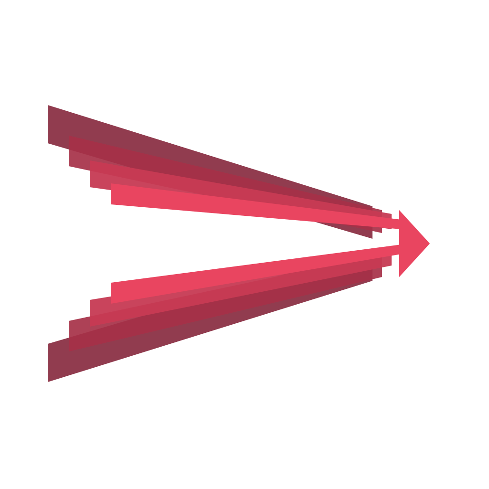
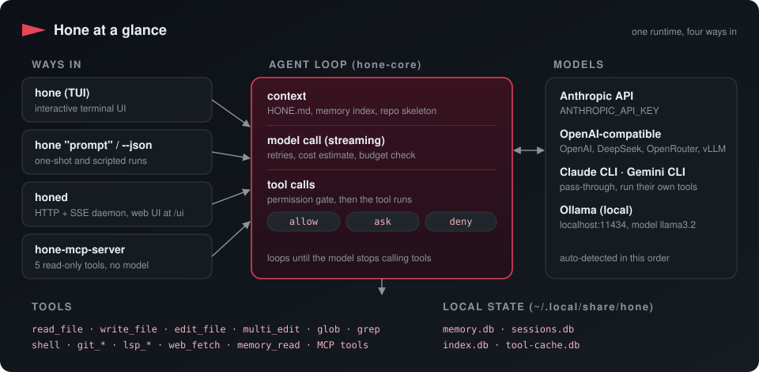
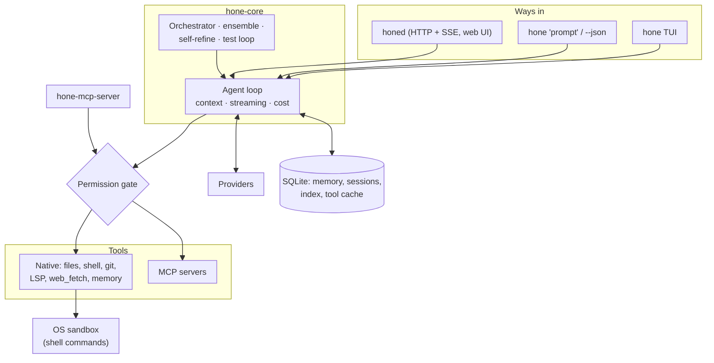
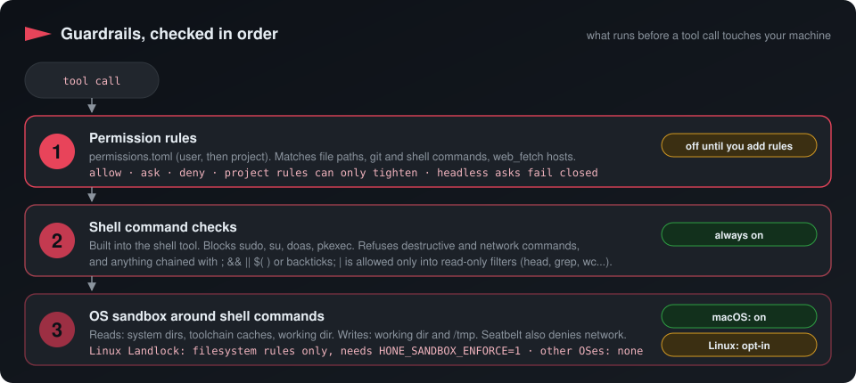
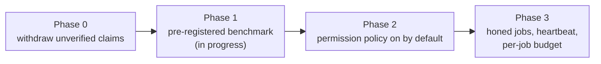

<p align="center">
  
</p>

<p align="center">
  <b>An agent runtime for the terminal, written in Rust.</b><br>
  Your models, your machine, rules you can read.
</p>

<p align="center">
  
  
  
  
  
</p>

<p align="center">
  <a href="getting-started.md">Getting started</a> ·
  <a href="onboarding/concepts.md">Concepts</a> ·
  <a href="configuration.md">Configuration</a> ·
  <a href="permissions-and-sandbox.md">Permissions</a> ·
  <a href="architecture.md">Architecture</a> ·
  <a href="onboarding/cheatsheet.md">Cheatsheet</a>
</p>

---

Hone is a general-purpose agent you run from a terminal. Give it a task in plain language
and it works through it with tools: reading and editing files, running shell commands,
querying git and language servers, fetching web pages and calling MCP servers. It is
strongest on code, and nothing in the loop is code-specific. The same agent loop runs
behind an interactive TUI, a one-shot CLI, an HTTP daemon and an MCP server.

<p align="center">
  
</p>

## Why Hone

| | |
|---|---|
| **Bring any model** | Anthropic, OpenAI and any OpenAI-compatible endpoint (DeepSeek, OpenRouter, Qwen, vLLM, ...), local Ollama, or the Claude and Gemini CLIs you already have. Change the model mid-session with `/model`. |
| **Guardrails you can read** | Allow / ask / deny rules in a TOML file, checked on every entry point. Built-in shell checks. An OS sandbox around shell commands (Seatbelt on macOS; Landlock on Linux, opt-in). |
| **State stays local** | Memory, sessions, the symbol index and caches are SQLite files under `~/.local/share/hone`. No telemetry. `--ephemeral` writes no memory, index or session data. |
| **One loop, many surfaces** | TUI with an Agent Rail, scripted `--json` runs, an HTTP + SSE daemon with a web UI and desktop app, distributed workers, and an MCP server. |
| **More than one agent** | An orchestrator that splits work across personas, ensembles that rank several attempts, and recipes for repeatable workflows. |

## Quick start

```bash
cargo install hone-cli honed          # or: git clone … && make install
export ANTHROPIC_API_KEY=sk-ant-...    # or OPENAI_API_KEY, or run Ollama
hone                                   # interactive TUI
hone "explain what src/main.rs does"   # one-shot
```

New here? Follow [Getting started](getting-started.md). Coming from another tool? See the
[onboarding hub](onboarding/README.md).

## How it fits together



Read the [architecture](architecture.md) for the crate map and data flow.

## What ships today

| Area | Feature | Status |
|---|---|---|
| Surfaces | TUI: Agent Rail, command palette, session switcher, plan preview, review mode |  |
| | One-shot and `--json` output for scripts and CI |  |
| | `honed` HTTP + SSE daemon, web UI at `/ui`, Tauri desktop app |  |
| | `hone-mcp-server`: five read-only tools over MCP stdio |  |
| Models | Anthropic, OpenAI-compatible, Ollama, with Hone's tools |  |
| | Claude CLI and Gemini CLI pass-through (they run their own tools) |  |
| | ACP client adapter |  |
| Tools | Files, shell, git, LSP, `web_fetch`, screen capture, MCP client |  |
| | `web_search` (Tavily, Brave, Exa) |  |
| Guardrails | Permission rules: allow / ask / deny, `--approve`, every entry point gated | -2ea043) |
| | Built-in default rules |  |
| | Shell command checks |  |
| | Seatbelt sandbox for shell commands (macOS) |  |
| | Landlock sandbox for shell commands (Linux) |  |
| State | Memory with typed entries, optional AES-256-GCM encryption |  |
| | Tree-sitter symbol index (`.rs`, `.py`), tool-result cache |  |
| | Tamper-evident run log in `honed` (`HONE_PROVENANCE_DIR`) |  |
| | `config.toml` strict schema (`default_model`, `[budget]`, ...) |  |
| Multi-agent | Orchestrator, distributed workers, ensemble, recipes, `hone spec` |  |
| Evidence | Pre-registered Hone vs Pi benchmark |  |

## Guardrails at a glance

<p align="center">
  
</p>

> [!IMPORTANT]
> Permission rules are **off until you write a `permissions.toml`**: no default rules ship
> yet. On Linux, set `HONE_SANDBOX_ENFORCE=1` to sandbox shell commands with Landlock.
> Details: [Permissions and sandbox](permissions-and-sandbox.md).

## Benchmarks: status

> [!NOTE]
> Earlier SWE-bench figures in this repository were withdrawn in November 2026: they were
> patch-generation rates on small samples, not graded resolve rates. A **pre-registered**
> comparison is in progress in [`benchmarks/harness-compare/`](https://github.com/wojciechkpl/hone/tree/main/benchmarks/harness-compare):
> one locally served model, the same sampling and caps for every arm, Hone (with and
> without context injection) against [Pi](https://github.com/badlogic/pi-mono), graded
> by the official SWE-bench harness, with all trajectories published. No headline number
> is quoted here until that run is graded.



| Suite | What | Graded by |
|---|---|---|
| A | SWE-bench Lite, 40 tasks, stratified by repo | official grader |
| B | 10-task mini-bench (never part of the headline) | check commands |
| C | Red team: 20 risky calls and 5 planted injections | tripwires |

## Built-in agents and recipes

| Agents (`@name` in the TUI) | | |
|---|---|---|
| `api-designer` | `code-reviewer` | `data-engineer` |
| `debugger` | `documentation-agent` | `ml-engineer` |
| `performance-optimizer` | `python-expert` | `researcher` |
| `rust-expert` | `security-auditor` | `tdd-workflow` |

Recipes (`hone --recipe <name>`): `tdd-feature`, `bug-fix`, `code-review`, `refactor`,
`security-audit`, `performance`, `migration`, `documentation`, `onboarding`. Add your own
agents in `~/.config/hone/agents/` or `.hone/agents/`. Known bug: the built-in personas'
`tools:` lists use names that match no tool, so `@persona` keeps only `shell`, `grep` and
`glob` ([details](configuration.md#custom-agents-and-slash-commands)).

## Documentation map

| I want to | Read |
|---|---|
| Install and run Hone | [Getting started](getting-started.md) |
| Understand how it works | [Core concepts](onboarding/concepts.md), [Architecture](architecture.md) |
| Look up a flag, key or command | [Cheatsheet](onboarding/cheatsheet.md) |
| Configure providers, MCP, HONE.md, themes | [Configuration](configuration.md) |
| Control what the agent may do | [Permissions and sandbox](permissions-and-sandbox.md) |
| Switch from another tool | [Onboarding hub](onboarding/README.md) |
| Run the daemon or call the API | [Getting started → daemon](getting-started.md#8-run-the-daemon-honed); older: [Server and remote](tutorials/server-and-remote.md), [HTTP API](api/http-api.md) (may be out of date) |
| Audit, traces and reports | [Observability](observability.md), [Session reports](session-reports.md) |
| Tune the TUI | [TUI keybindings and themes](tutorials/tui-keybindings-and-themes.md) (older; may be out of date) |
| Build the desktop app | [apps/hone-desktop/README.md](../apps/hone-desktop/README.md) |
| See past measurements | [Benchmarks](benchmarks.md) |

## License

Dual-licensed under MIT or Apache 2.0, at your option.
