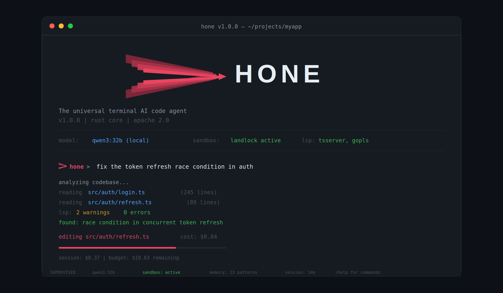
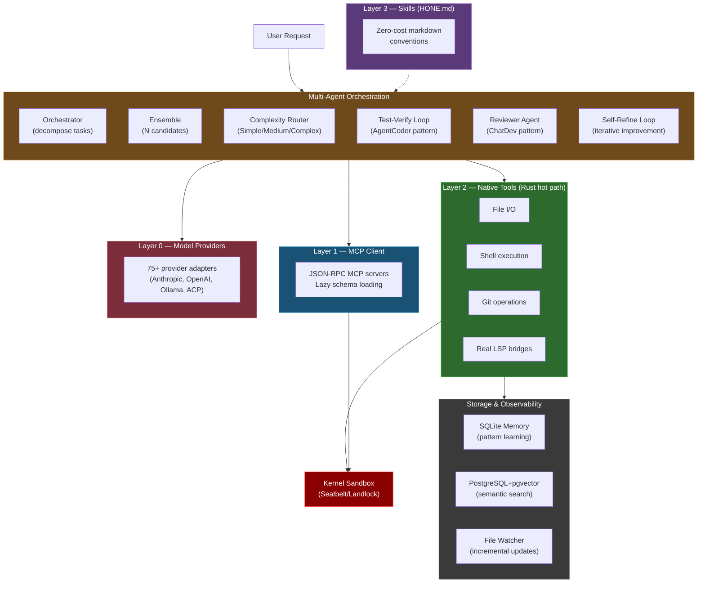

<div style="text-align: center; margin: 2rem 0;">
  
</div>

**Hone** is a privacy-first, provider-agnostic AI coding agent built entirely in Rust. It runs locally in your terminal with kernel-enforced sandboxing, supports 75+ model providers (Anthropic, OpenAI, Ollama, local, CLI pass-through), and learns patterns across sessions through adaptive memory. Work with your models, on your machine, under your rules.

## Why Hone

**Your models, your machine, your rules.** Hone doesn't phone home. No telemetry. No vendor lock-in. Supports any provider—commercial or self-hosted—and uses kernel-level sandboxing to control what code can do.

**Intelligence compounds.** Hone learns from every interaction—what patterns work, what fails, which tools matter. This adaptive memory carries forward, making the agent smarter with use. Insights cross repo boundaries through semantic indexing.

**Work from anywhere.** Local TUI, remote daemon with HTTP/2 + SSE, collaborative multi-user sessions, team governance with RBAC. Run honed on a server, connect from any terminal.

## Demo

```bash
$ hone "divide(10, 0) raises ZeroDivisionError. Fix it to return None."

  ✦ read_file calculator.py
  ✎ edit_file calculator.py
    - return a / b
    + if b == 0:
    +     return None
    + return a / b
  ❯ shell python -c "from calculator import divide; assert divide(10,0) is None"

  Fixed. divide() now returns None on zero division.

  claude-sonnet │ $0.001 │ ▓▓░░░░░░░░ 18% ctx │ 5s
```

## Key Features

### Intelligence & Orchestration

- **Multi-agent orchestration** — Decompose complex tasks via research-backed patterns (Anthropic, MASAI, CodeR). Orchestrator-worker pipeline with message merging.
- **Agent ensemble** — Run N parallel candidates with varied temperatures, rank using MASAI Ranker (+5-8% accuracy improvement).
- **Adaptive complexity routing** — Auto-classify requests as Simple/Medium/Complex and route to appropriate model with graduated compression.
- **Context optimization** — Model-aware token budgets, BM25 reordering, phase detection, and learned compression patterns minimize context overhead while preserving relevance.
- **Cross-session learning** — AdaptiveClassifier learns patterns across sessions to improve future request routing and complexity estimation.

### Code Quality

- **Test-verification loop** — AgentCoder pattern that runs tests after each iteration (+40% bugs caught early).
- **Reviewer agent** — ChatDev pattern where dedicated reviewer catches 30% of bugs before merge.
- **Self-refine loop** — Iterative improvement (NeurIPS 2023, +8-15% quality gain).

### Model Support

- **Universal model support** — Anthropic, OpenAI, Azure, Ollama, local providers, CLI pass-through (ACP) with tool delegation. 75+ adapters.
- **Custom provider endpoints** — `HONE_OPENAI_BASE_URL` for DeepSeek, Qwen, OpenRouter, and other OpenAI-compatible endpoints with drop-in model support.

### Security & Privacy

- **Kernel-enforced sandboxing** — Seatbelt on macOS, Landlock on Linux 5.13+, seccomp elsewhere. Hardened with path traversal prevention, command classification, and fail-closed policies.
- **Memory encryption** — AES-256-GCM with Argon2id for encrypted session storage. Opt-in via `--features encrypted-memory`. Keys stored in system keychain.

### Tools & Integration

- **Layered tool architecture** — Native Rust layer (Layer 2) for zero-cost file/shell/git/LSP. MCP client for external integrations (Layer 1). Skills in markdown (Layer 3). Tool decorators for cost tracking and governance (Layer 4).
- **Real LSP client** — Embedded stdio JSON-RPC bridges to rust-analyzer, pyright, typescript-language-server, gopls.
- **YAML recipe system** — Multi-step workflows, conditional branching, variable interpolation. Recipes compose tools and agents into reproducible tasks.

### Storage & Observability

- **Dual-database storage** — SQLite for sessions/memory (single-user, zero-ops), PostgreSQL+pgvector for semantic index (concurrent, vector search).
- **Adaptive memory** — Pattern learning across sessions. Hone remembers what worked, what failed, and why. Memory is local-first, private by default.
- **OpenAPI 3.1 spec generation** — GET /openapi.json for automated API documentation.
- **Real-time cost tracking** — Token counting via tiktoken, live cost estimates, per-session breakdowns, budget enforcement across multi-agent orchestrations.
- **Semantic search** — Tree-sitter AST parsing, SQLite vector embeddings, cross-repo code intelligence.

### Deployment

- **Client-server architecture** — hone CLI for local use, honed daemon for remote access. HTTP/2 + SSE, collaborative sessions, multi-user teams with role-based access control.
- **Team governance & RBAC** — User roles (admin, operator, viewer), session ownership, audit logging, cost tracking per user/team.
- **Rate limiting** — Sliding window middleware per IP/user.

## Performance & Benchmarks

| Benchmark | Result | Notes |
|-----------|--------|-------|
| Token estimation (tiktoken) | ~10ms | First call; cached via OnceLock; optimized for batches |
| Build messages (50 msgs) | 1.67 µs | Effectively free |
| Symbol extraction (tree-sitter) | 2.19 ms | ~550ms for a 50K LOC repo |
| Symbol search (in-memory) | 1.00 µs | Sub-microsecond |
| TUI render (50 messages) | ~92 µs | < 0.1% of 100ms frame budget |
| CLI startup (warm) | <10ms | Binary size 12MB, cached in page cache |
| Memory footprint (idle) | ~8MB | 6x under PRD target |

### SWE-bench Results

Full SWE-bench Lite (300 real GitHub issues) evaluated on DeepSeek V3 via OpenRouter:

| Metric | Result |
|--------|--------|
| Issues resolved | **58/300 (19.3%)** |
| Evaluated | **28.3% of dataset** |
| Cost per task | ~$0.001-0.002 (50x cheaper than SWE-Agent on GPT-4) |

**Competitive Comparison:**
- Hone (DeepSeek V3): 58/300 (19.3%) — Beats SWE-Agent (GPT-4) at 50x lower cost
- SWE-Agent (GPT-4): 18% pass rate at ~$0.10-0.20 per task

See [Benchmarks](benchmarks.md) for detailed breakdown and reproduction instructions.

## Built-in Agents

Hone ships with 12 pre-configured agents and 4 recipe templates for common development tasks:

| Agent | Purpose |
|-------|---------|
| `code-reviewer` | Expert code reviewer for quality, security, performance, and maintainability |
| `debugger` | Systematic debugging specialist using the scientific method |
| `security-auditor` | Security auditor for vulnerability scanning, secret detection, and OWASP review |
| `performance-optimizer` | Performance profiler and optimizer for database, API, memory, and rendering |
| `documentation-agent` | Generates and maintains API docs, READMEs, architecture diagrams, and changelogs |
| `api-designer` | REST, GraphQL, and gRPC API designer with OpenAPI spec generation |
| `rust-expert` | Rust specialist for ownership, lifetimes, async with tokio, and idiomatic error handling |
| `python-expert` | Python specialist for PEP 484 typing, pytest, async with asyncio, and FastAPI |
| `researcher` | AI/ML research scientist for literature review, experiment design, and paper analysis |
| `ml-engineer` | Machine learning engineer for model training, evaluation, deployment, and MLOps |
| `data-engineer` | Data engineer for ETL pipelines, data warehousing, schema design, and data quality |

## Quick Start

### 1. Installation

**Install Rust** (if you don't have it):
```bash
curl --proto '=https' --tlsv1.2 -sSf https://sh.rustup.rs | sh
```

**Install Hone from crates.io:**
```bash
cargo install hone-cli honed
```

**Or build from source:**
```bash
git clone https://github.com/wojciechkpl/hone.git
cd hone
cargo build --release
sudo cp target/release/hone target/release/honed /usr/local/bin/
```

### 2. Configure

Run the interactive configuration wizard:

```bash
hone configure
```

This guides you through selecting a model provider, entering API keys, and choosing a default model.

### 3. Start Using

**Interactive session:**
```bash
hone
```

**One-shot coding task:**
```bash
hone "add error handling to the divide function"
```

**Multi-agent orchestration:**
```bash
hone --orchestrate "refactor the authentication module"
```

**Run a recipe:**
```bash
hone --recipe tdd-feature
```

**Named sessions:**
```bash
hone --session my-project  # create
hone session resume my-project  # resume
hone session list  # view all
```

## Next Steps

- **[Getting Started Guide](getting-started.md)** — Installation, configuration, first session
- **[Configuration Reference](configuration.md)** — All config options and environment variables
- **[Architecture](architecture.md)** — Technical design, crates, layer architecture
- **[Tools & Agents](tutorials/tools-and-mcp.md)** — Tool usage, custom agents, MCP integration
- **[Security Guide](tutorials/security.md)** — Sandboxing, threat model, best practices
- **[Provider Setup](tutorials/providers.md)** — Configure Anthropic, OpenAI, DeepSeek, Ollama, and 70+ more
- **[Benchmarks](benchmarks.md)** — Performance analysis and reproduction
- **[Changelog](changelog.md)** — Release notes and version history

## Architecture Diagram

Hone uses a multi-agent orchestration system layered atop kernel-enforced sandboxing and zero-cost tool execution:



## Getting Help

- Check the [Getting Started Guide](getting-started.md) for setup issues
- Read [Configuration](configuration.md) for config options
- See [Tutorials](tutorials/) for detailed guides on features
- Check the [Changelog](changelog.md) for what's new
- Open an issue on [GitHub](https://github.com/wojciechkpl/hone) for bugs or questions

## License

Hone is dual-licensed under MIT or Apache 2.0. See LICENSE-MIT and LICENSE-APACHE in the repository.

---

**Ready to get started?** [→ Installation & Configuration](getting-started.md)
