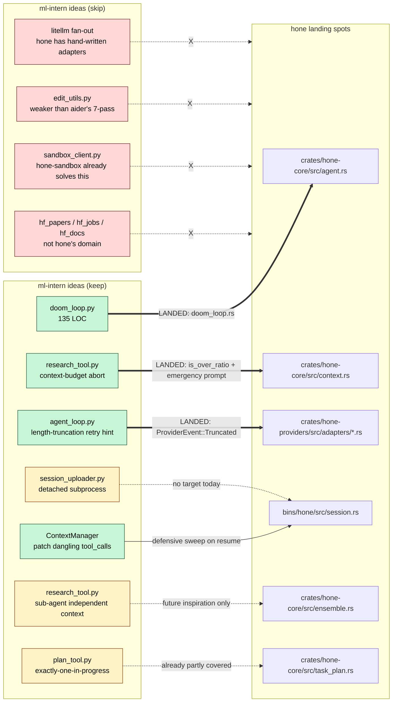

# ml-intern vs Hone — What's Worth Porting

Scoped comparative review of [huggingface/ml-intern](https://github.com/huggingface/ml-intern)
(Python CLI + FastAPI backend + React frontend; commit at `/tmp/ml-intern` on
2026-04-21) against `hone` (Rust TUI workspace, branch `main`).

Baseline for hone is `docs/aider-vs-hone.md` — this doc only covers novel
ideas, not the already-catalogued ones (MCP, pgvector, agent rail, etc.).

Research date: 2026-04-21.

---

## 1. What is ml-intern?

ml-intern is an **ML engineering assistant**, not a generic coding assistant.
Its pitch is: "autonomously researches, writes, and ships good quality ML
related code using the Hugging Face ecosystem" (`/tmp/ml-intern/README.md:7`).
Concretely, it is a single-agent tool-calling loop (max 300 iterations, driven
by `litellm.acompletion`) whose tool surface is dominated by HF-specific
research and execution primitives — HF papers + Semantic Scholar citation
graph, HF docs crawler, HF datasets inspector, HF Hub repo reader, HF Jobs
submit/monitor, and a per-session HF Space "sandbox" that the agent duplicates
on boot and runs training scripts in. The file/shell tools (`bash`, `read`,
`write`, `edit`) are duplicated for two execution backends: a remote HF Space
sandbox (`agent/tools/sandbox_tool.py`) and local subprocess/pathlib when
running in CLI mode (`agent/tools/local_tools.py`).

**This is not a head-to-head coding-assistant peer of hone.** Hone is a
generalist agentic coder with a polished TUI; ml-intern is a narrower "ML
intern" whose killer feature is that it can launch actual GPU training jobs on
HF infrastructure. The overlap is the agentic loop itself (tool calls,
context management, streaming, approvals, sandbox). The HF-ecosystem tools
are not portable — hone doesn't own that problem space. Treat the comparison
as **"what loop/context/tool-control patterns are transferable"** rather than
"what features should we copy."

---

## 2. Architecture snapshot

- **Language**: Python 3.11+ (agent + backend), TypeScript/React (frontend).
- **Runtime model**: single-threaded async (`asyncio`), LLM calls via
  `litellm` for provider fan-out. No ensemble, no multi-agent — just a
  `research` tool that spawns a cheaper LLM with an independent context.
- **Total code**: ~14.5k LOC Python (agent+backend), ~7k LOC TypeScript
  (frontend).
- **Entry points**:
  - `ml-intern` CLI (`agent/main.py`, 1096 lines) — Rich/prompt-toolkit REPL,
    supports interactive and headless modes.
  - `backend/main.py` (FastAPI) + React frontend — hosted web UI where the
    agent also runs; communicates via SSE.
- **Dependencies of note**: `litellm`, `fastmcp` (MCP client baked in),
  `huggingface_hub`, `semantic-scholar` (via direct API), `whoosh` (in-RAM
  BM25 index for docs search), `beautifulsoup4`, `httpx`, `fastapi`,
  `pydantic` v2. No tree-sitter, no vector DB, no pgvector analogue.
- **Audience**: HF customers doing ML experimentation. The hosted web UI is
  clearly the primary deployment target (there's an auth route, an org
  membership check, an SSE transport for the frontend); the CLI is a
  secondary target, with `local_mode=True` gated paths throughout.

### File tree (top two levels, pruned)

```
ml-intern/
  agent/
    core/
      agent_loop.py           # 1222 LOC — the Handlers.run_agent loop
      doom_loop.py            # 135 LOC — repeated-tool-call detector
      session.py              # 296 LOC — Session + trajectory upload
      session_uploader.py     # 202 LOC — detached HF dataset upload
      tools.py                # 376 LOC — ToolRouter + create_builtin_tools
    tools/
      research_tool.py        # 457 LOC — sub-agent with its own context
      papers_tool.py          # 1295 LOC — HF Papers + Semantic Scholar
      docs_tools.py           #  979 LOC — HF docs crawler + Whoosh BM25
      sandbox_client.py       # 1054 LOC — HF Space sandbox client
      sandbox_tool.py         #  292 LOC — sandbox tool wrapper
      local_tools.py          #  426 LOC — local bash/read/write/edit
      edit_utils.py           #  268 LOC — 4-pass fuzzy edit matcher
      jobs_tool.py            # 1095 LOC — hf_jobs submit/ps/logs/cancel
      hf_repo_files_tool.py   #  323 LOC
      hf_repo_git_tool.py     #  664 LOC
      github_*.py             # list/read/find_examples
      plan_tool.py            #  131 LOC — todo list with status
    context_manager/
      manager.py              #  335 LOC — compaction + patch dangling tool_calls
    prompts/
      system_prompt_v3.yaml   # Jinja2-rendered, ML-specific
  backend/
    main.py, session_manager.py, routes/{agent,auth}.py
  frontend/ ...
  configs/main_agent_config.json
```

---

## 3. Notable ideas

Six concrete techniques worth studying.

### 3.1 Doom-loop detector

A lightweight heuristic that scans the last 30 assistant messages for
repeated tool-call signatures and injects a system-level corrective prompt
when it finds them.

- **Identical-consecutive detection**: 3+ tool calls with the same
  `(name, md5(args))` triggers an injected "[SYSTEM: DOOM LOOP DETECTED]"
  user message instructing the model to try a fundamentally different
  approach. `/tmp/ml-intern/agent/core/doom_loop.py:55-71`
- **Repeating-sequence detection**: patterns of length 2–5 that repeat 2+
  times at the tail of the history (e.g. `read → edit → read → edit → read
  → edit`) trigger a sequence-specific correction.
  `/tmp/ml-intern/agent/core/doom_loop.py:74-100`
- Called both from the main loop (`agent/core/agent_loop.py:502`) and from
  the research sub-agent (`agent/tools/research_tool.py:303`), i.e. the
  same detector is reused wherever there is a tool-calling loop.

The whole thing is ~135 lines, no state beyond the message history, and
imposes O(30) work per iteration. It's the highest-ROI pattern in the repo.

### 3.2 Research sub-agent with independent context

`research` is a tool the main agent can call with `{task, context}`; the
handler spawns a fresh LLM conversation (on a cheaper/faster model, chosen
by `_get_research_model`) with its own system prompt and a restricted
read-only tool subset (papers, HF docs, GitHub read, dataset inspect,
bash/read). The sub-agent's context never pollutes the main agent's — only
the final summary comes back.

- Independent loop with max 60 iterations, its own `check_for_doom_loop`
  watchdog, and an explicit context budget (warn at 170k tokens, hard-stop
  at 190k) that forces the sub-agent to wrap up gracefully instead of
  dying. `/tmp/ml-intern/agent/tools/research_tool.py:299-335`
- Progress is surfaced via `tool_log` events so the parent UI shows
  per-tool-call status while the sub-agent is running.
  `/tmp/ml-intern/agent/tools/research_tool.py:284-291`
- The system prompt is a methodology (crawl citations → read §3/§4/§5 →
  attribute results to recipes) not just tool docs. `agent/tools/research_tool.py:43-140`

This is the same pattern Claude Code uses for its "Task" sub-agent, scaled
down to ~450 lines and specialised for ML literature review. The
*decoupling of context budgets* (main vs. sub) is the key insight — hone's
ensemble today shares a single working context.

### 3.3 Context-window abort with graceful summary

The research sub-agent treats token budget as a *first-class* control
variable. At 75% it injects a "wrap up in 1–2 iterations" nudge. At 95% it
strips tools entirely, tells the model "CONTEXT LIMIT REACHED — summarize
NOW, no more tools", and force-calls with `tools=None`. Worst case, it
returns whatever partial findings exist with `success=True` if content was
produced.
`/tmp/ml-intern/agent/tools/research_tool.py:309-347, 430-451`

Compare with hone's `ContextManager`: it compacts but doesn't (as far as I
can see) have a "we're out, salvage what you have" path. This is a
one-screen pattern that prevents silent truncation failures.

### 3.4 Dangling-tool-call patching

Every turn, `ContextManager.get_messages()` scans backwards for the last
assistant message with `tool_calls`, cross-references which `tool_call_id`s
have matching `role=tool` results, and *synthesises stub tool results* for
any missing ones with the content "Tool was not executed (interrupted or
error)." `/tmp/ml-intern/agent/context_manager/manager.py:185-227`

This is defensive engineering against the most common source of "400 Bad
Request: tool_use blocks must be followed by tool_result" errors — an
interrupted tool call, an OOM kill, a crash mid-execution. hone's loop
explicitly cancels pending tools on user interrupt and injects rejection
messages (`agent_loop.py:424-459`), but there's no post-hoc healer that
patches already-broken histories loaded from disk. If you ever resume a
corrupted session from SQLite, you lose.

### 3.5 Output-truncation retry hint

When the LLM returns `finish_reason="length"` with partial tool_calls, the
main loop *drops* the mangled tool calls and injects a targeted system
message telling the model exactly how to retry:

> "Your previous response was truncated because the output hit the token
> limit. The following tool calls were lost: [names]. IMPORTANT: Do NOT
> retry with the same large content. Instead: For 'write': use bash with
> cat<<'HEREDOC' to write the file, or split into several smaller edit
> calls."
>
> `/tmp/ml-intern/agent/core/agent_loop.py:536-575`

Same pattern for malformed JSON args: the tool call is recorded with an
empty `{}` args dict, a synthetic error tool-result is injected, and a
hint about splitting the edit is supplied. `agent_loop.py:620-665`

### 3.6 Detached-subprocess trajectory upload

Every N user turns, `Session.save_and_upload_detached()` writes the full
session trajectory (messages + events) to a local JSON file, then
`subprocess.Popen(..., start_new_session=True)` spawns a fully detached
Python process whose *only* job is to upload that file to HF and update
the status. The main loop returns immediately; the session survives
ml-intern dying mid-upload; the detached uploader retries on its own.
`/tmp/ml-intern/agent/core/session.py:238-268`,
`/tmp/ml-intern/agent/core/session_uploader.py`

Pattern worth noting: never block the agent loop on network I/O that isn't
on the critical path. Fire-and-forget with durable local state.

---

## 4. Relevance to hone

### Directly portable features

Thin — hone and ml-intern are in different product categories, and the
value-density of ml-intern is in HF-specific tools hone doesn't need. But
three things pass the test:

- **Doom-loop detector**. Implementation-language-agnostic (it's a hash +
  two loops), drops into `crates/hone-core/src/agent.rs` right before each
  `Agent::run_turn` iteration. Already has a clear call site: the loop
  where `pending_tool_calls` is built (`agent.rs:407`).
- **Context-budget graceful abort** (3.3). hone has `ContextManager`
  compaction but no "we're at the ceiling, strip tools, force summary"
  escape hatch. Low-lift addition.
- **Output-truncation retry hint** (3.5). hone almost certainly hits the
  same `finish_reason=length` + partial tool_calls edge case; a
  provider-level check in `crates/hone-providers/src/adapters/anthropic.rs`
  (and OpenAI adapter) that logs the dropped tool calls and injects a
  retry hint is ~50 Rust lines.

### Conceptual inspiration

- **Research sub-agent with independent context** (3.2). Not a direct port
  — hone already has an ensemble (`ensemble.rs`, `reviewer.rs`,
  `self_refine.rs`) that is more flexible than ml-intern's one-shot
  sub-agent. But the explicit-budget + read-only-tool-subset + progress-
  streaming shape is a good reference for a hypothetical "spawn a research
  agent" mode in hone, distinct from planner/worker/reviewer. Useful if
  hone adds a deep-research or literature-review capability.
- **Dangling-tool-call self-healer** (3.4). hone's agent loop is stricter
  than ml-intern's, but session-resume from SQLite (`bins/hone/src/session.rs`)
  could still produce histories with missing tool results if the previous
  run crashed. Worth a defensive sweep in the resume path.
- **Detached-subprocess upload** (3.6). hone doesn't upload sessions to
  anyone, so this is moot as-is. But the *pattern* — durable local write,
  detached worker, status field — is the right shape for any future
  telemetry/sharing feature. Don't block the agent.
- **Plan tool semantics** (`agent/tools/plan_tool.py`). ml-intern's
  `plan_tool` is the Claude Code TodoWrite pattern: single in-memory
  replaced-on-each-call list, one-in-progress invariant, frontend renders
  it as a stateful widget. hone has `task_plan.rs` and `plan_store.rs`
  which are richer (plans are stored, not ephemeral); but exposing a
  "current todo list" as an LLM-visible tool with the enforced invariant
  "exactly one in_progress" is worth considering for the TUI rail — it
  gives the user a live progress bar for free. Already partly covered by
  hone's agent rail; see §5.

### Irrelevant

- All HF-specific tools: `hf_papers`, `hf_jobs`, `hf_repo_files`,
  `hf_repo_git`, `hf_inspect_dataset`, `explore_hf_docs`, `fetch_hf_docs`.
  These are the product. hone is not a HF-ecosystem client.
- HF Space sandbox (`sandbox_client.py`, 1054 LOC). hone has
  `hone-sandbox` with its own model; ml-intern's approach (duplicate a
  template Space, wait for it, talk over HTTPS) is specific to running
  training jobs on HF infra.
- Whoosh-based docs index (`docs_tools.py`). hone has pgvector, which
  subsumes Whoosh for everything hone cares about.
- Frontend (React SPA). hone is TUI-first; the web frontend is
  orthogonal. (See `project_hone_webui_prd.md` in your agent memory if
  hone eventually grows a web UI — some of ml-intern's SSE transport
  (`frontend/src/lib/sse-chat-transport.ts`) could be reference material
  then, but not now.)
- Fuzzy edit matcher (`edit_utils.py`). ml-intern has a 4-pass matcher
  (exact → rstrip → strip → unicode-normalise), which is strictly weaker
  than aider's 7-pass `diff_match_patch` cascade already catalogued in
  `aider-vs-hone.md §3.1`. If hone adopts aider's matcher, it gets
  ml-intern's for free. Do not port ml-intern's version separately.
- LLM provider fan-out (`litellm`). hone has hand-written adapters; the
  choice is already made and reversing it isn't on the table.

---

## 5. Top 3 porting candidates, ranked

> **Status:** all three are implemented. See §5 items for the landing
> locations and §7 for a summary of what shipped.

### 1. Doom-loop detector — S effort, low risk — **IMPLEMENTED**

**What:** Port `agent/core/doom_loop.py` to Rust, ~150 lines. Signature is
`(tool_name, md5_of_args)`; two detectors (identical-consecutive,
repeating-sequence); returns an optional corrective-prompt string that the
loop injects as a synthetic user message before the next LLM call.

**Where landed:**
- `crates/hone-core/src/doom_loop.rs` — detector with pure functions
  (`detect_identical_consecutive`, `detect_repeating_sequence`,
  `check_for_doom_loop`).
- Call site: `crates/hone-core/src/agent.rs` — `Agent::run_turn` calls
  `doom_loop::check_for_doom_loop(&self.context.messages())` before each
  provider request, gated on `!doom_loop_warned && !context_emergency`
  so the warning fires at most once per turn and does not stack with
  the context-emergency user message.
- Tests: unit tests on the detectors in `doom_loop.rs`; integration test
  `doom_loop_detection_injects_corrective_user_message` in
  `crates/hone-core/tests/agent_turn.rs`.

**Stability note:** the detector hashes arguments with
`std::collections::hash_map::DefaultHasher` (SipHash-1-3). Stability is
only guaranteed within a single process run — the hashes are never
persisted.

**Risk/tradeoff:** Low. The detector is pure, deterministic, and falls
back to `None` when it's uncertain. The one downside is false positives on
legitimate long-running tools that legitimately get called repeatedly
(e.g. polling a job status). Not yet mitigated — add a `read_only` +
pollable allowlist if this becomes a problem in practice.

### 2. Graceful context-budget abort — S effort, low risk — **IMPLEMENTED**

**What:** When the ContextManager's tracked context length crosses a hard
ceiling (e.g. 95% of model max), force one more LLM call with
`tools = None` and a "wrap up NOW, no more tools" system message. Return
whatever the model produces as the final answer for the turn. Don't just
let compaction and truncation fight each other.

**Where landed:**
- `crates/hone-core/src/context.rs` — `ContextManager::is_over_ratio(ratio,
  extra_tokens)` includes out-of-band tokens (system prompt + memories) in
  the ceiling check. `estimate_text_tokens` uses tiktoken cl100k_base plus
  a per-message framing overhead.
- Call site: `crates/hone-core/src/agent.rs::run_turn` — before each
  provider request, compares against a 95% ceiling. When tripped, injects
  a synthetic user message ("finalize now, no more tool calls") and
  strips tools from the next `CompletionRequest`. Latches via a
  `context_emergency` flag so the wrap-up request is made exactly once
  per turn.

**Risk/tradeoff:** Low. The emergency prompt has no tools so the model
cannot infinite-loop; the request still counts against the ceiling, so
if the prompt itself pushes us over, compaction below the emergency
threshold should have caught it first. Tested by
`context_emergency_strips_tools_on_follow_up_request` in
`crates/hone-core/tests/agent_turn.rs`.

### 3. Output-truncation retry hint — S effort, low risk — **IMPLEMENTED**

**What:** In the provider adapters (anthropic.rs, openai.rs), when the
response has `finish_reason = "length"` AND partial tool calls are
present, drop the partial tool calls and return a structured hint that the
agent loop uses to inject:

> "Your previous response was truncated. Lost tool calls: [names]. Retry
> with smaller content — for large writes, split into multiple edits or
> use `bash` with a heredoc."

**Where landed:**
- New `ProviderEvent::Truncated { lost_tool_calls: Vec<String> }` variant
  in `hone-proto`.
- `crates/hone-providers/src/adapters/anthropic.rs` — detects
  `message_delta.delta.stop_reason == "max_tokens"`, collects names of
  any in-flight tool calls, emits `Truncated`, clears partial state.
- `crates/hone-providers/src/adapters/openai.rs` — same shape for
  `finish_reason == "length"`.
- `crates/hone-core/src/agent.rs::run_turn` — captures the event,
  commits an assistant message (or
  `"[response truncated at output token limit]"` placeholder when no text
  streamed) to satisfy role alternation, then appends a synthetic user
  message naming the lost tools, and `continue`s the loop.
- Tests:
  - `message_delta_with_max_tokens_emits_truncated` and
    `truncation_during_tool_call_reports_lost_tool_name` in
    `crates/hone-providers/tests/anthropic.rs`.
  - `finish_reason_length_emits_truncated` in
    `crates/hone-providers/tests/openai.rs`.
  - `truncation_event_injects_assistant_and_user_messages_before_retry`
    and `truncation_with_empty_lost_list_still_injects_placeholder_assistant`
    in `crates/hone-core/tests/agent_turn.rs`.

**Risk/tradeoff:** Low. The agent loop commits an assistant message
before the synthetic user hint so Anthropic's role-alternation contract
holds, and partial tool-call state is cleared before emission so the
next turn never contains a malformed `tool_use` block.

### Not making the cut

- **Research sub-agent.** Conceptually interesting but hone's ensemble
  already covers the "multiple model passes with different prompts"
  problem. Adding a separate sub-agent primitive is a feature decision,
  not a port. Revisit if/when hone adds a literature-review or web-research
  capability — at that point, copy the context-budget + tool-subset
  discipline, not the code.
- **Plan tool as LLM-visible todo list.** Hone's `task_plan.rs` and
  `plan_store.rs` already do this server-side, and the agent rail shows
  progress. Wiring a `TodoWrite`-style tool on top would duplicate
  functionality. If the tool *were* added, the enforced-invariant
  ("exactly one in_progress") from ml-intern's `plan_tool.py:49-56` is
  the part to keep.
- **Detached trajectory upload.** No target (hone doesn't ship sessions
  anywhere). If it ever does, the pattern is trivially derivable — don't
  pre-port.

---

## 6. Concept map — ml-intern ideas → hone components



---

## 7. Bottom line

Thin overlap. ml-intern is a specialist (HF-ecosystem ML intern) whose
product value lives in tools hone doesn't want to own. The agentic-loop
primitives, however, are clearly the work of people who've watched a lot of
agents break in production — and three of those primitives (doom-loop
detector, context-budget graceful abort, truncation-retry hint) are
high-value small ports that would make hone's loop visibly more robust.

**All three landed.** The branch that ported them touched:

- `crates/hone-core/src/doom_loop.rs` (new)
- `crates/hone-core/src/context.rs` — `is_over_ratio(ratio, extra_tokens)`,
  `estimate_text_tokens`
- `crates/hone-core/src/agent.rs` — three gated check points in `run_turn`
- `crates/hone-providers/src/adapters/{anthropic,openai}.rs` — `Truncated`
  event emission
- `crates/hone-proto` — new `ProviderEvent::Truncated` variant

Integration tests live in `crates/hone-core/tests/agent_turn.rs`, adapter
tests in `crates/hone-providers/tests/{anthropic,openai}.rs`. See
`CHANGELOG.md` for the user-visible summary.
