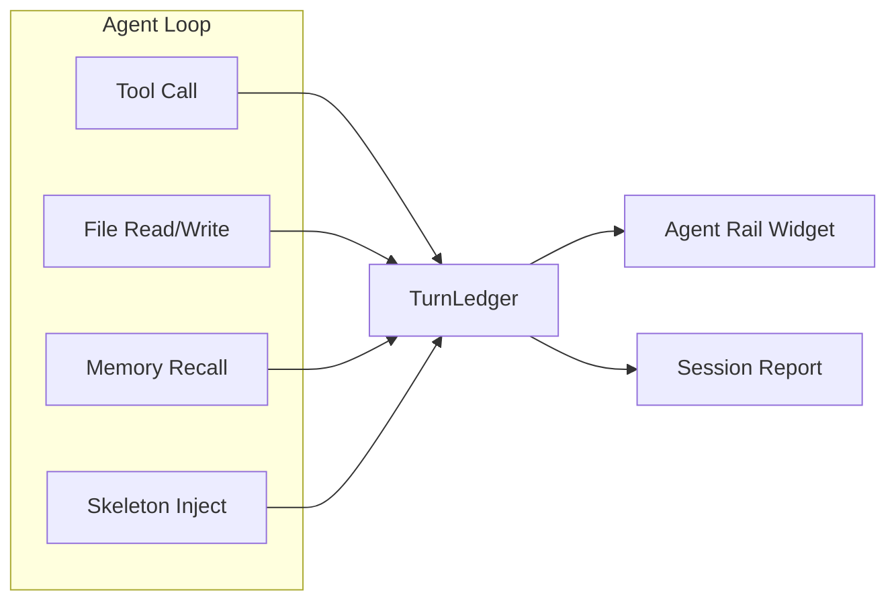

# Observability

Hone provides real-time per-turn observability through the **Agent Rail** sidebar and detailed **session reports**. Track what files the agent touches, which context gets injected, what the agent recalls from memory, and how tools are being used — all without slowing down the main agent loop.

## Agent Rail — Real-Time Sidebar

Press `Ctrl+R` to toggle the Agent Rail, a narrow right-side panel showing live observability data for the current (or most recent) turn.

### Requirements

- Terminal width ≥ 100 columns. On narrower terminals, the rail is suppressed automatically.
- Only visible in interactive TUI mode. Not available in one-shot, recipe, or orchestration modes yet.

### What It Shows

The rail has three sections, stacked vertically:

#### Files

Lists all files touched this turn, with operation badges and optional line numbers:

```
[FILES]
✦ src/auth.rs
✎ src/session.rs:45
❯ /tmp/build.log
  3 files  4 ops
```

**Badges:**
- `✦` (Read) — file was read
- `✎` (Write) — file was written or edited
- `❯` (Exec) — file was executed/run (e.g., test output)

In ASCII-only mode (`HONE_ASCII_ONLY=1`), badges become `[R]`, `[W]`, `[X]`.

#### Context

Top 5 injected skeleton/BM25 context entries, ranked by relevance score:

```
[CONTEXT]
skel CallGraph  auth.rs    0.91  840t
bm25 session.rs #1 0.74  320t
bm25 utils.rs   #2 0.62  180t
```

Columns:
- **Strategy**: `skel` (skeleton/directory tree), `bm25` (semantic search rank)
- **Path**: truncated from the left so filename is always visible
- **Score**: BM25 relevance (0.0–1.0) or `—` for skeleton entries
- **Tokens**: approximate count of tokens injected for this entry

Token counts are colored by budget threshold: green (< 1000t), yellow (1000–2000t), red (≥ 2000t). Helps spot context bloat.

#### Memory

Memory entries recalled in this turn: key + truncated snippet:

```
[MEMORY]
auth-token-refresh
  "Use refresh_token from session.rs…"
rate-limiter-pattern
  "Implement exponential backoff with…"
```

### Interaction

- **Scroll**: Use `j`/`k` (or arrow keys in future) to scroll within the rail. Scroll state resets each turn when new data arrives.
- **Toggle**: `Ctrl+R` to show/hide the rail. The toggle state persists across turns.
- **Empty sections**: If a section shows just `—`, the agent hasn't triggered that category in this turn yet (e.g., no tool calls, no memory recalls).

### Accessibility

Three environment variables control rail rendering for accessibility:

#### `HONE_REDUCED_MOTION=1`

Disables animation in spinners and loading indicators. The Agent Rail spinner respects this flag; full wiring into the animation system is planned. Set this if you experience motion discomfort.

#### `HONE_ASCII_ONLY=1`

Forces the use of ASCII characters for borders and badges instead of Unicode box-drawing:

```
Before:  ✦ src/auth.rs
After:   [R] src/auth.rs

Before:  ┌─ Files ──┐
After:   +- Files --+
```

Color is preserved unless `NO_COLOR=1` is also set.

#### `NO_COLOR=1`

Disables colored output (ANSI codes). Implies ASCII box-drawing automatically. Useful for log aggregation, screen readers, and CI/CD.

**Combinations:**
- `HONE_ASCII_ONLY=1` → ASCII borders + colored text
- `NO_COLOR=1` → ASCII borders + no color
- Both → ASCII borders + no color

### Data Collected Per Turn

The TurnLedger accumulates:

| Field | Type | Description |
|-------|------|-------------|
| `turn_index` | `usize` | Turn number (0-based) |
| `files_touched` | `Vec<FileTouch>` | Each file with path, operation type, optional line range |
| `skeleton_injections` | `Vec<SkeletonEntry>` | Strategy, path, BM25 score, token count |
| `memory_recalls` | `Vec<MemoryRecall>` | Key, snippet, timestamp |
| `tools_invoked` | `Vec<ToolInvocation>` | Tool name, duration, cache hit, error status |
| `phase_transitions` | `Vec<(Phase, u64)>` | Phase label + elapsed ms from turn start |

### Troubleshooting

**Rail not visible even on wide terminal?**
- Check that you're in interactive TUI mode (not `--recipe`, `--orchestrate`, `--ensemble`, or one-shot).
- Verify terminal width: `echo $COLUMNS` should be ≥ 100.
- Press `Ctrl+R` to toggle it on.

**Rail shows only dashes (`—`) in all sections?**
- The agent has completed a turn but hasn't run any tools, read files, or recalled memory yet.
- Run another turn or wait for the next tool invocation.

**Text is cut off in the rail?**
- Paths are truncated from the left to keep filenames visible. This is intentional for very long paths.
- Use `hone reports show <id>` to see the full report with complete paths.

## Architecture



On each agent turn:
1. Tool calls, file operations, memory recalls, and skeleton injections are recorded to `TurnLedger`.
2. The **Agent Rail** renders the current ledger in the sidebar (updated live, scroll resets per turn).
3. On session end (`/quit`), all completed ledgers are aggregated into a **Session Report** and written to disk.

## Known Limitations

- **Agent Rail Inspect overlay** — The `Ctrl+I` overlay for detailed turn inspection is not yet implemented. Use `hone reports show` for detailed post-session analysis.
- **Animation wiring** — `HONE_REDUCED_MOTION` currently only affects the Agent Rail spinner. The main TUI animation system (e.g., generic loading indicators) will be updated in a follow-up to also respect this flag.

## See Also

- [Session Reports](session-reports.md) — Full audit trail, retention, and CLI tools
- [Configuration](configuration.md) — Environment variable reference
- [Getting Started](getting-started.md) — First-time setup
