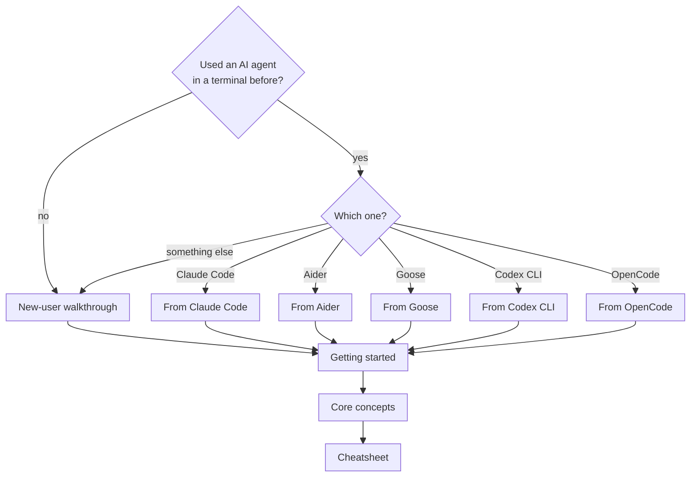
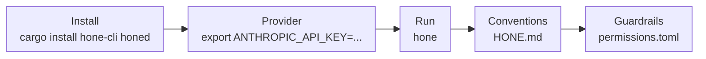

# Onboarding hub

  

  
  
  

Welcome. Pick the path that matches where you're coming from. Every path ends in the same
place: Hone running in your own project, with guardrails you chose.

## Which guide is for me?

| Coming from | Guide | You'll find |
|---|---|---|
| Nothing yet | [New-user walkthrough](new-user-walkthrough.md) | What an agent is, a first session, prompting tips |
| Claude Code | [from-claude-code.md](from-claude-code.md) | `CLAUDE.md` → `HONE.md`, the same `mcp.json` format, agents as Markdown files |
| Aider | [from-aider.md](from-aider.md) | Git-centric workflows, repo context, the symbol index |
| Goose | [from-goose.md](from-goose.md) | MCP extensions, recipes, provider setup |
| Codex CLI | [from-codex-cli.md](from-codex-cli.md) | Approvals, sandboxing, permission rules |
| OpenCode | [from-opencode.md](from-opencode.md) | Providers, LSP, the client/server split |

> [!NOTE]
> The migration guides were written earlier than this hub. Where a guide and the
> [Configuration reference](../configuration.md) disagree about a flag, file or setting,
> the reference is correct: it is checked against the code.

## The ten-minute path

Details for each step are in [Getting started](../getting-started.md).

## What makes Hone different

| | Hone |
|---|---|
| **Runtime** | Native Rust binaries (`hone`, `honed`, `hone-mcp-server`), no interpreter needed. The same agent loop serves the TUI, scripts (`--json`) and the HTTP daemon. |
| **Scope** | General-purpose: files, shell, git, LSP, web pages and MCP tools. Strongest on code, not limited to it. |
| **Models** | Anthropic, any OpenAI-compatible API, local Ollama, or pass-through to the Claude and Gemini CLIs. |
| **Guardrails** | allow / ask / deny rules in TOML on every entry point; shell checks that are always on; Seatbelt on macOS and opt-in Landlock on Linux for shell commands. [Details](../permissions-and-sandbox.md). |
| **Memory** | Typed memories (feedback, user, project, reference) in local SQLite, with optional encryption. |
| **Multi-agent** | Orchestrator with 12 built-in personas, distributed workers, ensembles, recipes. |

## Common questions

<b>Do I need an API key?</b>

No. Run a local model with [Ollama](https://ollama.com) (`ollama pull llama3.2`), or let
Hone drive the `claude` or `gemini` CLI you already use. API keys unlock Anthropic, OpenAI
and any OpenAI-compatible endpoint.

<b>Is my code private?</b>

Hone itself sends no telemetry and keeps its state in local SQLite files. Your prompts and
the code the agent reads go to the model provider you chose, so a local Ollama model keeps
everything on your machine. `--ephemeral` writes no memory, index or session data.

<b>Can a team use it?</b>

Yes, through `honed`: an HTTP + SSE daemon with a bearer token, a web UI, shared sessions
with participants, and distributed workers. There is one shared token today, not per-user
roles. See [Getting started → daemon](../getting-started.md#8-run-the-daemon-honed), and the
older [Server and remote](../tutorials/server-and-remote.md) tutorial (may be out of date).

<b>What does it cost?</b>

Hone is free and open source (MIT or Apache 2.0). You pay your model provider, if any. The
cost line in the CLI is an estimate; set a cap for the session with `/budget <usd>` in the
TUI.

<b>Can I switch models?</b>

Pick any model at startup with `--model provider:name`. Inside the TUI, `/model` changes the
model for the next turn, within the same provider.

## Next steps

| Step | Read |
|---|---|
| 1 | [Getting started](../getting-started.md): install, first run, modes |
| 2 | [Core concepts](concepts.md): the loop, tools, memory, agents |
| 3 | [Cheatsheet](cheatsheet.md): flags, keys and commands |
| 4 | [Permissions and sandbox](../permissions-and-sandbox.md): decide what the agent may do |
| 5 | [Recipes](../tutorials/recipes.md) and [Tools and MCP](../tutorials/tools-and-mcp.md) (older tutorials; may be out of date) |
| 6 | [FAQ](faq.md) |

Found a gap? Open an issue on [GitHub](https://github.com/wojciechkpl/hone/issues) with the
`docs` label.
