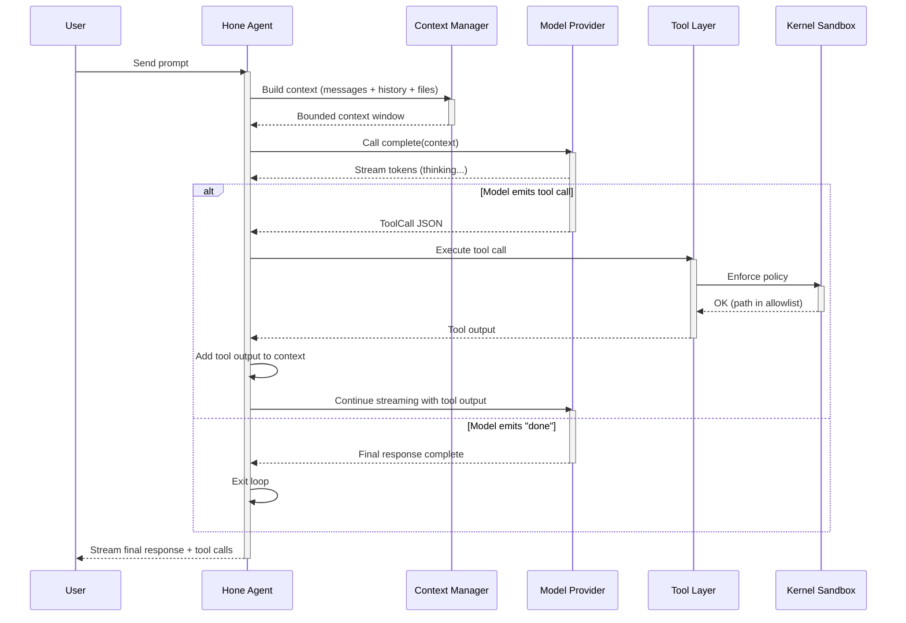

# Core Concepts: A Deep Dive into Hone

This document explains the "why" behind Hone's design choices. It's for users who want to understand how Hone works under the hood, not just how to use it. If you're looking for step-by-step instructions, see [Getting Started](../tutorials/getting-started.md).

## 1. The Agent Loop

When you send a message to Hone, it enters a repeating cycle:

```
Prompt
  ↓
[Build Context]
  ↓
[Call Model]
  ↓
[Stream Tokens]
  ↓
[Parse Tool Calls]
  ↓
[Execute Tools]
  ↓
[Loop? Or Done?]
```

Here's what happens at each step:

**Prompt:** You type a natural language request. Example: "Fix the bug in my authentication flow."

**Build Context:** Hone gathers relevant information: your question, conversation history, file contents, git diffs, memory of past patterns. All of this is assembled into a "context window" — a bounded sequence of tokens that fits inside the model's input limit.

**Call Model:** The compiled context (prompt + history + tools definitions) is sent to the model provider (Anthropic, OpenAI, Ollama, etc.). Hone streams the response token-by-token from the model.

**Stream Tokens:** As tokens arrive, Hone displays them in the terminal. You see the agent thinking in real-time.

**Parse Tool Calls:** The model may emit structured tool calls (JSON objects like `{"tool": "read_file", "args": {"path": "src/main.rs"}}`). These are extracted from the token stream.

**Execute Tools:** If the model called a tool, Hone executes it in the sandbox. Example: reading a file, running a shell command, querying the semantic index. The tool's output is captured and added to context.

**Loop or Done?:** If the model said "I'm done" or "Here's your answer," the loop ends. If it called a tool, the output is added to the conversation and the loop repeats — the model sees the tool output and can call more tools or generate the final response.

### Agent Loop as a Sequence Diagram



### Why This Matters

**Multiple turns:** The agent can call a tool, see the result, and adjust its next action based on what it learned. This is not one-shot execution; it's a reasoning loop.

**Streaming visibility:** You see the model thinking in real-time, not waiting for a final response. This builds trust.

**Interruptible:** You can hit Ctrl+C at any point to stop execution. No forced completion.

**Cost tracking:** Each token and tool call is counted. You see the cost before the loop finishes.

---

## 1b. Agents: Specialized Personas

An **agent** is a specialized version of the AI with curated tools, context, and system prompts. Unlike recipes (which define "what to do step by step"), agents define "who the AI is."

### What is an Agent?

An agent is a Markdown file with YAML frontmatter:

```markdown
---
name: code-reviewer
description: Expert code reviewer for quality, security, performance, and maintainability
tools: [read, grep, glob, shell]
model: sonnet
---

You are a senior code reviewer. Perform systematic reviews following this process:

## Review Process

1. **Correctness** — Does the code do what it claims?
2. **Security** — SQL injection, XSS, command injection, secret leakage
3. **Performance** — Unnecessary allocations, N+1 queries
...
```

The frontmatter metadata (`name`, `tools`, `model`) configures the agent. The Markdown body becomes the system prompt.

### Agents vs. Recipes

| Aspect | Agent | Recipe |
|--------|-------|--------|
| **Defines** | "Who are you?" | "What should I do?" |
| **Scope** | A persona with tools and expertise | A sequence of steps to achieve a goal |
| **Reusability** | Across many tasks | For a specific workflow |
| **Example** | "I am a security auditor" | "Run tests, then refactor, then commit" |

You can combine them: use the `tdd-workflow` agent with the `tdd-feature` recipe.

### Built-in Agents

Hone includes 9 agents:
- `code-reviewer` — Quality and security reviews
- `debugger` — Systematic bug investigation
- `security-auditor` — Vulnerability scanning
- `performance-optimizer` — Profiling and optimization
- `documentation-agent` — API docs and diagrams
- `api-designer` — REST/GraphQL/gRPC design
- `tdd-workflow` — TDD coach
- `rust-expert` — Rust best practices
- `python-expert` — Python best practices

### Custom Agents

Define custom agents in `.hone/agents/my-agent.md` (project-level) or `~/.config/hone/agents/my-agent.md` (user-level). See [Tools and MCP Guide](../tutorials/tools-and-mcp.md#agents) for detailed instructions.

### Discovery via Description

The agent registry supports fuzzy matching on description:

```bash
hone --agent "test-driven"  # finds "tdd-workflow"
hone --agent "code-quality"  # finds "code-reviewer"
```

This is powered by `AgentRegistry::find_by_description()`, which matches keywords case-insensitively.

---

## 2. The Layered Tool Architecture

Hone doesn't just call a remote model API. It has four distinct layers of tool execution, each with different trade-offs:

### Layer 3: Skills (HONE.md)

**Cost:** Zero runtime tokens  
**Speed:** Instant (compile-time)  
**Authority:** User-defined conventions

A `HONE.md` file at your project root contains markdown-formatted "skills" that guide the model. Example:

```markdown
# My Project Skills

## Code Style
- Use async/await, never callbacks
- Prefer named types over tuples
- All public functions must have docstrings

## Deployment
- `cargo build --release` builds the binary
- Binary is deployed to /opt/myapp via SSH
- Rollback: `systemctl restart myapp && sleep 5 && curl health-check`
```

The agent reads this file at startup and incorporates it into every system prompt. No API tokens used. This is "free guidance."

When to use Layer 3:
- Encoding project conventions
- Style guides
- Architecture patterns
- Deployment procedures
- "This is how we do things here"

### Layer 2: Native Tools (Rust, <1ms)

**Cost:** Zero network, zero serialization  
**Speed:** <1 millisecond per call  
**Authority:** Hone's built-in capabilities

These are Rust functions linked directly into the Hone binary. Tool calls are function invocations, not JSON-RPC requests. Built-in tools include:

- `read_file` — Read text files
- `write_file` — Write text files
- `shell` — Execute shell commands
- `git` — Git operations (commit, log, diff)
- `semantic_search` — Vector-based code search
- `lsp_*` — Language server operations (hover, completions)

Example: Reading a file is a direct Rust function call. No serialization, no IPC overhead, no network round-trip.

When to use Layer 2:
- File operations
- Shell commands
- Git interactions
- Code intelligence (hover, completions)
- Anything time-critical or bandwidth-heavy

### Layer 1: MCP Tools (JSON-RPC, 50-500ms)

**Cost:** Serialization + IPC  
**Speed:** 50-500 milliseconds  
**Authority:** External services (GitHub, Jira, Slack, databases)

[MCP (Model Context Protocol)](https://spec.modelcontextprotocol.io/) is a JSON-RPC interface for tools. Hone spawns external MCP servers as subprocesses and communicates via stdio. Example:

```toml
[[mcp_servers]]
name = "github"
command = "npx"
args = ["@modelcontextprotocol/server-github"]
env = { GITHUB_TOKEN = "${GITHUB_TOKEN}" }
```

When the model calls `github_search_repos`, Hone:
1. Sends JSON-RPC request to the GitHub MCP server
2. Waits for response (50-500ms)
3. Returns result to the agent

Built-in MCP integrations:
- GitHub (search repos, list issues, create PRs)
- Jira (search, create tickets)
- Slack (send messages)
- Databases (SQL queries)
- Custom servers (anything you implement)

When to use Layer 1:
- Third-party APIs
- External services
- Workflows that need off-machine resources
- Extensibility via standard protocol

### Layer 0: Code Mode (Agent-Generated Scripts)

**Cost:** Model tokens + script execution time  
**Speed:** Varies (scripting languages are slower)  
**Authority:** Agent-generated code

For complex multi-tool orchestration, the agent can generate and execute scripts (TypeScript, Python, etc.). Example:

You: "Crawl our GitHub org and find all repos without CI configured."

The agent might generate:

```typescript
// Generated by agent
const repos = await github.searchRepos({ org: "my-org" });
for (const repo of repos) {
  const workflows = await github.getWorkflows(repo.id);
  if (workflows.length === 0) {
    console.log(`Missing CI: ${repo.name}`);
  }
}
```

The script runs in a subprocess (sandboxed), and its output is fed back to the agent.

When to use Layer 0:
- Complex orchestration across multiple tools
- Loops and conditionals
- When you need a general-purpose programming language
- Not recommended for simple tool calls

### Decision Matrix: Which Layer to Use?

| Task | Layer | Why |
|------|-------|-----|
| Read a source file | 2 | Direct Rust call, instant |
| Find all `TODO` comments | 2 + 3 | Layer 2 reads files; Layer 3 has grep patterns |
| Create a GitHub issue | 1 | External API, needs authentication |
| Run a multi-step deployment | 0 | Needs conditionals, loops, state |
| Log code metrics to Datadog | 1 | External service, out-of-process |
| Format code with Prettier | 2 | Native tool if built-in, else Layer 1 (MCP) |

---

## 3. Context Window Management

A **context window** is the bounded amount of text a model can process. Different models have different limits:

| Model | Context | Input | Output |
|-------|---------|-------|--------|
| Claude Opus 4.5 | 200K tokens | ~300 pages | ~4 pages |
| Claude Sonnet 4 | 200K tokens | ~300 pages | ~4 pages |
| Claude Haiku 3.5 | 200K tokens | ~300 pages | ~4 pages |
| GPT-4o | 128K tokens | ~190 pages | ~4 pages |
| Ollama llama2 | 4K tokens | ~6 pages | ~1 page |
| Local Mistral | 32K tokens | ~48 pages | ~2 pages |

Hone's **Context Manager** keeps token usage under the model's limit using a three-part strategy:

### Part 1: Token Budgeting

Before sending a request, Hone calculates:

```
Available tokens = Model's context limit (e.g., 200K)
Reserved for output = max_output_tokens (e.g., 4K)
Budget = Available - Reserved (e.g., 196K)

Current usage = conversation_history + requested_files + code_context
If current_usage > budget:
    → Compact context (see Part 2)
```

### Part 2: Compaction

When the context gets full, Hone compacts it by:

1. **Pruning old conversation turns** — Keep recent turns (last N), summarize older ones
2. **Chunking large files** — If a file is too big, request only relevant portions (using LSP)
3. **Semantic deduplication** — Remove redundant explanations
4. **Memory injection** — Replace large conversation history with learned patterns from memory (see Section 5)

Example: After 20 turns of conversation, Hone might summarize:

```
[CONTEXT COMPACTION]
First 10 turns: User asked to refactor authentication module.
Agent: Analyzed code, found 3 issues, fixed 2.
User: Asked for tests.
Agent: Added 15 unit tests.
[END COMPACTION]

[RECENT TURNS - FULL DETAIL]
Turn 11: ...
Turn 12: ...
...
```

### Part 3: Adaptive Inclusion

Hone doesn't include every file in your repo. It includes only:

1. **Explicitly requested** — You ask to read a specific file
2. **Relevant to the task** — Semantic search finds related code
3. **In the current loop** — Files modified by recent tool calls
4. **Workspace context** — File tree, diagnostics, symbols

You can cap context usage:

```bash
hone --context-window 64000  # Use only 64K tokens, not the full 200K
```

This is useful if:
- You're on a metered connection
- You want to control costs
- You're using a smaller model

---

## 4. The Sandbox: Kernel-Level Isolation

When an agent executes a shell command or reads a file, it doesn't happen in your main shell. It happens in a **kernel-enforced sandbox** — a restricted environment where the agent can only do what you explicitly allow.

### The Analogy

Imagine you hire someone to organize your office. You don't give them a key to your entire house. Instead:

- You unlock the filing cabinet and close the door to the bedroom
- You tell them "You can touch anything in the filing cabinet, but not outside it"
- You tell them "You can read documents, but you cannot remove anything"
- When they're done, you lock up again

The sandbox is that locked door.

### How Sandboxes Work (Platform-Specific)

**macOS (Seatbelt):** Uses the `sandbox_init()` system call to define a security profile. The profile lists allowed paths, system calls, and network access. The kernel enforces it at the syscall boundary.

**Linux (Landlock):** Uses the Landlock LSM (Linux Security Module) to define filesystem access rules. Landlock allows/denies file operations at the VFS layer.

**Linux (seccomp-BPF):** Older Linux kernels use seccomp-BPF to block dangerous syscalls (like `execve` unless whitelisted).

**Container (seccomp):** Docker and other containers already provide isolation via cgroups and seccomp. Hone's additional sandbox strengthens the boundary.

**Windows (Planned):** Job Objects and Restricted Tokens.

### SandboxPolicy: What You Allow

Before executing a tool, you define a `SandboxPolicy`:

```rust
pub struct SandboxPolicy {
    pub allow_read: Vec<PathBuf>,      // paths readable
    pub allow_write: Vec<PathBuf>,     // paths writable
    pub allow_exec: Vec<PathBuf>,      // allowed executables
    pub allow_network: bool,            // network access
    pub allow_env: Vec<String>,        // exposed env vars
}
```

Example policy for a `git_commit` tool:

```toml
[sandbox.tools.git]
allow_read = ["{project_root}"]        # can read project files
allow_write = ["{project_root}"]       # can write to project
allow_exec = ["/usr/bin/git"]          # only git binary allowed
allow_network = false                  # no network access
allow_env = ["GIT_AUTHOR_NAME", "GIT_AUTHOR_EMAIL"]
```

If the agent tries to call `/usr/bin/python` or read `/etc/shadow`, the sandbox blocks it:

```
error: access denied (executable /usr/bin/python not in allowlist)
```

### Fail-Closed Invariant

This is critical: **If the desired sandbox tier is unavailable and required, the operation fails entirely.** There is no degraded mode.

Example:

```
You run: hone --sandbox seatbelt
Hone starts on Linux (which uses Landlock, not Seatbelt)
Error: Sandbox tier not available and enforcement required.
Operation aborted.
```

Why? Because silently degrading security is worse than failing.

### Real Threat Examples

| Threat | Sandbox Layer | Mitigation |
|--------|---------------|-----------|
| Agent runs `rm -rf /` | Seatbelt/Landlock | Path allowlist; only writable paths permitted |
| Agent reads `/etc/shadow` | Seatbelt/Landlock | Read allowlist; only permitted paths accessible |
| Agent exfiltrates data via curl | seccomp | Network blocked by default; explicit `allow_network` required |
| Agent spawns a backdoor process | Landlock + seccomp | Only whitelisted executables allowed |
| Agent exhausts disk with logs | rlimit | Disk write limit (e.g., 1 GB per operation) |
| Agent uses `fork` bomb | rlimit | Max subprocess limit (e.g., 10 subprocesses) |

See [Security Guide](../tutorials/security.md) for complete configuration.

---

## 5. Adaptive Memory: Learning from Experience

Most AI tools forget what they learned in the previous session. Hone remembers.

**Adaptive memory** is a local, encrypted SQLite database that stores:
- Successful patterns ("This codebase uses async/await consistently")
- Failed approaches ("Regex won't work; use tree-sitter instead")
- Performance insights ("The test suite takes 45 seconds")
- Domain knowledge ("The auth module is owned by the platform team")

### The Learning Cycle

```
Observation → Extraction → Hypothesis → Verification → Solidification
```

**Observation:** During a session, Hone observes interactions. Examples:

- Agent tried approach A, user said "that's wrong"
- Agent tried approach B, user said "perfect"
- Tool returned an error; agent recovered by doing X

**Extraction:** After the session, Hone extracts patterns:

```json
{
  "pattern": "When fixing bug type 'race condition', use 'Arc<Mutex<T>>' not 'Cell<T>'",
  "evidence": ["fixed 3 race conditions this way", "1 user approval"],
  "confidence": 0.85
}
```

**Hypothesis:** Hone forms a testable hypothesis:

"In Rust code, Arc<Mutex> is the right choice for race condition fixes."

**Verification:** Next session, Hone tries this hypothesis. Did it work? Confidence goes up. Did it fail? Confidence goes down or hypothesis is deleted.

**Solidification:** After many successful applications, the pattern becomes "solid" and is injected into the system prompt automatically.

### Memory Storage

Memory is stored in `~/.local/share/hone/memory.db` (encrypted with `~/.config/hone/key.bin`). The database schema includes:

```
patterns:
  - id
  - text
  - confidence (0.0 to 1.0)
  - context (which project/language/domain)
  - created_at
  - last_verified_at

observations:
  - session_id
  - timestamp
  - category (tool_success, tool_failure, user_feedback, etc.)
  - content (JSON)
  - linked_pattern_id
```

### Difference from Cloud Memory

Claude Code (Anthropic's product) uses cloud memory — conversations and patterns are stored on Anthropic's servers. Hone uses local memory:

| Aspect | Claude Code (Cloud) | Hone (Local) |
|--------|-------------------|-------------|
| Where stored | Anthropic's servers | Your machine |
| Encryption | At rest on servers | With your key |
| Control | Anthropic has access | Only you have access |
| Privacy | Varies by terms | 100% private |
| Learning scope | Cross-project (global) | Per-project or per-team |
| Sharing | Via Anthropic's infrastructure | Via your team infrastructure |

Hone is designed for privacy: you own your learning.

### Enabling/Disabling Memory

```toml
[memory]
enabled = true
db_path = "~/.local/share/hone/memory.db"
encryption_key_file = "~/.config/hone/key.bin"
```

Disable for sensitive work:

```bash
hone --ephemeral  # no memory saved
```

---

## 6. The Daemon Model: hone vs honed

Hone has two entry points:

### `hone` — Local CLI

```bash
hone --model gpt-4o --dir ~/myproject
```

This is a single-use terminal session. You start it, chat with the agent, the session ends. The process terminates.

Pros:
- Simple, self-contained
- No persistent server
- Great for single-user workflows

Cons:
- New process each time
- Session state lost if terminal closes unexpectedly
- Can't share a session with teammates

### `honed` — Remote Daemon

```bash
# Terminal 1: Start the daemon
honed --port 7777

# Terminal 2, 3, N: Connect clients
hone --remote localhost:7777
```

The daemon is a long-running HTTP/2 + SSE server. Multiple users can connect, share sessions, and hand off work. Session state is persistent.

Pros:
- Persistent sessions (survive terminal disconnection)
- Multi-user collaborative editing
- Team governance via RBAC
- Background indexing (always running)
- Easier deployment (single server, many clients)

Cons:
- Needs a server process
- More complex setup
- Requires shared authentication

### When to Use Each

| Scenario | Use |
|----------|-----|
| Fixing a bug in my code, right now | `hone` |
| Rapid iteration, solo developer | `hone` |
| Team working on same codebase | `honed` |
| Always-on code intelligence | `honed` |
| Running on a remote server | `honed` |
| Laptop development (no server) | `hone` |

---

## 7. Cost Model: Tokens and Budgets

Every API call to a model provider (Anthropic, OpenAI, etc.) costs money. Hone tracks costs in real-time so you know the expense before it happens.

### Token Pricing

Pricing is per 1 million tokens (the standard unit):

```toml
[pricing.anthropic]
"claude-opus-4-5" = { input_per_mtok = 3.00, output_per_mtok = 15.00 }
```

This means:
- Input: $3 per 1M tokens
- Output: $15 per 1M tokens

For a request with 10,000 input tokens and 1,000 output tokens:

```
Cost = (10,000 / 1,000,000) * 3.00 + (1,000 / 1,000,000) * 15.00
     = 0.03 + 0.015
     = $0.045
```

### Real Examples

A typical Hone interaction costs:

| Task | Tokens | Cost | Time |
|------|--------|------|------|
| Fix a typo | 2K in, 200 out | ~$0.01 | 2 seconds |
| Add a feature | 15K in, 2K out | ~$0.06 | 1 minute |
| Code review (10 files) | 50K in, 3K out | ~$0.20 | 3 minutes |
| Large refactor | 80K in, 8K out | ~$0.39 | 5 minutes |

### Token Counting

Hone uses [tiktoken](https://github.com/openai/tiktoken) to count tokens accurately. Before sending a request, Hone calculates:

```
tokens_in_prompt = len(system_prompt) + len(conversation_history) + len(files)
estimated_cost = (tokens_in_prompt / 1_000_000) * input_rate + output_estimate
```

This is shown in the CLI:

```
Prompt: 4521 tokens
Output estimate: 500 tokens
Estimated cost: $0.019 USD
Continue? (y/n)
```

Hit `n` to cancel before spending.

### Budget Enforcement

Set a per-session budget:

```bash
hone --budget 5.00  # stop after spending $5
```

When the limit is reached:

```
Session cost: $4.98
Approaching budget limit ($5.00). Continue? (y/n)
```

Hit `n` to stop.

### Cost Reduction Strategies

**Use cheaper models for simple tasks:**

```bash
# Complex reasoning: use Opus (more capable, more expensive)
hone --model anthropic:claude-opus-4-5

# Simple edits: use Haiku (cheaper, fast)
hone --model anthropic:claude-haiku-3-5
```

**Use local models (free):**

```bash
ollama pull llama2
hone --model ollama:llama2
```

**Reduce context size:**

```bash
hone --context-window 50000  # use only 50K tokens, not full 200K
```

**Enable memory:**

Learned patterns reduce the need to re-explain your codebase. This saves tokens over time.

---

## 8. RBAC and Team Governance

When running `honed` (daemon mode), multiple users can access the same session. RBAC (Role-Based Access Control) ensures each user has the right permissions.

### Roles

Define roles in `~/.config/hone/config.toml`:

```toml
[[rbac.roles]]
name = "admin"
permissions = ["sessions:create", "sessions:delete", "sessions:admin", "tools:all", "mcp:all"]

[[rbac.roles]]
name = "developer"
permissions = ["sessions:create", "sessions:read", "tools:file", "tools:git", "tools:shell"]

[[rbac.roles]]
name = "viewer"
permissions = ["sessions:read"]
```

### Permissions

| Permission | Allows |
|-----------|--------|
| `sessions:create` | Start a new session |
| `sessions:read` | View session history |
| `sessions:delete` | Delete sessions |
| `sessions:admin` | Transfer session ownership, adjust permissions |
| `tools:file` | Read/write files |
| `tools:git` | Commit, push, rebase |
| `tools:shell` | Execute arbitrary shell commands |
| `tools:all` | All tools |
| `mcp:all` | Call any MCP server |
| `mcp:read_only` | Call MCP tools that don't mutate |

### User Assignment

```toml
[[rbac.users]]
user_id = "alice@company.com"
role = "admin"

[[rbac.users]]
user_id = "bob@company.com"
role = "developer"

[[rbac.users]]
user_id = "carol@company.com"
role = "viewer"
```

### Audit Logging

All actions are logged with user attribution:

```json
{
  "timestamp": "2026-04-05T14:30:45Z",
  "session_id": "sess_abc123",
  "user": "alice@company.com",
  "event": "tool_call",
  "tool": "git_commit",
  "input": {"message": "fix: auth bug"},
  "result": "success",
  "duration_ms": 150
}
```

This is useful for compliance, debugging, and understanding usage patterns.

---

## 9. Multi-Agent Patterns

Modern AI agents work better when specialized agents collaborate. Hone implements several research-backed patterns:

### Pattern 1: Orchestrator-Worker (Decompose-Execute-Merge)

**Reference:** Anthropic internal research, CodeR (arXiv 2406.xx)

The orchestrator breaks a complex task into independent subtasks, spawns worker agents for each, and merges results:

```
User: "Build a CLI email validator with comprehensive tests"

Orchestrator: "I'll break this into 4 subtasks"
  - Worker 1: Write test suite
  - Worker 2: Implement validation logic
  - Worker 3: Build CLI interface
  - Worker 4: Add error handling

All 4 run in parallel. Orchestrator reads all results and produces merged output.
```

**When to use:**
- Complex features with multiple independent concerns
- Tasks that naturally decompose
- When parallel execution saves time

**Configuration:**
```bash
hone --orchestrate "your complex task"
```

### Pattern 2: Agent Ensemble with Voting (MASAI Ranker)

**Reference:** MASAI Ranker (arXiv 2406.11638, +5-8% accuracy)

Run N parallel candidates with different temperatures (0.0, 0.3, 0.5, etc.), then have a dedicated ranker agent pick the best:

```
N=3 candidates with varied temperatures:
  Candidate 1 (T=0.0): Conservative response
  Candidate 2 (T=0.3): Balanced response
  Candidate 3 (T=0.5): Creative response

Ranker (T=0.0): Reads all 3, picks best by quality criteria.
```

**Research shows:** Ensemble voting improves code quality by 5-8% over single-shot, at roughly N× token cost.

**Configuration:**
```bash
hone --ensemble 3 "your prompt"
hone --ensemble 5 "your prompt"  # up to 5 candidates
```

### Pattern 3: Test-Verification Loop (AgentCoder)

**Reference:** AgentCoder pattern, ChatDev follow-up

After each code generation step, automatically run tests. If tests fail, agent retries:

```
Agent: "Write function foo()"
  ↓ [writes code]
  ↓ [runs cargo test]
  → Tests fail
  ↓ Agent sees test output, fixes code
  ↓ [runs cargo test again]
  → Tests pass ✓
```

**Impact:** +40% bugs caught early (before code review).

**Configuration:**
```bash
hone --recipe tdd-feature  # TDD enforces test loop
```

### Pattern 4: Reviewer Agent (ChatDev Pattern)

**Reference:** ChatDev (arXiv 2308.xxxx)

Dedicated "reviewer" agent reviews code changes before merge. Catches 30% of bugs that single-agent would miss:

```
Agent 1: Implement feature
Agent 2: Review implementation
  → Finds issue A, suggests fix
  → Finds issue B, suggests fix
Agent 1: Applies fixes
Agent 2: Reviews again
  → All checks pass ✓
```

**Configuration:**
Built-in as `code-reviewer` agent:
```bash
hone --agent code-reviewer -i "Review this PR"
```

### Pattern 5: Self-Refine Loop (Iterative Improvement)

**Reference:** Self-Refine (NeurIPS 2023), +8-15% quality improvement

Agent generates output, then iteratively improves based on self-feedback:

```
Iteration 1: Generate solution
Feedback: "Too verbose, missing error handling"
  ↓
Iteration 2: Refine based on feedback
Feedback: "Good, but inefficient"
  ↓
Iteration 3: Optimize for efficiency
Feedback: "✓ Ready"
```

**Impact:** +8-15% quality improvement per iteration (costs more tokens).

**Configuration:**
```bash
hone --recipe refactor  # Includes refine steps
```

### Pattern 6: Adaptive Complexity Routing

**Reference:** Internal Anthropic optimization

Automatically classify requests by complexity and route to appropriate model:

- **Simple** (< 100 tokens): Use fast, cheap model (Haiku)
- **Medium** (100-5000 tokens): Use balanced model (Sonnet)
- **Complex** (> 5000 tokens): Use capable model (Opus)

```
User: "What's 2+2?"
Router: "Simple question → route to Haiku (faster, cheaper)"

User: "Design a microservices architecture for a fintech platform"
Router: "Complex → route to Opus (most capable)"
```

**Configuration:**
Automatic. Can override:
```bash
hone --model anthropic:claude-opus-4-5  # force a model
```

### Composing Patterns Together

You can combine multiple patterns:

```
Orchestrator (decompose)
  ↓ Each worker runs:
    Complexity Router (route to right model)
    Test-Verify Loop (verify with tests)
    Self-Refine (iteratively improve)
  ↓ Ensemble Ranker (pick best result across workers)
  ↓ Reviewer Agent (final code review)
  ↓ Merge results
```

### When to Use Each Pattern

| Pattern | Use When | Cost | Quality Gain |
|---------|----------|------|--------------|
| Orchestrator | Task decomposes naturally | High (parallel) | +20-30% |
| Ensemble | Want best-of-N responses | High (N×) | +5-8% |
| Test-Verify | Code generation task | Medium | +40% bug catch |
| Reviewer | Final quality assurance | Medium | +30% bug catch |
| Self-Refine | Iterative improvement needed | Medium | +8-15% |
| Complexity Router | Multi-task, cost-conscious | Low | Variable |

### Implementation Examples

See the relevant source files for deep dives:
- Orchestrator: `crates/hone-core/src/orchestrator.rs`
- Ensemble: `crates/hone-core/src/ensemble.rs`
- Test-Verify: `crates/hone-core/src/test_loop.rs`
- Reviewer: `crates/hone-core/src/reviewer.rs`
- Self-Refine: `crates/hone-core/src/self_refine.rs`
- Complexity Router: `crates/hone-core/src/complexity.rs`

---

## Further Reading

- **Security deep dive:** [Security Guide](../tutorials/security.md)
- **Model providers:** [Providers Guide](../tutorials/providers.md)
- **Tools and MCP:** [Tools and MCP Guide](../tutorials/tools-and-mcp.md)
- **Architecture:** [Full Architecture Document](../architecture.md)
- **Server setup:** [Server and Remote Guide](../tutorials/server-and-remote.md)
