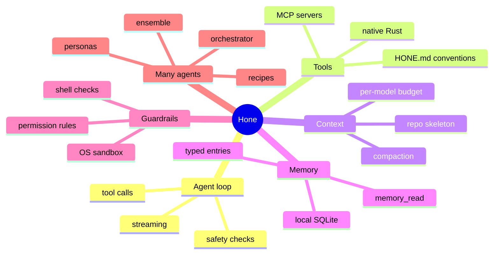
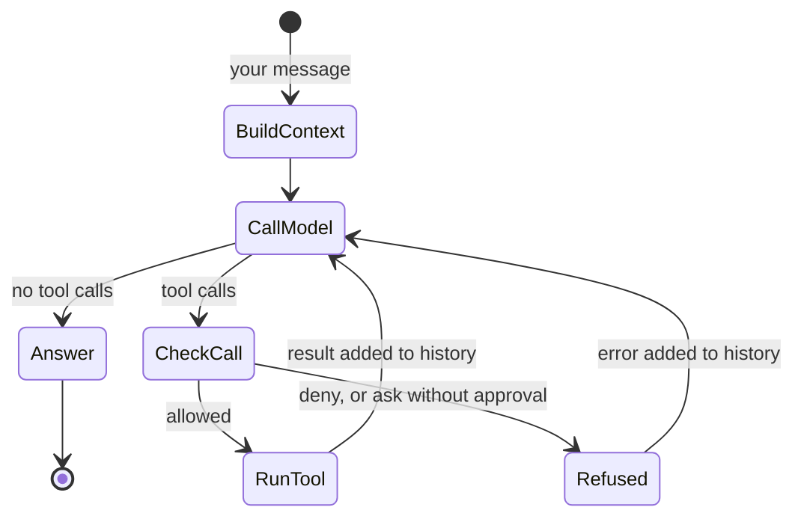
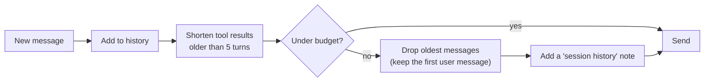
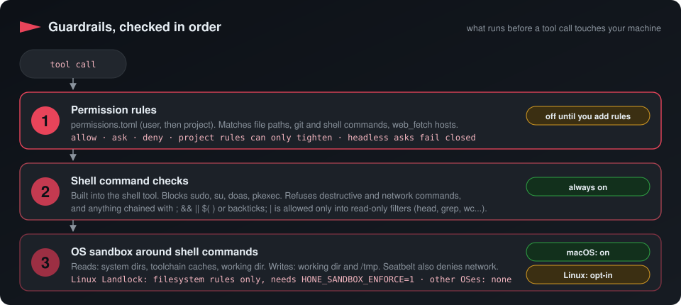
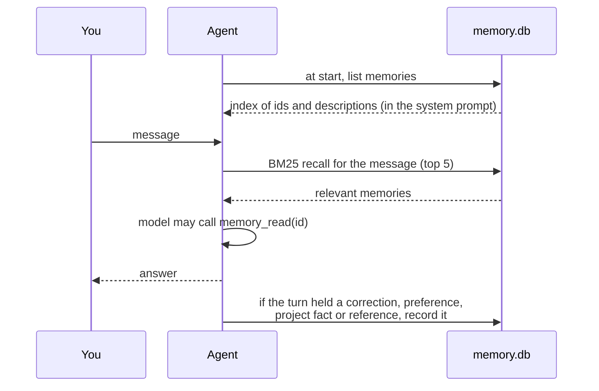
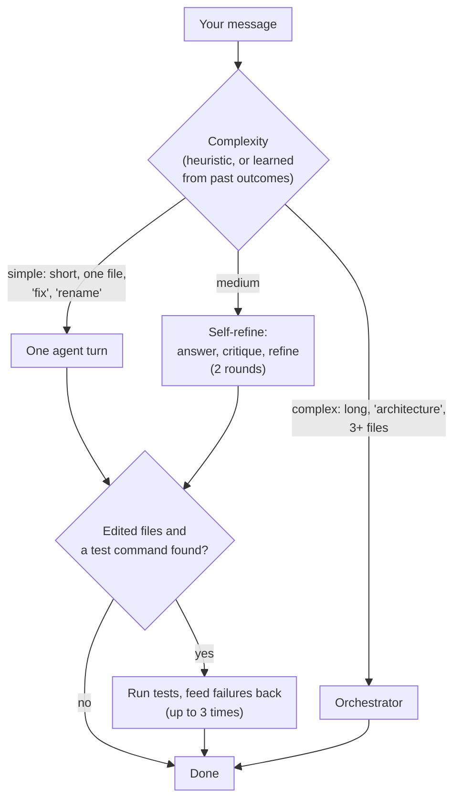

# Core concepts

<p align="center">
  
  
  
  
  
  
</p>

This page explains how Hone works, so its behaviour stops being surprising. For commands,
see the [cheatsheet](cheatsheet.md); for setup, [Getting started](../getting-started.md).



## 1. The agent loop

You send a message. Hone sends the model your message, the conversation so far and the
list of tools. The model either answers or asks for tool calls. Hone runs the calls,
returns the results, and asks again, until the model answers without calling a tool.



The loop also watches for trouble:

| Guard | Trigger | What Hone does |
|---|---|---|
| Budget | Session cost passed the `/budget` cap | Refuses to start the next turn |
| Context emergency | History passes 95% of the budget | Turns tools off and asks the model to summarise what it found |
| Doom loop | Three identical tool calls in a row, or a short repeating pattern | Adds a note telling the model it is stuck |
| Read before edit | An edit to a file the model hasn't read this turn | Runs `read_file` first and shows the model the content |
| Prompt injection | A tool result looks like instructions to the model | Prefixes it with a warning to treat it as data |

The turn streams events (`Token`, `ToolCallStart`, `ToolCallEnd`, `MemoryRecalled`, `Done`,
...) to whichever surface started it: the TUI draws them, `--json` collects them, and
`honed` forwards them as Server-Sent Events.

## 2. Tools

| Family | Tools | Notes |
|---|---|---|
| Files | `read_file`, `write_file`, `edit_file`, `multi_edit`, `glob`, `grep` | `grep` respects `.gitignore` |
| Shell | `shell` | Runs `sh -c`, 30 s default timeout (max 300 s), under the OS sandbox. No `sudo`; destructive, network and chained commands are refused (pipes into read-only filters such as `head` or `grep` are allowed) |
| Git | `git_status`, `git_diff`, `git_commit` | |
| Code intelligence | `lsp_diagnostics`, `lsp_hover`, `lsp_code_actions`, `symbol_search`, `symbol_at` | LSP for Rust, Python, TypeScript and Go when the server is installed; symbols come from the tree-sitter index |
| Web | `web_fetch` | `web_search` is registered but not live yet |
| Memory | `memory_read` | Reads one memory by id |
| Desktop | `screen_capture`, `computer_control` | |
| MCP | anything your MCP servers expose | Configured in `mcp.json` |

- **Native tools** are Rust functions in the Hone process. Consecutive read-only calls run
  in parallel, and their results are cached in `tool-cache.db`.
- **MCP tools** come from servers you list in `mcp.json`. They are wrapped to look like
  native tools; a native tool wins if the names collide.
- **`HONE.md`** isn't a tool, but it's the cheapest way to shape behaviour: its `##`
  sections are added to the system prompt every turn.

## 3. Context

A model's context window is finite, and models get worse well before it is full. Hone
budgets a fraction of the advertised window per model family and compacts history to stay
inside it.



| Model family | Budget used |
|---|---|
| Claude | 60% of 200k |
| GPT-4, o3, o4 | 55% of 128k |
| Gemini | 50% of 1M |
| DeepSeek, Qwen, Kimi | 45% of 128k |
| Llama | 40% of 128k |
| anything else | 50% of 128k |

If your server runs a model with a smaller window, set `HONE_CONTEXT_WINDOW` (for example
`32768`). On the first turn, the **context injector** adds a skeleton of the repository
and the most relevant signatures, so the model doesn't spend its first calls exploring.
Turn it off with `--no-inject`; pick a strategy with `--skeleton-strategy`. See
[Context injection](../context-injection.md).

## 4. Guardrails

<p align="center">
  
</p>

Three independent layers:

1. **Permission rules** (`permissions.toml`): `allow`, `ask` or `deny` for paths, commands
   and hosts. Off until you write rules. Project files can only tighten your own rules.
   Headless runs refuse an `ask` unless you pre-approve it with `--approve`.
2. **Shell checks**: always on. No `sudo`; destructive, network and chained commands are
   refused, except pipes into read-only filters (`head`, `tail`, `grep`, `wc`, `sort`, ...).
3. **OS sandbox** around shell commands: Seatbelt on macOS by default; Landlock on Linux
   with `HONE_SANDBOX_ENFORCE=1`.

Read [Permissions and sandbox](../permissions-and-sandbox.md) before you rely on any of
them: each one has limits, and the page lists them.

## 5. Memory

Hone keeps a small, typed memory in `~/.local/share/hone/memory.db`. It is local, and you
can list, inspect and delete every entry.



| Kind | Example | Written by |
|---|---|---|
| `feedback` | "Don't mock the database in these tests" | Corrections you make |
| `user` | "I prefer short answers" | Preferences you state |
| `project` | "We're migrating to Postgres 16 this quarter" | Project facts |
| `reference` | "Dashboards live in Grafana under team-x" | Pointers to other systems |
| `conversation`, `outcome` | Q&A, outcome records | Other writers (outcomes feed the TUI's complexity classifier) |

```bash
hone memory ls                 # most relevant first
hone memory show 01HXYZ12      # one entry (an 8-character prefix works)
hone memory forget --kind feedback
hone --encrypted-memory        # AES-256-GCM, key from HONE_MEMORY_PASSPHRASE via Argon2id
hone --ephemeral               # don't read or write memory this run
```

Only the `content` of each memory is encrypted; tags and descriptions are not.

## 6. Agents, personas and many agents

An **agent** is a Markdown file with YAML front matter. The body is its system prompt;
`tools:` is an allowlist of tool names (leave it out to keep every tool).

```markdown
---
name: my-debugger
description: Systematic debugging with a failing test first
tools: [read_file, edit_file, write_file, shell, grep, glob]
model: sonnet
---

You are a systematic debugger. Reproduce the bug with a test, then ...
```

> [!WARNING]
> Use real tool names. Unknown names are dropped with only a log warning. The built-in
> personas currently list short names (`read`, `edit`, `write`) that match nothing, so
> when their list is applied (`@persona` in the TUI, distributed workers) they keep only
> `shell`, `grep` and `glob`. This is a known bug.

Hone ships 12: `api-designer`, `code-reviewer`, `data-engineer`, `debugger`,
`documentation-agent`, `ml-engineer`, `performance-optimizer`, `python-expert`,
`researcher`, `rust-expert`, `security-auditor`, `tdd-workflow`. Your own files in
`~/.config/hone/agents/` or `<project>/.hone/agents/` override them by name. In the TUI,
start a message with `@name`; the orchestrator also assigns them to subtasks.

### How the TUI picks a strategy



| Pattern | What it does | Use it via |
|---|---|---|
| Orchestrator | A lead model writes a JSON plan of subtasks; workers (personas) run them, up to 4 at a time in dependency order; the lead merges the results | `--orchestrate`, `/plan`, complex TUI messages |
| Distributed | The same, with subtasks queued on a `honed` coordinator for remote workers | `--orchestrate --distributed URL` |
| Ensemble | N candidates at different temperatures, then a ranker picks the best | `--ensemble N` |
| Self-refine | Generate, critique, refine | medium TUI messages |
| Test loop | Run the project's tests after edits, fix failures | TUI, after `write_file` / `edit_file` / `multi_edit` |
| Recipes | Fixed multi-step workflows with variables | `--recipe`, `--var` |
| Specs | Requirements, design and tasks written to `.hone/specs/` | `hone spec` |

## 7. `hone` and `honed`

| | `hone` | `honed` |
|---|---|---|
| What | CLI and TUI | HTTP + SSE daemon |
| State | one process, one user | sessions in SQLite, many clients |
| Provider | detected at startup | Anthropic (`ANTHROPIC_API_KEY`) for `/run` |
| Auth | your shell | bearer token (`HONE_AUTH_TOKEN`), required off loopback |
| Extras | recipes, ensembles, sessions, reports | web UI, desktop app, collaboration, distributed coordinator and workers, provenance log |

## 8. Cost

Each turn reports token usage and a cost estimate. The CLI currently applies one rate
($3 input / $15 output per million tokens) to every model, so treat the number as a
ballpark for non-Anthropic models. In the TUI, `/cost` shows the session total and
`/budget 2.50` caps it; a turn that would start over the cap is refused. Local models cost
nothing to run, but the cost line still applies the flat rate to them, so ignore it for
Ollama.

## Further reading

- [Architecture](../architecture.md): crates and data flow
- [Permissions and sandbox](../permissions-and-sandbox.md)
- [Configuration](../configuration.md)
- [Cheatsheet](cheatsheet.md)
