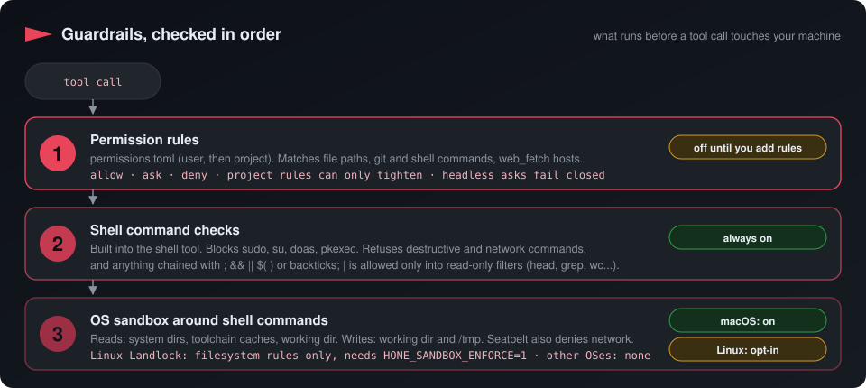
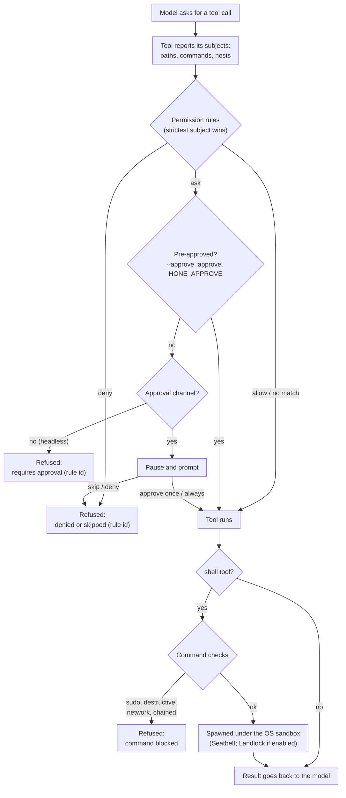
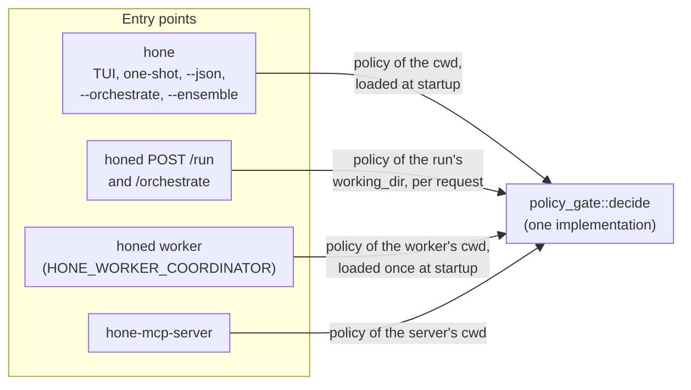
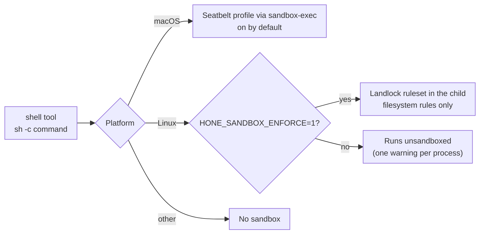

# Permissions and sandbox

<p align="center">
  
  
  
  
</p>

Hone puts three independent checks between the model and your machine. This page
explains each one, what is on by default, and where each one stops.

<p align="center">
  
</p>

## What is on by default

| Guardrail | Default | Turn it on or change it | Covers |
|---|---|---|---|
| [Permission rules](#1-permission-rules) | **Off** until you write rules; built-in rules are opt-in (`HONE_POLICY_BUILTINS=1`) | Write `~/.config/hone/permissions.toml` and/or `<workdir>/.hone/permissions.toml` | File paths, git and shell commands, `web_fetch` hosts |
| [Shell command checks](#2-shell-command-checks) | **On**, always | Not configurable | The `shell` tool |
| [OS sandbox](#3-os-sandbox) on macOS (Seatbelt) | **On** for shell commands | `HONE_SANDBOX_EXTRA_READ` adds read-only roots | Child processes started by the `shell` tool |
| [OS sandbox](#3-os-sandbox) on Linux (Landlock) | **Off** (opt-in while it is validated) | `HONE_SANDBOX_ENFORCE=1` | Child processes started by the `shell` tool, filesystem only |
| Approval prompts in the TUI | **On**: write and shell tools ask, read-only tools don't | `--step` asks for every tool; <kbd>Shift</kbd>+<kbd>Tab</kbd> to AutoApprove stops asking (permission rules still apply) | Interactive TUI only |

> [!IMPORTANT]
> Built-in rules (credentials, persistence, `git push`, privilege escalation,
> pipe-to-shell, new hosts) and secret redaction ship **opt-in**: they apply only with
> `HONE_POLICY_BUILTINS=1` until the benchmark gate passes. Without that variable and
> with no permission files, Hone behaves exactly as it did before the policy engine
> existed. The rule table is in [configuration.md](configuration.md#built-in-rules).

## How a tool call is checked



---

## 1. Permission rules

### Files

| Layer | Path | Trust | Notes |
|---|---|---|---|
| Built-in | compiled into Hone | — | 39 rules, loaded only with `HONE_POLICY_BUILTINS=1` (opt-in) |
| User | `~/.config/hone/permissions.toml` | You own the machine, so user rules **replace** the built-in verdict | `$HOME` must be absolute; otherwise the passwd entry is used |
| Project | `<workdir>/.hone/permissions.toml` | A repo is untrusted, so project rules can only **tighten** | Only the working directory itself is checked. Running from `repo/src` does not pick up `repo/.hone/`. |

A broken permission file stops the run: exit code 2 for the CLI, HTTP 400 for `honed`. Hone
never runs without the rules you wrote.

### Rule format

Each rule has exactly one matcher (`command`, `path` or `host`), a `decision`, an optional
`id`, and for path rules an optional `op` filter.

```toml
version = 2                 # optional; 1 and 2 are both accepted

[[rules]]
id = "no-push"              # optional; [A-Za-z0-9._-], up to 64 chars
command = "git push*"
decision = "deny"

[[rules]]
id = "ask-secrets"
path = "secrets/**"         # relative paths are joined onto the working dir
op = "read"                 # read | write | any (default)
decision = "ask"

[[rules]]
path = "~/.ssh/**"          # gets the automatic id user:3
decision = "deny"

[[rules]]
host = "*.internal.example"
decision = "ask"
```

Rules without an `id` get one from their layer and position, such as `user:3` or
`project:1`. Explicit ids must be unique across all layers.

<details>
<summary><b>Matching rules in detail</b> (globs, placeholders, normalisation)</summary>

| Matcher | Pattern syntax | Examples |
|---|---|---|
| `command` | A pattern with `*` or `?` is a glob over the whole command (`*` matches spaces and `/`). Any other pattern is a **literal prefix at a word boundary**: `cargo test` matches `cargo test` and `cargo test --all`, but not `cargo testx`. A newline is not a word boundary. Case-sensitive. | `"git push*"`, `"cargo test"`, `"rm *"` |
| `path` | Globs where `*` and `?` stay inside one path segment and `**` crosses segments. `~/` expands to your home, `{workdir}` to the working directory, and a relative pattern is joined onto the working directory. A pattern ending in `/**` also matches the directory itself. | `"src/**"`, `"~/.ssh/**"`, `"{workdir}/.env"` |
| `host` | A glob over the normalised host name; `*` matches dots. Lowercased, trailing dots removed, IP addresses canonicalised, ports stripped from the subject. A pattern may not contain a port. | `"*.example.com"`, `"169.254.169.254"`, `"[::1]"` |

- Within a layer, the **first** matching rule wins.
- Strictness is `allow < ask < deny`. A project rule changes the verdict only if it is
  **strictly** stricter than the user/built-in verdict, so a project `allow` never loosens
  anything.
- A tool call with several subjects (for example `cp a b`) gets the strictest verdict of
  all its subjects.
- A host name with characters outside `[A-Za-z0-9-_.:[]]` is malformed and never comes out
  looser than `ask` (rule id `builtin:invalid-host`).
- A shell command Hone can't parse is treated as `ask` (rule id
  `builtin:unparsed-command`) whenever you have any command or path rules.

The normative spec is [`docs/plans/policy-v2-spec.md`](plans/policy-v2-spec.md).

</details>

### What each tool reports

Rules only see what a tool reports. This is the list for the tools the `hone` CLI
registers:

| Tool | Subjects checked |
|---|---|
| `read_file`, `lsp_diagnostics`, `lsp_hover`, `lsp_code_actions`, `symbol_at` | path (read) |
| `write_file` | path (write) |
| `edit_file`, `multi_edit` | path (read and write) |
| `glob`, `grep` | the search root (read) |
| `git_status`, `git_diff`, `git_commit` | the command `git status`, `git diff`, `git commit` |
| `shell` | every command in the line after parsing (pipes, `&&`, `$(…)`, and wrappers such as `env`, `sudo`, `timeout`, `xargs`), plus paths it redirects to or edits in place |
| `web_fetch` | the URL's host |
| MCP tools, `web_search`, `symbol_search`, `memory_read`, `screen_capture`, `computer_control` | **nothing**: rules don't apply to them |

### Asks: interactive vs headless

| Where the run comes from | What an `ask` does |
|---|---|
| `hone` TUI (every turn) | Pauses and shows the approval menu: <kbd>y</kbd>/<kbd>Enter</kbd> approve once, <kbd>a</kbd> approve always, <kbd>s</kbd>/<kbd>Esc</kbd> skip, <kbd>d</kbd>/<kbd>n</kbd> deny. <kbd>Enter</kbd> and <kbd>a</kbd> answer only while the input box is empty |
| `hone "prompt"`, `--json`, `--recipe`, `--orchestrate`, `--ensemble` | Refused with `requires approval (rule <id>)` |
| `honed` `POST /run` without a step channel | Refused the same way |
| `honed` `POST /run` with `request_id` and an `approval_policy` other than `Auto` | Pauses; the client answers through `POST /run/{request_id}/step`. If the client disconnects, the run is cancelled |
| `hone-mcp-server` | Refused: the result is an MCP error and the tool is not called |

A `deny` is always refused, everywhere, and no flag turns it into an allow.

**"Approve always"** on a rule that contains a wildcard (`*`, `?`, `[` or `{`) approves only
that one host, path or command for the session. Approving `*.example` for `good.example`
does not approve `evil.example`. On a **command** rule, "always" covers exactly that
command line, with the same leading assignments, wrappers and working directory, so
approving `git push origin main` does not cover `git push --force origin main` or
`GIT_SSH_COMMAND=… git push origin main`. Only a literal host rule, or a literal
single-pattern path rule with an explicit read or write op, is remembered as a whole rule.

<a id="known-issue-tui"></a>

> [!NOTE]
> **Fixed: TUI prompts on every turn.** Before this fix, the TUI's main agent was created
> before the approval channel existed, so on simple and medium turns (most messages) write
> and shell tools ran without prompting, `--step` did nothing, and `ask` rules were refused.
>
> How the prompt behaves now:
>
> - **Typing can't answer it.** A key counts only if it comes at least 400 ms after the menu
>   opened and 400 ms after your previous key or paste; faster keys go to the input box. While
>   the input box has text, only <kbd>y</kbd> approves. <kbd>Esc</kbd> always skips.
> - **No answer means no.** If the TUI exits while a prompt is open, the call is refused.
>   <kbd>Esc</kbd> outside the menu cancels the turn before its next tool call, prompt or model
>   call; calls that didn't run are recorded as cancelled.
> - **AutoApprove** (<kbd>Shift</kbd>+<kbd>Tab</kbd>) skips the write/shell prompt, including
>   the one `--step` adds, but never a permission rule: `deny` still refuses and `ask` still
>   prompts.
> - With `--step`, <kbd>a</kbd> approves once: `--step` keeps no allow-list.
> - Orchestrated turns (a complex prompt, a `/plan` Run): the lead has no tools. Each worker gets
>   the tools its agent definition lists, from the session's tools, and prompts here like the
>   main agent, one worker at a time. <kbd>x</kbd> in the menu stops the whole turn.
> - An "always" answer covers the main agent and every worker for the rest of the session.

> [!WARNING]
> After an edit runs (`write_file`, `edit_file`, `multi_edit`: approved, or in AutoApprove), the TUI runs the
> project's detected test command (`cargo test`, `npm test`, `pytest`, …) **without a prompt
> and outside the sandbox**. `npm test` and similar run scripts from the repository.

### Pre-approving rules

| Surface | How | Validation |
|---|---|---|
| `hone` | `--approve <RULE_ID>`, repeatable | Unknown id, or `--approve` with no permission files: exit 2 |
| `honed` | `"approve": ["rule-id", ...]` in the `POST /run` body | Unknown id or no policy: 400. Needs an auth token on the server: without one you get 400 `approve requires an authenticated server` |
| `hone-mcp-server` | `HONE_APPROVE=id1,id2` | Unknown id or broken file: exit 2 |

Ids can be explicit, automatic (`user:2`) or the synthetic `builtin:unparsed-command` and
`builtin:invalid-host`. Pre-approval only lifts `ask`; it never lifts `deny`.

```bash
hone --approve ask-secrets "summarise the notes under secrets/"
```

```bash
curl -N -X POST http://127.0.0.1:3117/run \
  -H "Authorization: Bearer $HONE_AUTH_TOKEN" \
  -H 'Content-Type: application/json' \
  -d '{"prompt": "summarise secrets/notes.md", "approve": ["ask-secrets"]}'
```

### Where the policy is loaded



- `honed` loads the user file from the daemon's own `$HOME`. Orchestration runs apply the
  policy but don't accept `approve`.
- The distributed worker exits with code 2 on a broken permission file.

### Providers that run their own tools

The Claude CLI adapter, the Gemini CLI adapter and ACP agents execute tools inside their
own process. Hone only observes them, so its rules can't check them.

| Policy loaded | Provider runs its own tools | Result |
|---|---|---|
| none, or an empty file | any | runs normally |
| non-empty | no (Anthropic, OpenAI-compatible, Ollama) | runs normally |
| non-empty | yes | **refused**: exit 2 (CLI) or HTTP 400 (`honed`) |
| non-empty | yes, with `HONE_ALLOW_UNGATED_PROVIDER=1` | runs, with one warning |

Wrappers forward the check: a fallback chain or tier router is refused if **any** member
runs its own tools.

> [!TIP]
> The Claude CLI adapter starts `claude` with `--permission-mode acceptEdits` unless you
> set `HONE_CLAUDE_PERMISSION_MODE`. That is Claude Code's own permission system, not Hone's.

---

## 2. Shell command checks

The `shell` tool classifies every command before it runs. This happens inside the tool,
after the permission rules, and cannot be switched off.

| Class | Examples | Result |
|---|---|---|
| Privilege escalation | `sudo …`, `su`, `doas`, `pkexec` | blocked (`command blocked: privilege escalation …`) |
| Destructive | `rm -rf`, `dd if=`, `mkfs`, `truncate`, `chmod -R`, `git reset --hard`, `git clean -fd`, `git push --force` | refused (`requires approval`) |
| Network | `curl`, `wget`, `ssh`, `scp`, `rsync`, `nc`, `ftp`, `git push/pull/fetch/clone/remote` | refused (`requires approval`) |
| Chained | anything containing `;`, `&&`, `\|\|`, `$(` or a backtick outside quotes, and `\|` **except** into a read-only filter (`head`, `tail`, `grep`, `wc`, `sort`, `uniq`, `cut`, `tr`, `cat`, `less`, ...; `sed`/`awk` only without in-place or output-redirect forms) | treated as destructive: refused |
| Everything else | `ls`, `cargo test`, `pytest -x`, `cargo test \| tail -20` | runs (then the sandbox applies) |

There is no prompt at this layer: "requires approval" here means the call is refused
(`command blocked (requires approval): …`) and the model is told why. Use dedicated tools (`read_file`, `grep`, `git_*`, `web_fetch`) or
split the work into single commands.

> [!NOTE]
> Command rules and these checks match command **text**. Shell aliases, interpreters
> (`python -c …`), and paths hidden inside tool options are not visible to them. They are a
> speed bump. The sandbox is the boundary.

## 3. OS sandbox



The sandbox wraps **child processes started by the `shell` tool**. File tools
(`read_file`, `write_file`, ...), git tools and `web_fetch` run inside the Hone process and
are governed by permission rules, not by the OS sandbox.

| | macOS (Seatbelt) | Linux (Landlock, opt-in) |
|---|---|---|
| Enabled | by default | only with `HONE_SANDBOX_ENFORCE=1` |
| Writable | working dir, `/tmp`, `/dev/null` | working dir, `/tmp`, `/dev/null` |
| Readable | system dirs (`/bin`, `/usr/bin`, `/usr/lib`, `/usr/share`, `/etc`, Homebrew prefixes), `~/.cache`, `~/.cargo`, `~/.rustup`, git config, the working dir | system dirs (`/bin`, `/usr/bin`, `/usr/lib`, `/usr/lib64`, `/usr/share`, `/lib`, `/lib64`, `/etc`, `/opt`, `/usr/local`), the same home entries, the working dir |
| Network | denied | not restricted (Hone targets Landlock ABI v1, filesystem only) |
| Kernel needed | — | 5.13+; on older kernels the command fails instead of running unsandboxed |

On unix each `shell` command runs in its own process group with stdin closed. If its
call ends early (<kbd>Esc</kbd>, a worker's timeout, the tool's `timeout_ms`, 30 s by
default), Hone kills the whole group: the shell and everything it started. Hone also
kills its running commands when it exits or is stopped by SIGINT, SIGTERM or SIGHUP
(`honed` too). A command that starts its own session (`setsid`) escapes this, and so does
every command if Hone is killed with `kill -9`. A command that needs the terminal (an ssh
passphrase prompt) stops until its timeout.

Add read-only roots (for a toolchain outside the defaults) with
`HONE_SANDBOX_EXTRA_READ=/path/one:/path/two`. Relative paths, `/`, your home directory
or its parents, and anything under the working dir or `/tmp` are ignored.

> [!WARNING]
> Landlock stays opt-in until it has been validated on a Landlock-capable kernel. On Linux,
> without `HONE_SANDBOX_ENFORCE=1`, shell commands run unsandboxed, and Hone logs that
> once at warn level.

> [!NOTE]
> The `[sandbox]` table in `config.toml` is not applied; Hone warns at startup when it is
> set. The two environment variables above are the only sandbox settings that take effect.
> See [Configuration](configuration.md#configtoml).

---

## Recipes

<details>
<summary><b>Keep secrets and keys out of reach</b></summary>

```toml
# ~/.config/hone/permissions.toml
[[rules]]
id = "no-ssh-keys"
path = "~/.ssh/**"
decision = "deny"

[[rules]]
id = "no-dotenv"
path = "**/.env"
decision = "deny"

[[rules]]
id = "no-cloud-creds"
path = "~/.aws/**"
decision = "deny"
```

</details>

<details>
<summary><b>Ask before pushing or touching CI config</b></summary>

```toml
[[rules]]
id = "ask-push"
command = "git push*"
decision = "ask"

[[rules]]
id = "ask-ci"
path = ".github/**"
op = "write"
decision = "ask"
```

Run headless with an explicit approval:

```bash
hone --approve ask-ci "update the CI matrix to add Python 3.13"
```

</details>

<details>
<summary><b>Restrict which hosts <code>web_fetch</code> may reach</b></summary>

```toml
[[rules]]
id = "docs-ok"
host = "*.rust-lang.org"
decision = "allow"

[[rules]]
id = "metadata-never"
host = "169.254.169.254"
decision = "deny"

[[rules]]
id = "other-hosts"
host = "*"
decision = "ask"
```

Host rules match names, not resolved addresses, so they don't stop DNS tricks such as a
name that resolves to a metadata IP.

</details>

<details>
<summary><b>A project that wants to be stricter than you</b></summary>

```toml
# <repo>/.hone/permissions.toml  (can only tighten your user rules)
[[rules]]
id = "frozen-migrations"
path = "migrations/**"
op = "write"
decision = "deny"
```

</details>

## See also

- [Configuration reference](configuration.md#permissions) for file locations and env vars
- [P2.3 contract](plans/policy-p2.3-spec.md) for the headless, `--approve` and entry-point rules
- [Policy model v2](plans/policy-v2-spec.md) for the matching rules
