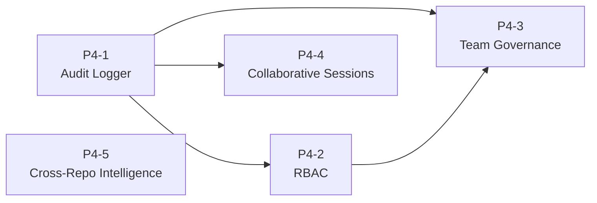
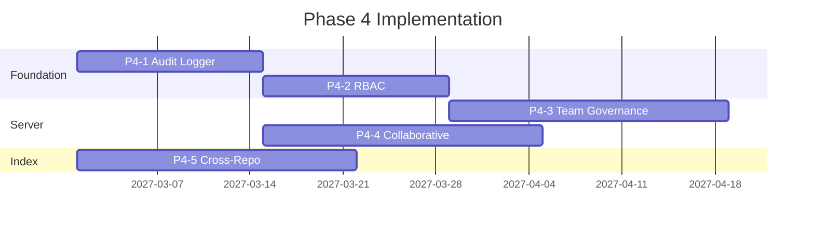

# Phase 4 — Team & Enterprise: Detailed TDD Plan

**Date:** 2026-04-05
**Status:** Ready for implementation
**Timeline:** Mar–Jul 2027

---

## Overview

Phase 4 adds team governance, audit logging, RBAC, and collaborative sessions. These features target the **Team Lead** persona who needs visibility into team AI usage and the **Enterprise** tier requiring compliance controls.

Five tasks, each following Red -> Green -> Refactor:



---

## Task P4-1: Audit Logger

**Crate:** New module in `hone-core`
**Goal:** Every tool call, model request, and session event produces a signed audit entry.

### RED — Tests

```
crates/hone-core/tests/audit.rs
```

- `test_audit_log_records_tool_call`: Execute a tool call via Agent, assert an AuditEntry with kind=ToolCall is recorded.
- `test_audit_log_records_model_request`: Run a turn, assert AuditEntry with kind=ModelRequest appears.
- `test_audit_entries_have_timestamps`: All entries have non-zero timestamps.
- `test_audit_entries_have_session_id`: All entries carry the session ID.
- `test_audit_export_produces_json`: Export audit log to file, deserialize back, assert entries match.
- `test_audit_log_is_append_only`: After recording entries, cannot modify or delete existing ones.

### GREEN — Implement

```rust
// hone-core/src/audit.rs

#[derive(Debug, Clone, Serialize, Deserialize)]
pub struct AuditEntry {
    pub id: String,
    pub session_id: String,
    pub timestamp: u64,
    pub kind: AuditKind,
    pub actor: String,        // user ID or "system"
    pub detail: Value,        // tool name+args, model ID, etc.
}

#[derive(Debug, Clone, Serialize, Deserialize)]
pub enum AuditKind {
    ToolCall,
    ModelRequest,
    SessionStart,
    SessionEnd,
    PolicyViolation,
}

#[async_trait]
pub trait AuditLog: Send + Sync {
    async fn record(&self, entry: AuditEntry) -> Result<(), AuditError>;
    async fn query(&self, filter: &AuditFilter) -> Result<Vec<AuditEntry>, AuditError>;
    async fn export(&self, path: &Path) -> Result<(), AuditError>;
}

pub struct InMemoryAuditLog { ... }
```

---

## Task P4-2: RBAC (Role-Based Access Control)

**Crate:** New module in `hone-core`
**Goal:** Policies that restrict which tools/models a user can access based on their role.

### RED — Tests

```
crates/hone-core/tests/rbac.rs
```

- `test_rbac_admin_can_use_all_tools`: Admin role has no restrictions.
- `test_rbac_viewer_cannot_use_write_tools`: Viewer role blocked from WriteFileTool, ShellTool, GitCommitTool.
- `test_rbac_developer_can_use_code_tools`: Developer role can use file/git tools but not shell.
- `test_rbac_custom_role_with_allowlist`: Custom role with explicit tool allowlist.
- `test_rbac_prevents_unauthorized_tool_use`: Attempt to call a denied tool returns RbacError::Denied.
- `test_rbac_policy_from_config`: Parse a RBAC policy from a JSON/TOML config snippet.

### GREEN — Implement

```rust
// hone-core/src/rbac.rs

#[derive(Debug, Clone, Serialize, Deserialize)]
pub struct RbacPolicy {
    pub roles: HashMap<String, Role>,
}

#[derive(Debug, Clone, Serialize, Deserialize)]
pub struct Role {
    pub name: String,
    pub allowed_tools: ToolAccess,
    pub allowed_models: Vec<String>,   // glob patterns
    pub budget_limit: Option<f64>,
}

#[derive(Debug, Clone, Serialize, Deserialize)]
pub enum ToolAccess {
    All,
    AllowList(Vec<String>),
    DenyList(Vec<String>),
}

impl RbacPolicy {
    pub fn check_tool(&self, role: &str, tool: &str) -> Result<(), RbacError>;
    pub fn check_model(&self, role: &str, model: &ModelId) -> Result<(), RbacError>;
}
```

---

## Task P4-3: Team Governance Dashboard API

**Crate:** `hone-server`
**Goal:** API endpoints for team spend analytics, model policies, and user management.

### RED — Tests

```
crates/hone-server/tests/governance.rs
```

- `test_get_team_usage_returns_aggregated_stats`: GET /team/usage returns total tokens, cost, by-model breakdown.
- `test_get_team_members_lists_all`: GET /team/members returns list of team members with roles.
- `test_post_team_policy_sets_model_restrictions`: POST /team/policy sets allowed models.
- `test_team_spend_cap_enforced`: Team-level spend cap prevents new turns when exceeded.
- `test_admin_only_endpoints_require_admin_role`: Non-admin users get 403 on governance endpoints.

### GREEN — Implement

```rust
// hone-server/src/governance.rs

#[derive(Debug, Clone, Serialize, Deserialize)]
pub struct TeamUsage {
    pub total_tokens: u64,
    pub total_cost_usd: f64,
    pub by_model: HashMap<String, ModelUsage>,
    pub by_member: HashMap<String, MemberUsage>,
}

#[derive(Debug, Clone, Serialize, Deserialize)]
pub struct TeamMember {
    pub id: String,
    pub name: String,
    pub role: String,
    pub joined_at: u64,
}

#[derive(Debug, Clone, Serialize, Deserialize)]
pub struct TeamPolicy {
    pub allowed_models: Vec<String>,
    pub spend_cap_usd: Option<f64>,
    pub approved_extensions: Vec<String>,
}
```

Routes: `GET /team/usage`, `GET /team/members`, `POST /team/policy`, `GET /team/policy`

---

## Task P4-4: Collaborative Sessions

**Crate:** `hone-server`
**Goal:** Multiple users can join a session, see events in real-time, and take turns.

### RED — Tests

```
crates/hone-server/tests/collaborative.rs
```

- `test_join_session_adds_participant`: POST /sessions/{id}/join adds user to participant list.
- `test_collaborative_session_lists_participants`: GET /sessions/{id}/participants returns all joined users.
- `test_collaborative_event_broadcast`: When user A submits a turn, user B's event stream receives the events.
- `test_leave_session_removes_participant`: POST /sessions/{id}/leave removes user.
- `test_session_owner_can_kick_participant`: Owner can remove another participant.

### GREEN — Implement

```rust
// hone-server/src/collaborative.rs

#[derive(Debug, Clone, Serialize, Deserialize)]
pub struct Participant {
    pub user_id: String,
    pub name: String,
    pub role: ParticipantRole,
    pub joined_at: u64,
}

#[derive(Debug, Clone, Copy, PartialEq, Eq, Serialize, Deserialize)]
pub enum ParticipantRole {
    Owner,
    Editor,
    Viewer,
}

pub struct CollaborativeSession {
    pub session_id: String,
    pub participants: Vec<Participant>,
    pub event_broadcast: broadcast::Sender<AgentEvent>,
}
```

---

## Task P4-5: Cross-Repo Intelligence

**Crate:** `hone-index`
**Goal:** Index and search across multiple repositories, understanding cross-repo impacts.

### RED — Tests

```
crates/hone-index/tests/cross_repo.rs
```

- `test_multi_repo_index_searches_all`: Index 2 repos, search returns symbols from both.
- `test_repo_scoped_search`: Search with repo filter returns only symbols from that repo.
- `test_cross_repo_symbol_includes_repo_name`: SearchResult includes repo identifier.
- `test_add_and_remove_repo`: Add a repo, assert indexed. Remove it, assert symbols gone.

### GREEN — Implement

```rust
// hone-index/src/multi_repo.rs

pub struct MultiRepoIndex {
    repos: HashMap<String, SemanticIndex>,  // repo name -> index
}

impl MultiRepoIndex {
    pub fn new() -> Self;
    pub fn add_repo(&mut self, name: &str, root: &Path) -> Result<(), IndexError>;
    pub fn remove_repo(&mut self, name: &str);
    pub fn search(&self, query: &str, repo: Option<&str>) -> Vec<MultiRepoResult>;
    pub fn repo_count(&self) -> usize;
}

pub struct MultiRepoResult {
    pub repo: String,
    pub result: SearchResult,
}
```

---

## Dependency Order



P4-1 (Audit) is the foundation — P4-2 (RBAC) and P4-3 (Governance) depend on it.
P4-4 (Collaborative) depends on P4-1 for event logging.
P4-5 (Cross-Repo) is independent.
