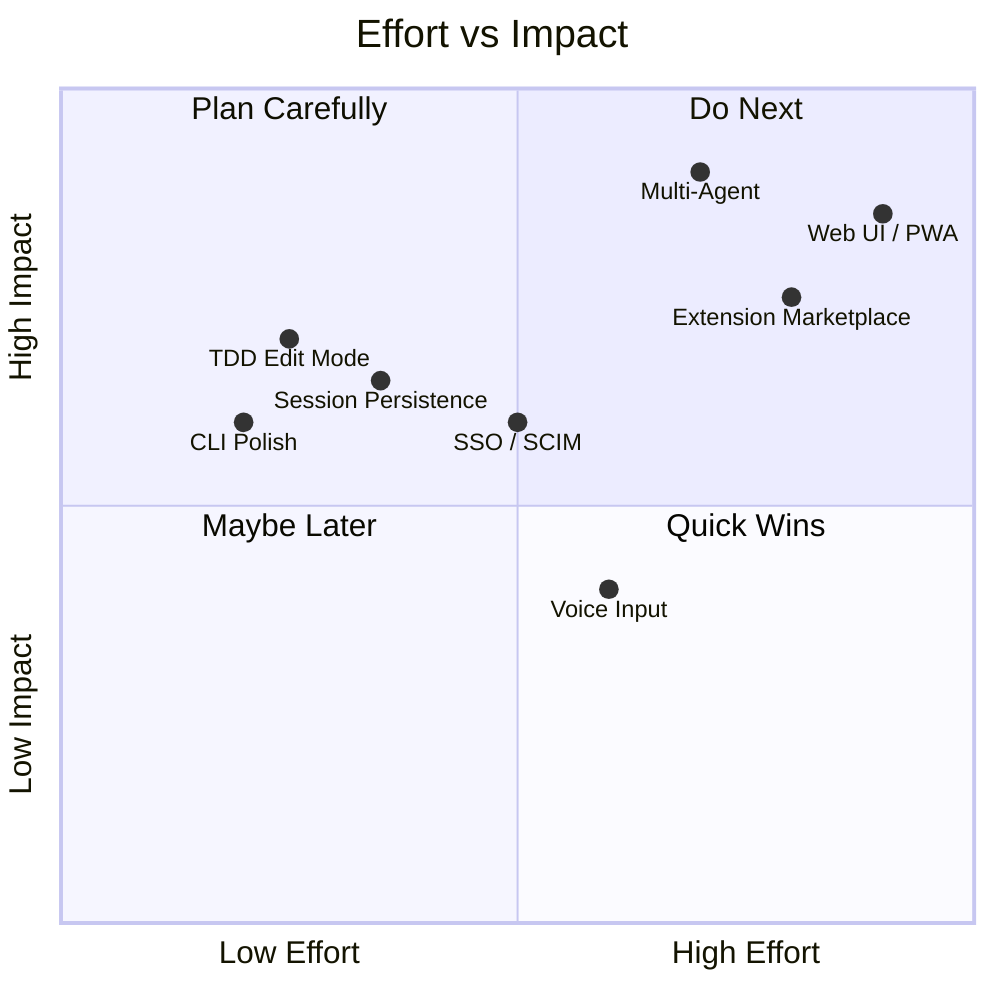
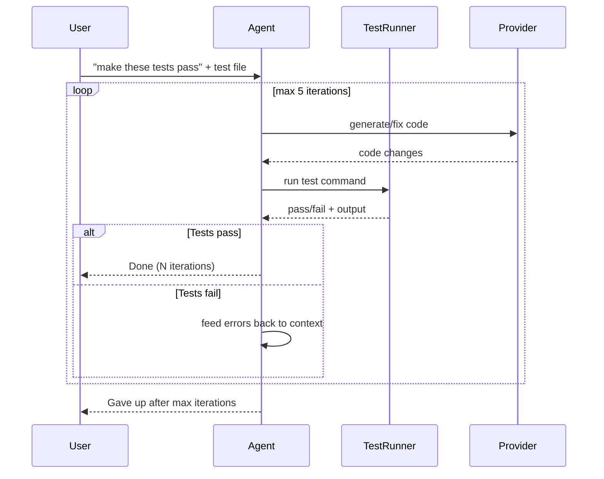
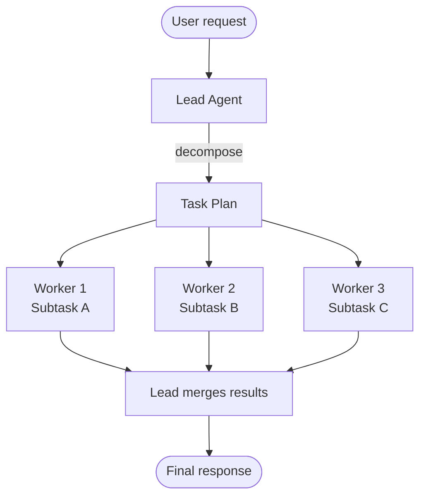
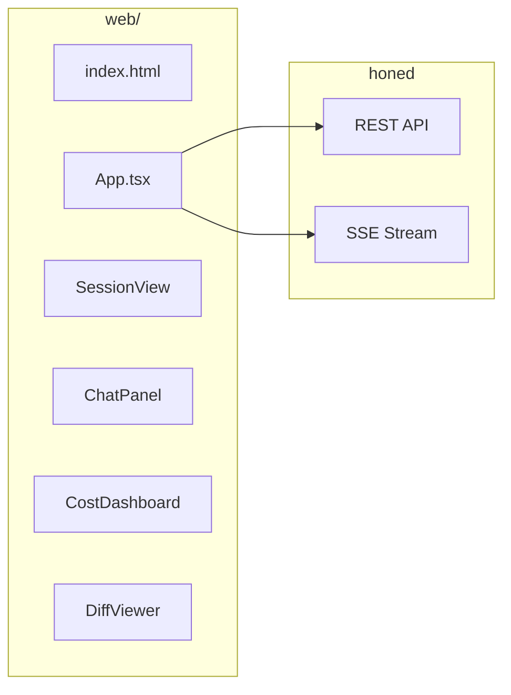
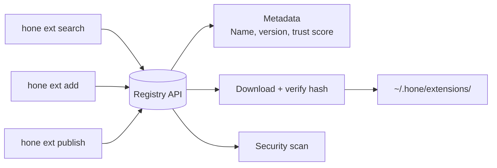
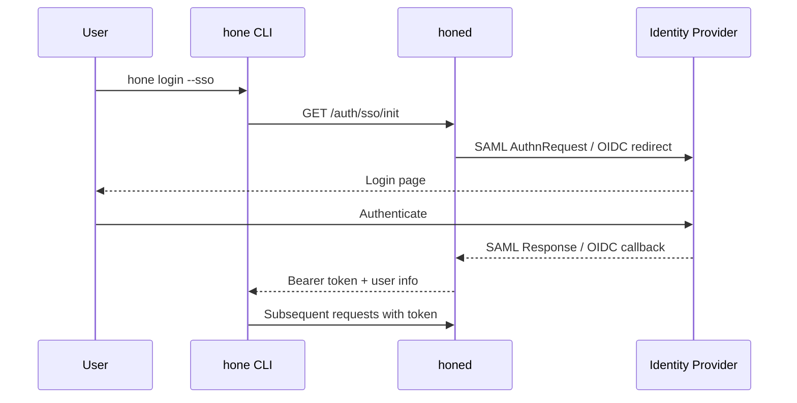
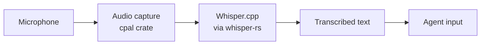
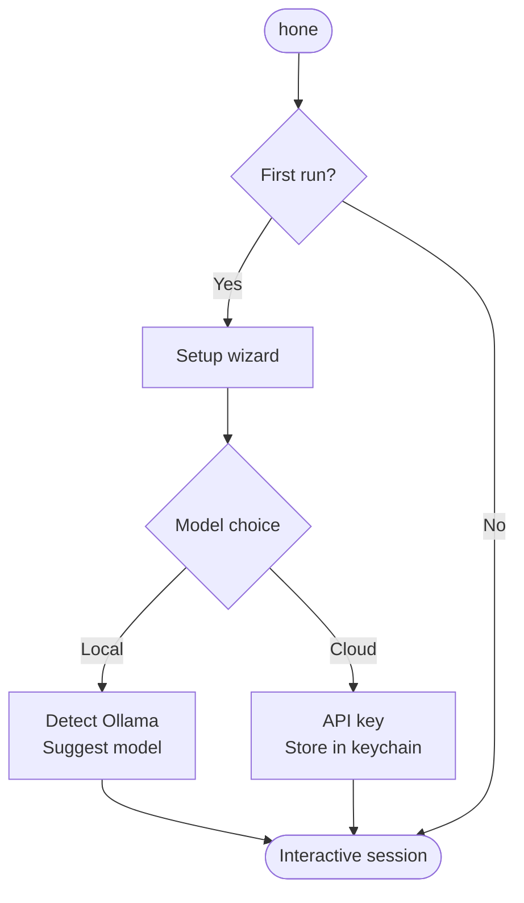
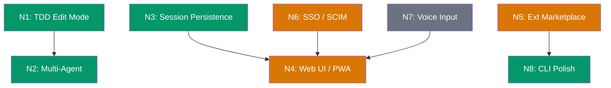
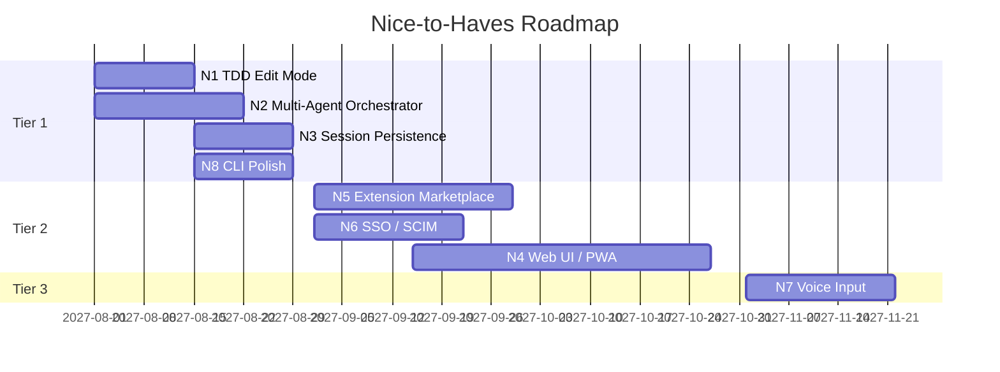

# Phase 5 — Nice-to-Haves: Detailed Plan

**Date:** 2026-04-05
**Status:** Ready for prioritization
**Scope:** PRD features not covered in Phases 0–4

---

## Overview

These are the remaining PRD requirements (R9, R13, R15, R18, R19) plus SSO/SCIM, web UI, and CLI polish. Grouped by effort and impact into three tiers.



---

## Tier 1 — High Impact, Moderate Effort

### N1: Test-Driven Editing Mode (R18)

**Crate:** `hone-core`
**Goal:** Accept a test file/command, iterate code generation until tests pass. TDD autopilot.



#### Tests
```
crates/hone-core/tests/tdd_mode.rs
```
- `test_tdd_mode_succeeds_when_tests_pass`: Mock provider returns correct code on first try. Assert TddResult::Success with 1 iteration.
- `test_tdd_mode_retries_on_failure`: Mock provider returns bad code first, good code second. Assert 2 iterations.
- `test_tdd_mode_gives_up_after_max`: Mock provider always returns bad code. Assert TddResult::MaxIterations with remaining errors.
- `test_tdd_mode_feeds_errors_back`: Assert the second provider call includes test output from the first failure.

#### Implementation
```rust
pub struct TddMode {
    test_cmd: String,
    max_iterations: u32,
    working_dir: PathBuf,
}

pub enum TddResult {
    Success { iterations: u32 },
    MaxIterations { iterations: u32, last_output: String },
}

impl TddMode {
    pub async fn run(&self, agent: &mut Agent, task: &str, events: mpsc::Sender<AgentEvent>) -> Result<TddResult, AgentError>;
}
```

**Dependencies:** None new — uses existing Agent, ShellTool patterns.

---

### N2: Multi-Agent Orchestration (R13)

**Crate:** New `crates/hone-orchestrator` or extend `hone-core`
**Goal:** Lead-worker pattern where a lead agent spawns parallel subagents for independent subtasks.



#### Tests
```
crates/hone-core/tests/orchestrator.rs
```
- `test_orchestrator_runs_single_worker`: One subtask, one worker. Assert result matches worker output.
- `test_orchestrator_runs_parallel_workers`: 3 subtasks with mock providers. Assert all 3 results merged.
- `test_orchestrator_handles_worker_failure`: 1 of 3 workers fails. Lead reports partial success.
- `test_orchestrator_respects_budget`: Total cost across workers checked against budget.

#### Implementation
```rust
pub struct Orchestrator {
    lead_agent: Agent,
    worker_config: AgentConfig,  // template for spawning workers
    max_workers: usize,
}

pub struct SubTask {
    pub description: String,
    pub context: String,
}

pub struct OrchestratorResult {
    pub merged_response: String,
    pub worker_results: Vec<TurnResult>,
    pub total_cost_usd: f64,
}
```

Workers run as `tokio::spawn` tasks with independent Agent instances. Lead collects results via `JoinSet`.

**Dependencies:** None new.

---

### N3: Session Persistence & Reconnect

**Crate:** `hone-server`
**Goal:** Sessions survive daemon restarts. Clients can reconnect and replay events.

#### Tests
```
crates/hone-server/tests/persistence.rs
```
- `test_session_survives_export_import`: Create session, export store to JSON, import into new store, assert session exists.
- `test_reconnect_replays_events`: Create session, record events, reconnect with Last-Event-ID, assert only new events sent.
- `test_session_gc_removes_old`: Create sessions, mark one as completed 30 days ago, run GC, assert removed.

#### Implementation
- `SessionStore::export/import` for JSON-based persistence
- Event replay buffer per session (bounded ring buffer)
- `GET /sessions/{id}/events?last_event_id=N` replays from that point
- `DELETE /sessions/gc?older_than_days=30` garbage collection endpoint

---

## Tier 2 — High Effort, High Impact

### N4: Web UI / Mobile PWA (R9)

**Location:** New `web/` directory at workspace root
**Goal:** SolidJS + Tailwind lightweight SPA that connects to `honed` via SSE.



#### Components
| Component | Responsibility |
|-----------|---------------|
| `SessionList` | List/create/delete sessions |
| `ChatPanel` | Message input + streaming response display |
| `DiffViewer` | Syntax-highlighted file diffs from tool calls |
| `CostDashboard` | Real-time spend per session/model |
| `ApprovalDialog` | Mobile-friendly approve/reject for pending actions |
| `VoiceInput` | Microphone button with Whisper transcription (N6) |

#### Key decisions
- **SolidJS** over React — smaller bundle (<100KB), no virtual DOM
- **PWA manifest** — installable, push notifications, offline shell
- **SSE consumer** — connects to `GET /sessions/{id}/events`
- **< 500KB initial load** per PRD requirement

#### Tests
- Playwright/Vitest for component tests
- API integration tests against a mock honed

**Dependencies:** SolidJS, Tailwind CSS, Vite, @solidjs/router

---

### N5: Extension Marketplace (R15)

**Crate:** New `crates/hone-marketplace`
**Goal:** CLI commands to discover, install, update, and publish MCP servers and recipes.



#### Tests
```
crates/hone-marketplace/tests/
```
- `test_search_returns_results`: Mock registry returns matching extensions.
- `test_install_downloads_and_verifies`: Install extension, assert files present with correct hash.
- `test_install_rejects_bad_hash`: Tampered download returns error.
- `test_list_installed`: After install, `list()` returns the extension.
- `test_uninstall_removes_files`: After uninstall, extension dir is gone.

#### Implementation
```rust
pub struct ExtensionRegistry {
    base_url: String,
    client: reqwest::Client,
}

pub struct ExtensionMeta {
    pub name: String,
    pub version: String,
    pub description: String,
    pub kind: ExtensionKind,  // McpServer, Recipe, Agent
    pub sha256: String,
    pub download_url: String,
    pub trust_score: f64,
}

pub struct ExtensionManager {
    install_dir: PathBuf,
    registry: ExtensionRegistry,
}
```

CLI commands: `hone ext search <query>`, `hone ext add <name>`, `hone ext remove <name>`, `hone ext list`, `hone ext update`, `hone ext publish`.

**Dependencies:** reqwest (already in workspace), sha2 (new)

---

### N6: SSO / SCIM Integration

**Crate:** `hone-server`
**Goal:** Enterprise SSO (SAML 2.0, OIDC) and SCIM user provisioning for team management.



#### Tests
- `test_sso_init_returns_redirect_url`: GET /auth/sso/init returns a URL.
- `test_sso_callback_issues_token`: POST /auth/sso/callback with mock SAML assertion returns bearer token.
- `test_scim_create_user`: POST /scim/v2/Users creates team member.
- `test_scim_list_users`: GET /scim/v2/Users returns provisioned users.

#### Implementation
- `SsoProvider` trait with `OidcProvider` and `SamlProvider` implementations
- SCIM 2.0 endpoints for user provisioning
- Integration with GovernanceStore for role assignment

**Dependencies:** openidconnect (new), base64 (new)

---

## Tier 3 — Lower Priority

### N7: Voice-to-Code Input (R19)

**Crate:** New `crates/hone-voice` or module in `hone-tui`
**Goal:** Local Whisper transcription from microphone, no cloud dependency.



#### Tests
- `test_transcribe_wav_file`: Feed a known WAV file to transcriber, assert output contains expected words.
- `test_empty_audio_returns_empty`: Silent audio returns empty string.

#### Implementation
```rust
pub struct VoiceInput {
    model_path: PathBuf,  // whisper model file
}

impl VoiceInput {
    pub async fn transcribe_file(&self, path: &Path) -> Result<String, VoiceError>;
    pub async fn listen_and_transcribe(&self, duration: Duration) -> Result<String, VoiceError>;
}
```

**Dependencies:** whisper-rs (new), cpal (new)

---

### N8: CLI Polish & First-Run Experience

**Crate:** `bins/hone`
**Goal:** Production CLI with subcommands, first-run wizard, session management.



#### CLI subcommands
```
hone                          # Interactive session
hone "fix the bug"            # One-shot task
hone --resume                 # Resume last session
hone --ephemeral              # No memory, no history
hone --model <id>             # Override model
hone --recipe <name>          # Run a recipe
hone sessions                 # List sessions
hone sessions gc              # Garbage collect old sessions
hone attach <id>              # Reconnect to session
hone ext search/add/remove    # Extension management
hone tunnel start/stop/status # Tunnel management
hone init                     # First-run setup
hone config                   # Open config in editor
```

#### Tests
```
tests/cli.rs  (workspace integration tests)
```
- `test_cli_help_output`: `hone --help` exits 0 with expected subcommands listed.
- `test_cli_version`: `hone --version` prints version string.
- `test_cli_one_shot_mode`: `hone "echo hello"` (with mock provider) produces output.
- `test_cli_ephemeral_flag`: `hone --ephemeral` does not write to memory store.

**Dependencies:** clap (new)

---

## Dependency Graph



Green = Tier 1 (do next), Orange = Tier 2 (plan carefully), Gray = Tier 3 (maybe later)

---

## Suggested Implementation Order



---

## Summary Table

| ID | Feature | Crate | Effort | Impact | New Deps |
|----|---------|-------|--------|--------|----------|
| N1 | TDD Edit Mode | hone-core | Low | High | None |
| N2 | Multi-Agent | hone-core | Medium | High | None |
| N3 | Session Persistence | hone-server | Low | High | None |
| N4 | Web UI / PWA | web/ (new) | High | High | SolidJS, Tailwind |
| N5 | Extension Marketplace | hone-marketplace (new) | High | High | sha2 |
| N6 | SSO / SCIM | hone-server | Medium | Medium | openidconnect |
| N7 | Voice Input | hone-voice (new) | Medium | Low | whisper-rs, cpal |
| N8 | CLI Polish | bins/hone | Low | Medium | clap |
