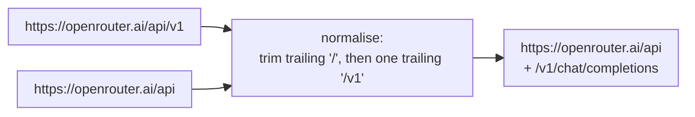

# Base URLs ending in `/v1` — spec

**Date:** 2026-11-09 · **Branch:** `fix/openai-base-url-v1` · **Found by:** PR #81 review

## 1. The problem

`OpenAiProvider` sends requests to `format!("{}/v1/chat/completions", base_url)` and
`AnthropicProvider` to `format!("{}/v1/messages", base_url)`. The common convention, used by
the OpenAI SDKs, OpenRouter, vLLM, Groq, Together and most docs, is a base URL that already
ends in `/v1`. Such a URL becomes `…/v1/v1/chat/completions`, which fails.

- `hone configure` → OpenRouter writes `base_url = "https://openrouter.ai/api/v1"`, so every
  OpenRouter wizard user hits `https://openrouter.ai/api/v1/v1/chat/completions`. Since
  PR #81 the wizard's settings (and its implied `openai:<model>`) are fully applied, so this
  path is now the default for them.
- `HONE_OPENAI_BASE_URL=http://localhost:8000/v1` (the usual vLLM form) fails the same way.
- The benchmark passes its base URL without `/v1` and is unaffected.

The stream parser already ignores SSE comment lines (OpenRouter's `: OPENROUTER PROCESSING`).

## 2. Contract

| # | Requirement | Test |
|---|---|---|
| B1 | `OpenAiProvider::with_base_url` accepts a base URL with or without a trailing `/v1`, and with or without trailing slashes: it removes trailing `/` characters, then one trailing `/v1` segment, then trailing `/` again. Requests (`complete` and `health`) go to `<normalised>/v1/chat/completions` | Mock server: bases `<mock>`, `<mock>/`, `<mock>/v1`, `<mock>/v1/`, `<mock>/api/v1` → requests arrive at `/v1/chat/completions` (or `/api/v1/chat/completions`), never `/v1/v1/…` |
| B2 | Only a whole `/v1` path segment is removed: `…/apiv1` and `…/v1beta` are left alone | `<mock>/apiv1` → `/apiv1/v1/chat/completions` |
| B3 | `AnthropicProvider::with_base_url` normalises the same way; requests go to `<normalised>/v1/messages` | Mock: `<mock>/v1` and `<mock>` → `/v1/messages` |
| B4 | End to end: a wizard-format user file (`[provider] name = "openrouter"`, `base_url = "<mock>/api/v1"`, `model = "…"`) and `HONE_OPENAI_BASE_URL=<mock>/v1` each reach the mock at the right path through the `hone` binary | Binary test with the existing mock harness |
| B5 | Surrounding whitespace in a base URL (a stray space or newline in an environment variable or config value) is trimmed before the normalisation of B1, for both providers. Reviewer-confirmed bug: `HONE_OPENAI_BASE_URL="http://host/v1 "` requested `/v1%20/v1/chat/completions` | Bases with leading and trailing spaces, tabs and newlines, alone and combined with `/v1/`, for `complete` and `health` of both providers |

Unchanged: `OpenAiProvider::new` / `AnthropicProvider::new` and their default URLs; the
wizard keeps writing `https://openrouter.ai/api/v1`.

## 3. Out of scope

- Base URLs whose API version is not `/v1` (Gemini's OpenAI-compatible
  `…/v1beta/openai`, Azure's `?api-version=`).
- OpenRouter's optional `HTTP-Referer` / `X-Title` headers.
- The SSE reader drops a whole chunk when it isn't valid UTF-8 on its own (a multi-byte
  character split across chunks); pre-existing, every OpenAI-compatible provider. Follow-up.
