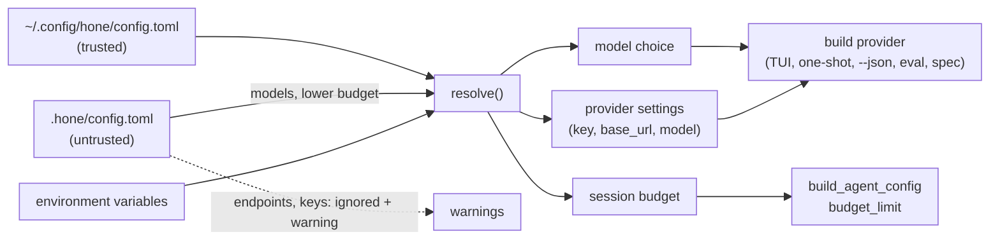

# Apply config.toml — spec

**Date:** 2026-11-09 · **Branch:** `fix/config-toml-applied`

## 1. The problems

1. **Nothing in `config.toml` is applied.** `load_project_config` (`bins/hone/src/main.rs`)
   returns a `hone_config::Config`, and the binary only checks `is_some()`. No code reads
   `default_model`, `[providers.*]`, `[budget]`, `[sandbox]`, `[[routing]]` or `[server]`.
2. **A wizard-written file fails validation.** `hone configure` writes a `[provider]` table,
   which the strict schema (`deny_unknown_fields`) rejects. Validation failure drops the
   whole file with a `tracing::warn!` that nobody sees without `RUST_LOG`.
3. **Two readers.** A separate line parser (`configure::load_wizard_config`) reads
   `[provider]` from the user file only, and only fills keys and the OpenAI base URL/model.
   Choosing Ollama or Claude CLI in the wizard, or an Anthropic model, has no effect.
4. **`--model` doesn't always pick its provider.** `--model anthropic:…` / `openai:…`
   without a key, and `claude-cli:…` / `gemini-cli:…`, fall back to auto-detection while
   keeping the model id. The id is then sent to whichever provider was detected.

## 2. Trust model

The user file `~/.config/hone/config.toml` is trusted. The project file
`<cwd>/.hone/config.toml` comes with the repository, so it is **untrusted**, the same as the
project `permissions.toml`. A project file may choose models and lower the budget. It may
not set endpoints, key variables or keys, because a project `base_url` would send your API
key and your code to a host the repository chose.

## 3. Contract

### Keys

| # | Key | Effect | In the project file |
|---|---|---|---|
| C1 | `default_model` | The model when `--model` is absent. Same format and validation as `--model` | allowed; project wins over user |
| C2 | `[providers.
].model` (`p` = `anthropic`, `openai`, `ollama`) | The model used when auto-detection picks provider `p` | allowed; project wins over user |
| C3 | `[providers.
].base_url` | Endpoint for `p` (Anthropic, OpenAI-compatible, Ollama) | **ignored, with a warning** |
| C4 | `[providers.
].api_key_env` (`anthropic`, `openai`) | Name of the environment variable that holds the key, replacing `ANTHROPIC_API_KEY` / `OPENAI_API_KEY`. No fallback to the default variable when the named one is unset | **ignored, with a warning** |
| C5 | `[providers.<other>]`, or `api_key_env` under `ollama` | Config error | — |
| C6 | `[provider]` (wizard table: `name`, `api_key`, `model`, `base_url`) | Accepted by the schema. Fills the key and base URL for its provider where nothing higher is set (see precedence). `name` + `model` imply a default model: `anthropic` → `anthropic:<m>`, `openai`/`deepseek`/`openrouter` → `openai:<m>`, `ollama` → `ollama:<m>`, `claude-cli` → `claude-cli:<m>` | **ignored, with a warning** |
| C7 | `[budget].session_limit_usd` | Cost cap per session, the same cap `/budget` sets; `/budget` still changes it at runtime | allowed, but it can only lower the cap: effective = min(user, project) |
| C8 | `[budget].daily_limit_usd`, `[sandbox]`, `[[routing]]`, `[server]` | **Not applied.** One warning per key at startup naming what to use instead (`permissions.toml` and `HONE_SANDBOX_*` for sandbox; `--model`/`default_model` for routing; `honed`'s port argument, `HONE_BIND`, `HONE_AUTH_TOKEN` for server) | same |

### Precedence (highest first)

- **Model:** `--model` → `default_model` (project, then user) → model implied by the wizard
  `[provider]` → auto-detection.
- **Key for `p`:** the variable named by `api_key_env` (user file) or the default variable →
  wizard `api_key` (when the wizard's provider maps to `p`).
- **Base URL for `openai`:** `HONE_OPENAI_BASE_URL` → `[providers.openai].base_url` → wizard
  `base_url` → none. **`anthropic`:** `[providers.anthropic].base_url` → built-in.
  **`ollama`:** `[providers.ollama].base_url` → wizard `base_url` (wizard `ollama`) →
  `http://localhost:11434`; used for the detection probe and for `ollama:` models.
- **Model when auto-detection picks `p`:** `openai`: `HONE_OPENAI_MODEL` → `[providers.openai].model`
  → wizard `model` → `gpt-4o`. `anthropic`: `[providers.anthropic].model` → wizard `model` →
  `claude-sonnet-4-5`. `ollama`: `[providers.ollama].model` → `llama3.2`.

### Model choice builds its own provider

| # | Requirement |
|---|---|
| C9 | An explicit model (from `--model`, `default_model` or the wizard) uses the provider its prefix names, for all five prefixes. `claude-cli:` / `gemini-cli:` use the CLI adapters. A choice that can't be built (no key for `anthropic:` / `openai:`) stops with exit 1 and a message naming where the choice came from (`--model` or the file path) and how to supply the key. It never falls back to auto-detection with a mismatched id |
| C10 | Every place `hone` builds a provider uses the resolved settings: interactive TUI, one-shot, `--json`, the orchestrate / ensemble / medium paths that reuse the detected provider, `hone eval`, `hone spec` |
| C11 | `build_agent_config` sets `budget_limit` from C7 |

### Errors and warnings

| # | Requirement |
|---|---|
| C12 | A file that can't be read or parsed, an unknown key, a wrong type, an unknown provider name, a `default_model` without a known prefix, or a negative / non-finite limit stops `hone` with **exit 2** and `hone: config error in <path>: <reason>`, like a broken `permissions.toml`. This applies to commands that start a model (TUI, one-shot, `--json`, `eval`, `spec`) |
| C13 | `hone configure` still runs when the existing file is broken (it rewrites it). `session`, `memory` and the other subcommands that don't start a model don't read `config.toml` |
| C14 | Warnings (C3, C4, C6 in a project file; C8) go to **stderr** as `hone: warning: <path>: <message>`, once per start, never to stdout (so `--json` output stays clean) |
| C15 | The line parser `configure::load_wizard_config` / `WizardConfig` is removed; the strict loader is the only reader. A file written by `build_toml` loads without error or warning |

## 4. Out of scope (follow-ups)

- Applying `[sandbox]`, `[[routing]]`, `daily_limit_usd` (needs spend persisted across
  sessions) and `[server]` in `honed`.
- `hone spec` hard-codes `anthropic:claude-3-5-sonnet-20241022` as its model; `hone eval`
  ignores the OpenAI model. C10 only requires that they build providers from resolved settings.
- `OLLAMA_HOST`.
- The wizard still stores the API key in plain text.

## 5. Test plan

- **Pure resolver** (new module in `hone-config`, env passed in as a lookup function so tests
  don't touch the process environment): each row of C1–C8, each precedence chain, the trust
  rules, and every C12 error.
- **Binary level** (spawn the built `hone` with a temporary `HOME` and working directory, a
  local mock OpenAI-compatible server, provider env vars cleared):
  - `default_model = "openai:<m>"` + user `[providers.openai] base_url = <mock>` +
    `api_key_env` → the mock receives the request for model `<m>` with that key.
  - A project `base_url` pointing at a second mock is ignored (the user's mock gets the
    request) and stderr carries the warning; stdout of `--json` stays valid JSON.
  - A broken file → exit 2, the path in stderr, and no request to the mock.
  - A wizard-written file (from `build_toml`) → no warning, and its implied model is used.
  - `session_limit_usd` reaches the agent (a run that exceeds it reports the budget error).
- The old `WizardConfig::parse` unit tests in `configure.rs` are replaced by resolver tests.
