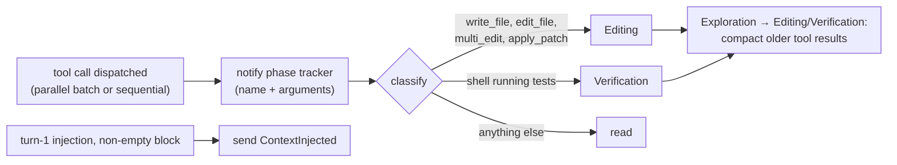

# Phase-aware compaction runs; `ContextInjected` is sent: spec

Branch `fix/context-phase-events`, stacked on `fix/memory-recall-index` (#101). This is the contract for the TDD rounds: rows K1–K7. The defects are 4 and 5 in `docs/research/pluggable-context-memory-2026-11.md` §3.2, plus the rest of defect 7 (pgvector claims in docs). Plan: `docs/plans/pluggable-context-implementation.md`, PR A.

## Problem

1. **Phase-aware compaction never runs.** `ContextManager::notify_tool_call` (`crates/hone-core/src/context.rs`) has no caller outside tests. Its tool tables also name tools Hone doesn't have: writes are `write_file | edit_file | multi_edit | apply_diff` and tests are `run_tests`. Hone's real patch tool is `apply_patch`, and tests run through `shell`.
2. **`AgentEvent::ContextInjected` is never sent.** It is defined in `hone-proto/src/event.rs`, rendered by the TUI (`hone-tui/src/app.rs`, the turn ledger's skeleton entries) and named by the server's SSE mapping, but `hone-core` never emits it. The agent's turn-1 injection (`agent.rs`, `run_turn`, the `inject_context` branch) only logs at debug level.
3. **Docs still claim pgvector.** `docs/research/competitive-analysis-2026-05.md` and `docs/aider-vs-hone.md` describe a pgvector index that was never built.

## Rows

| Row | Behaviour |
|---|---|
| K1 | **Every dispatched tool call feeds the phase tracker once, in call order.** This covers the parallel read-only batch and the sequential path. A call that doesn't run (blocked by the permission policy, denied by a `PreToolUse` hook, cancelled, or refused by a guard before dispatch) doesn't count. A call that runs and returns a tool error counts. |
| K2 | **Writes are Hone's real write tools.** `write_file`, `edit_file`, `multi_edit` and `apply_patch` are writes. `apply_diff` stays as an alias. Every other tool, including MCP tools and unknown names, counts as a read, as today. |
| K3 | **A `shell` call that runs a test suite is a test call.** The tracker receives the call's arguments, not only its name. A `shell` call is a test call when any command segment of its `command` string, split on `&&`, `\|\|`, `;`, `\|` and newlines, runs a test runner. Before matching, a segment drops leading `NAME=value` assignments and the wrappers `env`, `time`, `uv run`, `poetry run`, `pdm run`, `npx`, `bunx`, `pnpm exec` and `bundle exec`. Runners: `cargo test`, `cargo nextest`, `pytest`, `py.test`, `python -m pytest`, `python3 -m pytest`, `python -m unittest`, `python3 -m unittest`, `npm test`, `npm run test…`, `pnpm test`, `pnpm run test…`, `yarn test`, `bun test`, `deno test`, `jest`, `vitest`, `go test`, `mvn test`, `gradle test`, `./gradlew test`, `make test`, `flutter test`, `dart test`, `ctest`, `rspec`, `phpunit`, `tox`, `nox`, `mix test`, `swift test`, `dotnet test`. • `cd crates/x && cargo test -p foo` is a test call; so is `RUST_LOG=debug cargo nextest run`. • `echo "cargo test"`, `grep -r pytest .` and `cargo build` are not. • The legacy name `run_tests` stays a test call. Any other `shell` call is a read. |
| K4 | **The first write or test call after exploration compacts older tool results, in a real agent turn.** When an agent turn runs `read_file` (or other reads) and then `edit_file`, `apply_patch` or a test `shell` call, tool results older than the recent window and longer than 200 characters are replaced by their structural summary, as `force_compress_exploration_results` does today. Results inside the recent window are unchanged. A session that only reads never compacts. The phase transition is recorded on the context metrics. `ContextManager::notify_tool_call(name)` keeps working for existing callers. |
| K5 | **`ContextInjected` is sent once when turn-1 injection adds a block.** When `inject_context` is on, it's the first turn, and the injector returns a non-empty block, the agent sends `ContextInjected` before the first model call's output: • `strategy`: the skeleton strategy's CLI spelling (`flat`, `dependency_graph`, `call_graph`, `hybrid`, `adaptive`), the same strings `SkeletonStrategy::from_str` accepts; • `tokens_used`: the injection's token estimate; • `bm25_hits`: the injection's tier-2 hits (path, score) in order, empty when tier 2 didn't fire; • `confidence`: `"High"`, `"Medium"` or `"Low"`.  It is not sent when injection is off, on later turns, or when the block is empty. |
| K6 | **Event docs say what the scores are.** The doc comments on `ContextInjected.bm25_hits` and `InjectionResult.bm25_hits` say they are index match scores, not BM25. The field name stays, so the wire format doesn't change. |
| K7 | **Docs stop claiming pgvector.** `docs/research/competitive-analysis-2026-05.md` and `docs/aider-vs-hone.md` gain a dated correction note, and their table cells and sentences that state pgvector exists are corrected. So are `docs/benchmarks.md`, `docs/ml-intern-vs-hone.md` and the two `docs/changelog.md` entries (annotated, not rewritten). Plans that propose pgvector stay as history, marked superseded. `docs/architecture.md` and the README are already right. Docs only; no test. |

## Testing notes

- **K2/K3** are unit tests on the classifier: each runner, each wrapper, the separators, and the negative examples.
- **K1/K4** go through a real `Agent` with a scripted mock provider:
  - a turn that reads a long file, adds enough messages to push it past the recent window, then edits, and checks via `Agent::messages()` that the old read result was summarised and the recent ones weren't;
  - the same with a `shell` test command instead of the edit;
  - a read-only session that never compacts;
  - a `PreToolUse` hook that denies the write, so nothing is compacted.
- **K5** runs an agent with `inject_context: true` and an index or working directory that yields a non-empty block, collects events and checks for exactly one `ContextInjected` with the fields above, before the first `Token`. Also check that a second turn sends none, and that `inject_context: false` sends none.

## Out of scope

- Turning compaction off by config. The compactor becomes selectable in PR D (`[context] compactor`).
- Renaming the `bm25_hits` field.
- Re-running `harness-compare`. K4 changes what the model sees, so the `hone-inject` arm should be re-run before and after #101 and this PR. That uses model API spend, so it waits for the user.
