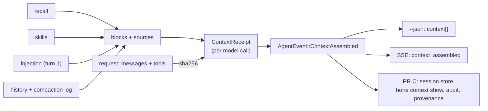

# Context receipts: spec

Branch `feat/context-receipts`, stacked on `fix/context-phase-events` (PR A). Plan: `docs/plans/pluggable-context-implementation.md`, PRs B and C. Design: `docs/research/pluggable-context-memory-2026-11.md` §4.3.

## Problem

Nothing records what Hone put in front of the model. `MemoryRecalled` carries friendly keys and 80-character snippets, `ContextInjected` (sent since PR A) carries paths and scores for turn 1 only, and history compaction leaves no trace. So a user can't see which memories, files or summaries a call used, and `hone eval` (Phase 3) has nothing to score retrieval against. The Belief Ledger design (`traceable-memory-pivot-2026-08.md` §5.1) also needs each write's `read_set`, which is the recall part of a receipt.

## Types (`hone-proto`, new module `receipt`)

As in the research doc §4.3, with these choices:
- `Slot`: `SystemPrompt`, `Recall`, `Skills`, `Injection`, `History`, `Retrieval` (reserved). snake_case on the wire.
- `SourceRef` (tagged `kind`, snake_case): `Memory { id, version: Option<u64> }`, `File { path, sha256: Option<String>, lines: Option<(u32,u32)> }`, `Message { index, sha256 }`, `ToolResult { call_id, sha256 }`, `Skill { name }`, `Command { argv, sha256 }`, `Chunk { index, chunk_id, sha256 }`, `Opaque { plugin, note }`.
- `StrategyId { slot, name, version, params_sha256 }`. Until PR D adds config tables, `params_sha256` is the SHA-256 of the strategy's parameters as canonical JSON (sorted keys), for example `{"exclude":["outcome"],"limit":5}` for recall.
- `ContextReceipt { turn, call, model, request_sha256, blocks, dropped, compaction, tools_offered }`, `BlockReceipt { slot, strategy, tokens, sources: Vec<ScoredSource>, duration_ms }`, `ScoredSource { source, score: Option<f32> }`, `CompactionStep { strategy, replaced: Vec<SourceRef>, derived: Option<SourceRef> }`.
- All types are `Serialize + Deserialize + Clone + Debug + PartialEq`, and round-trip through JSON.

## Rows (PR B)

| Row | Behaviour |
|---|---|
| CR1 | **One receipt per model call.** Every completion request the agent builds (each iteration of the tool loop, including the context-emergency call) is preceded by exactly one `AgentEvent::ContextAssembled { receipt }`. Provider-level retries and fallbacks of one request are not separate calls. `turn` is the agent's 1-based turn count; `call` is 1-based within the turn. |
| CR2 | **`request_sha256` identifies the request.** It is the SHA-256 (hex) of the canonical JSON of the request's messages and offered tool names, in the order sent. Two calls with identical messages and tools have equal hashes; any change to a message or the tool list changes it. `tools_offered` lists the tool names in order (empty under context emergency). `model` is the request's model id. |
| CR3 | **Blocks match what was sent.** One `BlockReceipt` per non-empty slot, in prompt order: `SystemPrompt` (no sources), `Recall`, `Skills`, `Injection`, `History`. `tokens` uses the agent's token estimator on that block's text. Building a receipt never changes the request: with the same inputs, the messages sent are byte-identical to the previous release. |
| CR4 | **Recall sources are memory ids.** The `Recall` block lists `Memory { id }` for each recalled memory, in prompt order, with strategy name `bm25` (or `bm25+semantic:rrf` when an embedder ran). Its params include the limit and excluded kinds. Candidates the strategy fetched but cut (semantic candidates beyond the limit, fused ids beyond 5) go in `dropped`. |
| CR5 | **Injection sources are files.** On turn 1 with injection on, the `Injection` block's strategy is `skeleton:<strategy>` (the `as_str` spelling from PR A), its sources are `File { path }` for each tier-2 hit with its score, and it appears on every call of turn 1 (the block lives in the first user message). Later turns have no `Injection` block. The injected text is part of the first user message, which `History` also lists, so block token counts can overlap and needn't sum to the request total. |
| CR6 | **Skills sources are skill names.** The `Skills` block lists `Skill { name }` for each matched skill. |
| CR7 | **History sources are message hashes.** The `History` block lists `Message { index, sha256 }` for every non-system message sent, where `index` is its position in the request and `sha256` hashes its role, text, tool calls and tool-call id. Implementation note (not tested): cache per-message hashes in the context manager rather than rehashing the whole history on every call. |
| CR8 | **Compaction is recorded.** Each receipt's `compaction` lists what the context manager changed since the previous receipt: phase compaction (PR A), graduated compression, tool-result dedup, and drop-oldest trimming. Each step names its strategy (`phase`, `graduated`, `dedup`, `drop_oldest`), the `Message` refs it replaced (with the hashes they had), and the derived message (`Message` ref of the summary or marker), or `None` when content was only removed. |
| CR9 | **Receipts reach `--json` and SSE.** The one-shot `--json` report gains `context: [ContextReceipt…]` in call order. The server's SSE and execution event-name maps send `context_assembled`. The TUI ignores the event (no change on screen). Worker agents in an orchestrated run send receipts on their own event channels; what the orchestrator forwards is unchanged. |
| CR10 | **No text in receipts.** Receipts contain ids, paths, hashes, names, scores and counts, never message, memory or file text. A test serialises a receipt from a turn whose memories, skills and messages contain a marker string and checks the marker isn't in the JSON. |

## Rows (PR C)

| Row | Behaviour |
|---|---|
| CR11 | **The CLI stores receipts with the session.** The session store gains a `context_receipts` table (session name, turn, call, receipt JSON), written when the session is saved. Old databases upgrade in place. |
| CR12 | **`hone context show [--session NAME] [--turn N] [--json]`.** Prints, per call: turn/call, model, request hash prefix, each block (slot, strategy, tokens, sources with scores), dropped sources, and compaction steps. Default session: the most recent. `--json` prints the stored receipts. An unknown session or turn is an error with exit code 1. |
| CR13 | **Audit log.** With `--audit`/`HONE_AUDIT_LOG=1`, each receipt adds one `.hone/audit.jsonl` line with a new `SpanKind::Context`, its parent the turn span, carrying the receipt. |
| CR14 | **`honed` provenance.** `ProvenanceEvent::ContextAssembled { receipt_sha256, strategies, sources }` is appended to a run's chain for each receipt, where `strategies` are the block strategy names and `sources` the source refs. Existing chains still verify; the variant is a pure addition. |

## Testing notes

- **CR1–CR8, CR10** through a real `Agent` with a scripted mock provider that records the requests it receives. Compare `request_sha256` with a hash computed from the recorded request. Use an `InMemoryStore` with seeded memories, a skill registry with one trigger, and a context config small enough to force compression and trimming.
- **CR3 byte-identity:** record requests for a fixed scripted session and compare with a golden JSON fixture captured from the base branch (generate the fixture before implementing).
- **CR9** in `bins/hone` (the `--json` builder) and `hone-server` (event-name maps).
- **CR11–CR14** in their crates; CR12 runs the binary against a temp `HOME`.

## Out of scope

- Strategy selection by config (PR D); until then `params_sha256` hashes built-in parameters.
- Showing receipts in the TUI or desktop app.
- `hone memory blame`.
