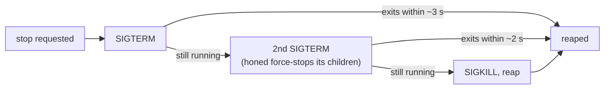

# Desktop app: stop the managed daemon gently, and respond at once at launch: spec

Branch `fix/desktop-graceful-stop`. This is the contract for the TDD rounds: rows G1–G6. Follow-ups from the PR #99 review.

## Problem

- **Stopping `honed` kills it outright.** Every stop path in `apps/hone-desktop/src-tauri/src/supervisor.rs` sends SIGKILL (`Child::kill`), so `honed` gets no chance to stop its own children:
  - `SidecarSupervisor::shutdown`, used by **Daemon → Stop**, the tray's Stop and Quit, switching or removing a profile, and `RunEvent::Exit`;
  - `Drop`;
  - the kill after a failed start.

  Since PRs #90–#95, `honed` runs its MCP servers and shell commands in their own process groups and stops them only on a signal it can handle: drain, then a graceful MCP shutdown; a second signal forces it (PR #95, D5). A SIGKILLed `honed` leaves them running.

  Reproduced in the #99 review: the app passes its environment to `honed`, and with a worker MCP server that ignores SIGTERM, quitting the app left that server running.
- **The window is blank at launch.** `app.js` awaits `daemon_boot` before it shows the home view or the wizard, and before it registers any listener (the wizard cards, Start/Stop, the command palette). Until the start finishes, the window shows neither view and ignores clicks: about 1 s normally, up to about 5 s if `honed` hangs.
- **Smaller items from the same review:**
  - **Start can't revive a crashed daemon.** `start_in_slot` treats any supervisor in the slot as running, so after `honed` dies, **Start** does nothing until **Stop** is pressed.
  - **A stale error survives.** "daemon failed to start" stays after Stop, a profile switch, or a switch to an external daemon.
  - **The stderr reader can stop early.** It stops on any read error, including `Interrupted`, after which a chatty `honed` could block on a full pipe.

## Rows

| Row | Behaviour |
|---|---|
| G1 | **Stopping the managed daemon is gentle, then firm.** Every stop path stops `honed` the same way: Stop, the tray's Stop and Quit, a profile switch or removal, the app's exit, dropping the supervisor, and the kill after a failed start. 1. Send SIGTERM and wait up to about 3 s for it to exit. 2. If it's still running, send a second SIGTERM (its force-stop) and wait up to about 2 s. 3. Only then send SIGKILL. 4. Always reap it.  A `honed` that exits on the first SIGTERM is reaped at once: no fixed sleep, and stop returns as soon as it's gone. A child that has already exited, or was already reaped, is never signalled, because its pid may have been reused. Unix only; elsewhere `kill` as before. |
| G2 | **The managed daemon's drain is short.** The app starts `honed` with `HONE_SHUTDOWN_GRACE_SECS=1`, unless the app's own environment sets that variable, in which case it's passed through. That way the first SIGTERM leads to a quick, orderly stop: the drain, then the graceful MCP shutdown, then exit. The 20 s server default doesn't apply. |
| G3 | **The window responds at once.** At launch, the home view (or the wizard) and every listener are set up before the daemon start finishes. While the start runs, the pill reads "starting daemon…". When it finishes, the pill shows the result: green, or "daemon failed to start" with the reason. |
| G4 | **Start revives a crashed daemon.** If the supervisor in the slot belongs to a `honed` that has exited, Start and boot reap it, replace it with a new one, and report `Started`. If it's alive, they report `AlreadyRunning`, as before. |
| G5 | **No stale start error.** The stored start error is cleared on Stop, on a profile switch, and when connecting to an external daemon, so an unhealthy status after those reads "daemon not reachable", not "daemon failed to start". |
| G6 | **The stderr reader retries interrupted reads.** An `Interrupted` read error is retried; any other error, or end of file, ends the reader. |

## Testing notes

- **G1, G2, G4, G6 in Rust** (`cargo test -p hone-desktop`), with fake `honed` scripts as in `tests/sidecar_start.rs`:
  - one that exits on SIGTERM after writing a marker;
  - one that ignores the first SIGTERM and exits on the second;
  - one that ignores SIGTERM entirely.

  Check:
  - the order of signals received;
  - that stop returns promptly for the polite one;
  - that the stubborn one is gone within the bound;
  - that the environment has `HONE_SHUTDOWN_GRACE_SECS=1` by default, and the app's own value when set;
  - that Start replaces a dead supervisor.
- **G3 and G5** are `app.js` wiring, with no JS test setup. Keep them small and check them by hand on the real app.
- **End to end, by hand:** launch the real app with a worker MCP server that ignores SIGTERM in its environment, quit it, and confirm the server is gone. The #99 reviewer's driver `scratchpad/driver/desk_quit.py` does this through a throwaway `.app` bundle.

## Out of scope

- A plain SIGTERM or `kill -9` to the app itself. `RunEvent::Exit` doesn't run, so `honed` keeps running unless it gets the signal through the terminal's process group.
- The slot lock held during a start, which blocks status and quit for up to about 5 s.
- Packaging `honed` inside the app bundle.
