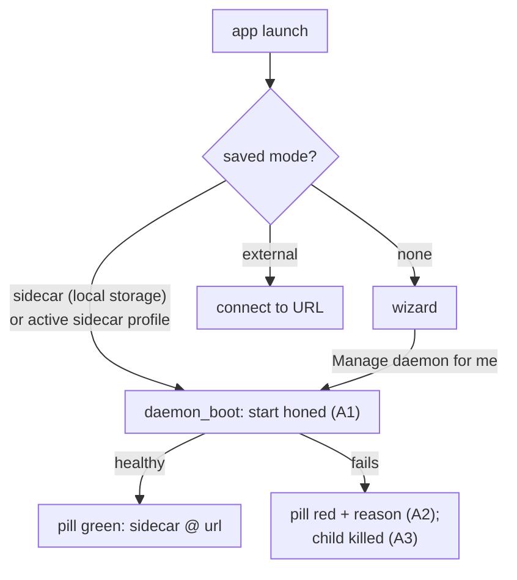

# Desktop app: the managed daemon starts on launch: spec

Branch `fix/desktop-sidecar-autostart`. This is the contract for the TDD rounds: rows A1–A5.

## Problem

Following the README's desktop quick start (`cargo build -p honed --release`, copy `honed` onto `PATH`, `cargo run -p hone-desktop`), the app showed **"daemon not reachable"**. The same `honed` binary, started the way the app starts it, was healthy in about 200 ms. Reported by the user on 2026-11-11.

- **Nothing starts the daemon on launch.**
  - The first-run wizard's **Manage daemon for me** card is the only thing that starts the managed daemon: it calls `daemon_start`.
  - The card's choice is saved in the web view's local storage (`hone.gui.state.v1` = `{"mode":"sidecar"}`).
  - On every later launch, `app.js` sees a saved mode, skips the wizard, shows the home screen and calls only `refreshDaemon()`.
  - The Rust side starts nothing either: `lib.rs` `setup` installs the tray, and `DaemonState::new` seeds only an *external* profile.
  - So the status reads `mode: "none"`, and the pill says "daemon not reachable" until the user finds **Daemon → Start** in the sidebar. The user's saved choice dated from May 2026.
- **A failed start says nothing.**
  - `daemon_start` errors are caught with `console.warn` in `app.js` and never shown.
  - `honed`'s stderr goes to `Stdio::null()`.
  - A `honed` that exits at once (bad environment, port taken) is only noticed when the 5 s health wait runs out, and even then the user sees only "daemon not reachable".
- **A failed start can leave `honed` running.** When `wait_until_healthy` fails, `daemon_start` drops the `SidecarSupervisor`. It has no `Drop` that kills the child, and `std::process::Child` doesn't kill on drop, so a `honed` that started but never became healthy keeps running, orphaned.
- **The README is wrong in two places.** It says the choice is saved to `~/.config/hone/desktop.json`; it's local storage, and on macOS `desktop.json` lives in `~/Library/Application Support/hone/`. It also never says that the daemon needs `ANTHROPIC_API_KEY` in the environment the app is launched from: `honed`'s `/run` reads only that key.

## Rows

| Row | Behaviour |
|---|---|
| A1 | **The managed daemon starts on launch.** If the saved choice is "manage the daemon for me", the app starts its `honed` without a click, and the pill turns green once it's healthy. The saved choice is either the web view's saved mode `sidecar`, or an active sidecar profile in `desktop.json`. The decision lives in Rust (testable): a pure function decides from the saved mode and the config, and a new command (for example `daemon_boot(saved_mode)`) starts the sidecar when it says so. `app.js` calls that command at boot instead of only `refreshDaemon()`. |
| A2 | **A failed start says why.** When starting the managed daemon fails, the pill and the **Daemon** panel show the reason, at launch, from the wizard card and from **Start** alike. The possible reasons: • `honed` isn't on `PATH`: say so and how to install it; • it exited before it was healthy: give its exit status and the last lines it wrote to stderr; • it didn't become healthy in time.  An early exit is reported as soon as it happens (within about 1 s), not after the full health wait. `honed`'s stderr is kept, its last lines in a small buffer, instead of being discarded. |
| A3 | **A failed start leaves nothing running.** If `honed` started but the start fails (it never became healthy), the app kills and reaps it before returning the error. An app restart, or a later **Start**, then begins clean. |
| A4 | **Only one daemon, and only when wanted.** With an external profile active, or with no saved choice, launch starts nothing. If a sidecar is already running, launch and **Start** don't start a second one, as `daemon_start` already ensures. |
| A5 | **README desktop quick start.** It must work as written on a fresh or a used machine: • install `honed` with `cargo install --path bins/honed --locked`; • `export ANTHROPIC_API_KEY=…` in the terminal before `cargo run -p hone-desktop`, because the daemon reads only that key for now; • what you should see (the green pill), and what to do if it's red: the reason shown, **Daemon → Start**, <kbd>Cmd</kbd>+<kbd>K</kbd> → "Reset onboarding".  Correct where the choice is saved: the app's local storage, and the `desktop.json` path per OS. |

### Found while checking by hand (A6–A8)

| Row | Behaviour |
|---|---|
| A6 | **Starting works from inside the app.** The Tauri commands `daemon_start` and `daemon_boot` are `async fn`, so they run on Tauri's async (tokio) runtime. Starting the sidecar from there must succeed: it must not panic and must not block a runtime worker for the whole health wait.  Today the start path waits with `reqwest::blocking`, which panics when used inside a tokio runtime. The likely result: the wizard's start never succeeded. The user's machine has no `desktop.json`, which is written only after a successful start. A launched app with an active sidecar profile started no `honed`. The unit tests run the start from plain `#[test]` functions, outside any runtime, so they didn't see it.  Fix: run the blocking start on a blocking thread (`tauri::async_runtime::spawn_blocking`), or make the health wait async. Test it the way the command runs it, from inside a multi-thread tokio runtime task. |
| A7 | **The page can reach the app.** `tauri.conf.json` sets `app.withGlobalTauri: true`, so `window.__TAURI__` exists and `invoke` and `listen` reach the Rust commands and events.  Today it isn't set. `app.js` falls back without a word to a stub `invoke` that returns `{stub: true}` for every call, which is why the user saw "daemon not reachable". The status came back as the stub, and the wizard's start, **Start**, and every other command did nothing. `listen` was a no-op too.  When the Tauri API is missing (the page opened in a plain browser), the page says so in a visible banner, and the daemon label reads "not running inside the Hone app", instead of pretending the daemon is down.  (Found by launching the real app: with a sidecar profile active, no `honed` started even after A6. The Rust tests call the commands directly, so they never saw the page's side.) |
| A8 | **Quitting the app stops its managed daemon.** Every way the app quits stops the `honed` it started: <kbd>Cmd</kbd>+<kbd>Q</kbd>, the app menu's Quit, the tray's **Quit Hone**, and the app process ending normally. Today only the tray's Quit does; nothing handles the app's own exit, and `std::process::Child` doesn't kill on drop, so every other quit leaves `honed` running with nothing to stop it.  Mechanism: a `Drop` for `SidecarSupervisor` that kills and reaps the child if it is still running, plus handling of the app's exit event (`RunEvent::Exit`), which stops the sidecar in the slot. A crash or `kill -9` of the app is out of scope.  (Found while checking by hand: after the test app ended, its `honed` kept running.) |

## Testing notes

- **Rust unit and integration tests in `apps/hone-desktop/src-tauri`** (`cargo test -p hone-desktop`):
  - **A1:** the autostart decision for each combination of saved mode and active profile.
  - **A2/A3:** use a fake `honed`, a small script passed as `honed_path`.
    - One that prints an error to stderr and exits 2 gives an error naming the status and that line, within about 1 s.
    - One that never answers `/health` gives a timeout error, after which its pid is gone.
    - A missing binary gives a "not found on PATH" error.
  - **A4:** at most one sidecar.
- **`app.js`** has no test setup. Keep its change to wiring (call the command, show its error), and check it by hand: launch the app with a temporary `HOME` whose `desktop.json` has an active sidecar profile, then confirm a `honed` child appears and answers `/health`.
- **No real API key** is needed for any test.

## Out of scope

- `honed`'s `/run` using providers other than Anthropic (OpenRouter, Ollama, Claude Code). That's a separate feature.
- Packaging `honed` inside the app bundle as a Tauri sidecar binary.
