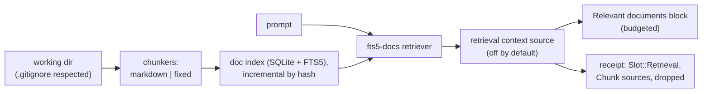

# Workspace document retrieval: spec

Branch `feat/doc-retrieval`, stacked on `feat/fts5-recall` (PR G). Plan: `docs/plans/pluggable-context-implementation.md`, PR G2. Design: `docs/research/pluggable-context-memory-2026-11.md` §4.4 (Retrieval traits) and §4.7 (chunkers, lexical).

## Problem

Hone's index holds code symbols only. Markdown notes, READMEs, design docs and plain-text files can't be retrieved, so a non-coding agent (research notes, meeting notes, a docs folder) gets no context from them unless the model goes looking with `grep`. The plan's `[retrieval]` slot has nothing behind it.

## Rows

| Row | Behaviour |
|---|---|
| R1 | **Traits.** `hone-index` gains `Document { uri, text, sha256 }`, `Chunk { id, doc_uri, start_line, end_line, heading: Option<String>, text, sha256 }`, `Hit { source: SourceRef, text, score }`, `trait Chunker { id(); chunk(&Document) -> Vec<Chunk> }` and `#[async_trait] trait Retriever { id(); retrieve(query, k) -> Result<Vec<Hit>> }`. |
| R2 | **`markdown` chunker.** Splits at headings (`#`–`######`, outside fenced code blocks); each chunk carries its heading path (`Setup > Linux`). A section longer than 60 lines splits further at blank lines into pieces of at most 60 lines. Front matter is skipped. Chunk ids are stable: `<path>#<start_line>`. |
| R3 | **`fixed` chunker.** Windows of `lines` lines (default 40) overlapping by `overlap` (default 5); used for `.txt`, `.rst`, `.org` and any file the markdown chunker doesn't take. |
| R4 | **Document index.** A SQLite database next to the code index (`~/.local/share/hone/docs.db`, keyed by working directory) with files (path, sha256, mtime), chunks and an FTS5 table over chunk text and heading. Indexing walks the working directory respecting `.gitignore` and `.honeignore`, takes `*.md`, `*.markdown`, `*.txt`, `*.rst`, `*.org`, skips files over 1 MiB and hidden directories, stops at 5,000 files, and is incremental: unchanged files (same mtime and size, else same hash) aren't re-chunked; deleted files are removed. `HONE_DISABLE_PERSISTENT_STORES=1` and `--ephemeral` use an in-memory index. |
| R5 | **`fts5-docs` retriever.** Builds the query with the same tokenizer as PR G's `fts5` recaller (prompt syntax never interpreted), ranks with `bm25()` over text and heading (heading weighted 2×), and returns hits with `SourceRef::Chunk { index: "docs", chunk_id, sha256 }`, the chunk text and the score. |
| R6 | **`retrieval` context source, off by default.** When `[context] sources` includes `retrieval`, each turn (cadence `EachTurn`) the index is brought up to date (bounded to 2 s; on timeout it uses what's indexed) and the top `[retrieval] top_k` hits (default 3) for the user's prompt are added as one system message, `# Relevant documents`, each hit headed by `path:start-end` and its heading path, after the skills block. Hits that don't fit `[retrieval] max_tokens` (default 1,200) are dropped whole. No hits → no block. The block is redacted. |
| R7 | **Receipts.** A `Retrieval` block with strategy `fts5-docs`, params `{"chunker":…,"max_tokens":…,"top_k":…}`, Chunk sources with scores, and the budget-cut hits in `dropped`. |
| R8 | **Config.** `[retrieval]` gains `top_k` (1–20), `max_tokens` (100–8,000), `chunker` (`markdown` or `fixed` as the default for markdown files; `.txt`-style files always use `fixed`) and `[retrieval.fixed] lines`/`overlap`. A project file may only lower `top_k` and `max_tokens`. `hone strategies` lists the retriever and chunkers. Unknown keys and names are errors. |

## Testing notes

- **R2/R3** as pure functions on fixture texts (headings inside code fences, front matter, long sections, CRLF).
- **R4** on temp directories: `.gitignore`, size and count caps, incremental reindex (count chunker calls), deletions.
- **R5** ranking on a fixed corpus; FTS5 syntax in prompts.
- **R6/R7** through a real agent with the scripted provider and a temp working dir of notes.
- **R8** in `hone-config` and the `hone strategies` CLI.

## Out of scope

- Embeddings and hybrid retrieval (PR H), rerankers (PR I), code chunks by symbol body.
- Turning `retrieval` on by default; that needs an eval report.
