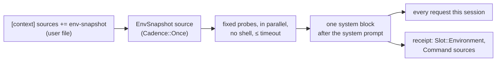

# `env-snapshot` context source: spec

Branch `feat/env-snapshot`, stacked on `feat/strategy-registry` (PR D). Plan: `docs/plans/pluggable-context-implementation.md`, PR E. Design: `docs/research/pluggable-context-memory-2026-11.md` §4.7. Source: Meta-Harness Appendix B.3, the "environment bootstrap" that was the TerminalBench-2 harness's one additive gain (7 of 89 tasks).

## Problem

An agent's first turns are often spent discovering where it is: which OS, what's in the working directory, which languages and package managers are installed. The paper's best harness gathered this once, before the first model call, with a 15-second budget and silent failure. Hone has no such source, and it's the first new built-in that proves PR D's `ContextSource` seam works.

## Rows

| Row | Behaviour |
|---|---|
| E1 | **Off by default.** It runs only when `[context] sources` includes `env-snapshot`. Since a project file can only narrow `sources`, only the user file (or a flag/env added later) can turn it on. With it off, requests are byte-identical to PR D's (golden fixture). |
| E2 | **What it gathers.** One block, in this order, with lines omitted when a probe fails: • `OS: <os> <arch>` (from Rust's `std::env::consts`, plus the kernel release from `uname -r` on unix); • `Working directory: <path>`; • `Top-level entries:` the working directory's entries, sorted, directories suffixed `/`, hidden entries skipped, at most 50 (then `… and N more`); • `Toolchains:` for each of `rustc`, `cargo`, `python3`, `node`, `npm`, `go`, `java`, `ruby`, `deno`, `bun`, `uv`, `pip3`, `poetry`, `pnpm`, `yarn`, `git`, `make`, `cmake`, `docker` that is on `PATH`, its first line of `--version` output (`java -version` for java), trimmed to 120 characters; • `Memory: <N> GiB` (total RAM; `sysctl -n hw.memsize` on macOS, `/proc/meminfo` on Linux). The block starts with a `# Environment` header. |
| E3 | **No shell, read-only, bounded.** Each probe runs as a fixed argv (never `sh -c`, never anything from the prompt or the repository), with stdin closed, in the working directory, in parallel. Each probe has a 3-second timeout and is killed (with its process group on unix) when it expires; the whole snapshot finishes within `timeout_secs` (default 15). The directory listing and OS lines are computed in Rust. |
| E4 | **Fails silently.** A missing binary, a non-zero exit, a timeout or unreadable output omits that line. If nothing at all is gathered, no block is added. The turn never fails because of the snapshot, and nothing is printed to the user. |
| E5 | **Gathered once, placed stably.** It's gathered before the first model call of the session (cadence `Once`) and reused unchanged on every request: one system-role message right after the base system prompt, before "Relevant Memories" and the skills block, so the prompt-cache prefix stays stable. |
| E6 | **Redacted.** The block passes through the session's redaction before it's sent, like injected skeletons. |
| E7 | **Receipts.** Each request's receipt has an `Environment` block (a new `Slot` variant, `environment` on the wire) with strategy `env-snapshot`, its tokens, and one `Command { argv, sha256 }` source per probe that contributed a line (the hash is of that probe's output), plus `Command { argv: ["<builtin:listing>"], … }` for the directory listing. `params_sha256` hashes `{"timeout_secs":N}`. |
| E8 | **Configurable.** `[context.env-snapshot] timeout_secs` (1–60, default 15; a project file may only lower it) is shown by `hone strategies`, where `env-snapshot` appears as a built-in source. An out-of-range value is a config error. |

## Testing notes

- **E2/E3/E4** with a temp working directory and a `PATH` pointing at a temp dir of fake executables (scripts that print a version, sleep past the timeout, or exit non-zero). Pin a constructor that takes the probe list or the `PATH` so tests don't depend on the machine.
- **E5/E7** through a real `Agent` with the scripted provider: the block's position in every request of a 2-turn session, unchanged across calls; the receipt block.
- **E1** reuses PR B's golden fixture.
- **E8** in `hone-config` and the `hone strategies` CLI test.

## Out of scope

- Probing the network, GPU or running services.
- Refreshing the snapshot mid-session.
- Turning it on by default; that waits for an eval comparison (PR F).
