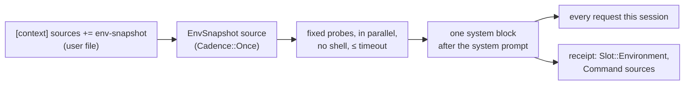

# `env-snapshot` context source: spec

Branch `feat/env-snapshot`, stacked on `feat/strategy-registry` (PR D). Plan: `docs/plans/pluggable-context-implementation.md`, PR E. Design: `docs/research/pluggable-context-memory-2026-11.md` §4.7. Source: Meta-Harness Appendix B.3, the "environment bootstrap" that was the TerminalBench-2 harness's one additive gain (7 of 89 tasks).

## Problem

An agent's first turns are often spent discovering where it is: which OS, what's in the working directory, which languages and package managers are installed. The paper's best harness gathered this once, before the first model call, with a 15-second budget and silent failure. Hone has no such source, and it's the first new built-in that proves PR D's `ContextSource` seam works.

## Rows

| Row | Behaviour |
|---|---|
| E1 | **Off by default.** It runs only when `[context] sources` includes `env-snapshot`. Since a project file can only narrow `sources`, only the user file (or a flag/env added later) can turn it on. With it off, requests are byte-identical to PR D's (golden fixture). |
| E2 | **What it gathers.** One block, in this order, with lines omitted when a probe fails: • `OS: <os> <arch>` (from Rust's `std::env::consts`, plus the kernel release from `uname -r` on unix); • `Working directory: <path>`; • `Top-level entries:` the working directory's entries, sorted, directories suffixed `/`, hidden entries skipped, at most 50 (then `… and N more`); • `Toolchains:` for each of `rustc`, `cargo`, `python3`, `node`, `npm`, `go`, `java`, `ruby`, `deno`, `bun`, `uv`, `pip3`, `poetry`, `pnpm`, `yarn`, `git`, `make`, `cmake`, `docker` that is on `PATH`, its first line of `--version` output (`java -version` for java), trimmed to 120 characters; • `Memory: <N> GiB` (total RAM; `sysctl -n hw.memsize` on macOS, `/proc/meminfo` on Linux). The block starts with a `# Environment` header. |
| E3 | **No shell, read-only, bounded.** Each probe runs as a fixed argv (never `sh -c`, never anything from the prompt or the repository), with stdin closed, in the working directory, in parallel. Each probe has a 3-second timeout and is killed (with its process group on unix) when it expires; the whole snapshot finishes within `timeout_secs` (default 15). The directory listing and OS lines are computed in Rust. |
| E4 | **Fails silently.** A missing binary, a non-zero exit, a timeout or unreadable output omits that line. If nothing at all is gathered, no block is added. The turn never fails because of the snapshot, and nothing is printed to the user. |
| E5 | **Gathered once, placed stably.** It's gathered before the first model call of the session (cadence `Once`) and reused unchanged on every request: one system-role message right after the base system prompt, before "Relevant Memories" and the skills block, so the prompt-cache prefix stays stable. |
| E6 | **Redacted.** The block passes through the session's redaction before it's sent, like injected skeletons. |
| E7 | **Receipts.** Each request's receipt has an `Environment` block (a new `Slot` variant, `environment` on the wire) with strategy `env-snapshot`, its tokens, and one `Command { argv, sha256 }` source per probe that contributed a line (the hash is of that probe's output), plus `Command { argv: ["<builtin:listing>"], … }` for the directory listing. `params_sha256` hashes `{"timeout_secs":N}`. |
| E8 | **Configurable.** `[context.env-snapshot] timeout_secs` (1–60, default 15; a project file may only lower it) is shown by `hone strategies`, where `env-snapshot` appears as a built-in source. An out-of-range value is a config error. |

### Review round 1 (E9–E20)

The review reproduced that probes ran repository-controlled code (`.yarnrc` `yarn-path`, `packageManager` pins fetched by pnpm, `rust-toolchain.toml` triggering rustup downloads) and repo binaries through relative `PATH` entries, which E3 forbids.

| Row | Behaviour |
|---|---|
| E9 | **Probes don't run in the repository.** Each probe's working directory is a fresh empty temporary directory (removed afterwards), never the working directory, so repository files can't redirect a toolchain. |
| E10 | **Probes get a minimal, hardened environment.** Only `PATH` (filtered, E11), `HOME`, `LANG`/`LC_ALL`, `TMPDIR`/`TEMP`/`TMP`, `SYSTEMROOT` (Windows) and these fixed settings: `YARN_IGNORE_PATH=1`, `RUSTUP_AUTO_INSTALL=0`, `GOTOOLCHAIN=local`, `COREPACK_ENABLE_NETWORK=0`, `COREPACK_ENABLE_DOWNLOAD_PROMPT=0`, `npm_config_manage_package_manager_versions=false`. In particular `JAVA_TOOL_OPTIONS`, `_JAVA_OPTIONS` and `JDK_JAVA_OPTIONS` never reach a probe. |
| E11 | **Only absolute PATH entries outside the working directory are searched.** Empty, relative (`.`, `node_modules/.bin`) and in-working-directory entries are skipped, and each probe is spawned by its absolute path. On Windows, candidates are tried with `PATHEXT` extensions, and extensionless files are skipped. |
| E12 | **Listing names can't inject text.** Each listed name has control characters escaped (`\u{…}`) and is cut to 80 characters with `…`; the whole block is capped at 6,000 characters (lines past the cap are dropped and replaced by `… (truncated)`). |
| E13 | **Lines carry versions, not noise.** The java line is the first line containing ` version "`; `go` is probed as `go version`; on macOS the OS line adds the product version from `sw_vers -productVersion`. |
| E14 | **`$HOME` is shown as `~`.** In the working-directory line and in probe output, a leading home-directory prefix is replaced with `~`. |
| E15 | **The whole snapshot is bounded by `timeout_secs`.** The listing runs off the async runtime (`spawn_blocking`), stops reading after 5,000 entries (`… and more`), and the whole gather (listing and probes) is cut at `timeout_secs`; each probe's own limit is `min(3 s, timeout_secs)`. |
| E16 | **No probe process outlives the snapshot.** After every probe finishes, times out, or its future is dropped, the probe's process group is killed (unix), so a probe that forks a detached child, or whose child holds stdout open, leaves nothing running. |
| E17 | **The emergency check counts gathered blocks.** The context-emergency (95%) check includes the tokens of gathered source blocks, so a large environment block can't push a request past the budget with tools still on. |
| E18 | **Gathering doesn't hold up the turn.** Once sources are gathered concurrently with memory recall; each source has a deadline (`timeout_secs` + 1 s for env-snapshot; 5 s for others); a cancelled turn (events channel closed) stops waiting; a failing source is logged at debug level and skipped. |
| E19 | **Once blocks stay ahead of EachTurn blocks** in the prompt regardless of their order in `sources`, so the cached prefix stays stable. |
| E20 | **Small fixes.** The default timeout is one constant used everywhere; a gathered source's every block keeps its own slot in receipts. |

### Review round 2 (E21–E25)

| Row | Behaviour |
|---|---|
| E21 | **The probes' temp dir is never in the repository.** The parent for the probe directory is canonicalised; if `TMPDIR` is relative or resolves inside the working directory, the OS default temp location is used instead (`/tmp` on unix). Probes get that absolute directory as `TMPDIR`. |
| E22 | **Interrupts stop probes.** Probe process groups are registered with Hone's running-command registry for as long as they run, so SIGINT, SIGTERM and every other exit path that stops commands (`kill_running_commands`) also stop probes. |
| E23 | **The listing is data, not prose.** The top-level entries are rendered as one JSON array of strings (`Top-level entries (JSON): ["Cargo.toml","src/",…]`), each name escaped and cut as in E12, so a file name can't read as an instruction line in the system message. |
| E24 | **Running from home or root keeps the user's toolchains.** The "PATH entry inside the working directory" filter applies only when the working directory is neither `$HOME` nor `/` (nor an ancestor of `$HOME`); in those cases PATH entries are filtered only for being relative or empty. |
| E25 | **`~` replaces the home prefix before lines are cut**, so a long line still shows `~`. |

## Testing notes

- **E2/E3/E4** with a temp working directory and a `PATH` pointing at a temp dir of fake executables (scripts that print a version, sleep past the timeout, or exit non-zero). Pin a constructor that takes the probe list or the `PATH` so tests don't depend on the machine.
- **E5/E7** through a real `Agent` with the scripted provider: the block's position in every request of a 2-turn session, unchanged across calls; the receipt block.
- **E1** reuses PR B's golden fixture.
- **E8** in `hone-config` and the `hone strategies` CLI test.

## Out of scope

- Probing the network, GPU or running services.
- Refreshing the snapshot mid-session.
- Turning it on by default; that waits for an eval comparison (PR F).
