# `hone eval` runs real agents and compares strategy profiles: spec

Branch `feat/eval-profiles`, stacked on `feat/env-snapshot` (PR E). Plan: `docs/plans/pluggable-context-implementation.md`, PR F. Design: `docs/research/pluggable-context-memory-2026-11.md` §4.6.

## Problem

`hone eval` can't measure anything about context or memory, and today it can't run a real task either:
- `EvalRunner::run_one` (`crates/hone-eval/src/runner.rs`) builds an `AgentConfig` with an empty `ToolRegistry`, no memory, no index and `inject_context: false`, so the agent can't read or edit a file.
- Its model id is the literal `eval:mock`, which a real provider rejects; `cmd_eval` only builds Anthropic or OpenAI providers, so local models (Ollama on wk-system) can't be used.
- Tasks share and mutate their working directory, there are no repeats, and the report has no confidence intervals.

Phase 4 merges each new strategy "with its eval report", and the Meta-Harness paper's lesson is that harness changes need measuring on small, hard task sets one slot at a time. That needs this PR.

```mermaid
%%{init: {"themeVariables": {"fontSize": "13px"}, "flowchart": {"nodeSpacing": 25, "rankSpacing": 30, "padding": 8}, "sequence": {"actorMargin": 30, "messageMargin": 25, "boxMargin": 6}, "gantt": {"barHeight": 16, "barGap": 3}}}%%
flowchart LR
  T["tasks.toml<br/>tasks + [profiles.*]"] --> X["expand: profiles × tasks × repeats<br/>(--ablate: one slot varied)"]
  X --> W["fresh copy of the task dir<br/>+ memory fixture"]
  W --> A["real agent: CLI builder,<br/>tools, sandbox, strategies"]
  A --> C["success check"]
  A --> R["run dir: outcome, receipts,<br/>transcript, check output"]
  C --> R
  R --> REP["report: pass rate + Wilson CI,<br/>cost, context tokens, Pareto,<br/>paired vs base"]
```

## Rows

| Row | Behaviour |
|---|---|
| F1 | **A task runs a real agent.** Each run builds its agent with the same builder as a one-shot `hone` run: the built-in tools, sandbox and permission rules, the index for the run's directory, the strategy selection (PR D), receipts on. The model is `--model`, else the tasks file's `model`, else the resolved default model. Any provider the one-shot CLI supports works, including `ollama:`. Turns are auto-approved (`--yes` semantics); `deny` permission rules still apply. |
| F2 | **Runs don't share state.** Each run gets a fresh temporary copy of the task's `working_dir` (skipping `target/` and `node_modules/`; `.git/` is copied so git-based checks work), a fresh memory store loaded from the task's `memory_fixture` (a JSONL file of memories, or none), and its own session. The copy is deleted after the run unless `--keep-workdirs`. The success check runs in the copy. |
| F3 | **Profiles.** A tasks file may define `[profiles.<name>]` tables whose contents use the `[context]` / `[memory]` schema of `config.toml`, validated by the same parser (unknown keys and names are errors naming the file and profile). `[eval] base_profile` names the baseline (default: a built-in `default` profile = no overrides). `--profile NAME` (repeatable) selects profiles; without it every profile runs. A profile is applied over the user's config like a project file would be, except it may also widen (it's the evaluator's own file). |
| F4 | **Repeats and order.** `--repeats N` (or `[eval] repeats`, default 1) runs each (profile, task) N times. Runs are ordered task-major and interleave profiles (task 1 × all profiles, then task 2, …) so drift in a remote model affects profiles evenly. `--jobs N` (default 1) runs that many in parallel. |
| F5 | **`--ablate SLOT`.** Generates profiles from the base profile by varying only `SLOT` (`context.skeleton`, `context.compactor`, `context.graduated.phase`, `memory.recaller`, `context.sources:<name>` toggling one source) across its built-in values. It can be combined with `--profile` only to pick the base. |
| F6 | **`--check`.** Validates the tasks file, every profile, every `working_dir` and `memory_fixture`, and that the model's provider is configured, without any model call. Prints a summary (tasks × profiles × repeats = runs) and exits 0, or prints the errors and exits 2. |
| F7 | **Run directories.** Output goes to `<out>/<run-id>/` (`run-id` = UTC timestamp plus a short hash of the tasks file), with `manifest.json` (hone version and git SHA, model, profiles with their resolved strategy ids, tasks file hash, repeats, start/end) and, per run, `<profile>/<task>/r<k>/` holding `outcome.json`, `receipts.json` (all context receipts of the run), `transcript.json` (the session messages, redacted) and `check.txt` (the check's stdout/stderr and exit code). |
| F8 | **Outcome.** Per run: status (`pass`, `fail`, `timeout`, `agent_error`, `infra_error` for a failed copy or fixture load), duration, input/output/cache tokens and cost from the turn's usage, model calls (number of receipts), context tokens (sum over receipts of their blocks' tokens), and the check's exit code. A timeout kills the agent's commands and MCP servers. |
| F9 | **Report.** `report.json` and `report.md` in the run directory. Per profile: runs, passes, pass rate with a Wilson 95% interval, mean and median cost, mean context tokens, mean model calls, and timeouts and errors counted separately (they're failures in the pass rate). A Pareto column marks profiles not dominated on (pass rate ↑, mean cost ↓) and on (pass rate ↑, mean context tokens ↓). For each non-base profile, a paired comparison with the base over the tasks both ran: per-task pass-rate difference, tasks better / worse / tied, and a 95% bootstrap interval (10,000 resamples of tasks, fixed seed) for the mean difference. |
| F10 | **History.** Each finished run directory is recorded in the existing eval history store with its profile summaries, so `RegressionBisector::compare` keeps working on the base profile. |

### Added with the starter suite (F11)

| Row | Behaviour |
|---|---|
| F11 | **Checks know where the suite lives, and fixtures are JSONL memories.** The success check runs with the run's working-directory copy as its current directory and with `EVAL_SUITE_DIR` set to the absolute path of the tasks file's directory **in the check's process environment only** (never `set_var` in the runner: the agent runs in-process and its shell would inherit it), and the copy lives outside the repository (the system temp dir), so a check can be `sh "$EVAL_SUITE_DIR/checks/<id>.sh"` and keep its data outside the working directory. Paths in the tasks file (`working_dir`, `memory_fixture`) are relative to the tasks file. A `memory_fixture` is JSONL, one `hone_memory::Memory` object per line, where `id`, `kind` and `content` are required and other fields default; a malformed line is an `infra_error` naming the file and line. |

### Review round 1 (F12–F24)

| Row | Behaviour |
|---|---|
| F12 | **A copy never shares git state with the original.** When the task directory is a git worktree (`.git` is a `gitdir:` file) or inside one, the copy gets an independent repository at the same `HEAD` with the same working-tree contents (committed and uncommitted), so `git commit`, `git checkout` or branch moves in the copy never reach the original. If that can't be set up, the run is `infra_error` with a message; a copy whose git commands reach the original is never used. A `.git` directory copied as a directory is already independent. |
| F13 | **Agent-CLI models are refused.** `claude-cli:` and `gemini-cli:` models run their own tools outside Hone's sandbox, permission rules and working directory, so `hone eval` (including `--check`) rejects them with exit 2 and a message, consistent with hermetic runs. |
| F14 | **Interrupts clean up.** On SIGINT or SIGTERM, `hone eval` stops every running agent's commands (process groups), removes every live working-directory copy, marks unfinished runs `interrupted` in their `outcome.json`, writes `report.json`/`report.md` for what finished (with `ended_at` and an `interrupted: true` flag in the manifest), and exits 130 (SIGINT) or 143 (SIGTERM). A second signal exits immediately after killing commands. |
| F15 | **Runs recall like the CLI.** Each run's memory store is a `SqliteStore` on a temp file (deleted with the run), loaded from the fixture, so exclusions apply before the top-k cap and ties order as in the CLI. |
| F16 | **Ablation varies one slot over the effective base.** `--ablate` builds the base from the user's config plus the base profile, then changes only the ablated slot; values equal to the base aren't generated as variants. |
| F17 | **`--check` checks what a run would use.** It resolves every profile over the user's config (an invalid user value is reported), requires a model (`--model`, the tasks file's `model`, or the resolved default), and exits 2 on any error. A run whose every outcome is `infra_error` exits non-zero. |
| F18 | **Unknown keys in the tasks file are errors.** `[[tasks]]`, `[eval]` and profile tables reject unknown keys, naming the file and key. |
| F19 | **Symlinks can't write through.** A symlink in the task directory whose target is outside the task directory (absolute, or relative escaping it) makes the run `infra_error` naming the link; links inside the task directory are recreated as links in the copy. FIFOs, sockets and devices are skipped with a note in `check.txt`. |
| F20 | **Echoed config values are escaped.** Profile config errors use the same escaping as PR D's S12 (no raw control characters). |
| F21 | **Copies are cheaper and bounded.** The copy respects the task directory's `.gitignore` (keeping `.git`), skips `target/` and `node_modules/` only at the top level, uses copy-on-write cloning where the filesystem supports it (APFS `clonefile`, Linux reflink), and warns once per task when a copy exceeds 200 MB. |
| F22 | **Small correctness fixes.** `--repeats 0` is an error; `--profile` with `--ablate` other than one base profile is an error; a run that panics is recorded as `agent_error`, not dropped; profile and task names are sanitised before becoming path components (`..`, `/`, control characters rejected); on timeout or agent error, tokens are taken from the session usage like the cost. |
| F23 | **The manifest says what ran.** It records hone's build version and git SHA (from build metadata), the suite's git SHA separately, and the values of environment variables that change runs (`HONE_AUDIT_LOG`, `HONE_CONTEXT_WINDOW`, `HONE_POLICY_BUILTINS`, `HONE_PHASE_COMPACTION`). |
| F24 | **Docs.** `docs/eval.md` explains: repeats aren't independent samples (the per-profile interval is per run; the paired comparison resamples tasks); HONE.md files above the task directory aren't loaded; shell commands that need approval in a one-shot run need it in eval too; and that cost depends on the provider reporting usage and on model pricing. Docs only. |

### Added from the suite review (F25)

| Row | Behaviour |
|---|---|
| F25 | **A check's processes die with it.** The runner starts each success check in its own process group, kills the group when the check times out and after it finishes, so a check (or code it runs) that leaves background processes behind leaves nothing running. |

### Review round 2 (F26–F30)

| Row | Behaviour |
|---|---|
| F26 | **A task inside a larger repository gets only its own files.** When the task directory is a subdirectory of a git repository or worktree (not its root), the copy gets a fresh git repository with the task's files committed as one initial commit, so the agent sees the same thing wherever the suite is checked out; a task directory that is a repository root keeps its own history (F12). |
| F27 | **It builds on Windows.** Signal handling in `eval_cmd.rs` is `#[cfg(unix)]`, with a `ctrl_c` fallback elsewhere. |
| F28 | **The SHA is current.** The build script re-runs when the resolved branch ref changes (`refs/heads/<branch>` or `packed-refs`), not only `HEAD`. The manifest's `git_sha` field is removed (`hone_git_sha` and `suite_git_sha` remain). |
| F29 | **Interrupted runs are complete in the report.** Runs that never started because of an interrupt are listed as `interrupted` in the manifest's outcomes. Config error text keeps newlines readable (escaped control characters except `\n`, rendered as separate indented lines). |
| F30 | **Limits are documented.** `docs/eval.md` says a check that starts a new session (`setsid`) escapes the process-group kill, and that a copied `.git` directory's `core.worktree` is cleared and submodules aren't linked in copies. The copy clears `core.worktree` in a copied `.git/config`. |

## Testing notes

- **F1/F2/F8** through `EvalRunner` with a scripted mock provider that calls tools (`write_file` then reply), a temp tasks dir, and a success check (`test -f out.txt`). Check isolation: two runs of a task that appends to a file each see the original.
- **F3–F6** parsing and expansion as pure functions; CLI tests for `--check` exit codes.
- **F7** directory layout and manifest fields.
- **F9** statistics as pure functions with known values (Wilson interval for 7/10; a bootstrap interval with a fixed seed is deterministic; Pareto marking).
- No test calls a real model.

## Out of scope

- The 20-task starter suite (follow-up PR F2: tasks, fixtures and checks, including non-coding tasks).
- Running a comparison: that costs model calls, or wk-system time with a local model, and waits for the user.
- `hone eval search` (Phase 5).
