# `hone eval` runs real agents and compares strategy profiles: spec

Branch `feat/eval-profiles`, stacked on `feat/env-snapshot` (PR E). Plan: `docs/plans/pluggable-context-implementation.md`, PR F. Design: `docs/research/pluggable-context-memory-2026-11.md` §4.6.

## Problem

`hone eval` can't measure anything about context or memory, and today it can't run a real task either:
- `EvalRunner::run_one` (`crates/hone-eval/src/runner.rs`) builds an `AgentConfig` with an empty `ToolRegistry`, no memory, no index and `inject_context: false`, so the agent can't read or edit a file.
- Its model id is the literal `eval:mock`, which a real provider rejects; `cmd_eval` only builds Anthropic or OpenAI providers, so local models (Ollama on wk-system) can't be used.
- Tasks share and mutate their working directory, there are no repeats, and the report has no confidence intervals.

Phase 4 merges each new strategy "with its eval report", and the Meta-Harness paper's lesson is that harness changes need measuring on small, hard task sets one slot at a time. That needs this PR.

```mermaid
%%{init: {"themeVariables": {"fontSize": "13px"}, "flowchart": {"nodeSpacing": 25, "rankSpacing": 30, "padding": 8}, "sequence": {"actorMargin": 30, "messageMargin": 25, "boxMargin": 6}, "gantt": {"barHeight": 16, "barGap": 3}}}%%
flowchart LR
  T["tasks.toml<br/>tasks + [profiles.*]"] --> X["expand: profiles × tasks × repeats<br/>(--ablate: one slot varied)"]
  X --> W["fresh copy of the task dir<br/>+ memory fixture"]
  W --> A["real agent: CLI builder,<br/>tools, sandbox, strategies"]
  A --> C["success check"]
  A --> R["run dir: outcome, receipts,<br/>transcript, check output"]
  C --> R
  R --> REP["report: pass rate + Wilson CI,<br/>cost, context tokens, Pareto,<br/>paired vs base"]
```

## Rows

| Row | Behaviour |
|---|---|
| F1 | **A task runs a real agent.** Each run builds its agent with the same builder as a one-shot `hone` run: the built-in tools, sandbox and permission rules, the index for the run's directory, the strategy selection (PR D), receipts on. The model is `--model`, else the tasks file's `model`, else the resolved default model. Any provider the one-shot CLI supports works, including `ollama:`. Turns are auto-approved (`--yes` semantics); `deny` permission rules still apply. |
| F2 | **Runs don't share state.** Each run gets a fresh temporary copy of the task's `working_dir` (skipping `target/` and `node_modules/`; `.git/` is copied so git-based checks work), a fresh memory store loaded from the task's `memory_fixture` (a JSONL file of memories, or none), and its own session. The copy is deleted after the run unless `--keep-workdirs`. The success check runs in the copy. |
| F3 | **Profiles.** A tasks file may define `[profiles.<name>]` tables whose contents use the `[context]` / `[memory]` schema of `config.toml`, validated by the same parser (unknown keys and names are errors naming the file and profile). `[eval] base_profile` names the baseline (default: a built-in `default` profile = no overrides). `--profile NAME` (repeatable) selects profiles; without it every profile runs. A profile is applied over the user's config like a project file would be, except it may also widen (it's the evaluator's own file). |
| F4 | **Repeats and order.** `--repeats N` (or `[eval] repeats`, default 1) runs each (profile, task) N times. Runs are ordered task-major and interleave profiles (task 1 × all profiles, then task 2, …) so drift in a remote model affects profiles evenly. `--jobs N` (default 1) runs that many in parallel. |
| F5 | **`--ablate SLOT`.** Generates profiles from the base profile by varying only `SLOT` (`context.skeleton`, `context.compactor`, `context.graduated.phase`, `memory.recaller`, `context.sources:<name>` toggling one source) across its built-in values. It can be combined with `--profile` only to pick the base. |
| F6 | **`--check`.** Validates the tasks file, every profile, every `working_dir` and `memory_fixture`, and that the model's provider is configured, without any model call. Prints a summary (tasks × profiles × repeats = runs) and exits 0, or prints the errors and exits 2. |
| F7 | **Run directories.** Output goes to `<out>/<run-id>/` (`run-id` = UTC timestamp plus a short hash of the tasks file), with `manifest.json` (hone version and git SHA, model, profiles with their resolved strategy ids, tasks file hash, repeats, start/end) and, per run, `<profile>/<task>/r<k>/` holding `outcome.json`, `receipts.json` (all context receipts of the run), `transcript.json` (the session messages, redacted) and `check.txt` (the check's stdout/stderr and exit code). |
| F8 | **Outcome.** Per run: status (`pass`, `fail`, `timeout`, `agent_error`, `infra_error` for a failed copy or fixture load), duration, input/output/cache tokens and cost from the turn's usage, model calls (number of receipts), context tokens (sum over receipts of their blocks' tokens), and the check's exit code. A timeout kills the agent's commands and MCP servers. |
| F9 | **Report.** `report.json` and `report.md` in the run directory. Per profile: runs, passes, pass rate with a Wilson 95% interval, mean and median cost, mean context tokens, mean model calls, and timeouts and errors counted separately (they're failures in the pass rate). A Pareto column marks profiles not dominated on (pass rate ↑, mean cost ↓) and on (pass rate ↑, mean context tokens ↓). For each non-base profile, a paired comparison with the base over the tasks both ran: per-task pass-rate difference, tasks better / worse / tied, and a 95% bootstrap interval (10,000 resamples of tasks, fixed seed) for the mean difference. |
| F10 | **History.** Each finished run directory is recorded in the existing eval history store with its profile summaries, so `RegressionBisector::compare` keeps working on the base profile. |

## Testing notes

- **F1/F2/F8** through `EvalRunner` with a scripted mock provider that calls tools (`write_file` then reply), a temp tasks dir, and a success check (`test -f out.txt`). Check isolation: two runs of a task that appends to a file each see the original.
- **F3–F6** parsing and expansion as pure functions; CLI tests for `--check` exit codes.
- **F7** directory layout and manifest fields.
- **F9** statistics as pure functions with known values (Wilson interval for 7/10; a bootstrap interval with a fixed seed is deterministic; Pareto marking).
- No test calls a real model.

## Out of scope

- The 20-task starter suite (follow-up PR F2: tasks, fixtures and checks, including non-coding tasks).
- Running a comparison: that costs model calls, or wk-system time with a local model, and waits for the user.
- `hone eval search` (Phase 5).
