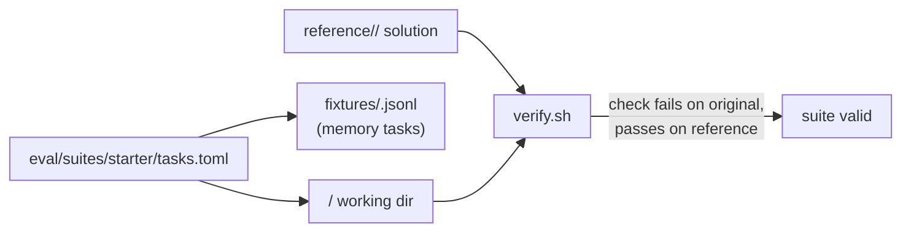

# Eval starter suite: spec

Branch `feat/eval-starter-suite`, stacked on `feat/eval-profiles` (PR F). Plan: `docs/plans/pluggable-context-implementation.md`, PR F (second part). Format: `docs/plans/eval-profiles-spec.md`.

## Goal

A small, hard-enough, offline task suite that `hone eval` (PR F) can run under different strategy profiles. Every task has a deterministic check, and every check is verified without a model: it must fail on the untouched task directory and pass on a reference solution.

## Rows

| Row | Behaviour |
|---|---|
| T1 | **Layout.** `eval/suites/starter/tasks.toml` (PR F's format: `[[tasks]]` with `id`, `prompt`, `success_check`, `working_dir`, optional `memory_fixture`, `timeout_secs`), one working directory per task under `eval/suites/starter/<id>/`, memory fixtures under `fixtures/`, and reference solutions under `reference/<id>/` (files that overwrite the working copy). References and fixtures sit outside every working directory, so the agent never sees them. |
| T2 | **20 tasks in four groups.** • 8 coding: small Rust, Python and JavaScript projects; fix a bug, add a function with a test, a refactor that keeps tests green. Checks run the project's own tests (offline, no dependency downloads: Python stdlib `unittest`, Node built-in `node --test`, Rust with no external crates). • 4 memory: the needed fact (a naming convention, a port number, a preferred date format, a reviewer's rule) is only in the task's memory fixture; the check verifies it was applied. • 4 non-coding: summarise local notes into a file that must contain listed facts; extract a markdown table to CSV; rename files to a convention; fill a config from a meeting note. Checks compare exact outputs or grep for required facts. • 4 context/retrieval: a 40–80 file project where the prompt describes behaviour in plain English and the change belongs in one file the prompt doesn't name; the check verifies the right file changed and the wrong ones didn't. |
| T3 | **Checks are deterministic and offline.** Each check is a POSIX shell command or script in the task directory's parent (not inside the working dir), finishes in under 30 s, needs no network, and depends only on `sh`, coreutils, `python3`, `node` or `cargo` as the task's group needs. |
| T4 | **`eval/suites/starter/verify.sh`.** For every task: copy the working dir to a temp dir, run the check (must exit non-zero), overlay the reference, run the check again (must exit 0). It prints one line per task and exits non-zero if any task fails either condition, or if `tasks.toml` lists a task without a directory, check or reference (or a reference without a task). Tasks whose toolchain is missing are reported as skipped, not passed. |
| T5 | **A Rust test runs `verify.sh`** (in `hone-eval`'s tests), skipping when `sh` is unavailable; it fails if any task fails. |
| T6 | **README.** `eval/suites/starter/README.md` lists the tasks, their groups, what each measures, and how to run the suite under two profiles (`hone eval eval/suites/starter/tasks.toml --profile default --profile no-inject --repeats 3`), and says that runs cost model calls or local-model time. |

## Out of scope

- Running the suite against a model.
- SWE-bench-style tasks (that's `benchmarks/harness-compare`).
