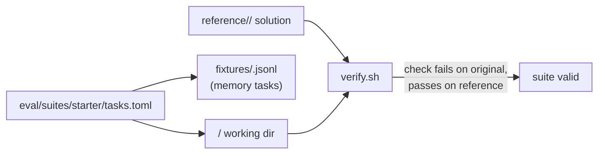

# Eval starter suite: spec

Branch `feat/eval-starter-suite`, stacked on `feat/eval-profiles` (PR F). Plan: `docs/plans/pluggable-context-implementation.md`, PR F (second part). Format: `docs/plans/eval-profiles-spec.md`.

## Goal

A small, hard-enough, offline task suite that `hone eval` (PR F) can run under different strategy profiles. Every task has a deterministic check, and every check is verified without a model: it must fail on the untouched task directory and pass on a reference solution.

## Rows

| Row | Behaviour |
|---|---|
| T1 | **Layout.** `eval/suites/starter/tasks.toml` (PR F's format: `[[tasks]]` with `id`, `prompt`, `success_check`, `working_dir`, optional `memory_fixture`, `timeout_secs`), one working directory per task under `eval/suites/starter/<id>/`, memory fixtures under `fixtures/`, and reference solutions under `reference/<id>/` (files that overwrite the working copy). References and fixtures sit outside every working directory, so the agent never sees them. |
| T2 | **20 tasks in four groups.** • 8 coding: small Rust, Python and JavaScript projects; fix a bug, add a function with a test, a refactor that keeps tests green. Checks run the project's own tests (offline, no dependency downloads: Python stdlib `unittest`, Node built-in `node --test`, Rust with no external crates). • 4 memory: the needed fact (a naming convention, a port number, a preferred date format, a reviewer's rule) is only in the task's memory fixture; the check verifies it was applied. • 4 non-coding: summarise local notes into a file that must contain listed facts; extract a markdown table to CSV; rename files to a convention; fill a config from a meeting note. Checks compare exact outputs or grep for required facts. • 4 context/retrieval: a 40–80 file project where the prompt describes behaviour in plain English and the change belongs in one file the prompt doesn't name; the check verifies the right file changed and the wrong ones didn't. |
| T3 | **Checks are deterministic and offline.** Each check is a POSIX shell command or script in the task directory's parent (not inside the working dir), finishes in under 30 s, needs no network, and depends only on `sh`, coreutils, `python3`, `node` or `cargo` as the task's group needs. |
| T4 | **`eval/suites/starter/verify.sh`.** For every task: copy the working dir to a temp dir, run the check (must exit non-zero), overlay the reference, run the check again (must exit 0). It prints one line per task and exits non-zero if any task fails either condition, or if `tasks.toml` lists a task without a directory, check or reference (or a reference without a task). Tasks whose toolchain is missing are reported as skipped, not passed. |
| T5 | **A Rust test runs `verify.sh`** (in `hone-eval`'s tests), skipping when `sh` is unavailable; it fails if any task fails. |
| T6 | **README.** `eval/suites/starter/README.md` lists the tasks, their groups, what each measures, and how to run the suite under two profiles (`hone eval eval/suites/starter/tasks.toml --profile default --profile no-inject --repeats 3`), and says that runs cost model calls or local-model time. |

## Out of scope

- Running the suite against a model.
- SWE-bench-style tasks (that's `benchmarks/harness-compare`).

## Review round 2 (T7–T12)

Review reproduced six ways to pass coding checks without fixing anything, all through files the agent leaves in its working copy: a `unittest.py` / `unittest/__main__.py` shadowing the stdlib; an `UNCHECKED_HASH` `.pyc` of a gutted test in `__pycache__`; the module under test disarming `assertEqual` / `node:assert`; a `.cargo/config.toml` `runner = "true"`; a `build.rs` rewriting the tests; and `EVAL_SUITE_DIR` visible to agent code.

| Row | Behaviour |
|---|---|
| T7 | **Checks run in a fresh directory.** Each coding check copies only an allowlist of solution files (per task, e.g. `stats.py`, `src/**/*.rs`) from the agent's copy into a fresh temp directory, adds the pristine tests and project files from `checks/data/<id>/`, and runs there. Nothing else from the agent's copy (`.cargo/`, `build.rs`, `__pycache__`, shadow modules, symlinks) reaches the run. |
| T8 | **Interpreters run isolated.** Python runs with `-I` and a fresh `PYTHONPYCACHEPREFIX`; `EVAL_SUITE_DIR` is unset before any agent code runs; Node runs with no `NODE_OPTIONS`/`NODE_PATH`. |
| T9 | **Behaviour is probed out of process.** c01, c02, c04, c05, c07 and c08 each add one probe with held-out inputs (not in the test file), run in a separate process that only imports the solution, so in-process assertion patching can't pass the check. |
| T10 | **Every cheat above is a guarded self-test.** Each becomes a `checks/cheats/<id>/<name>/` entry that `verify.sh` must see rejected. |
| T11 | **The watchdog kills the whole check.** Each check runs in its own process group (where available) and a timeout kills the group, or the watchdog is awaited rather than killed mid-recursion; a check that spawns background sleepers leaves nothing running after a timeout, on macOS and Linux (dash). |
| T12 | **n01's size cap uses the suite's notes.** The cap is computed from the pristine `n01-summarise-notes/notes/`, not the agent's copy. The README notes that c03/c06 helpers must be module-level bindings looked up at call time, and T5 requires 0 skipped tasks for every installed toolchain. |

## Review round 3 (T13–T17)

Review reproduced that 19 of 20 checks pass without the task being solved: agent code exits 0 at import or load (`os._exit(0)`, `process.exit(0)`, `std::process::exit(0)`), shadows a stdlib module used by a `python3 -` check from the copy's cwd, or forges the probe's output from the expected values passed in argv; and agent code under the probe learned the suite path and rewrote `checks/lib/probe_compare.py`.

| Row | Behaviour |
|---|---|
| T13 | **No pass is ever taken from a process that runs agent code.** Each check's verdict comes from a parent that runs no agent code (`python3 -I`, or sh/coreutils), with its cwd outside the copy. Agent code runs only in a child that gets inputs on stdin and prints one JSON output per case; the parent requires an output for every case and compares against expectations the child never sees (not in its argv, environment, cwd or files it can reach). The project's own tests (unittest, `node --test`, `cargo test`) still run but are advisory: a failing test fails the check, a passing one proves nothing on its own. |
| T14 | **Check assets are private and read-only.** Before running, each check copies what it needs (probe inputs, comparison script, pristine tests) into a fresh private temp directory made read-only, and expected values are kept only in the parent process (or as hashes in files the child can't read). The suite's path never appears in a child's argv, environment or cwd. |
| T15 | **Every reproduced forgery is a guarded self-test:** exit at import (Python, Node), `process::exit` in a Rust solution, a probe output forged from inputs, a stdlib shadow in the copy's cwd, and rewriting check files. `verify.sh` must see each rejected. |
| T16 | **Probes only test stated behaviour.** c05's `chunk([1], 1.5)` and c02's underscore case are dropped from the probes or stated in the task prompt and tests; every probe case is implied by the prompt or the visible tests. |
| T17 | **Residual risk is documented.** The README says eval agents run in a copy but aren't sandboxed from reading the rest of the disk, so a determined agent could find the suite; it recommends running suites from a location the model isn't told about and treating results as measurements, not proofs. |

## Review round 4 (T18–T22)

Review reproduced that agent code running as the same user finds the suite through its parent process (the judge's command line names it; the outer shell's environment holds `EVAL_SUITE_DIR`), then reads expectations from `checks/specs/` or rewrites `judge.py` so every later task passes; and that a process escaping into its own session hangs a check (the judge waits for pipe EOF with no deadline).

| Row | Behaviour |
|---|---|
| T18 | **Expectations reveal nothing.** Spec files store, per case, a salted SHA-256 of the canonical expected result (salt per case, stored beside it), not the result itself; the judge hashes the child's canonical output and compares. Reading a spec gives no answer. |
| T19 | **The judge doesn't name the suite.** Each check copies its judge and assets into a private temp directory and `exec`s the judge from there with `EVAL_SUITE_DIR` removed from the environment (`exec env -u EVAL_SUITE_DIR …`), so no process an agent child can inspect carries the suite path in its argv or environment. |
| T20 | **Tampering invalidates the run.** `verify.sh`, and `hone eval` when the tasks file sets `[eval] integrity = ["checks", "reference"]` (the starter suite does), record a hash of those directories before the run and re-check after every check; any change marks the remaining and the current runs `infra_error` with "suite modified during the run". |
| T21 | **Escaped processes can't hang a check.** After the direct child exits or times out, the judge stops reading (closes its pipe ends, or drains with a short deadline) and every `communicate`/wait has a timeout; a check whose solution leaves a session-escaped process holding the pipes finishes within its timeout plus 2 s. |
| T22 | **New self-tests and an honest limit.** The ancestor-`ps` forgery, the judge rewrite and a pipe-holding session escape are self-tests that must be rejected (the rewrite detected by T20). The README states the remaining limit: agent code running as your user can read any file your user can, including `reference/`; run suites on a machine or account where that matters, or treat results as measurements of cooperative models, not proofs. |
