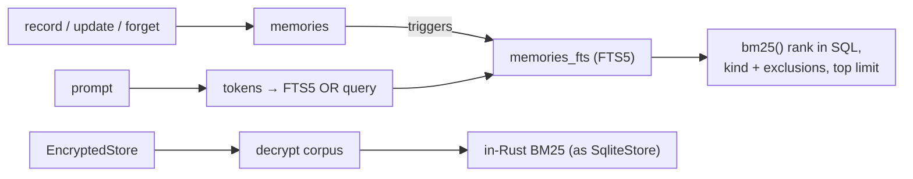

# FTS5 memory recall, and ranked recall for encrypted stores: spec

Branch `feat/fts5-recall`, stacked on `feat/eval-profiles` (PR F). Plan: `docs/plans/pluggable-context-implementation.md`, PR G (first part; the workspace document index is the second). Design: `docs/research/pluggable-context-memory-2026-11.md` §4.7.

## Problem

1. **Recall ranks in Rust over a capped corpus.** Since #101, `SqliteStore` loads the newest 5,000 memories (after kind filters) and ranks them with an in-Rust BM25. A relevant memory older than the newest 5,000 is never found, and every turn reads up to 5,000 rows.
2. **Encrypted stores get no "Relevant Memories".** `EncryptedStore::recall` (`crates/hone-memory/src/encrypted.rs`) decrypts every memory and keeps those whose content contains the *whole query* as a substring, so a prompt almost never matches. This predates #101.

SQLite's FTS5 is compiled into the bundled SQLite (`libsqlite3-sys` sets `SQLITE_ENABLE_FTS5`), so an indexed, uncapped ranking needs no new dependency.

## Rows

| Row | Behaviour |
|---|---|
| G1 | **An FTS5 index mirrors the memories.** `SqliteStore` keeps an FTS5 table over memory content (a plain FTS5 table whose rowids a mapping table `memories_fts_map` ties to the memory ids, kept in sync by triggers on insert, update of `content` or `description`, and delete). Opening a store creates it if missing and rebuilds it when its row count differs from `memories`. This is not a schema version change (v4 stays reserved for the ledger). Existing databases are indexed on first open. |
| G2 | **`fts5` recaller.** A built-in recaller `fts5` (PR D's `[memory] recaller`) ranks with FTS5's `bm25()` in SQL, applies the kind filter and excluded kinds in the same query, and returns the top `top_k` with no corpus cap. A relevant memory older than 6,000 newer unrelated ones is found. The prompt is turned into an FTS5 query from its word tokens (letters, digits, `_`; at least 3 characters; English stop words dropped; at most 32), each quoted as a string and OR-ed, so FTS5 syntax in a prompt (`"`, `*`, `NEAR`, `-`, `:`) is never interpreted. A prompt with no usable tokens returns nothing. Scores are `-bm25()` (higher is better). |
| G3 | **Ranking quality matches today's BM25 on the same corpus.** On a fixed corpus of memories and queries, `fts5`'s top result equals the in-Rust `bm25` recaller's top result for every query where both return something, and each returns only memories sharing at least one token with the query. |
| G4 | **Receipts and strategies.** Receipts name the strategy `fts5` with params `{"exclude":[…],"limit":N}`. `hone strategies` lists `fts5` as a built-in recaller. The default stays `bm25` until an eval report (PR F) says otherwise. |
| G5 | **Encrypted stores rank too.** `EncryptedStore::recall` with a non-empty query decrypts the newest memories (up to the same 5,000 cap, after the kind filter and exclusions) and ranks them with the same BM25 as `SqliteStore`, returning the top `limit`. So a prompt that shares words with an encrypted memory recalls it. An empty query lists as today. `recall_excluding` applies exclusions before the cap. |
| G6 | **`fts5` with an encrypted store falls back.** FTS5 can't index ciphertext, so choosing `recaller = "fts5"` with `--encrypted-memory` uses `bm25` instead, with one warning on stderr and in `hone strategies`; receipts name `bm25`. |
| G7 | **`hone memory reindex`.** Rebuilds the FTS5 index and prints the number of memories indexed. A store without the FTS5 table gains it. |

### Parity and robustness (G8–G10)

Found while implementing G1–G7.

| Row | Behaviour |
|---|---|
| G8 | **Non-English words match.** The prompt's tokens are split on any character that isn't a Unicode letter or digit (as the in-Rust BM25's `tokenize` does), not on `[A-Za-z0-9_]`, so `zażółć gęślą jaźń`, `café` and `Zürich` are kept whole and match memories containing them (FTS5's `unicode61` tokenizer, with diacritics folding left at its default, also matches `cafe`). The 3-character minimum counts characters, not bytes. |
| G9 | **The index doesn't depend on row numbers.** The FTS5 rowids are mapped to memory ids by `memories_fts_map` and the triggers are keyed on `id`, so a `VACUUM` or any rowid renumbering can't misalign it. Opening a store whose index disagrees with `memories` (count or ids) rebuilds it. |
| G10 | **Decay weight scales the score, as `bm25` does.** The `fts5` score is `-bm25() × weight`, so a decayed memory ranks below an equally matching fresh one, and G3's top-result parity holds on a corpus with mixed weights. |

### Review round 1 (G11–G19)

Review measured that G9's id-keyed table makes every trigger delete scan the whole FTS table: the daily decay on open took 25.7 s at 10,000 memories (quadratic; other processes' writes timed out meanwhile), single writes took 11–44 ms at 50,000, and concurrent opens failed 1 time in 6 on trigger re-creation.

| Row | Behaviour |
|---|---|
| G11 | **Writes cost the same at any store size.** The FTS table is keyed through a mapping table (`memory id → FTS rowid`, unique on both), so triggers delete by FTS rowid; the update trigger fires only when `content` or `description` change, not on `weight`. Measured bounds (release, tests may use generous margins): `record`, replace and `forget` of one memory stay under 5 ms at 50,000 memories; a decay pass over 10,000 memories (opening with the daily decay due) finishes in under 1 s. Rowid renumbering of `memories` still can't misalign the index (G9). |
| G12 | **Concurrent opens never fail.** All FTS setup (table, mapping table, triggers, consistency check and rebuild) runs inside one `BEGIN IMMEDIATE` transaction, and triggers are created only when missing or when their stored SQL differs from the current definition, not dropped and recreated on every open. Two stores opening the same database at the same time both succeed, every time. |
| G13 | **`fts5` and `bm25` agree on what a word is.** Both tokenizers split on non-(Unicode letter or digit), lowercase, and fold diacritics of Latin letters the same way (NFD, their combining marks removed, so `kąt`→`kat` and `café`→`cafe` in both; `ł` stays `ł` in both, as in unicode61; other scripts keep their marks, see G19). The FTS5 query keeps tokens of 2 or more characters that aren't stop words, removes duplicates, and when there are more than 32 keeps the 32 rarest (by document frequency in the index), not the first 32. G3's top-result parity holds on queries with 2-letter words, accents and prompts of up to 32 distinct usable words; with more, `fts5` uses the 32 rarest and `bm25` all of them, so their top results can differ (G23). |
| G14 | **Reindexing is atomic.** `hone memory reindex` / `reindex_fts` rebuilds inside one transaction; a concurrent recall never sees an empty or doubled index. |
| G15 | **Encrypted recall is cheaper.** `EncryptedStore`'s inner store doesn't maintain an FTS index (its content is ciphertext), and ranked recall doesn't load embeddings for the whole corpus, only for the memories it returns. |
| G16 | **Forgotten text leaves the index.** The FTS table uses `secure-delete`, so a forgotten memory's tokens are no longer present in the index's stored data. |
| G17 | **Failures fall back, visibly.** A recaller error is logged as a warning and the turn falls back to `bm25`; `fts5` on a store with no index uses `bm25` (with real scores). `hone strategies` shows the encrypted fallback as chosen by `--encrypted-memory`. |
| G18 | **Docs match.** Spec row G1 and test headers describe the mapping-table design; `docs/configuration.md` notes that `memory.db` then needs an SQLite build with FTS5 for external tools that write to it. |

### Review round 2 (G19–G24)

| Row | Behaviour |
|---|---|
| G19 | **Folding leaves non-Latin scripts intact.** Diacritics are removed only from Latin base letters (the letters `unicode61` folds); text is recomposed to NFC afterwards, so Hangul syllables, kana with voicing marks (`パ`, `バ`), Devanagari vowel signs and virama, and Thai marks are kept. The FTS table uses `unicode61 remove_diacritics 2`, and the Rust side folds Vietnamese letters with two diacritics the same way. Queries in Korean (`한국어`), Japanese (`データベース`), Hindi (`हिन्दी`), Vietnamese (`Việt`, `phở`) and Thai find their memories with both `fts5` and `bm25`, and `パス` doesn't match `バス` or `ハス`. |
| G20 | **Scale is checked structurally, not by wall-clock.** The FTS write path's delete statements search the mapping table by id and the FTS table by rowid (`EXPLAIN QUERY PLAN`), a weight-only update doesn't touch the index, and the median delete-by-id cost at 50,000 memories stays within 5× of the cost at 1,000. Absolute timings move to an `#[ignore]`d perf test. |
| G21 | **Encrypted memories keep a compatible format and compact vectors.** Content stays `enc:v1` (readable by older binaries). An embedding is stored encrypted as a binary blob in the embedding column (a marker byte, nonce, ciphertext of little-endian f32s), decrypted only for memories being returned or scored semantically; ranked lexical recall doesn't decrypt vectors. Rows already written as `enc:v2:` (from earlier builds of this branch) still decrypt. Existing `enc:v1` rows with a plaintext embedding column are re-encrypted once on open. An older binary reading a new row sees its content and treats the blob as no embedding (no crash). The CHANGELOG documents the format. |
| G22 | **An encrypted store never gets an FTS index.** `open_without_fts` drops any FTS table, mapping table and triggers it finds (inside one `BEGIN IMMEDIATE`), and a plain `open` of a database holding the encryption sentinel skips FTS setup, so `hone memory …` subcommands and other plain opens don't reinstate it. |
| G23 | **The parity claim matches what's built.** For prompts with more than 32 distinct usable tokens, `fts5` uses the 32 rarest and `bm25` all of them, so their top results may differ; the spec and docs say so. |
| G24 | **Small fixes.** `hone strategies` names the encrypted fallback's origin `--encrypted-memory`; `bm25::tokenize` uses the shared folding tokenizer (its doc stays true); doc comments and test headers describe the mapping-table design. |

### Review round 3 (G25–G28)

| Row | Behaviour |
|---|---|
| G25 | **A wrong passphrase changes no memory, vector or key check.** `EncryptedStore::new` verifies the passphrase before any migration or write: by a key-check value stored with the salt sentinel (written on first use, or created from a successful trial decryption of an existing `enc:v1` row), or, if neither exists, by trial-decrypting an `enc:v1` row. A wrong passphrase returns an error and modifies nothing. Opening wrong-then-right leaves every embedding intact. |
| G26 | **Sealed vectors are recognised reliably.** The embedding blob starts with an 8-byte magic (`E1 48 4F 4E 45 56 31 00`, "\xE1HONEV1\0") instead of one byte. The one-time migration reads `id, embedding` directly and decides by magic plus a successful trial decryption, so a legacy plaintext vector that happens to start with `0xE1` is still re-encrypted. Blobs from earlier builds of this branch (1-byte marker) still decrypt. |
| G27 | **Older binaries degrade safely, and the docs say exactly how.** The sealed blob's length is chosen so an older Hone's embedding decoder rejects it (treating the memory as having no embedding) rather than reading a bogus vector — verified against `main`'s decoder; if no such length exists, the CHANGELOG states precisely what an older binary does (a debug build may panic in semantic recall; a release build scores those memories 0) and recommends not downgrading. |
| G28 | **Small fixes.** `hone strategies` maps the encrypted-memory fallback's origin explicitly (not "any flag on `memory.recaller`"); `docs/configuration.md` notes that encrypted semantic recall scores the newest 1,024 memories and that opening an encrypted store reads every row once (the migration check). |

### Review round 4 (G29–G34)

Review found: two concurrent first opens of a fresh encrypted DB corrupt it (each generates a salt; the sentinel is written after Argon2; last writer wins) — 40/40 runs, a regression from main; the trial-decrypt path for DBs without a key check is untested (a mutation removing it survives); every open re-reads every row with embeddings (1.6 s at 50k rows without embeddings, ~3 s with); a magic-prefixed blob that fails to decrypt is re-sealed as if plaintext. Storing sealed vectors in the `embedding` column is the root of the magic/older-binary problems, so this round moves them out.

| Row | Behaviour |
|---|---|
| G29 | **Sealed vectors live in their own table.** `EncryptedStore` stores each embedding sealed (nonce + AES-GCM ciphertext of LE f32s) in a side table `memory_vectors_sealed(id TEXT PRIMARY KEY, blob BLOB NOT NULL)` (created if absent; not a schema-version change), and leaves `memories.embedding` NULL for encrypted rows. Forgetting or replacing a memory removes its sealed vector. An older Hone binary reading the database sees no embedding for those memories — no bogus vector, no panic. |
| G30 | **Migration is targeted and safe.** On open (after G31's verification), rows with `content LIKE 'enc:v1:%'` and a non-NULL `embedding` are migrated: plaintext vectors and blobs from earlier builds of this branch (8-byte magic or 1-byte marker) are decrypted or read, sealed into the side table, and the column set to NULL. Selection is in SQL, so opens with nothing to migrate don't read embeddings. A blob from an earlier build that fails to decrypt is never treated as plaintext: it's left in place, skipped with a warning, and read as no embedding. |
| G31 | **Concurrent first opens are safe.** The salt sentinel is written insert-if-absent before deriving the key, then re-read, and the key is derived from the stored salt; the key check is written insert-if-absent and verified after writing. Two first opens of a fresh DB with the same passphrase both succeed and every row written by either is readable; with different passphrases exactly one succeeds. |
| G32 | **Verification without a key check is tested and robust.** Opening a DB whose sentinel has no key check (as `main` writes it) with a wrong passphrase errors and changes no memory or vector; trial decryption tries up to 5 encrypted rows and accepts if any decrypts; a sentinel-only DB pins the first passphrase used and prints a notice saying so. |
| G33 | **Claims are accurate.** Error text, spec G25 and the CHANGELOG say that a wrong passphrase changes no memory, vector or key check (schema setup, the daily decay and FTS removal may still run, as they don't depend on the passphrase). The CHANGELOG describes the side table and that older binaries see no embedding. |
| G34 | **No sealed-blob heuristics remain.** `looks_sealed` and the listing special-cases are removed; listings are plain again. |

### Review round 5 (G35–G40)

Review approved the side-table design (concurrent first opens 40/40 safe; opens about 30 ms at 50k rows; `origin/main` sees no embedding). It found:
- **A wrong passphrase can be pinned (R4-M1).** The trial sample is the newest 1,000 rows. With 1,000 newer plaintext rows (plain runs on the same database, which ES7 documents), a wrong passphrase is accepted and pinned, vectors are sealed under it, and the right passphrase is locked out.
- **Writes through custom stores fail after writing (R4-M2).** The `set_sealed_vector` default errors even for `None`, after `record` has written the row. The other defaults silently degrade, including non-atomic `record_if_absent`, which reopens C1 for wrappers.
- **Stale sealed vectors survive a replacement (m1).** A replacement written by an older binary or a plain store doesn't fire the AFTER DELETE trigger, so the old sealed vector survives.
- **Notices are invisible (m2).** The pin notice and skip warnings don't show without `RUST_LOG`.
- **Migration and hygiene (m3, m4).** Migration runs one transaction per row with every candidate loaded at once, plus doc hygiene.
- **Merge hazards with `fix/encrypted-store-safety`.** They include a duplicate `record_if_absent`, and description encryption silently lost on merge.

| Row | Behaviour |
|---|---|
| G35 | **Verification samples encrypted rows directly.** The trial-decrypt sample is chosen by a direct query for encrypted rows (`content LIKE 'enc:v1:%' AND id != sentinel LIMIT 5`, the same pattern as ES4's `has_encrypted_rows`). A passphrase is pinned only when no encrypted row exists. Scenario: a `main`-format database with 3 encrypted rows that have vectors, plus 1,000 or more newer plaintext rows. A wrong passphrase errors with a full snapshot unchanged; the right one then works. |
| G36 | **Sealed-vector storage is an explicit capability.** The atomic and sealed-vector operations live in an extension trait with no defaults (for example `SealedVectorStore`: `record_if_absent`, `set_description_if_absent`, `record_sealed(memory, Option<blob>)` that writes the row and its sealed vector in one transaction, `sealed_vector`, `vector_migration_candidates`, `move_vector_to_sealed`). `EncryptedStore<S>` requires it. `SqliteStore` and `InMemoryStore` implement it. A store without it can't be wrapped, which is a compile error, not a runtime failure after a write. `record` never reports an error after the row was written. |
| G37 | **A sealed vector belongs to its row.** Vectors are sealed with AES-GCM associated data made of the memory id and the row's content ciphertext. A sealed vector whose row was replaced outside `EncryptedStore` (an older binary, a plain store, `INSERT OR REPLACE` without the trigger) fails to open and reads as no embedding. A blob moved to another id reads as none too. |
| G38 | **Notices are visible.** `EncryptedStore::new` reports what it did: a first passphrase was pinned, or N vectors were migrated or skipped. The CLI prints these to stderr whatever `RUST_LOG` says. |
| G39 | **Migration is batched, and the docs are tidy.** Migration runs in chunks of about 500 rows per transaction and doesn't load every candidate at once. Fix `open_without_fts`'s doc, remove the stale `keep_encrypted_embedding` doc, say in G25 what may change (schema, decay, FTS drop) and what doesn't, mark G26/G27 as superseded by G29, and add `#[must_use]` consistently. |
| G40 | **The branch builds on the encrypted-store safety fix.** It is rebased onto `fix/encrypted-store-safety`, with these combined: |
|  | - one `record_if_absent`; |
|  | - descriptions encrypted in G's `record` (ES2's tests pass); |
|  | - ES4's `has_encrypted_rows` used when the sentinel is created; |
|  | - ES's `pub SALT_SENTINEL_ID` and its forget/decay guards alongside G's trigger; |
|  | - one CHANGELOG/docs account of what `--encrypted-memory` covers. |
|  | The key check in the sentinel's description is skipped by any description pass. |

## Testing notes

- **G1/G2/G7** on temp SQLite stores: inserts, updates (`record` is `INSERT OR REPLACE`), `forget`, reopening an old database without the FTS table, FTS5 syntax in prompts, 6,000-row corpora.
- **G3** with a fixed corpus of 30–50 memories and 10 queries in a test fixture.
- **G4/G6** through the registry and an agent with the scripted provider.
- **G5** on an `EncryptedStore` over a temp store.

## Out of scope

- The workspace document index (markdown and fixed chunkers, `[retrieval]`), PR G's second part.
- Making `fts5` the default.
