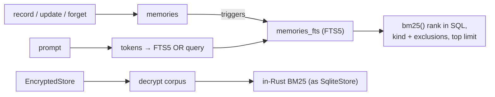

# FTS5 memory recall, and ranked recall for encrypted stores: spec

Branch `feat/fts5-recall`, stacked on `feat/eval-profiles` (PR F). Plan: `docs/plans/pluggable-context-implementation.md`, PR G (first part; the workspace document index is the second). Design: `docs/research/pluggable-context-memory-2026-11.md` §4.7.

## Problem

1. **Recall ranks in Rust over a capped corpus.** Since #101, `SqliteStore` loads the newest 5,000 memories (after kind filters) and ranks them with an in-Rust BM25. A relevant memory older than the newest 5,000 is never found, and every turn reads up to 5,000 rows.
2. **Encrypted stores get no "Relevant Memories".** `EncryptedStore::recall` (`crates/hone-memory/src/encrypted.rs`) decrypts every memory and keeps those whose content contains the *whole query* as a substring, so a prompt almost never matches. This predates #101.

SQLite's FTS5 is compiled into the bundled SQLite (`libsqlite3-sys` sets `SQLITE_ENABLE_FTS5`), so an indexed, uncapped ranking needs no new dependency.

## Rows

| Row | Behaviour |
|---|---|
| G1 | **An FTS5 index mirrors the memories.** `SqliteStore` keeps an FTS5 table over memory content (external content on `memories`, kept in sync by triggers on insert, update and delete). Opening a store creates it if missing and rebuilds it when its row count differs from `memories`. This is not a schema version change (v4 stays reserved for the ledger). Existing databases are indexed on first open. |
| G2 | **`fts5` recaller.** A built-in recaller `fts5` (PR D's `[memory] recaller`) ranks with FTS5's `bm25()` in SQL, applies the kind filter and excluded kinds in the same query, and returns the top `top_k` with no corpus cap. A relevant memory older than 6,000 newer unrelated ones is found. The prompt is turned into an FTS5 query from its word tokens (letters, digits, `_`; at least 3 characters; English stop words dropped; at most 32), each quoted as a string and OR-ed, so FTS5 syntax in a prompt (`"`, `*`, `NEAR`, `-`, `:`) is never interpreted. A prompt with no usable tokens returns nothing. Scores are `-bm25()` (higher is better). |
| G3 | **Ranking quality matches today's BM25 on the same corpus.** On a fixed corpus of memories and queries, `fts5`'s top result equals the in-Rust `bm25` recaller's top result for every query where both return something, and each returns only memories sharing at least one token with the query. |
| G4 | **Receipts and strategies.** Receipts name the strategy `fts5` with params `{"exclude":[…],"limit":N}`. `hone strategies` lists `fts5` as a built-in recaller. The default stays `bm25` until an eval report (PR F) says otherwise. |
| G5 | **Encrypted stores rank too.** `EncryptedStore::recall` with a non-empty query decrypts the newest memories (up to the same 5,000 cap, after the kind filter and exclusions) and ranks them with the same BM25 as `SqliteStore`, returning the top `limit`. So a prompt that shares words with an encrypted memory recalls it. An empty query lists as today. `recall_excluding` applies exclusions before the cap. |
| G6 | **`fts5` with an encrypted store falls back.** FTS5 can't index ciphertext, so choosing `recaller = "fts5"` with `--encrypted-memory` uses `bm25` instead, with one warning on stderr and in `hone strategies`; receipts name `bm25`. |
| G7 | **`hone memory reindex`.** Rebuilds the FTS5 index and prints the number of memories indexed. A store without the FTS5 table gains it. |

### Parity and robustness (G8–G10)

Found while implementing G1–G7.

| Row | Behaviour |
|---|---|
| G8 | **Non-English words match.** The prompt's tokens are split on any character that isn't a Unicode letter or digit (as the in-Rust BM25's `tokenize` does), not on `[A-Za-z0-9_]`, so `zażółć gęślą jaźń`, `café` and `Zürich` are kept whole and match memories containing them (FTS5's `unicode61` tokenizer, with diacritics folding left at its default, also matches `cafe`). The 3-character minimum counts characters, not bytes. |
| G9 | **The index doesn't depend on row numbers.** The FTS5 table stores the memory `id` (unindexed) and is kept in sync by triggers keyed on `id`, so a `VACUUM` or any rowid renumbering can't misalign it. Opening a store whose index disagrees with `memories` (count or ids) rebuilds it. |
| G10 | **Decay weight scales the score, as `bm25` does.** The `fts5` score is `-bm25() × weight`, so a decayed memory ranks below an equally matching fresh one, and G3's top-result parity holds on a corpus with mixed weights. |

### Review round 1 (G11–G19)

Review measured that G9's id-keyed table makes every trigger delete scan the whole FTS table: the daily decay on open took 25.7 s at 10,000 memories (quadratic; other processes' writes timed out meanwhile), single writes took 11–44 ms at 50,000, and concurrent opens failed 1 time in 6 on trigger re-creation.

| Row | Behaviour |
|---|---|
| G11 | **Writes cost the same at any store size.** The FTS table is keyed through a mapping table (`memory id → FTS rowid`, unique on both), so triggers delete by FTS rowid; the update trigger fires only when `content` or `description` change, not on `weight`. Measured bounds (release, tests may use generous margins): `record`, replace and `forget` of one memory stay under 5 ms at 50,000 memories; a decay pass over 10,000 memories (opening with the daily decay due) finishes in under 1 s. Rowid renumbering of `memories` still can't misalign the index (G9). |
| G12 | **Concurrent opens never fail.** All FTS setup (table, mapping table, triggers, consistency check and rebuild) runs inside one `BEGIN IMMEDIATE` transaction, and triggers are created only when missing or when their stored SQL differs from the current definition, not dropped and recreated on every open. Two stores opening the same database at the same time both succeed, every time. |
| G13 | **`fts5` and `bm25` agree on what a word is.** Both tokenizers split on non-(Unicode letter or digit), lowercase, and fold diacritics the same way (NFD, combining marks removed, so `kąt`→`kat` and `café`→`cafe` in both; `ł` stays `ł` in both, as in unicode61). The FTS5 query keeps tokens of 2 or more characters that aren't stop words, removes duplicates, and when there are more than 32 keeps the 32 rarest (by document frequency in the index), not the first 32. G3's top-result parity holds on queries with 2-letter words, accents and prompts longer than 32 words. |
| G14 | **Reindexing is atomic.** `hone memory reindex` / `reindex_fts` rebuilds inside one transaction; a concurrent recall never sees an empty or doubled index. |
| G15 | **Encrypted recall is cheaper.** `EncryptedStore`'s inner store doesn't maintain an FTS index (its content is ciphertext), and ranked recall doesn't load embeddings for the whole corpus, only for the memories it returns. |
| G16 | **Forgotten text leaves the index.** The FTS table uses `secure-delete`, so a forgotten memory's tokens are no longer present in the index's stored data. |
| G17 | **Failures fall back, visibly.** A recaller error is logged as a warning and the turn falls back to `bm25`; `fts5` on a store with no index uses `bm25` (with real scores). `hone strategies` shows the encrypted fallback as chosen by `--encrypted-memory`. |
| G18 | **Docs match.** Spec row G1 and test headers describe the mapping-table design; `docs/configuration.md` notes that `memory.db` then needs an SQLite build with FTS5 for external tools that write to it. |

## Testing notes

- **G1/G2/G7** on temp SQLite stores: inserts, updates (`record` is `INSERT OR REPLACE`), `forget`, reopening an old database without the FTS table, FTS5 syntax in prompts, 6,000-row corpora.
- **G3** with a fixed corpus of 30–50 memories and 10 queries in a test fixture.
- **G4/G6** through the registry and an agent with the scripted provider.
- **G5** on an `EncryptedStore` over a temp store.

## Out of scope

- The workspace document index (markdown and fixed chunkers, `[retrieval]`), PR G's second part.
- Making `fts5` the default.
