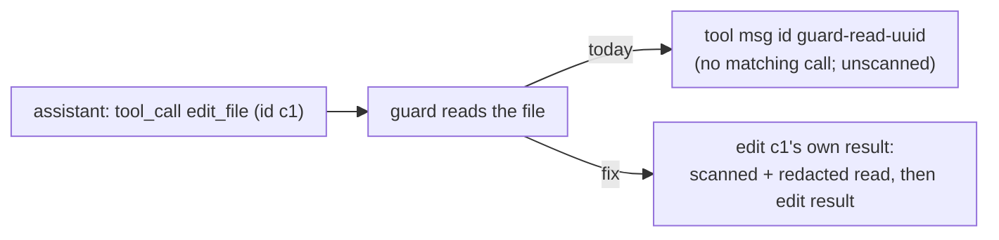

# Read-before-edit guard: scan its read and stop inventing tool ids — spec

**Date:** 2026-11-09 · **Branch:** `fix/guard-read-injection-scan` · **Found by:** PR #79 review

## 1. The problems

When the model edits a file it hasn't read this turn, the guard (`agent.rs`, "Guard 1:
Must-read-before-edit") calls `read_file` itself and adds the content to the history as a
tool-result message with a **made-up id** (`guard-read-<uuid>`). Then the edit runs as usual.

1. **No injection scan, no audit entry.** Successful results go through
   `scan_for_injection` (metric, egress risk label, SECURITY prefix) and an egress entry. The guard's
   read gets neither, although repository files can be attacker-written. (Redaction does apply:
   `tool_result_message(redact, …)`.)
2. **An id the model never issued.** The Anthropic adapter turns every tool message into a
   `tool_result` block with that `tool_use_id`; OpenAI-compatible adapters send it as `tool_call_id`.
   Both APIs document that a tool result must answer a tool call in the preceding assistant message,
   so this likely makes the next request fail (unverified live: no API key here; local vLLM does not
   validate ids). The guard's read tracking resets every turn, so in multi-turn sessions it fires
   often.

## 2. Contract

| # | Requirement | Test |
|---|---|---|
| G1 | **No invented ids.** The guard never adds a tool-role message whose id the model didn't issue. Its read is delivered inside the **edit call's own tool result**, as a block **after** the call's own result (`(guard: auto-read '<path>' before edit)` + content; see G6), on every path where that call gets a result in this iteration (ran, tool error, denied, skipped) | Model edits an unread file → in the provider's next request, every tool-role message's id is one of the tool-call ids of the preceding assistant message, and the edit call's result contains the file content |
| G2 | **Injection scan.** The guard's read goes through `scan_for_injection("read_file", …)`: metric, SECURITY prefix in front of the read block when flagged | File with injection-like text → the edit's result carries the SECURITY prefix immediately before the guard line |
| G3 | **Redaction** (unchanged in effect, now on the folded text): a secret in the file is redacted in what the model receives | File containing a secret (built at runtime) → not present in the next request |
| G4 | **Audit.** The guard's read records an egress entry (`tool: read_file`, preview of the redacted content, injection label) | `--audit`-style egress log contains the guard read with the label when flagged |

Unchanged: the guard still runs after hooks and the policy gate and only reads when the policy
allows it; a failed guard read is still skipped silently; the edit runs as before.

## 3. Out of scope

Running the guard's read through `PreToolUse`/`PostToolUse` hooks (none are loaded by any binary).

## 4. Review round 1: required changes

| # | Finding | Requirement | Test |
|---|---|---|---|
| G5 | **B1** Guard 3 (edit streak) still adds a tool message with an invented id (`guard-edit-streak-<uuid>`) on the 3rd consecutive edit in a turn, between real tool results | Its hint is delivered inside the triggering edit call's own result (a trailing note), through the same mechanism; no tool-role message with an id the model didn't issue remains anywhere in `agent.rs` | Three sequential edits in one turn → every tool-role id in the next request answers a call of the preceding assistant message; the hint text is inside the third edit's result |
| G6 | Compression (`context.rs` `structural_summary`, first ~200 chars of old tool messages) would cut an older guarded edit's own outcome, because the read leads | Order inside the folded result: the call's own result (with its own SECURITY prefix / redaction note) **first**, then the guard read block (SECURITY prefix, if flagged, immediately before the guard line), then the Guard 3 hint | G1 tests: the edit's own result precedes the guard line; G2: SECURITY immediately precedes the guard line |
| G7 | A guard block left set by a cancelled turn can attach to a later call with the same id (repeating ids: Ollama fallback `call_{name}`, test scripts) | Clear the pending guard block at the start of `run_turn` / `run_turn_content` and in `cancel_pending_calls` | Turn 1: guard reads, then the edit is cancelled at its approval prompt (event receiver closed); turn 2: a call with the same id gets a result → it contains no guard block |
