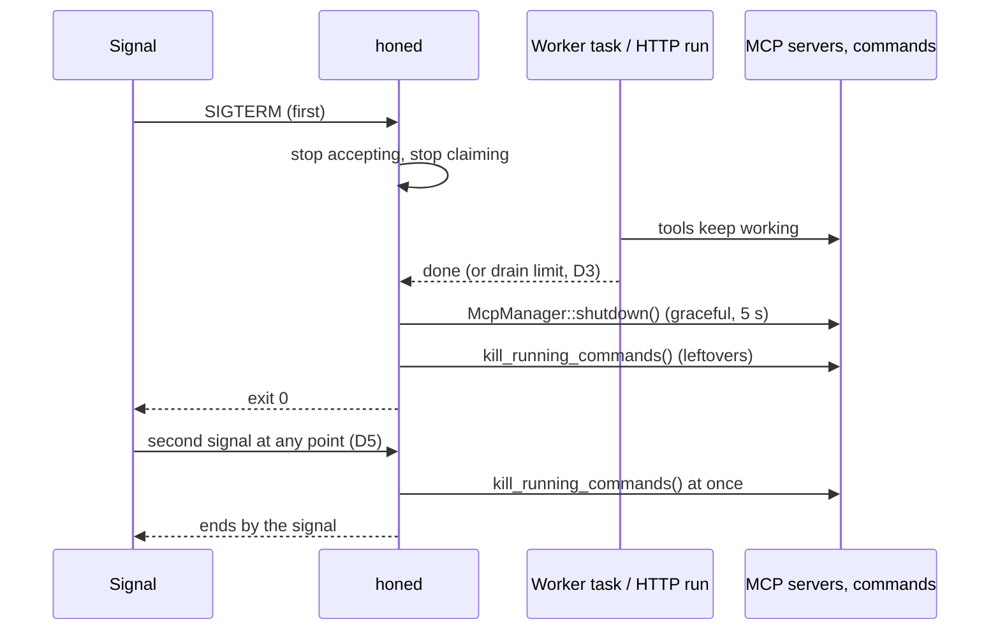

# honed shuts down gracefully, MCP servers last: spec

Branch `fix/honed-mcp-graceful`. Contract for the TDD rounds: rows D1–D6.

## Problem

`honed` (`bins/honed/src/main.rs`) handles SIGINT, SIGTERM and SIGHUP in `shutdown_signal()`. Shutdown has two parts:

1. **First, at the signal:** `shutdown_signal()` calls `hone_tools::kill_running_commands()`, which hits every registered process group:
   - shell commands get SIGKILL;
   - MCP servers get SIGTERM, then SIGKILL about 1 s later.
2. **Then the drain:** `axum::serve(..).with_graceful_shutdown(..)` stops accepting connections and waits for every open response to finish, with no time limit.

This gets the order backwards:

- **Workers lose their tools mid-task.** In worker mode (`HONE_WORKER_COORDINATOR`), the worker pool runs a claimed task, and only that task uses MCP servers (`HONE_WORKER_MCP_CONFIG`). Its MCP servers and shell commands die at the signal, so its tool calls fail.
  - The pool itself is never told to stop. Its `JoinHandle` is dropped (`_worker_handle`), and the loop dies with the runtime when `main` returns, mid-task.
  - The task stays claimed at the coordinator until its lease expires.
- **HTTP runs fail during the drain.** A `/run` request that is still running gets no new connections cut, but its shell commands were already killed.
- **The drain can last forever.** An open response keeps `honed` running after the signal for as long as it stays open: a run paused for step approval, or an SSE stream nobody closes.
- **MCP servers never get a graceful shutdown.** `McpManager` is dropped right after its tools are registered, so `shutdown()` is never called: no notification, no input closed, no 5 s budget.

## Rows

| Row | Behaviour |
|---|---|
| D1 | **A worker finishes the task it is running.** When a worker-mode `honed` gets its first SIGINT, SIGTERM or SIGHUP, its worker pool stops claiming new tasks. A task already running keeps going, with its MCP servers and shell commands, and its result is reported to the coordinator (`complete`) as usual. Then the pool's loop ends. A pool that is idle at the signal ends at once. |
| D2 | **HTTP requests drain with their commands.** The first signal no longer kills running shell commands up front. `honed` stops accepting connections, and requests already running finish with their commands, as part of the drain. |
| D3 | **The drain has a limit.** The drain (D1 and D2 together) lasts at most `HONE_SHUTDOWN_GRACE_SECS` seconds, default 25. When the limit passes, `honed` stops waiting: • a worker task still running is dropped, as before (the coordinator's lease reaper requeues it); • open responses are dropped, including an SSE stream that never ends.  A value that isn't a whole number of seconds ≥ 0 logs a warning and uses the default. `0` means no drain: go straight to D4. The default leaves room for D4's 5 s inside a 30 s stop timeout (the Kubernetes default). |
| D4 | **Then MCP servers shut down gracefully, then everything left is stopped.** After the drain (finished or out of time), `honed` calls `McpManager::shutdown()` for the worker's MCP servers. Each server, all at once, gets the notification, its input closed and up to 5 s, then its group is killed (PR #92). Then `hone_tools::kill_running_commands()` stops anything still registered. Then it logs "honed stopped" and exits 0. |
| D5 | **A second signal stops `honed` at once.** A second SIGINT, SIGTERM or SIGHUP during the drain or the MCP shutdown makes `honed` stop everything with `kill_running_commands()`: commands get SIGKILL, MCP servers get SIGTERM, then SIGKILL after about 1 s. `honed` then ends *by* that signal (`kill_commands_and_reraise`), as a one-shot `hone` run does. A signal that was ignored when `honed` started stays ignored for the second signal too: `nohup` leaves SIGHUP ignored, a background job leaves SIGINT ignored. |
| D6 | **Docs.** `honed --help` lists `HONE_SHUTDOWN_GRACE_SECS`. The `honed` and MCP parts of the docs describe the shutdown order: drain with tools working, then a graceful MCP shutdown, a second signal to force it. The CHANGELOG has an entry. |

## Testing notes

- **The `honed` binary has no test seams for a model or a coordinator.** The worker's provider is the real Anthropic/OpenAI API at its default URL. So test the behaviour at library level in `hone-server`, where the shutdown logic should live.
  - **Shutdown signals come from a channel or `Notify`,** not real signals.
  - **The worker pool:** a slow `MockExecutor` or test executor, and a fake `QueueClient` coordinator. The existing worker pool tests show how.
  - **The drain limit:** a response that never ends (an SSE route in a test router), with a short limit.
  - **The order:** graceful MCP shutdown, then `kill_running_commands`. Use a scripted Python MCP server in its own group, as in the `hone-mcp` tests. A server that exits when its input closes shows the graceful path ran; it must not get SIGTERM or SIGKILL first.
- **D5 and the wiring in `bins/honed/src/main.rs`:** a test may spawn the real `honed` binary in plain HTTP mode (no worker; `HONE_EPHEMERAL=1`, `HONE_BIND=127.0.0.1`, a free port). Check:
  - the first signal leads to exit 0 once idle;
  - a second signal during a held-open request ends it by the signal.

  Use the Python exec wrapper from `bins/hone/tests/mcp_servers_on_every_exit.rs` to reset signal dispositions.
- **No test-only triggers in production code.**

## Out of scope

- The worker's heartbeat stalls while it runs a task, because the poll loop awaits `execute` inside the `select!`. Unchanged.
- HTTP `/run` requests don't use MCP servers; `honed` starts MCP servers only for worker tasks. Unchanged.
- `kill -9`, the OOM killer, crashes that aren't panics: unchanged (see PR #93).
