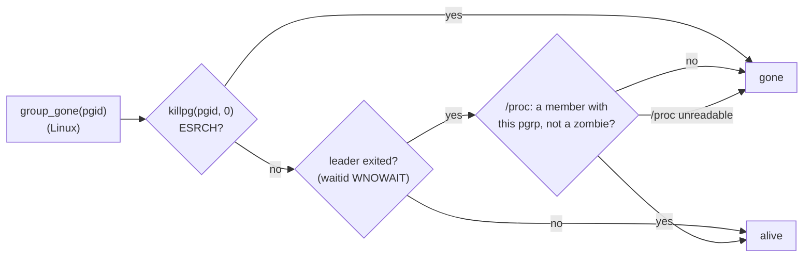

# Linux: the SIGTERM grace lasts through a shell launcher: spec

Branch `fix/linux-launcher-grace`. This is the contract for the TDD rounds: rows L1–L4.

## Problem

`hone_tools::kill_running_commands()` (`crates/hone-tools/src/command_run.rs`, `unix::kill_all`) stops MCP-server process groups in three steps:
1. it sends each group SIGTERM;
2. it waits, for up to `TERM_GRACE` (1 s), until `group_gone(pgid)` says no member we care about is left;
3. it sends SIGKILL.

This runs on every abrupt exit: an error exit, a signal to a one-shot run, a second signal to `honed`, a panic (PR #93).

On **macOS**, `group_gone` uses `killpg(pgid, 0)`: ESRCH means the group is empty, and EPERM means only zombies are left. So the wait lasts while any group member is alive (PR #92, row P14).

On **Linux** (and other non-macOS unix), `killpg(pgid, 0)` keeps succeeding while an unreaped zombie remains. So `group_gone` counts the group as gone as soon as its **leader** has exited (a `waitid(.., WNOWAIT)` check), or when `killpg` returns ESRCH.

A server started through a shell that doesn't `exec` it is a grandchild of hone. For example `sh -c "cd DIR && server; true"`, or any launcher script that runs the server as a child. The shell is the group leader, and on SIGTERM it dies at once. The wait then ends after about 20 ms, and SIGKILL hits the real server in the middle of its cleanup: it can't close a browser it started, or save its state. `docs/configuration.md` works around this by telling users to `exec` the server.



## Rows

| Row | Behaviour |
|---|---|
| L1 | **On Linux the grace lasts while any group member is alive.** After SIGTERM, `kill_running_commands()` waits (up to about 1 s, as before) while any process in an MCP server's group is still alive. A zombie doesn't count. So a server started through a shell launcher that doesn't `exec` it still gets to finish a SIGTERM cleanup of about 300 ms after the shell itself has died, as it already does on macOS (P14). When the leader has exited, the check scans `/proc/<pid>/stat` for a process whose process group is this group and whose state isn't `Z` (zombie) or `X` (dead). |
| L2 | **An empty group still ends the wait at once.** A group whose only remaining member is its zombie leader, or that has no members at all, counts as gone straight away, as before. A server that exits on SIGTERM still ends the call well under 1 s after the signal, on Linux too (the P14 pinning test). The `/proc` scan only runs once the leader has exited, so a group with a live leader costs no more than before. |
| L3 | **The `/proc` reading is robust.**<br>• A command name containing spaces or parentheses parses correctly: fields are read after the *last* `)` in `stat`.<br>• A process that vanishes during the scan, or whose `stat` can't be read or parsed, is skipped.<br>• If `/proc` itself can't be read (not mounted, a restricted sandbox), the check falls back to the old rule: the leader has exited, so the group counts as gone.<br>• Other non-macOS unix systems (the BSDs) keep the old rule. |
| L4 | **Docs.** `docs/configuration.md` no longer says that on Linux the grace ends when a shell launcher exits. `exec` stays as good practice, not a requirement. The CHANGELOG has an entry. |

### Review round 1 (L5–L8)

| Row | Behaviour |
|---|---|
| L5 | **A command name that isn't valid UTF-8 doesn't hide a live member.** Linux cuts `comm` to 15 bytes, which can split a multi-byte character (a server binary or script with a non-ASCII name). The `stat` line is read as bytes, split at the last `)` byte, and only the ASCII fields after it are parsed. Such a process is found like any other.<br><br>(Review S1, reproduced on Linux: a live `sleep` copied to `/tmp/серверный` got a truncated comm, its `stat` failed UTF-8 decoding, and the scan returned `Some(false)`.) |
| L6 | **A process whose main thread has exited but whose other threads are running counts as alive.** Its `stat` state is `Z` but `num_threads` (field 20) is above 1. A true zombie has `num_threads` 1 (reproduced). |
| L7 | **The fallback is pinned.** "Leader exited, `/proc` unreadable" means gone, and "leader exited, scan found no live member" means gone. Only a scan that found a live member keeps the wait going. Pin this with a small pure function and a unit test. (Review nit: inverting the mapping passed every test.) |
| L8 | **The scan stays cheap, and builds stay warning-free.**<br>• While waiting, at most one `/proc` scan runs per wait tick, whatever the number of groups.<br>• A group already seen gone isn't checked again: an empty group can't regain members.<br>• The dead-code allowance covers every non-Linux unix, not only macOS.<br><br>This row isn't pinned by tests. (Review nits: about 5.7 ms per scan with about 2000 processes, repeated per group and per tick.) |

## Testing notes

- **L3 on every OS.** The scan takes the `/proc` root as a parameter, so unit tests can feed it a fake tree in a temp dir. Cover:
  - a live member;
  - only zombies;
  - another group;
  - a command name like `a) (b`;
  - a truncated or unreadable `stat`;
  - a missing root.
- **L1 and L2 on Linux.** Make the P14 shell-launcher test in `crates/hone-mcp/tests/mcp_kill_sigterm_first.rs` run on Linux too. The launcher must really not `exec`: Debian's `/bin/sh` (dash) may exec a trailing command by itself, so end it with `; true`. Keep the macOS version passing.
- **Running on Linux.** Use Docker, with the image `hone-linux-test:1.99`: the official Rust 1.99 bookworm image plus `python3` and `procps`. Mount the worktree at `/src` and use named volumes for the target dir and the cargo registry:

  ```
  docker run --rm -v "$PWD":/src -w /src \
    -v hone-linux-target:/target -e CARGO_TARGET_DIR=/target \
    -v hone-cargo-registry:/usr/local/cargo/registry \
    -e HONE_DISABLE_PERSISTENT_STORES=1 \
    hone-linux-test:1.99 cargo test -p hone-mcp --test mcp_kill_sigterm_first
  ```
- **Bounded waits, no leaked processes,** as in the existing tests.

## Out of scope

- A server that leaves its process group (`setsid`, a daemonizing launcher) escapes every group kill. Unchanged.
- `kill -9` and non-panic crashes of hone. Unchanged.
