# MCP servers connect in parallel — spec

Branch `fix/mcp-parallel-connect`. Contract for the TDD rounds: rows P1–P15.

## Problem

`McpManager::from_config` (`crates/hone-mcp/src/manager.rs`) starts and
handshakes the configured MCP servers one after another, and both `hone`
(TUI and one-shot) and `honed` workers wait for it before doing anything else.
Startup therefore takes the **sum** of every server's start time:

- A server that hangs during its handshake delays startup by its whole
  handshake timeout (60 s by default since PR #91) before the next server even
  starts.
- Several `npx -y …` servers on a cold cache download their packages one at a
  time.

Exit has the same shape: `McpManager::shutdown()` shuts servers down one after
another, and each server that ignores its input closing is given 5 s before
it is killed, so exit can take 5 s per such server. Worse, the
`notifications/cancelled` message sent first, and the flush after it, have no
time limit: a server that stopped reading with a full input pipe holds hone's
exit forever (a follow-up from PR #91).

```mermaid
%%{init: {"themeVariables": {"fontSize": "13px"}, "flowchart": {"nodeSpacing": 25, "rankSpacing": 30, "padding": 8}, "sequence": {"actorMargin": 30, "messageMargin": 25, "boxMargin": 6}, "gantt": {"barHeight": 16, "barGap": 3}}}%%
gantt
  title Startup with three servers (fast, cold npx, hung)
  dateFormat X
  axisFormat %M:%S
  section Before: one after another
  fast       :0, 1
  cold npx   :1, 21
  hung       :21, 81
  section After: all at once
  fast       :0, 1
  cold npx   :0, 20
  hung       :0, 60
```

## Rows

| Row | Behaviour |
|---|---|
| P1 | **Servers connect at the same time.** `McpManager::from_config` starts and handshakes every enabled server concurrently and returns once each has connected or failed, so startup takes about as long as the slowest server (at most its handshake timeout), not the sum. Every enabled server's handshake is in flight at once; there is no limit on how many. |
| P2 | **Nothing else changes.** For any mix of healthy, failing (command not found, handshake error, early exit), timed-out and disabled servers, the manager ends up with the same live servers and tools as before, and logs the same lines (`MCP server connected`, `MCP server failed to start, skipping`, `MCP server disabled, skipping`). A server that fails or times out is killed (PR #91 T5). One server's failure or slowness never changes another server's result. |
| P3 | **Cancelling startup leaves nothing behind.** If the `from_config` future is dropped before it returns (hone exits, an outer timeout), every server it started, whether connected or still in its handshake, is killed promptly. None keeps running or connecting in the background. |
| P4 | **Servers shut down at the same time.** `McpManager::shutdown()` shuts every server down concurrently, so exit waits about one server's shutdown budget (5 s) at most, not 5 s per server that ignores its input closing. A server that exits when its input ends still stops at once. |
| P5 | **A server that stopped reading can't stall exit.** Each server's shutdown (the `notifications/cancelled` message, closing its input, waiting for it to exit) shares one 5 s budget; when it runs out, the process is killed and `shutdown` returns. Before, the notification write and flush had no limit. Waiting for an in-flight tool call to release the connection is outside the budget (that call is bounded by `timeout_ms`). |
| P6 | **Docs.** `docs/configuration.md` says servers start in parallel and startup waits for the slowest one (a hung server delays it by its handshake timeout); the CHANGELOG has an entry. |

### Review round 1 (P7–P9)

| Row | Behaviour |
|---|---|
| P7 | **A failed session resume stops MCP servers.** `hone session resume <name>` that ends with "Session '…' not found" or "Could not load session" (exit code 1) shuts its MCP servers down first, like every other exit path; a server that ignores its input closing is not left running after hone exits. (Review S1, reproduced: `std::process::exit(1)` skipped `mcp_manager.shutdown()` and destructors. Older than this branch.) |
| P8 | **Each server's result is logged when it finishes.** The `MCP server connected` / `MCP server failed to start, skipping` line for a server is logged as soon as that server's start ends, not when the slowest server's does (a healthy server's line no longer waits out a hung server's handshake timeout). Startup still returns only when every server has finished. |
| P9 | **The kill after an exhausted budget doesn't wait forever.** When a server's 5 s shutdown budget runs out, hone sends the kill and waits at most about 1 s more for the process to go away, then returns. A process that can't die promptly (stuck in the kernel, e.g. on a hung network mount) no longer holds hone's exit. Not testable without such a process; the P5 test covers the kill path. |

### Review round 2 (P10–P11)

| Row | Behaviour |
|---|---|
| P10 | **No hone exit leaves an MCP server running.** Every way `hone` ends after its MCP servers started stops them, not only the normal exit and P7's: an argument error found after startup (an unknown `--approve` id and a malformed project `permissions.toml`, both exit code 2; `--ensemble 11`, exit code 1), and SIGINT/SIGTERM/SIGHUP to a one-shot run (hone still dies *by* the signal, PR #90 W37). `honed` stops them on shutdown. Mechanism: each server runs in its own process group registered with hone's running-process registry (`hone_tools`, the one shell commands use), so every path that kills running commands kills MCP servers too, and each `std::process::exit` after startup goes through it first. (Review round 2 S1, reproduced for all four; older than this branch.) |
| P11 | **Killing a server kills what it started.** When hone kills an MCP server (failed or timed-out start, exhausted shutdown budget, drop, P10), it kills the server's whole process group, so a server started through a launcher (`npx -y …`, `uvx`, `sh -c …`) doesn't leave its real process running. After hone lets go of a server, nothing in its group keeps running. Unix only, like PR #90's process groups. |

Since a stubborn server gets its 5 s shutdown budget, a failed `session resume` (P7) with one takes about 5 s to exit; that is expected.

Not covered: a crash (panic, which aborts in release) or `kill -9`/OOM of hone. A server that ignores its input closing then keeps running.

### Review round 3 (P12–P13)

| Row | Behaviour |
|---|---|
| P12 | **A TUI exit shuts MCP servers down gracefully.** The TUI's exit guard (`KillCommandsOnExit`) kills only shell-command groups, through a new `hone_tools::kill_shell_commands()`. MCP servers are left to `main`'s `McpManager::shutdown()`: the notification, input closed, up to 5 s, then the group kill. So a server that cleans up when its input ends (closing a browser it started, saving state) still does. (Review round 3 M1, reproduced: since P10 the guard SIGKILLed every MCP group first, so the graceful shutdown found them dead.) |
| P13 | **Abrupt exits stop MCP servers politely first.** `hone_tools::kill_running_commands()`, used by `exit_now`, the one-shot SIGINT/SIGTERM/SIGHUP handler and `honed`, still SIGKILLs shell-command groups at once. MCP groups (a server's `ProcessGroupGuard`) get SIGTERM first, and only those still alive about 1 s later get SIGKILL. It returns once every MCP group is gone or has been killed, after at most about 1 s plus the kill. Before this branch such a server got the terminal's SIGINT or the end of its input and could clean up; P10's plain SIGKILL took that away. The forced kills inside the client (failed start, exhausted budget) signal the group before the leader is reaped, so its pid stays reserved. |

### Review round 4 (P14–P15)

| Row | Behaviour |
|---|---|
| P14 | **The SIGTERM grace lasts while any group member is alive.** P13's wait ends when the server's whole group is gone, not when its leader exits. So a server started through a shell that doesn't `exec` it (`sh -c "cd DIR && server"`) still gets up to about 1 s to clean up after the shell itself has died. A group with no live member ends the wait at once, including one whose leader is an unreaped zombie. On macOS, `killpg(pgid, 0)` tells these apart: success means a live member, EPERM means only zombies, ESRCH means empty. On Linux it succeeds while any zombie remains, so there the wait still ends once the leader has exited; the docs advise `exec`-ing the server in a shell launcher. (Review round 4 S1, reproduced on macOS: the grace dropped to about 20 ms, and a detached browser leaked.) |
| P15 | **No shell command outlives an abrupt exit.** `kill_running_commands()` kills shell-command groups again after the MCP wait, so a command the agent started during that wait (up to about 1 s, while hone keeps running) is killed too. (Review round 4 S2, reproduced.) |

Pinned by tests too: a server that exits on SIGTERM ends the wait promptly (well under 1 s, on both OSes), and a server whose SIGTERM cleanup takes about 300 ms gets it.

## Out of scope

- A limit on how many servers start at once (every server is started; only
  the handshakes now overlap).
- Starting hone before MCP servers finish connecting (connecting in the
  background, showing progress).
- Restarting a server after repeated timeouts; per-tool timeouts.
- A request of 8 KiB or more cut off mid-write by a timeout can leave a partial
  line on the server's stdin (PR #91 follow-up).
