# MCP servers connect in parallel — spec

Branch `fix/mcp-parallel-connect`. Contract for the TDD rounds: rows P1–P6.

## Problem

`McpManager::from_config` (`crates/hone-mcp/src/manager.rs`) starts and
handshakes the configured MCP servers one after another, and both `hone`
(TUI and one-shot) and `honed` workers wait for it before doing anything else.
Startup therefore takes the **sum** of every server's start time:

- A server that hangs during its handshake delays startup by its whole
  handshake timeout (60 s by default since PR #91) before the next server even
  starts.
- Several `npx -y …` servers on a cold cache download their packages one at a
  time.

Exit has the same shape: `McpManager::shutdown()` shuts servers down one after
another, and each server that ignores its input closing is given 5 s before
it is killed, so exit can take 5 s per such server. Worse, the
`notifications/cancelled` message sent first, and the flush after it, have no
time limit: a server that stopped reading with a full input pipe holds hone's
exit forever (a follow-up from PR #91).

```mermaid
%%{init: {"themeVariables": {"fontSize": "13px"}, "flowchart": {"nodeSpacing": 25, "rankSpacing": 30, "padding": 8}, "sequence": {"actorMargin": 30, "messageMargin": 25, "boxMargin": 6}, "gantt": {"barHeight": 16, "barGap": 3}}}%%
gantt
  title Startup with three servers (fast, cold npx, hung)
  dateFormat X
  axisFormat %M:%S
  section Before: one after another
  fast       :0, 1
  cold npx   :1, 21
  hung       :21, 81
  section After: all at once
  fast       :0, 1
  cold npx   :0, 20
  hung       :0, 60
```

## Rows

| Row | Behaviour |
|---|---|
| P1 | **Servers connect at the same time.** `McpManager::from_config` starts and handshakes every enabled server concurrently and returns once each has connected or failed, so startup takes about as long as the slowest server (at most its handshake timeout), not the sum. Every enabled server's handshake is in flight at once; there is no limit on how many. |
| P2 | **Nothing else changes.** For any mix of healthy, failing (command not found, handshake error, early exit), timed-out and disabled servers, the manager ends up with the same live servers and tools as before, and logs the same lines (`MCP server connected`, `MCP server failed to start, skipping`, `MCP server disabled, skipping`). A server that fails or times out is killed (PR #91 T5). One server's failure or slowness never changes another server's result. |
| P3 | **Cancelling startup leaves nothing behind.** If the `from_config` future is dropped before it returns (hone exits, an outer timeout), every server it started, whether connected or still in its handshake, is killed promptly. None keeps running or connecting in the background. |
| P4 | **Servers shut down at the same time.** `McpManager::shutdown()` shuts every server down concurrently, so exit waits about one server's shutdown budget (5 s) at most, not 5 s per server that ignores its input closing. A server that exits when its input ends still stops at once. |
| P5 | **A server that stopped reading can't stall exit.** Each server's shutdown (the `notifications/cancelled` message, closing its input, waiting for it to exit) shares one 5 s budget; when it runs out, the process is killed and `shutdown` returns. Before, the notification write and flush had no limit. Waiting for an in-flight tool call to release the connection is outside the budget (that call is bounded by `timeout_ms`). |
| P6 | **Docs.** `docs/configuration.md` says servers start in parallel and startup waits for the slowest one (a hung server delays it by its handshake timeout); the CHANGELOG has an entry. |

## Out of scope

- A limit on how many servers start at once (every server is started; only
  the handshakes now overlap).
- Starting hone before MCP servers finish connecting (connecting in the
  background, showing progress).
- Restarting a server after repeated timeouts; per-tool timeouts.
- A request of 8 KiB or more cut off mid-write by a timeout can leave a partial
  line on the server's stdin (PR #91 follow-up).
