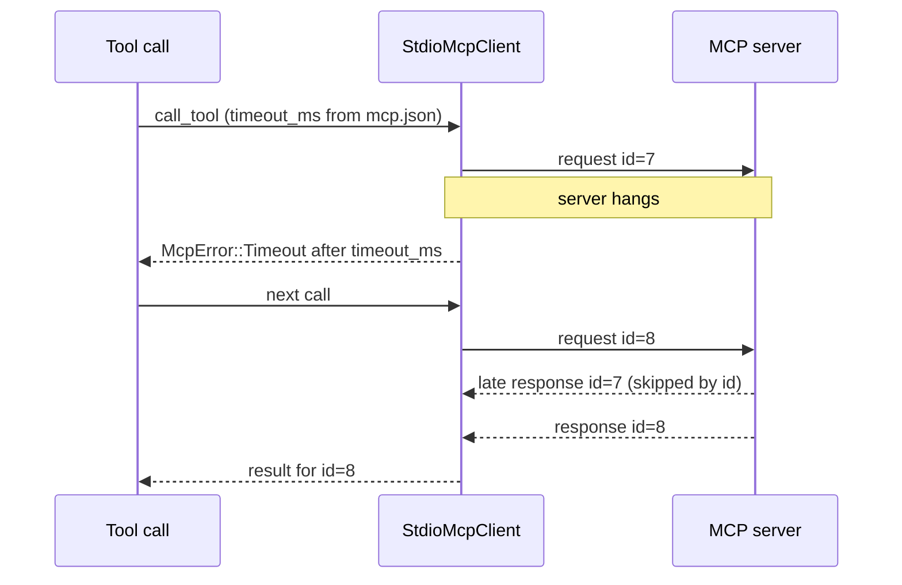

# MCP request timeout — spec

Branch `fix/mcp-timeout`. Contract for the TDD rounds: rows T1–T6.

## Problem

`McpServerConfig.timeout_ms` (`crates/hone-config/src/mcp.rs`) is documented as
the per-request timeout (default 10 000 ms; `docs/configuration.md`,
`docs/tutorials/mcp-extensions.md`), but nothing reads it: `McpError::Timeout`
is never raised. A stdio MCP server that never answers holds its transport
forever:

- **At startup** the manager connects to servers one after another
  (`McpManager`, `spawn_and_connect` → `initialize`), so a server that hangs
  during the handshake blocks hone from starting.
- **During a turn** a tool call to a hung server waits until <kbd>Esc</kbd>
  (TUI) or <kbd>Ctrl</kbd>+<kbd>C</kbd> (one-shot); a `honed` worker waits
  indefinitely. Every other call to that server queues behind it on the
  client's lock.
- PR #90 made two such waits more likely to be bounded only by this missing
  timeout: a server that echoes our numeric id back as a string (skipped by id
  matching) and any reply hone skips.

Related, older: a line on the server's stdout that isn't JSON (log output)
fails the call, though the code's comment says such output is skipped. After a
timeout drops a read mid-line, the rest of that line arrives later and would
fail the next call the same way.

## Rows

| Row | Behaviour |
|---|---|
| T1 | **Every request is bounded.** Each JSON-RPC request a `StdioMcpClient` sends (`initialize`, `tools/list`, `tools/call`, any other) — writing it and waiting for its response — is bounded by the client's request timeout. On expiry the call returns `McpError::Timeout { server, timeout_ms }` promptly. Notifications (no response expected) are unaffected. |
| T2 | **The timeout comes from `mcp.json`.** The manager gives each client its server's `timeout_ms` (default 10 000). A client built directly (`StdioMcpClient::spawn` / `spawn_with_name`) has no timeout unless one is set with a builder such as `with_request_timeout(Duration)`. `timeout_ms: 0` means no timeout. |
| T3 | **The client stays usable after a timeout.** The timed-out request's late response is skipped by id (PR #90 W50), so the next call to the same server gets its own result. |
| T4 | **Non-JSON lines are skipped.** A line on the server's stdout that doesn't parse as JSON (log output, or the rest of a line whose read was dropped by a timeout or a cancel) is skipped and logged at debug level instead of failing the call; the wait stays bounded by T1. |
| T5 | **A hung server can't block startup.** A server whose `initialize` doesn't answer within its timeout is skipped at startup with the existing "failed to start, skipping" warning, and its process is killed (not left running). The other servers still connect. |
| T6 | **Docs.** `docs/configuration.md` describes what `timeout_ms` bounds and `0`; the CHANGELOG says the setting is now applied (a long-running MCP tool may need a larger value). |

## Out of scope

- Connecting to several servers in parallel at startup (a hung server still delays startup by its timeout).
- Restarting a server after repeated timeouts.
- Per-tool timeouts, or a separate handshake timeout.
