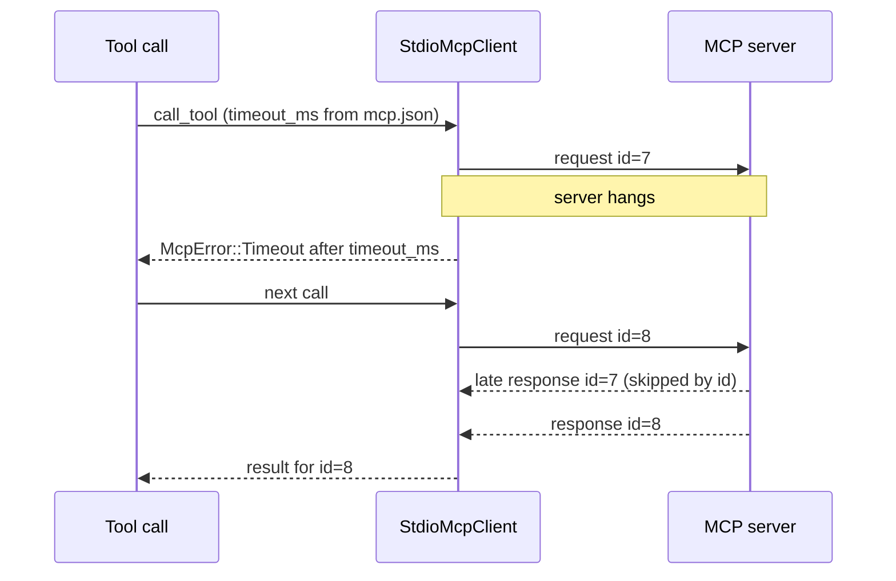

# MCP request timeout — spec

Branch `fix/mcp-timeout`. Contract for the TDD rounds: rows T1–T10.

## Problem

`McpServerConfig.timeout_ms` (`crates/hone-config/src/mcp.rs`) is documented as
the per-request timeout (default 10 000 ms; `docs/configuration.md`,
`docs/tutorials/mcp-extensions.md`), but nothing reads it: `McpError::Timeout`
is never raised. A stdio MCP server that never answers holds its transport
forever:

- **At startup** the manager connects to servers one after another
  (`McpManager`, `spawn_and_connect` → `initialize`), so a server that hangs
  during the handshake blocks hone from starting.
- **During a turn** a tool call to a hung server waits until <kbd>Esc</kbd>
  (TUI) or <kbd>Ctrl</kbd>+<kbd>C</kbd> (one-shot); a `honed` worker waits
  indefinitely. Every other call to that server queues behind it on the
  client's lock.
- PR #90 made two such waits more likely to be bounded only by this missing
  timeout: a server that echoes our numeric id back as a string (skipped by id
  matching) and any reply hone skips.

Related, older: a line on the server's stdout that isn't JSON (log output)
fails the call, though the code's comment says such output is skipped. After a
timeout drops a read mid-line, the rest of that line arrives later and would
fail the next call the same way.

## Rows

| Row | Behaviour |
|---|---|
| T1 | **Every request is bounded.** Each JSON-RPC request a `StdioMcpClient` sends (`initialize`, `tools/list`, `tools/call`, any other) — writing it and waiting for its response — is bounded by the client's request timeout. On expiry the call returns `McpError::Timeout { server, timeout_ms }` promptly. Notifications (no response expected) are unaffected. |
| T2 | **The timeout comes from `mcp.json`.** The manager gives each client its server's `timeout_ms` (default 10 000). A client built directly (`StdioMcpClient::spawn` / `spawn_with_name`) has no timeout unless one is set with a builder such as `with_request_timeout(Duration)`. `timeout_ms: 0` means no timeout. |
| T3 | **The client stays usable after a timeout.** The timed-out request's late response is skipped by id (PR #90 W50), so the next call to the same server gets its own result. |
| T4 | **Non-JSON lines are skipped.** A line on the server's stdout that doesn't parse as JSON (log output, or the rest of a line whose read was dropped by a timeout or a cancel) is skipped and logged at debug level instead of failing the call; the wait stays bounded by T1. |
| T5 | **A hung server can't block startup.** A server whose `initialize` doesn't answer within its timeout (the handshake timeout since T7) is skipped at startup with the existing "failed to start, skipping" warning, and its process is killed (not left running). The other servers still connect. |
| T6 | **Docs.** `docs/configuration.md` describes what `timeout_ms` bounds and `0`; the CHANGELOG says the setting is now applied (a long-running MCP tool may need a larger value). |

### Review round 1 (T7–T9)

| Row | Behaviour |
|---|---|
| T7 | **The startup handshake gets more time.** `connect()` (`initialize` and the first `tools/list`) is bounded by a handshake timeout that defaults to the larger of the request timeout and 60 s, so an `npx -y <package>` server (every built-in marketplace entry) can download on its first start. `with_handshake_timeout(Duration)` overrides it; a request timeout of `0` means no handshake timeout either. Later requests keep `timeout_ms`. (Review S1: a cold `npx` start commonly takes over 10 s and would be killed and skipped.) |
| T8 | **A cut multi-byte character can't fail a call.** Lines are read as bytes up to `\n` and decoded afterwards; a line that isn't valid UTF-8 is skipped like any other non-JSON line (T4). (Review S2, reproduced: a timeout inside "é" made the next call fail with `ConnectionFailed(InvalidData)`.) |
| T9 | **Shutdown is quick for a server that exits on end of input.** `McpManager::shutdown()` (and the client's `shutdown`) closes the server's stdin before waiting, so a server that exits when its input ends is gone at once; the 5 s wait and kill remain the fallback. (Review follow-up, reproduced: every hone exit waited 5 s per MCP server, then killed it.) |

### Handshake setting (T10)

| Row | Behaviour |
|---|---|
| T10 | **`handshake_timeout_ms` in `mcp.json`.** An optional per-server field: when set, the manager uses it as the client's handshake timeout (`with_handshake_timeout`); `0` means no handshake timeout. When absent, T7's default applies (`max(timeout_ms, 60 000)`, none if `timeout_ms` is 0). Lets a user give a very slow first `npx` start more time, and a test bound a hung server's start. Existing configs parse unchanged. (The manager had no way to set the handshake bound, so T5's startup test couldn't bound a hung server once T7 raised the default.) |

## Out of scope

- Connecting to several servers in parallel at startup (a hung server still delays startup by its timeout).
- Restarting a server after repeated timeouts.
- Per-tool timeouts (the handshake got its own bound in T7).
- A request of 8 KiB or more cut off mid-write by a timeout can leave a partial
  line on the server's stdin (one later call may fail; the stream resyncs).
- Paths that never call `shutdown()` (`honed` exit, worker pools) SIGKILL their
  servers when the transport drops, without closing stdin first.
